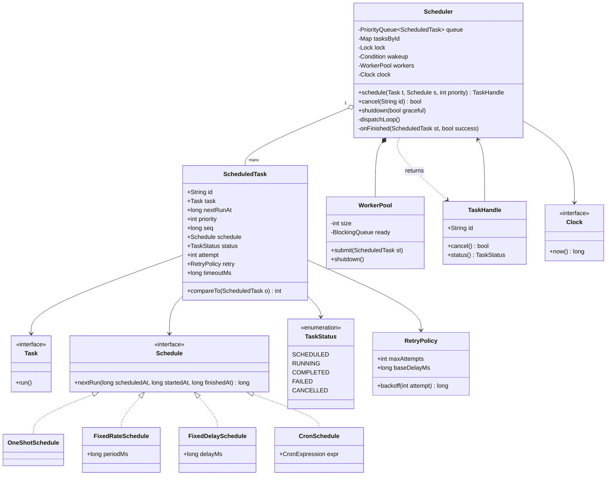
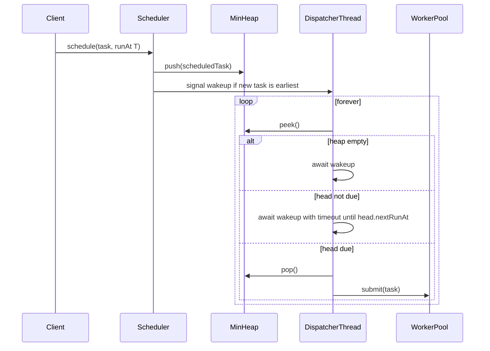
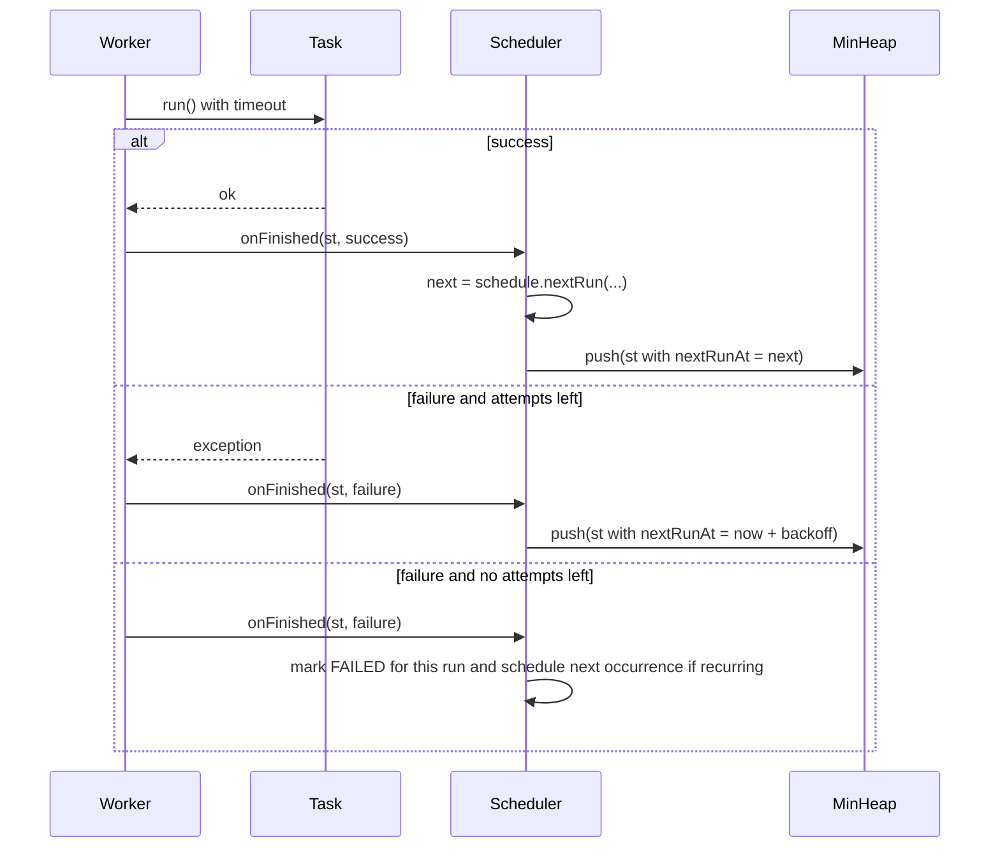

# Task Scheduler

**Category:** Low-Level Design
**Difficulty:** 🔴 Hard
**Seniority:** senior
**Companies:** Google, Amazon, Microsoft, Uber, Netflix, Airbnb
**Tags:** oop, priority-queue, concurrency, thread-pool, cron, condition-variables
**Time:** 60 min

---

## Problem Statement

Design an in-process task scheduler similar to Java's `ScheduledExecutorService`, Quartz, or a cron engine. Clients submit tasks to run once at a specific time, after a delay, or repeatedly (fixed rate, fixed delay, or cron expression). A pool of worker threads executes due tasks, with support for priorities, cancellation, retries and timeouts.

The interviewer is assessing the data structure for "next due task" (a min-heap ordered by run time), a correct and efficient wait/notify loop that neither busy-waits nor misses earlier tasks, separation between the scheduling thread and worker threads, and handling of recurring task semantics, failures and shutdown.

## Clarifying Questions

- Which schedule types? *One-shot at time T, one-shot after delay, fixed rate, fixed delay, and cron expressions.*
- Single process or distributed? *Single process; distributed is a follow-up.*
- How many tasks? *Up to ~1M pending tasks; thousands executing per second.*
- Priorities? *When multiple tasks are due at the same time, higher priority runs first.*
- What if a recurring run overruns the next start? *Fixed rate skips overlapping runs (no concurrent executions of the same task).*
- Failure handling? *Configurable retries with exponential backoff; recurring tasks continue after failure.*
- Timeouts and cancellation? *Yes, cancel by task ID; per-task execution timeout.*
- Persistence across restarts? *Out of scope for core; discuss as follow-up.*

## Requirements

### Functional

- `schedule(task, runAt)`, `scheduleAfter(task, delay)`, `scheduleAtFixedRate(task, initialDelay, period)`, `scheduleWithFixedDelay(task, initialDelay, delay)`, `scheduleCron(task, expr)`.
- Return a `TaskHandle` to cancel or query status (SCHEDULED, RUNNING, COMPLETED, FAILED, CANCELLED).
- Execute tasks on a bounded worker pool.
- Priorities break ties among due tasks.
- Retry policy and execution timeout per task.
- Graceful shutdown (finish running tasks, optionally drop pending) and immediate shutdown.

### Non-Functional

- Tasks start within ~10 ms of their scheduled time under normal load.
- No busy-waiting; scheduler thread sleeps until the next due time or a new earlier task arrives.
- O(log n) schedule and dispatch; O(1) or O(log n) cancel.
- Thread-safe API; a misbehaving task must not kill the scheduler.

### Out of Scope

- Distributed coordination, DAG workflows/dependencies (follow-up), persistent storage.

## Core Entities

- **Task** → user-supplied unit of work (`run()`), with an optional ID and name.
- **ScheduledTask** → wraps Task with next run time, priority, schedule, status, attempt count, sequence number.
- **Schedule** (interface) → computes the next run time: OneShot, FixedRate, FixedDelay, Cron.
- **TaskQueue** → min-heap ordered by (nextRunTime, priority, sequence).
- **Scheduler** → facade: submit, cancel, shutdown; owns the dispatcher thread and queue.
- **Dispatcher** → loop that waits for the earliest due task and hands it to workers.
- **WorkerPool** → bounded thread pool executing tasks.
- **RetryPolicy** → max attempts and backoff.
- **TaskHandle** → client view: cancel, status, result future.
- **Clock** → abstraction for time (testable).

## Class Diagram



## Design Patterns

| Pattern | Where | Why |
|---|---|---|
| Command | `Task` / `ScheduledTask` | Encapsulate work as objects that can be queued, retried, cancelled. |
| Strategy | `Schedule` implementations, `RetryPolicy` | Next-run computation and backoff vary independently of the engine. |
| Producer-Consumer | Dispatcher → worker pool queue | Decouple timing from execution; bounded parallelism. |
| State | `TaskStatus` lifecycle | Guard illegal transitions (e.g. cancel after completion is a no-op). |
| Facade | `Scheduler` | Simple API over heap, locks, threads. |
| Observer (optional) | Task lifecycle listeners | Metrics, logging, alerting on failures. |

## Key Workflows

### Dispatch loop



The dispatcher sleeps exactly until the earliest run time; a newly scheduled earlier task signals the condition so the dispatcher re-evaluates.

### Execute recurring task with retry



## Implementation

```text
CLASS ScheduledTask
    FUNCTION compareTo(o)                      // min-heap order
        IF nextRunAt != o.nextRunAt THEN RETURN compare(nextRunAt, o.nextRunAt)
        IF priority != o.priority THEN RETURN compare(o.priority, priority)   // higher first
        RETURN compare(seq, o.seq)             // FIFO among equals

CLASS FixedRateSchedule IMPLEMENTS Schedule
    FUNCTION nextRun(scheduledAt, startedAt, finishedAt)
        SET next ← scheduledAt + periodMs
        IF next <= finishedAt THEN                         // overran: skip missed slots
            SET missed ← (finishedAt - scheduledAt) DIV periodMs
            SET next ← scheduledAt + (missed + 1) * periodMs
        RETURN next

CLASS FixedDelaySchedule IMPLEMENTS Schedule
    FUNCTION nextRun(scheduledAt, startedAt, finishedAt)
        RETURN finishedAt + delayMs

CLASS OneShotSchedule IMPLEMENTS Schedule
    FUNCTION nextRun(...) RETURN NONE

CLASS CronSchedule IMPLEMENTS Schedule
    FUNCTION nextRun(scheduledAt, startedAt, finishedAt)
        RETURN expr.nextMatchAfter(max(scheduledAt, finishedAt))   // minute/hour/day/month/dow fields

CLASS Scheduler
    FIELDS queue : MinHeap<ScheduledTask>, tasksById : Map, lock, wakeup : Condition,
           workers : WorkerPool(size N), seqCounter : AtomicLong, running ← true, clock

    FUNCTION schedule(task, schedule, firstRunAt, priority, retry)
        SET st ← NEW ScheduledTask(newId(), task, firstRunAt, priority,
                                   seqCounter.increment(), schedule, SCHEDULED, retry)
        WITH lock
            IF NOT running THEN THROW RejectedError
            queue.push(st)
            SET tasksById[st.id] ← st
            IF queue.peek() == st THEN wakeup.signal()      // new earliest task
        RETURN NEW TaskHandle(st.id, this)

    FUNCTION cancel(id)
        WITH lock
            SET st ← tasksById[id]
            IF st IS NULL OR st.status IN [COMPLETED, CANCELLED] THEN RETURN false
            SET st.status ← CANCELLED                        // lazy deletion; skipped on pop
            REMOVE tasksById[id]
            RETURN true

    FUNCTION dispatchLoop()                                  // single dedicated thread
        WHILE true
            SET due ← NULL
            WITH lock
                WHILE due IS NULL
                    IF NOT running AND (shutdownNow OR queue IS EMPTY) THEN RETURN
                    IF queue IS EMPTY THEN wakeup.await(); CONTINUE
                    SET head ← queue.peek()
                    IF head.status == CANCELLED THEN queue.pop(); CONTINUE
                    SET waitMs ← head.nextRunAt - clock.now()
                    IF waitMs > 0 THEN wakeup.await(waitMs); CONTINUE   // spurious wakeups re-check
                    SET due ← queue.pop()
                    SET due.status ← RUNNING
            workers.submit(due)                              // outside the lock

    FUNCTION executeOnWorker(st)                             // runs in worker thread
        SET started ← clock.now()
        SET ok ← true
        TRY
            runWithTimeout(st.task, st.timeoutMs)            // interrupt on timeout
        CATCH any error
            SET ok ← false
            log error with st.id
        onFinished(st, ok, started, clock.now())

    FUNCTION onFinished(st, ok, started, finished)
        WITH lock
            IF st.status == CANCELLED THEN RETURN
            IF NOT ok AND st.attempt < st.retry.maxAttempts THEN
                SET st.attempt ← st.attempt + 1
                SET st.nextRunAt ← finished + st.retry.backoff(st.attempt)  // base * 2^attempt + jitter
                requeue(st)
                RETURN
            SET st.attempt ← 0
            SET next ← st.schedule.nextRun(st.nextRunAt, started, finished)
            IF next IS NONE THEN
                SET st.status ← COMPLETED IF ok ELSE FAILED
                REMOVE tasksById[st.id]
            ELSE
                SET st.nextRunAt ← next
                requeue(st)

    FUNCTION requeue(st)                                     // caller holds lock
        SET st.status ← SCHEDULED
        SET st.seq ← seqCounter.increment()
        queue.push(st)
        IF queue.peek() == st THEN wakeup.signal()

    FUNCTION shutdown(graceful)
        WITH lock
            SET running ← false
            SET shutdownNow ← NOT graceful
            wakeup.signalAll()
        IF graceful THEN workers.shutdownAndAwait() ELSE workers.shutdownNow()
```

## Concurrency & Extensibility

- **Single lock + condition:** one mutex protects the heap and the task map; the dispatcher waits on a condition with a timeout equal to the time until the earliest task. Signalling only when the new task becomes the head avoids needless wakeups. Always re-check in a loop to handle spurious wakeups.
- **Execution outside the lock:** the dispatcher pops under lock and submits to the worker pool after releasing it; workers never hold the scheduler lock while running user code.
- **No overlapping runs:** a recurring task is re-enqueued only after its current run finishes, so the same task never runs concurrently.
- **Cancellation:** lazy deletion (mark CANCELLED, skip on pop) gives O(1) cancel; periodically purge if cancelled tasks accumulate. An indexed heap enables O(log n) true removal.
- **Clock jumps:** use a monotonic clock for delays; cron uses wall-clock with time-zone-aware computation (DST handling).
- **Scale of timers:** for millions of short timers, a hierarchical timing wheel (as in Kafka/Netty) gives O(1) insert/expire at the cost of tick granularity.
- **Open/Closed:** new schedule types implement `Schedule`; listeners observe lifecycle events; worker pools can be per-priority to isolate critical tasks.

## Trade-offs

| Decision | Option A | Option B | Choice & Why |
|---|---|---|---|
| Due-task structure | Min-heap (O(log n)) | Hierarchical timing wheel (O(1)) | Heap — exact times, simple; timing wheel for millions of timers with coarse ticks. |
| Waiting | Poll every X ms | Condition await with timeout to next due | Condition — no busy-wait, precise, wakes early on earlier insert. |
| Cancel | Remove from heap O(n) | Lazy deletion flag | Lazy — O(1) cancel; purge periodically. |
| Fixed-rate overrun | Run catch-up bursts | Skip missed slots | Skip — avoids thundering catch-up after GC pauses or slow runs. |
| Threading | Dispatcher runs tasks | Separate dispatcher + worker pool | Separate — long tasks never delay dispatch of other due tasks. |

## Follow-up Questions

1. **How would you make it distributed?** Store tasks in a DB (PostgreSQL with `SELECT ... FOR UPDATE SKIP LOCKED` on `next_run_at <= now()`) or Redis sorted sets; workers claim tasks with leases and heartbeats; recover expired leases.
2. **How do you guarantee a task runs exactly once?** You can't fully; use at-least-once with leases plus idempotent tasks (idempotency keys), or fencing tokens to reject stale workers.
3. **How would you support task dependencies (DAG)?** Track in-degree per task; a task becomes schedulable when all parents complete; topological order with cycle detection at submission.
4. **How do you survive restarts?** Persist schedules and next run times; on startup reload them and apply a misfire policy (run once now, or skip to next).
5. **How do you prevent one tenant from starving others?** Per-tenant queues with weighted fair scheduling or token buckets before handing tasks to workers.

## Common Mistakes

- Busy-waiting or sleeping a fixed interval instead of waiting until the earliest due time.
- Sleeping until the head's time without waking when an earlier task is inserted.
- Running task code inside the scheduler lock or on the dispatcher thread.
- Letting an uncaught exception in a recurring task silently stop future runs.
- Using wall-clock time for delays and breaking on clock adjustments.

## Key Takeaways

- A min-heap keyed by (nextRunAt, priority, seq) plus a condition variable is the core.
- Separate the timing (dispatcher) from execution (worker pool).
- `Schedule` as a Strategy cleanly models one-shot, fixed-rate, fixed-delay and cron.
- Define semantics explicitly: overruns, retries, cancellation and shutdown.
