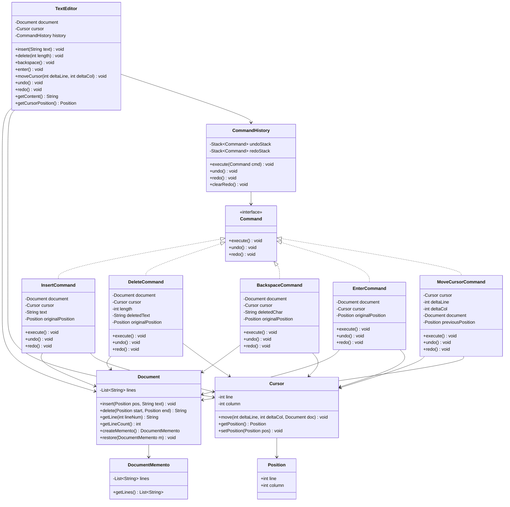
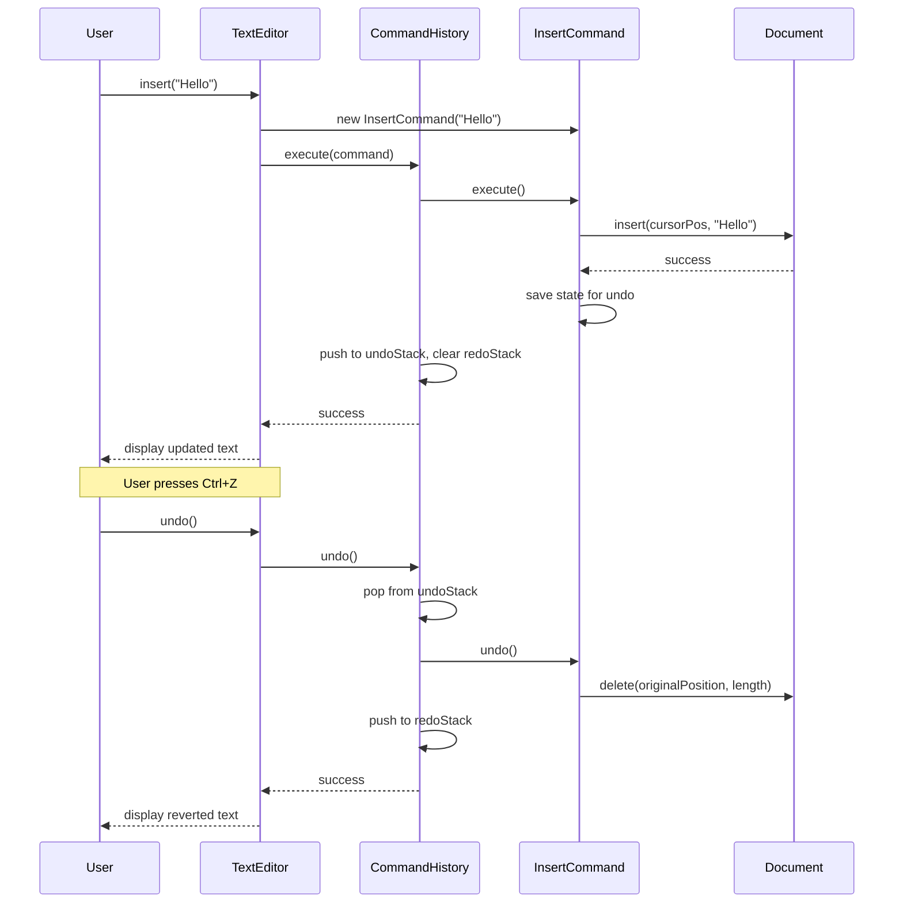
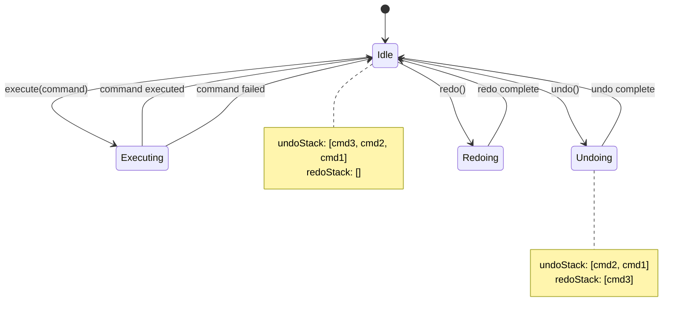

# Text Editor with Undo Redo

**Category:** Low-Level Design
**Difficulty:** 🟡 Medium
**Seniority:** mid
**Companies:** Common interview question
**Tags:** patterns, command, memento
**Time:** 45-60 min

---

## Problem Statement

Design a text editor that supports basic text editing operations (insert, delete, backspace) with undo and redo functionality. The editor should maintain a cursor position, support multiple lines, and allow unlimited undo/redo operations. The interviewer is looking for a clean implementation using design patterns to encapsulate operations and manage state history.

The key challenge is designing the undo/redo mechanism efficiently while supporting various editing operations and maintaining the document state.

## Clarifying Questions

- What operations to support? *Insert text, delete text (selection), backspace (delete before cursor), enter (new line), cursor movement.*
- Undo/redo scope? *Unlimited history; undo reverts to previous state, redo reapplies undone operations.*
- Selection support? *Yes, delete can operate on a selected range.*
- Copy/paste? *Out of scope for this problem, but can be mentioned as extension.*
- Memory constraints? *Assume reasonable memory; discuss optimization if needed.*
- Large file support? *Assume in-memory for this design; discuss chunking for large files.*
- Multiple cursors? *Single cursor for this design.*

## Requirements

### Functional

- Insert text at cursor position.
- Delete text at cursor or selected range.
- Backspace to delete character before cursor.
- Enter to insert newline.
- Move cursor (left, right, up, down, home, end).
- Undo last operation.
- Redo previously undone operation.
- Display current document content with cursor position.

### Non-Functional

- O(1) or O(log n) for common operations (insert, delete, cursor move).
- Memory efficient for undo/redo history.
- Clean separation between operations and state management.
- Extensible to add new operations easily.

### Out of Scope

- Syntax highlighting, search/replace, file I/O, copy/paste, multiple cursors.

## Core Entities

- **TextEditor** → main class managing document, cursor, undo/redo stacks.
- **Document** → represents the text content with efficient operations.
- **Cursor** → position (line, column) in the document.
- **Command** → interface for encapsulating editing operations.
- **InsertCommand** → inserts text at cursor.
- **DeleteCommand** → deletes text at cursor or selection.
- **BackspaceCommand** → deletes character before cursor.
- **EnterCommand** → inserts newline.
- **MoveCursorCommand** → moves cursor.
- **CommandHistory** → manages undo and redo stacks.
- **Memento** → snapshot of document state for undo/redo.

## Class Diagram



## Key Workflows

### Insert text with undo/redo



### Command-based undo/redo flow



## Implementation

```text
CLASS TextEditor
    FIELDS document : Document
    FIELDS cursor : Cursor
    FIELDS history : CommandHistory

    FUNCTION insert(text)
        SET cmd ← NEW InsertCommand(document, cursor, text)
        history.execute(cmd)

    FUNCTION delete(length)
        SET cmd ← NEW DeleteCommand(document, cursor, length)
        history.execute(cmd)

    FUNCTION backspace()
        SET cmd ← NEW BackspaceCommand(document, cursor)
        history.execute(cmd)

    FUNCTION enter()
        SET cmd ← NEW EnterCommand(document, cursor)
        history.execute(cmd)

    FUNCTION moveCursor(deltaLine, deltaCol)
        SET cmd ← NEW MoveCursorCommand(cursor, deltaLine, deltaCol, document)
        history.execute(cmd)

    FUNCTION undo()
        history.undo()

    FUNCTION redo()
        history.redo()

CLASS CommandHistory
    FIELDS undoStack : Stack~Command~
    FIELDS redoStack : Stack~Command~

    FUNCTION execute(cmd)
        cmd.execute()
        undoStack.push(cmd)
        redoStack.clear()

    FUNCTION undo()
        IF undoStack.isEmpty() THEN RETURN
        SET cmd ← undoStack.pop()
        cmd.undo()
        redoStack.push(cmd)

    FUNCTION redo()
        IF redoStack.isEmpty() THEN RETURN
        SET cmd ← redoStack.pop()
        cmd.redo()
        undoStack.push(cmd)

CLASS InsertCommand IMPLEMENTS Command
    FIELDS document, cursor, text, originalPosition

    FUNCTION execute()
        SET originalPosition ← cursor.getPosition()
        document.insert(originalPosition, text)
        cursor.move(0, text.length())

    FUNCTION undo()
        document.delete(originalPosition, originalPosition + text.length())
        cursor.setPosition(originalPosition)

    FUNCTION redo()
        execute()

CLASS DeleteCommand IMPLEMENTS Command
    FIELDS document, cursor, length, deletedText, originalPosition

    FUNCTION execute()
        SET originalPosition ← cursor.getPosition()
        SET deletedText ← document.delete(originalPosition, length)

    FUNCTION undo()
        document.insert(originalPosition, deletedText)
        cursor.setPosition(originalPosition)

    FUNCTION redo()
        execute()

CLASS BackspaceCommand IMPLEMENTS Command
    FIELDS document, cursor, deletedChar, originalPosition

    FUNCTION execute()
        SET originalPosition ← cursor.getPosition()
        IF originalPosition.column = 0 AND originalPosition.line = 0 THEN RETURN
        SET prevPos ← getPreviousPosition(originalPosition)
        SET deletedChar ← document.delete(prevPos, 1)
        cursor.setPosition(prevPos)

    FUNCTION undo()
        document.insert(originalPosition, deletedChar)
        cursor.setPosition(originalPosition)

    FUNCTION redo()
        execute()

CLASS EnterCommand IMPLEMENTS Command
    FIELDS document, cursor, originalPosition

    FUNCTION execute()
        SET originalPosition ← cursor.getPosition()
        SET currentLine ← document.getLine(originalPosition.line)
        SET before ← currentLine.substring(0, originalPosition.column)
        SET after ← currentLine.substring(originalPosition.column)
        document.setLine(originalPosition.line, before)
        document.insertLine(originalPosition.line + 1, after)
        cursor.setPosition(originalPosition.line + 1, 0)

    FUNCTION undo()
        SET currentLine ← document.getLine(originalPosition.line)
        SET nextLine ← document.getLine(originalPosition.line + 1)
        SET joined ← currentLine + nextLine
        document.setLine(originalPosition.line, joined)
        document.deleteLine(originalPosition.line + 1)
        cursor.setPosition(originalPosition)

    FUNCTION redo()
        execute()

CLASS Document
    FIELDS lines : List~String~

    FUNCTION insert(pos, text)
        SET line ← lines[pos.line]
        SET updated ← line.substring(0, pos.column) + text + line.substring(pos.column)
        lines[pos.line] ← updated

    FUNCTION delete(start, end)
        IF start.line = end.line
            SET line ← lines[start.line]
            SET updated ← line.substring(0, start.column) + line.substring(end.column)
            lines[start.line] ← updated
            RETURN line.substring(start.column, end.column)
        ELSE
            // Handle multi-line delete
            RETURN deleteMultiLine(start, end)

    FUNCTION insertLine(lineNum, content)
        lines.add(lineNum, content)

    FUNCTION deleteLine(lineNum)
        lines.remove(lineNum)

CLASS Cursor
    FIELDS line, column

    FUNCTION move(deltaLine, deltaCol, doc)
        SET newLine ← line + deltaLine
        SET newCol ← column + deltaCol
        SET newLine ← max(0, min(newLine, doc.getLineCount() - 1))
        SET maxCol ← doc.getLine(newLine).length()
        SET newCol ← max(0, min(newCol, maxCol))
        SET line ← newLine
        SET column ← newCol
```

## Design Patterns

| Pattern | Where | Why |
|---|---|---|
| Command | All editing operations (Insert, Delete, etc.) | Encapsulates operations as objects with execute/undo/redo. |
| Memento | DocumentMemento for state snapshots | Alternative to command-based undo; captures full state. |
| Composite | Could group multiple commands as macro | Not implemented but extensible for macros. |
| Strategy | Different undo strategies (command vs memento) | Allows switching between undo implementations. |
| Factory | CommandFactory to create commands | Centralizes command creation logic. |

## Scalability

- **Memory optimization:** For command-based undo, store only the delta (inserted/deleted text). For large operations, consider using a gap buffer or rope data structure for the document.
- **Large files:** For very large documents, use a piece table or rope data structure instead of a simple list of strings. This allows O(log n) insert/delete operations.
- **Undo history limit:** Add a configurable limit to undo stack size to prevent unbounded memory growth. Discard oldest commands when limit is reached.
- **Batch operations:** Group multiple small operations (like typing a word) into a single command to reduce undo stack size.

## Error Handling

- **Invalid cursor position:** Clamp cursor to valid bounds after every operation.
- **Empty undo stack:** Undo does nothing when no operations to undo.
- **Empty redo stack:** Redo does nothing when no operations to redo.
- **Delete beyond document:** Delete operation adjusts to delete only available text.
- **Backspace at start:** Backspace at (0,0) does nothing.

## Trade-offs

| Decision | Option A | Option B | Choice & Why |
|---|---|---|
| Undo implementation | Command pattern | Memento pattern | Command pattern — more memory efficient, standard for editors. |
| Document storage | List of strings | Gap buffer / Rope | List for simplicity; gap buffer/rope for large files. |
| Cursor movement | Absolute position | Relative movement | Both supported; relative for operations, absolute for restore. |
| History limit | Unlimited | Fixed size | Unlimited for this design; configurable limit for production. |
| Redo on new command | Clear redo stack | Keep redo stack | Clear redo — standard behavior; new command invalidates redo. |

## Follow-up Questions

1. **How do you handle large files?** Use a rope data structure (balanced binary tree with text in leaves) or gap buffer. This gives O(log n) insert/delete instead of O(n) for shifting strings.
2. **How do you optimize memory for undo history?** Use command pattern with deltas. For very large operations, store a memento instead of delta. Implement history size limit.
3. **How do you support macros?** Create a MacroCommand that contains a list of commands. Its execute/undo/redo calls the corresponding methods on all child commands.
4. **How do you handle collaborative editing?** Use Operational Transformation (OT) or Conflict-Free Replicated Data Types (CRDTs). Each operation is transformed against concurrent operations.
5. **How do you add syntax highlighting?** Separate the view from the model. Use a tokenizer/parser to identify syntax elements and apply styling in the rendering layer, not in the core document model.

## Common Mistakes

- Not using the Command pattern, making undo/redo difficult to implement.
- Storing full document snapshots for every operation (memory inefficient).
- Not clearing the redo stack when a new command is executed.
- Not handling cursor position correctly in undo/redo.
- Using O(n) operations for insert/delete in the document (shifting entire strings).
- Not considering edge cases (empty document, cursor at boundaries).

## Key Takeaways

- Use the Command pattern to encapsulate editing operations with execute/undo/redo.
- Each command stores enough state to reverse its operation (delta-based undo).
- CommandHistory manages undo/redo stacks; clear redo on new command.
- Document can use simple data structures for small files, rope/gap buffer for large files.
- Cursor management is critical; commands must save and restore cursor position.
- Memento pattern is an alternative but less memory-efficient for text editors.
- The design is extensible: new operations just implement the Command interface.
