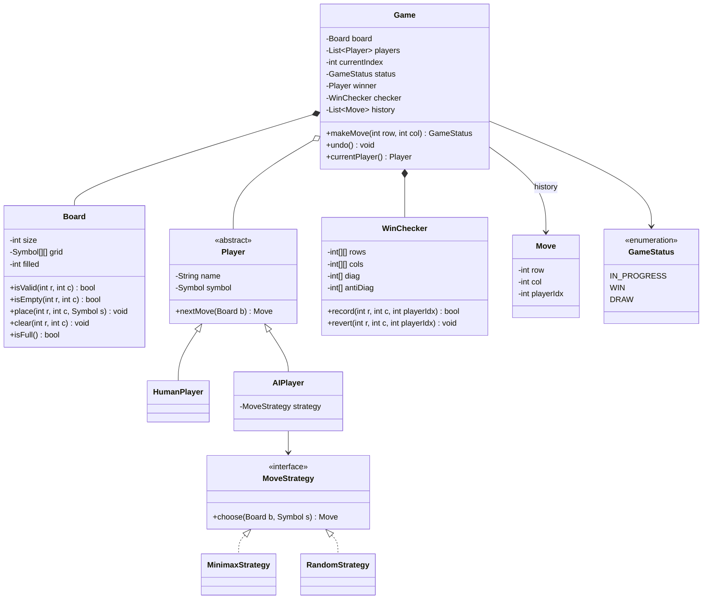
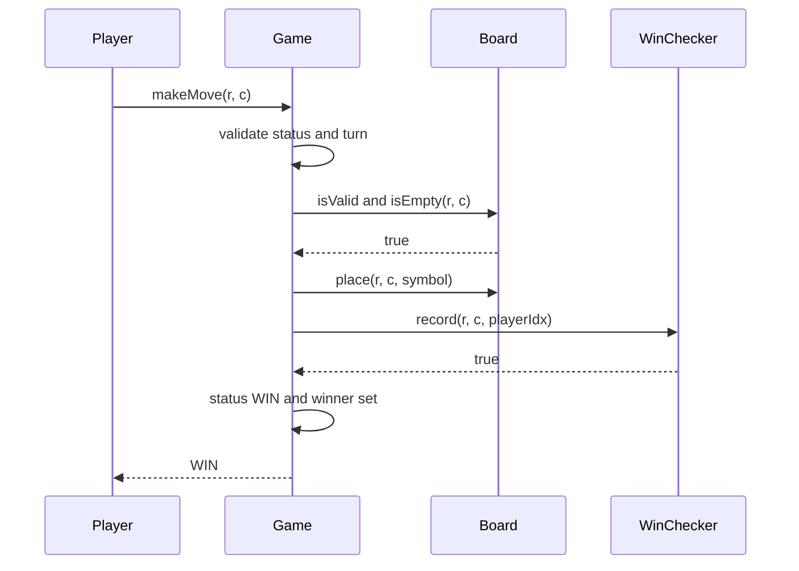

# Tic-Tac-Toe

**Category:** Low-Level Design
**Difficulty:** 🟢 Easy
**Seniority:** junior
**Companies:** Amazon, Microsoft, Google, Meta, Apple, Zoho
**Tags:** oop, game-design, strategy-pattern, board-games, time-complexity, extensibility
**Time:** 30 min

---

## Problem Statement

Design a Tic-Tac-Toe game for two players on an N x N board. Players alternate placing their symbol; the first to fill a full row, column, or diagonal wins, and the game is a draw when the board is full with no winner.

The interviewer looks for clean separation between board, players, and game rules, an O(1) win check per move, and an extensible design (larger boards, more players, computer opponents, undo).

## Clarifying Questions

- Board size fixed at 3x3? *Support any N x N; win requires a full line of N.*
- Number of players? *Two, but don't hard-code two if it's cheap to generalize.*
- Human vs computer? *Humans first; a pluggable AI player is a follow-up.*
- Interface? *Console/API; UI is out of scope.*
- Undo? *Nice-to-have.*
- Should we validate moves? *Yes — out of bounds, occupied cell, wrong turn, game already over.*

## Requirements

### Functional
- Start a game with N and two players with distinct symbols.
- Make a move at (row, col) for the current player.
- Detect win, draw, or continue after each move.
- Reject invalid moves with a clear error.

### Non-Functional
- Win detection in O(1) per move (not O(N²) board scan).
- Board memory O(N²); counters O(N).
- Players, rules, and board size extensible without rewriting the game loop.

### Out of Scope
- Networking/matchmaking, persistence, graphical UI.

## Core Entities

- **Game** → orchestrates turns, holds status, validates moves, delegates win checking.
- **Board** → N x N grid of cells; place and query symbols.
- **Player** (abstract) → name and symbol; `nextMove(board)` for input. HumanPlayer, AIPlayer.
- **Symbol** → enum (X, O, …).
- **Move** → player, row, col (also used for undo history).
- **WinChecker** → incremental row/column/diagonal counters for O(1) checks.
- **GameStatus** → IN_PROGRESS, WIN, DRAW.

## Class Diagram



## Design Patterns

| Pattern | Where | Why |
|---|---|---|
| Strategy | `MoveStrategy` for AI players | Swap random, heuristic, or minimax without changing `Game`. |
| Template / Polymorphism | `Player.nextMove` | Game loop treats humans and AIs identically. |
| Command | `Move` stored in history | Enables undo/replay by reverting the last move. |
| Factory | `PlayerFactory.create(type, symbol)` | Build human/AI players from configuration. |

## Key Workflows

### A move that wins the game



If `record` returns false, the game checks `board.isFull()` for a draw; otherwise it advances `currentIndex` to the next player.

## Implementation

```text
CLASS WinChecker
    // rows[p][r] = how many cells player p owns in row r
    FIELDS n, rows[P][n], cols[P][n], diag[P], antiDiag[P]

    FUNCTION record(r, c, p)
        SET rows[p][r] ← rows[p][r] + 1
        SET cols[p][c] ← cols[p][c] + 1
        IF r = c
            SET diag[p] ← diag[p] + 1
        IF r + c = n - 1
            SET antiDiag[p] ← antiDiag[p] + 1
        RETURN rows[p][r] = n OR cols[p][c] = n OR diag[p] = n OR antiDiag[p] = n

    FUNCTION revert(r, c, p)
        // exact inverse of record, used by undo and minimax
        SET rows[p][r] ← rows[p][r] - 1
        SET cols[p][c] ← cols[p][c] - 1
        IF r = c          SET diag[p] ← diag[p] - 1
        IF r + c = n - 1  SET antiDiag[p] ← antiDiag[p] - 1

CLASS Game
    FIELDS board, players, currentIndex ← 0, status ← IN_PROGRESS, winner ← NULL
    FIELDS checker, history ← []

    FUNCTION makeMove(r, c)
        IF status ≠ IN_PROGRESS
            THROW GameOverException
        IF NOT board.isValid(r, c)
            THROW InvalidMoveException("out of bounds")
        IF NOT board.isEmpty(r, c)
            THROW InvalidMoveException("cell occupied")
        SET p ← currentIndex
        board.place(r, c, players[p].symbol)
        history.push(NEW Move(r, c, p))
        IF checker.record(r, c, p)
            SET status ← WIN
            SET winner ← players[p]
        ELSE IF board.isFull()
            SET status ← DRAW
        ELSE
            SET currentIndex ← (currentIndex + 1) MOD players.size()
        RETURN status

    FUNCTION undo()
        IF history.isEmpty()  RETURN
        SET m ← history.pop()
        board.clear(m.row, m.col)
        checker.revert(m.row, m.col, m.playerIdx)
        SET status ← IN_PROGRESS
        SET winner ← NULL
        SET currentIndex ← m.playerIdx

    FUNCTION play()                           // game loop
        WHILE status = IN_PROGRESS
            SET move ← currentPlayer().nextMove(board)
            TRY makeMove(move.row, move.col)
            CATCH InvalidMoveException e
                display(e.message)            // ask the same player again

CLASS MinimaxStrategy IMPLEMENTS MoveStrategy
    // Exhaustive for 3x3 (< 9! states); use depth limit + alpha-beta for larger N
    FUNCTION choose(board, me)
        SET best ← -INF, bestMove ← NULL
        FOR each empty (r, c)
            simulate place, score ← minimax(board, opponent, depth 1)
            undo simulation
            IF score > best  SET best ← score, bestMove ← (r, c)
        RETURN bestMove
```

## Concurrency & Extensibility

- A local game is single-threaded. For an online version, each `Game` instance is guarded by a lock (or processed by a single actor/queue per game) so two simultaneous requests can't both pass the "is it my turn" check.
- Include an expected move number in each request (optimistic concurrency) so a stale client move is rejected.
- **K-in-a-row (Gomoku):** the counter approach no longer works since the line need not span the board; replace `WinChecker` with a `WinRule` interface whose Gomoku implementation scans up to K-1 cells in each of 4 directions from the last move — still O(K).
- **More players:** counters are already indexed by player; turn order is modulo `players.size()`.
- **New player types:** subclass `Player` or add a `MoveStrategy`.

## Trade-offs

| Decision | Option A | Option B | Choice & Why |
|---|---|---|---|
| Win detection | Scan the whole board after each move | Per-player row/col/diag counters | Counters: O(1) per move, O(N·P) extra memory. |
| Counter encoding | Separate counters per player | Single counter with +1/-1 for two players | Separate counters generalize to more than 2 players; +1/-1 trick is fine for exactly two. |
| Win rule | Hard-coded in Game | `WinRule` interface | Interface when variants (Gomoku, misère) are expected; otherwise keep simple. |
| Invalid move handling | Return boolean | Throw typed exceptions | Exceptions carry a reason and can't be silently ignored. |

## Follow-up Questions

1. **How do you make win detection O(1)?** Maintain per-player counts for each row, column, and both diagonals; a move wins when any touched counter reaches N.
2. **How would you build an unbeatable AI?** Minimax with alpha-beta pruning; for 3x3 the full tree is small, and memoizing board states makes it instant.
3. **How do you support undo/redo?** Keep `Move` objects on undo and redo stacks; revert board and counters symmetrically.
4. **How would you make it multiplayer online?** A game service holds game state keyed by game id, clients send moves over WebSocket, server validates and broadcasts; persist moves for reconnection.
5. **How do you detect an inevitable draw early?** Track whether each line is still winnable (contains only one player's symbols); if none are, declare a draw.

## Common Mistakes

- Scanning the full board for a win on every move.
- Letting `Board` know about turn order or players (mixing responsibilities).
- Not validating turn, bounds, occupancy, and game-over state.
- Hard-coding 3x3 and two players with magic numbers.
- Forgetting the anti-diagonal condition `r + c = n - 1`.

## Key Takeaways

- Separate Board (data), Game (rules and turn flow), and Player (input source).
- Incremental counters turn win detection into O(1).
- Strategy for AI and Command for moves give cheap extensibility and undo.
- Even a simple game benefits from explicit status and validation.
