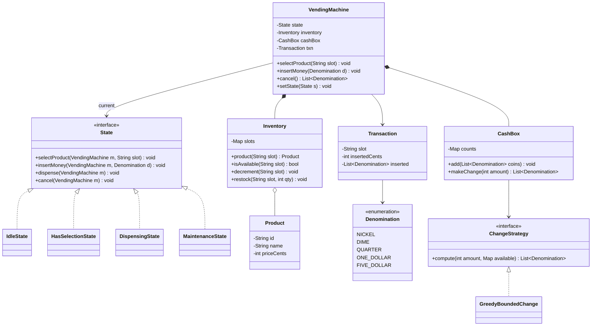
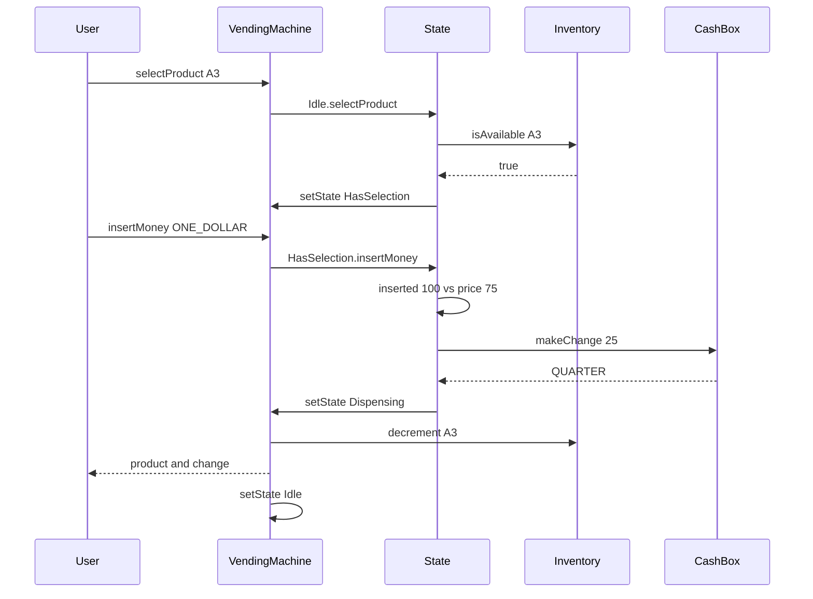
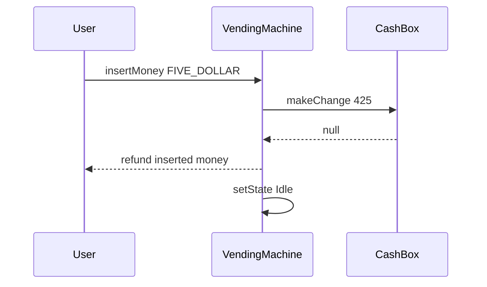

# Vending Machine

**Category:** Low-Level Design
**Difficulty:** 🟢 Easy
**Seniority:** junior
**Companies:** Amazon, Microsoft, Google, Adobe, Walmart, Flipkart
**Tags:** oop, state-pattern, state-machine, inventory, change-making, solid
**Time:** 45 min

---

## Problem Statement

Design the software for a vending machine. A user selects a product, inserts coins or notes, and the machine dispenses the product and returns change. The machine must handle insufficient funds, sold-out items, cancellation with refund, and the case where exact change cannot be returned.

The interviewer is primarily checking whether you recognize this as a state machine and model it cleanly (State pattern), plus inventory and change-making logic.

## Clarifying Questions

- Which denominations are accepted? *Coins 5, 10, 25 cents and 1, 5 dollar notes.*
- Select first or pay first? *Select product first, then insert money.*
- One product per transaction? *Yes, one item per transaction.*
- What if the machine can't make change? *Reject the purchase and refund everything inserted.*
- Card payments? *Out of scope initially, but design should allow adding them.*
- Is there an admin/maintenance mode? *Yes — restock products and collect/refill cash.*
- Is there a timeout? *If no action for 60 seconds after selection, cancel and refund.*

## Requirements

### Functional
- Display products with price and availability per slot code (e.g., "A3").
- Select a product, insert money, dispense product, return change.
- Cancel at any point before dispensing and get a full refund.
- Reject selection of sold-out items and invalid denominations.
- Admin: restock items, set prices, collect/refill the coin box.

### Non-Functional
- Never lose money: every inserted coin is either kept for a sale or refunded.
- Deterministic behavior; invalid actions in a given state are rejected with a clear message.
- Extensible to new payment methods and product types.

### Out of Scope
- Network telemetry, remote price updates, multi-item carts.

## Core Entities

- **VendingMachine** → context; holds current state, inventory, cash box, current transaction; delegates actions to state.
- **State** (interface) → `selectProduct`, `insertMoney`, `dispense`, `cancel`; concrete Idle, HasSelection, Dispensing, Maintenance.
- **Inventory** → slot code → (Product, quantity).
- **Product** → id, name, price.
- **CashBox** → counts of each denomination; computes change.
- **Denomination** → enum with value in cents.
- **Transaction** → selected slot, amount inserted, inserted coins list.
- **ChangeStrategy** → computes which coins to return given available counts.

## Class Diagram



## Design Patterns

| Pattern | Where | Why |
|---|---|---|
| State | `IdleState`, `HasSelectionState`, `DispensingState`, `MaintenanceState` | Each state defines which actions are legal; removes nested `if (state == ...)` switches. |
| Strategy | `ChangeStrategy` | Greedy works for canonical coin systems; swap for DP when denominations are non-canonical or counts are limited. |
| Singleton | `VendingMachine` per device | Exactly one controller owns the hardware. |
| Command (optional) | Hardware actions (`DispenseCommand`, `ReturnCoinsCommand`) | Decouples logic from motor/coin-hopper drivers and allows logging/retry. |

## Key Workflows

### Successful purchase with change



State transitions: `Idle → HasSelection` on valid selection, `HasSelection → Dispensing` once inserted ≥ price and change is possible, `Dispensing → Idle` after the hardware confirms. `cancel` from HasSelection refunds the exact inserted coins and returns to Idle.

### Cannot make change



## Implementation

```text
CLASS VendingMachine
    FIELDS state ← IdleState, inventory, cashBox, txn ← NULL
    FUNCTION selectProduct(slot)   state.selectProduct(this, slot)
    FUNCTION insertMoney(d)        state.insertMoney(this, d)
    FUNCTION cancel()              state.cancel(this)

CLASS IdleState IMPLEMENTS State
    FUNCTION selectProduct(m, slot)
        IF NOT m.inventory.isAvailable(slot)
            m.display("SOLD OUT")
            RETURN
        SET m.txn ← NEW Transaction(slot)
        m.setState(HasSelectionState)
    FUNCTION insertMoney(m, d)
        m.returnCoins([d])            // must select first
        m.display("Select a product")
    FUNCTION cancel(m)                // nothing to do

CLASS HasSelectionState IMPLEMENTS State
    FUNCTION selectProduct(m, slot)
        // allow changing selection before paying
        IF m.inventory.isAvailable(slot)
            SET m.txn.slot ← slot
    FUNCTION insertMoney(m, d)
        m.txn.inserted.append(d)
        SET m.txn.insertedCents ← m.txn.insertedCents + d.value
        SET price ← m.inventory.product(m.txn.slot).priceCents
        IF m.txn.insertedCents < price
            m.display("Insert " + (price - m.txn.insertedCents))
            RETURN
        // tentatively add coins so they can be used for change
        m.cashBox.add(m.txn.inserted)
        SET change ← m.cashBox.makeChange(m.txn.insertedCents - price)
        IF change = NULL
            m.cashBox.remove(m.txn.inserted)
            m.returnCoins(m.txn.inserted)
            m.display("Exact change only")
            SET m.txn ← NULL
            m.setState(IdleState)
            RETURN
        m.setState(DispensingState)
        m.state.dispense(m, change)
    FUNCTION cancel(m)
        m.returnCoins(m.txn.inserted)  // return the same coins, cash box untouched
        SET m.txn ← NULL
        m.setState(IdleState)

CLASS DispensingState IMPLEMENTS State
    FUNCTION dispense(m, change)
        m.hardware.dispense(m.txn.slot)
        m.inventory.decrement(m.txn.slot)
        m.returnCoins(change)
        SET m.txn ← NULL
        m.setState(IdleState)
    FUNCTION insertMoney(m, d)   m.returnCoins([d])   // busy
    FUNCTION cancel(m)           m.display("Dispensing, please wait")

CLASS GreedyBoundedChange IMPLEMENTS ChangeStrategy
    // Greedy with available counts; correct for US coins when supply is ample.
    FUNCTION compute(amount, available)
        SET result ← []
        FOR d IN denominations sorted by value DESC
            SET use ← min(amount / d.value, available[d])
            REPEAT use TIMES result.append(d)
            SET amount ← amount - use * d.value
        IF amount ≠ 0
            RETURN NULL               // DP fallback could be tried here
        RETURN result

CLASS CashBox
    FIELDS counts, strategy
    FUNCTION makeChange(amount)
        SET coins ← strategy.compute(amount, counts)
        IF coins ≠ NULL
            FOR c IN coins  SET counts[c] ← counts[c] - 1
        RETURN coins
```

## Concurrency & Extensibility

- A physical machine has a single user at a time, but events arrive from different hardware threads (coin acceptor, keypad, timeout timer). Serialize all events through a single event queue or a mutex on `VendingMachine` so state transitions are atomic.
- The 60-second timeout fires `cancel()` via the same queue; if it races with a final coin insertion, whichever event is processed first wins and the other sees the new state.
- Card payment: add a `PaymentMethod` interface (`CoinPayment`, `CardPayment`) and a `HasSelectionState` that awaits authorization; no change to Idle/Dispensing.
- Dispensing failure (item stuck): the hardware reports failure → refund full amount, mark slot faulty, transition to Idle.
- New states (e.g., `OutOfService`) are new classes; existing states only gain a transition to them.

## Trade-offs

| Decision | Option A | Option B | Choice & Why |
|---|---|---|---|
| State handling | Enum + switch in each method | State pattern classes | State pattern: each state's rules isolated and testable; switches become unwieldy as states grow. |
| Change algorithm | Greedy | Dynamic programming over bounded counts | Greedy by default (canonical coins); DP fallback for non-canonical sets or low coin supply. |
| Refund on cancel | Return equivalent value | Return the exact coins inserted | Exact coins: they are held in escrow, always possible, and avoids depleting the change box. |
| State objects | New instance per transition | Shared stateless singletons | Stateless singletons: transaction data lives on the machine, states hold no data. |

## Follow-up Questions

1. **How do you handle non-canonical denominations (e.g., 1, 3, 4)?** Greedy fails (6 = 4+1+1 vs 3+3); use bounded DP minimizing coin count with available quantities.
2. **How do you add multi-item carts?** Transaction holds a list of slots and a running total; dispensing iterates items; refund if any item fails.
3. **How would you report low stock remotely?** Inventory publishes events (Observer) to a telemetry module that batches and sends when stock drops below threshold.
4. **What about power loss mid-transaction?** Persist the transaction (inserted amount) to non-volatile storage before dispensing; on boot, refund pending escrow.
5. **How do you test this?** Unit-test each state in isolation with a mocked machine and hardware; table-driven tests for change-making.

## Common Mistakes

- Modeling state with booleans (`isPaid`, `isSelected`) leading to illegal combinations.
- Dispensing before verifying that change can be made.
- Mixing inserted escrow coins with the cash box before the sale is committed.
- Assuming greedy change-making is always optimal or always possible.
- Forgetting cancel, timeout, and sold-out paths.

## Key Takeaways

- A vending machine is the canonical State pattern problem — draw the state diagram first.
- Keep money handling exact: escrow inserted coins, commit only on successful dispense.
- Change-making is a bounded coin-change problem; know when greedy fails.
- Isolate hardware behind interfaces so logic is testable.
