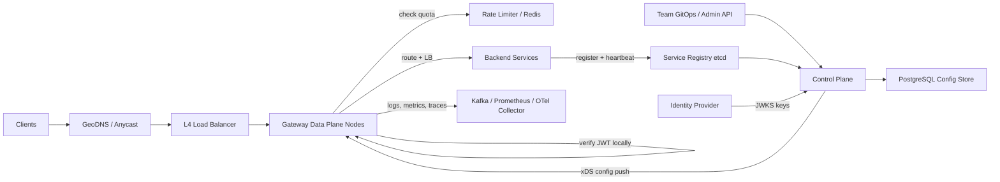

# API Gateway

**Category:** System Design
**Difficulty:** 🟡 Medium
**Seniority:** senior
**Companies:** Amazon, Netflix, Google, Microsoft, Uber, Stripe, Kong, Cloudflare
**Tags:** reverse-proxy, authentication, service-discovery, routing, observability, control-plane
**Time:** 45 min

---

## Problem Statement

Design an API gateway that sits in front of hundreds of backend microservices and serves as the single entry point for all external client traffic (mobile apps, web, third-party partners). The gateway routes requests to the right service, authenticates and authorizes callers, enforces rate limits and quotas, transforms requests and responses, and emits consistent logs, metrics, and traces.

The interviewer hints at ~1M requests/second at peak across multiple regions, ~500 backend services owned by different teams who need to change their routes without redeploying the gateway, and a strict latency budget: the gateway itself should add no more than a few milliseconds.

## Clarifying Questions

- What traffic volume? *1M RPS peak globally, ~3 regions, average payload 2 KB.*
- Which protocols? *HTTP/1.1 and HTTP/2 from clients, gRPC and HTTP to backends; WebSocket passthrough.*
- What auth schemes? *OAuth2/OIDC JWTs for users, API keys for partners, mTLS for internal callers.*
- Who configures routes? *Each service team self-serves via a config API/GitOps; changes go live in < 30 s.*
- Is rate limiting in scope? *Integrate with a rate limiter service; its internals are covered elsewhere.*
- Latency budget? *Gateway overhead p99 < 5 ms excluding backend time.*
- Do we aggregate multiple backend calls? *Simple composition yes; heavy BFF logic belongs in dedicated services.*
- Multi-tenant? *Yes, partners have plans with quotas and per-tenant analytics.*

## Requirements

### Functional
- Route requests by host, path, method, headers, and version to backend services.
- Authenticate (JWT, API key, mTLS) and authorize (scopes, per-route policy).
- Enforce rate limits and quotas per API key, user, IP, and route.
- Transform requests/responses: header injection, path rewrite, protocol translation (REST to gRPC), response field filtering.
- Discover healthy backend instances dynamically and load balance.
- Emit access logs, metrics, and distributed traces for every request.
- Dynamic configuration with versioning and rollback.

### Non-Functional
- Added latency p99 < 5 ms; throughput 1M RPS.
- Availability 99.99%: the gateway is on every request's path, so it must never be the outage.
- Horizontal scalability, stateless data plane.
- Isolation: one misbehaving backend or tenant must not degrade others.
- Secure by default: TLS everywhere, deny unknown routes.

### Out of Scope
- Rate limiter algorithm internals, WAF/bot detection rules, a full service mesh for east-west traffic.

## Capacity Estimation

| Metric | Arithmetic | Result |
|---|---|---|
| Peak RPS | given | 1M RPS, ~333K per region |
| Per-node capacity | Envoy/NGINX ~20-30K RPS per 8-core node with TLS and filters | ~15K RPS with headroom |
| Data plane nodes | 333K / 15K x 1.5 headroom | ~35 nodes per region |
| Bandwidth | 1M x (2 KB req + 4 KB resp) | ~6 GB/s (~48 Gbps) globally |
| Concurrent connections | 1M RPS x 200 ms avg backend time | ~200K in-flight requests |
| Access logs | 1M x 500 B x 86,400 | ~43 TB/day raw (sample or compress ~10x) |
| Route config | 500 services x 20 routes x 2 KB | ~20 MB, fits in memory of every node |
| API key cache | 10M keys x 200 B | ~2 GB, hot set ~100 MB in local LRU |

Everything needed on the hot path (routes, keys, JWKS public keys, policies) fits in memory, so the data plane makes no synchronous remote calls in the common case.

## API Design

Data plane: transparent proxy for client traffic. Control plane admin API:

```text
PUT  /admin/v1/routes/{route_id}
  req:  { match: { host: "api.example.com", path_prefix: "/v2/orders", methods: ["GET","POST"] },
          upstream: { service: "orders", protocol: "grpc", timeout_ms: 800, retries: 2 },
          auth: { type: "jwt", required_scopes: ["orders:read"] },
          rate_limit: { key: "api_key", limit: 1000, window: "1m" },
          transforms: [ { type: "strip_prefix", value: "/v2" }, { type: "add_header", name: "X-Tenant", from: "jwt.tenant" } ] }
  resp: { route_id, version: 42, status: "PENDING_ROLLOUT" }

GET  /admin/v1/routes?service=orders
POST /admin/v1/config/rollback   req: { to_version: 41 }
POST /admin/v1/api-keys          req: { tenant_id, plan }   resp: { key_id, secret (shown once) }
DELETE /admin/v1/api-keys/{key_id}

Data plane (xDS-style streaming, gRPC):
StreamConfig(node_id, last_version) -> stream ConfigSnapshot { version, routes, clusters, policies }
```

## Data Model

| Store | Entity | Key fields | Why |
|---|---|---|---|
| PostgreSQL (control plane) | routes | route_id, service, match spec, policies JSONB, version, owner_team | Transactional, auditable source of truth |
| PostgreSQL | config_versions | version, diff, author, created_at, status | Rollback and audit trail |
| PostgreSQL | api_keys | key_id, sha256(secret), tenant_id, plan, scopes, status | Never store raw secrets |
| etcd / Consul | service registry | service → [instance ip:port, zone, health, weight] | Watch-based, strongly consistent membership |
| Redis Cluster | rate limit counters | `rl:{key}:{route}:{window}` | Shared counters with TTL, sub-ms ops |
| In-memory on each node | compiled route table, key cache, JWKS | trie / radix tree by host+path | Zero network hops on the hot path |
| Kafka → ClickHouse / S3 | access logs | ts, route, tenant, status, latency, trace_id | High-volume analytics and billing |

Control plane data is small and relational; the data plane only holds read-only, versioned snapshots pushed to it.

## High-Level Design



**Request path (data plane):**
1. Client resolves the regional anycast IP; an L4 load balancer (NLB) spreads TCP connections across gateway nodes. TLS terminates at the gateway.
2. Filter chain executes in order: request ID and trace context → route match (radix tree) → authN (JWT signature check with cached JWKS, or API key hash lookup in local cache) → authZ (scopes, route policy) → rate limit check → request transforms.
3. Gateway selects a healthy upstream endpoint (least-request or P2C load balancing, zone-aware), forwards over pooled HTTP/2 connections with a per-route timeout and retry budget.
4. Response transforms run, then the response returns; access log and metrics are emitted asynchronously.

**Config path (control plane):**
1. A team submits a route change via GitOps PR or admin API; the control plane validates schema, conflicts, and policy (e.g. public routes must have auth).
2. A new immutable config version is stored in PostgreSQL and pushed to nodes over streaming gRPC (Envoy xDS model). Nodes swap snapshots atomically.
3. Rollout is canaried: 1 node, then 10%, then 100%, auto-rolled back on error-rate spikes.

## Deep Dives

### Routing and filter chain on the hot path

- Routes compile into a per-host radix tree keyed by path segments, with method and header predicates at leaves. Lookup is O(path length), independent of route count.
- Precedence: exact match > longest prefix > regex; conflicts rejected at config validation time, not at runtime.
- The filter chain is a pipeline of plugins, each able to short-circuit (e.g. 401, 429):

```text
FUNCTION handle(request):
    SET ctx ← new Context(request_id = uuid(), trace = extract_or_start(request.headers))
    SET route ← route_table.match(request.host, request.path, request.method)
    IF route IS NULL THEN RETURN 404
    FOR filter IN route.filters:              // authn, authz, ratelimit, transform...
        SET result ← filter.on_request(ctx, request)
        IF result.short_circuit THEN RETURN result.response
    SET endpoint ← balancer[route.cluster].pick()     // P2C least-request, zone-aware
    SET response ← forward(endpoint, request, timeout = route.timeout, retry_budget = route.retries)
    FOR filter IN reverse(route.filters):
        filter.on_response(ctx, response)
    emit_async(access_log(ctx, response), metrics(ctx))
    RETURN response
```

- Config snapshots are immutable; in-flight requests keep using the snapshot they started with, so swaps are lock-free (read via an atomic pointer).

### Authentication and authorization without remote calls

- **JWT**: verify signature locally using JWKS public keys fetched by the control plane and refreshed every few minutes (and on unknown `kid`). Check `exp`, `aud`, `iss`. Cost: ~50 microseconds for RS256 verification, cacheable per token hash.
- **Revocation**: short-lived access tokens (5-15 min) plus a small revocation bloom filter pushed via config for emergency kills.
- **API keys**: hash the presented key with SHA-256, look up in a local LRU; on miss, query a key service backed by Redis/PostgreSQL and cache for 60 s. Negative caching prevents brute-force misses from hammering the store.
- **AuthZ**: coarse-grained (scopes, tenant plan, route allowlist) at the gateway; fine-grained resource ownership ("can user X read order Y?") stays in the service. The gateway forwards verified identity as signed internal headers (`X-User-Id`, `X-Tenant`) and strips any client-supplied copies to prevent spoofing.
- Internal hop uses mTLS so backends trust only the gateway or mesh.

### Rate limiting integration

- Two layers: a **local** token bucket per node for coarse protection (IP floods, per-route global caps divided by node count) and a **global** check against Redis for exact per-tenant quotas.
- To keep the hot path fast, the global check uses a pipelined Redis call (~0.5 ms) with a strict 2 ms timeout; on timeout or Redis failure, **fail open** for paid tenants with local limits as backstop (prefer availability), fail closed for abusive keys.
- Batch/lease optimization: each node leases chunks of quota (e.g. 100 tokens) from Redis and spends them locally, cutting Redis QPS by ~100x at the cost of slight over-admission.
- Respond with `429` plus `Retry-After` and `X-RateLimit-Remaining` headers. Algorithms themselves are covered in the Rate Limiter problem.

### Service discovery, load balancing, and resilience

- Services register in etcd/Consul (or Kubernetes Endpoints); the control plane watches and pushes endpoint sets to gateways via EDS. Gateways also run **active health checks** and **passive outlier detection** (eject an endpoint after 5 consecutive 5xx for 30 s).
- Load balancing: power-of-two-choices least-request, zone-aware to avoid cross-AZ cost, with slow-start for new instances.
- Per-cluster **circuit breakers** (max connections, max pending requests, max retries) isolate a failing backend so it cannot exhaust gateway workers or connection pools.
- **Retry budget**: retries capped at e.g. 20% of active requests, only for idempotent methods or on connection failures, with jittered backoff, preventing retry storms.
- **Deadlines**: gateway sets `grpc-timeout` / `X-Request-Deadline` so backends stop work after the client has given up.

### Observability

- Every request gets a request ID and W3C `traceparent`; the gateway starts the root span and exports via OpenTelemetry (sampled 1% plus 100% of errors and slow requests, tail-based).
- RED metrics (rate, errors, duration) per route, tenant, and upstream to Prometheus; high-cardinality per-tenant analytics go to Kafka → ClickHouse for dashboards and billing.
- Access logs written asynchronously to a local buffer and shipped; if the log pipeline is down, drop logs rather than block requests.

## Scaling & Reliability

- **Stateless data plane**: scale horizontally behind NLB; autoscale on CPU and connection count. Deploy across 3 AZs per region with N+2 capacity.
- **Static stability**: if the control plane is down, nodes keep serving with the last known good config (persisted to local disk for restarts). Control plane outages only block config changes.
- **Config safety**: schema validation, dry-run against shadow traffic, canary rollout, automatic rollback, and full version history.
- **Isolation**: separate gateway fleets (or cells) for public API, partner API, and internal traffic so a partner flood cannot affect the mobile app; per-tenant concurrency limits.
- **Load shedding**: when CPU > 85%, shed low-priority traffic first (analytics, batch partners) using request priority headers.
- **Monitoring**: gateway-added latency (total minus upstream), 5xx split by gateway vs upstream origin, config push lag per node, auth failure rate, Redis rate-limit timeout rate.

## Trade-offs

| Decision | Option A | Option B | Choice & Why |
|---|---|---|---|
| Config delivery | Nodes poll DB | Control plane pushes snapshots (xDS) | Push: propagation in seconds, no DB load from 100+ nodes, atomic versioned swaps |
| Token validation | Introspect with IdP per request | Local JWT verification | Local: no network hop; mitigate revocation with short TTLs and a pushed deny-list |
| Rate limit failure mode | Fail closed | Fail open with local backstop | Fail open for most traffic: the gateway must not cause outages when Redis blips |
| Gateway logic scope | Rich business logic and aggregation | Thin cross-cutting concerns only | Thin: business logic in gateways becomes a deployment bottleneck owned by no team; use BFF services |
| Topology | One shared global fleet | Cells per traffic class/region | Cells: limit blast radius at slightly higher cost |
| Build vs buy | Custom proxy | Envoy / Kong / AWS API Gateway | Envoy-based data plane plus custom control plane: proven performance and extensibility |

## Follow-up Questions

1. **How do you deploy a gateway binary upgrade safely?** Blue/green node pools behind the NLB with connection draining, canary 1% traffic, compare error and latency metrics, then shift.
2. **How do you support API versioning?** Route on path prefix or header (`Accept-Version`), letting v1 and v2 point to different upstreams; deprecation via response headers and usage analytics per version.
3. **How do you handle large file uploads or streaming?** Stream bodies without buffering, raise per-route body limits, or bypass the gateway with presigned object-storage URLs.
4. **What about WebSockets?** Gateway authenticates the upgrade request, then proxies the long-lived connection; track connections separately and use connection draining on deploy.
5. **Gateway vs service mesh?** Gateway handles north-south edge concerns (external auth, quotas, public API); mesh sidecars handle east-west mTLS and retries; both can share the Envoy data plane and control plane.
6. **How do you prevent a single slow backend from exhausting the gateway?** Per-cluster connection and pending-request limits, timeouts, and circuit breakers; event-loop proxies do not block threads on slow upstreams.

## Common Mistakes

- Making synchronous calls to an auth service or database on every request, adding latency and a hard dependency.
- Putting business logic and complex orchestration into the gateway.
- Ignoring control-plane failure: nodes must keep serving with the last known good config.
- Unbounded retries that amplify a backend outage into a retry storm.
- Trusting identity headers sent by clients instead of stripping and re-injecting them.
- No canary or rollback path for route config, so a single bad regex takes down all APIs.

## Key Takeaways

- Split into a stateless, in-memory data plane and a versioned control plane that pushes config.
- Keep the hot path free of remote calls: local JWT verification, cached keys, leased rate-limit quotas.
- Resilience primitives (timeouts, retry budgets, circuit breakers, outlier detection) protect both clients and backends.
- Static stability and cell-based isolation limit the blast radius of failures in the gateway itself.
- Consistent observability at the edge (trace IDs, RED metrics, access logs) is a primary feature, not an afterthought.
