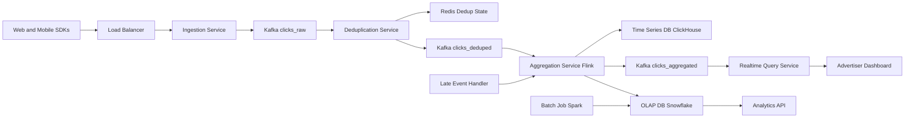

# Ad Click Aggregation

**Category:** System Design
**Difficulty:** 🔴 Hard
**Seniority:** Senior
**Companies:** Google, Meta
**Tags:** streaming, aggregation, deduplication
**Time:** 90-120 min

---

## Problem Statement

Design a real-time ad click aggregation system that processes billions of click events per day from ad impressions across web and mobile platforms. The system must deduplicate clicks (same user clicking the same ad multiple times), aggregate metrics by various dimensions (campaign, ad, user segment, time window), and provide low-latency queries for advertisers to view performance dashboards.

The interviewer expects you to reason about stream processing, exact vs. approximate deduplication, windowing strategies, handling late-arriving data, and the trade-offs between real-time accuracy and system complexity.

## Clarifying Questions

- What is the click volume? *10B clicks/day, peak ~100K clicks/sec.*
- What dimensions do we aggregate on? *Campaign, ad, user segment, geography, device, time windows (hour, day).*
- What are the latency requirements? *Real-time dashboards within 5-10 seconds; batch reports within hours.*
- How strict is deduplication? *Exact deduplication per user-ad within a time window (e.g., 24 hours).*
- What's the data retention? *Raw events for 30 days, aggregated metrics for 1+ years.*
- Do we need click-through rate (CTR) or just clicks? *CTR = clicks / impressions; need both metrics.*
- How do we handle fraud detection? *Separate service; we just need to flag suspicious clicks.*
- What's the query pattern? *Mostly time-series aggregations with filters on dimensions.*

## Requirements

### Functional

- Ingest click events from web/mobile SDKs and server-side tracking.
- Deduplicate clicks per (user_id, ad_id) within a configurable time window.
- Aggregate metrics in real-time across multiple dimensions and time windows.
- Support both exact counts for billing and approximate counts for analytics.
- Provide APIs for advertisers to query metrics with filters.
- Handle late-arriving events (up to a few hours delay).

### Non-Functional

- Throughput: handle 100K+ events/sec at peak.
- Latency: aggregations visible within 10 seconds.
- Accuracy: exact deduplication for billing; approximate acceptable for exploration.
- Scalability: horizontal scaling to 10x volume.
- Durability: no event loss (at-least-once processing).
- Cost-efficiency: balance real-time processing with batch for cost optimization.

### Out of Scope

- Impression tracking (assume separate system provides impression counts).
- Fraud detection algorithms (just need to ingest fraud flags).
- Ad serving logic.

## Capacity Estimation

| Metric | Arithmetic | Result |
|---|---|---|
| Clicks/day | given | 10B |
| Avg TPS | 10B / 86,400 | ~115K TPS |
| Peak TPS | 3-5x avg | ~400K TPS |
| Event size | ~200 B (user_id, ad_id, timestamp, metadata) | ~2 TB/day raw |
| Dedup state | 10B clicks × 30 days × 50 B | ~15 TB (Bloom filter) |
| Aggregated data | ~100 dimensions × 24 hours × 365 days | ~100M metric points/year |
| Storage | Raw + aggregated + dedup state | ~50 TB/year active |

Throughput is significant; stream processing with Kafka and a scalable aggregation engine is required.

## API Design

```text
// Ingestion (high-throughput, fire-and-forget)
POST /v1/clicks
  body: { "userId": "u_123", "adId": "ad_456", "campaignId": "c_789",
          "timestamp": "2024-01-15T10:30:00Z", "device": "mobile",
          "geo": "US-CA", "sessionId": "s_abc", "fraudScore": 0.1 }
  resp: 202 { "eventId": "e_xyz" }

// Query API for dashboards
GET /v1/metrics/clicks
  query: campaignId=c_789&startTime=2024-01-15T00:00:00Z
         &endTime=2024-01-15T23:59:59Z&granularity=hour
         &groupBy=geo,device
  resp: 200 {
    "metrics": [
      { "timestamp": "2024-01-15T10:00:00Z", "geo": "US-CA", "device": "mobile",
        "clicks": 1234, "uniqueClicks": 1156, "ctr": 0.045 }
    ]
  }

// Real-time streaming endpoint (WebSocket)
WS /v1/stream/metrics?campaignId=c_789
  -> pushes metric updates every second

// Admin - configure dedup window
PUT /v1/config/deduplication
  body: { "windowHours": 24 }
```

## Data Model

**Kafka Topics:**

```text
clicks_raw           // Partitioned by user_id for load balancing
clicks_deduped       // After deduplication, partitioned by ad_id
clicks_aggregated    // Time-windowed aggregates, partitioned by time
```

**Click Event (Avro/Protobuf):**

```text
message ClickEvent {
  string event_id;
  string user_id;
  string ad_id;
  string campaign_id;
  int64 timestamp_ms;
  map<string, string> dimensions;  // geo, device, segment, etc.
  float fraud_score;
}
```

**Aggregated Metric (Time-series database):**

```text
metric_key = "clicks:campaign:{campaign_id}:hour:{ts}:geo:{geo}:device:{device}"
value = {
  total_clicks: 1234,
  unique_clicks: 1156,  // after dedup
  fraud_clicks: 12
}
```

**Deduplication State:**

```text
// Redis or dedicated key-value store
key = "dedup:{user_id}:{ad_id}:{window_start}"
value = { first_click_ts: 1234567890, click_count: 3 }
ttl = dedup_window_hours * 3600
```

## High-Level Design



**Ingestion path:**

1. SDKs send click events to ingestion service (HTTP/gRPC with async response).
2. Events are written to Kafka `clicks_raw` topic (partitioned by user_id for load distribution).
3. Deduplication service consumes from `clicks_raw`, checks Redis for existing clicks within the dedup window.
4. First click per (user, ad, window) is forwarded to `clicks_deduped`; duplicates are dropped but counted.
5. Aggregation service (Flink/Spark Streaming) consumes `clicks_deduped`, performs windowed aggregations.
6. Aggregates are written to time-series DB for real-time queries and to OLAP for historical analysis.
7. Late events (outside window but within allowed lateness) trigger window updates.

**Query path:**

1. Dashboard queries hit real-time query service.
2. Service reads from time-series DB for recent data and OLAP for historical.
3. Results are merged and returned.

## Deep Dives

### Deduplication strategy

Exact deduplication is required for billing but expensive at scale. We use a hybrid approach:

```text
FUNCTION processClick(event):
  SET windowStart ← floor(event.timestamp / windowSize) * windowSize
  SET key ← "dedup:{event.userId}:{event.adId}:{windowStart}"

  SET existing ← redis.get(key)
  IF existing EXISTS:
    // Duplicate - update count but don't forward
    redis.hincrby(key, "click_count", 1)
    metrics.duplicateClicks += 1
    RETURN

  // First click in window
  redis.hset(key, "first_click_ts", event.timestamp)
  redis.hset(key, "click_count", 1)
  redis.expire(key, windowSizeSeconds + gracePeriod)

  kafka.produce("clicks_deduped", event)
  metrics.uniqueClicks += 1
```

**Optimizations:**
- Use Redis Cluster for horizontal scaling.
- For very high cardinality, use probabilistic structures (HyperLogLog) for approximate unique counts.
- Cache hot keys (popular ads) in memory with LRU eviction.

### Windowing and late data

Flink's event-time windowing with watermarks handles out-of-order events:

```text
// Tumbling window with allowed lateness
WINDOW TUMBLING(EventTime, 1 HOUR)
ALLOWED_LATENESS(2 HOURS)
SIDE_OUTPUT(late_events)

// On window trigger
FUNCTION aggregateWindow(window):
  SET results ← {}
  FOR event IN window:
    results[event.dimensions] += 1
  tsdb.write(window.start, results)

// Late events trigger window re-computation
FUNCTION processLateEvent(event):
  SET window ← getWindow(event.timestamp)
  SET oldResults ← tsdb.read(window.start)
  SET newResults ← recompute(window)  // read from state backend
  tsdb.update(window.start, newResults)
```

Trade-off: longer allowed lateness = more accurate but higher state and computation.

### Multi-level aggregation

Pre-aggregate at multiple granularities to optimize queries:

```text
// Level 1: Raw events (Kafka) - 30 days
// Level 2: 5-minute aggregates (ClickHouse) - 90 days
// Level 3: Hourly aggregates (ClickHouse) - 1 year
// Level 4: Daily aggregates (Snowflake) - 7+ years

// Query routing
FUNCTION queryMetrics(request):
  IF request.timeRange < 6 hours:
    RETURN queryLevel2(request)
  ELSE IF request.timeRange < 90 days:
    RETURN queryLevel3(request)
  ELSE:
    RETURN queryLevel4(request)
```

Materialized views for common query patterns (e.g., campaign-level daily metrics).

### Exactly-once semantics

Achieved through Kafka transactional writes and Flink's checkpointing:

```text
// Flink sink with exactly-once
KafkaSink.builder()
  .setTransactionalIdPrefix("clicks-aggregator")
  .setCommitOffsetsCheckpointsIntervalMillis(5000)
  .build()

// Checkpoint to durable storage (HDFS/S3)
env.enableCheckpointing(60000)  // 1 minute
env.getCheckpointConfig().setCheckpointingMode(CheckpointingMode.EXACTLY_ONCE)
```

State is stored in RocksDB state backend with periodic snapshots to S3.

## Scaling & Reliability

- **Horizontal scaling:** Kafka partitions scale linearly; Flink parallelism matches partitions.
- **Backpressure:** Kafka consumer lag monitoring; auto-scale based on lag thresholds.
- **Hot keys:** Detect popular ads/users; route to dedicated partitions with more resources.
- **Multi-region:** Ingest regionally, aggregate centrally to reduce cross-region traffic.
- **Fault tolerance:** Kafka replication (3x); Flink checkpoint recovery; Redis Cluster with replicas.
- **Data quality:** Monitor dedup rate, event ordering, watermark progress, late event percentage.
- **Cost optimization:** Tiered storage (hot: SSD, warm: HDD, cold: S3); batch reprocessing for corrections.

**Consistency & Availability:**
- Eventual consistency for real-time analytics (aggregates may be stale by a few seconds).
- Strong consistency for billing via separate batch job.
- Kafka cluster remains available during node failures; Flink jobs restart from checkpoint.
- AP posture for real-time analytics; CP for billing reconciliation.

**Security:**
- API keys for SDK ingestion; OAuth for dashboard access.
- Campaign-level access control; advertisers see only their data.
- Hash user IDs; PII anonymization before long-term storage.
- TLS in transit; at-rest encryption for Kafka and databases.
- Audit logging for all metric queries.

## Trade-offs

| Decision | Option A | Option B | Choice & Why |
|---|---|---|---|
| Deduplication | Exact (Redis) | Approximate (HyperLogLog) | Exact for billing; approximate for exploration where cost matters more. |
| Windowing | Processing time | Event time with watermarks | Event time — handles late data correctly; processing time is simpler but inaccurate. |
| Aggregation engine | Flink | Spark Streaming | Flink — lower latency, better state management for real-time. |
| Storage for queries | ClickHouse only | ClickHouse + Snowflake | Hybrid — ClickHouse for real-time, Snowflake for cost-effective historical. |
| Exactly-once | Kafka transactions | Idempotent sinks | Kafka transactions — simpler semantics; idempotent requires more application logic. |

## Follow-up Questions

1. **How would you handle deduplication across devices (same user on mobile and desktop)?** Use a user graph service to link devices; maintain cross-device dedup keys with higher TTL.
2. **How do you ensure no events are lost during ingestion?** Use Kafka ack=all with replication factor 3; client-side retry with idempotency keys; monitor consumer lag.
3. **How would you add impression tracking to compute CTR?** Separate ingestion path; join clicks and impressions in aggregation layer using windowed co-group.
4. **How do you handle schema evolution for click events?** Use Avro/Protobuf with schema registry; backward-compatible field additions; migrate consumers gradually.
5. **How would you detect and handle click fraud?** Separate ML service scores events in real-time; high-score events are tagged but not dropped; fraud analysis runs offline.

## Common Mistakes

- Using processing time instead of event time, causing incorrect windowed aggregates.
- Forgetting to handle late-arriving events, leading to undercounting.
- Storing all raw events indefinitely without tiered storage, exploding costs.
- Not planning for hot keys (popular ads) causing partition skew.
- Assuming exactly-once is automatic without configuring Kafka transactions and Flink checkpoints.
- Ignoring the difference between billing (exact) and analytics (approximate) requirements.

## Key Takeaways

- Stream processing with event-time windowing and watermarks is essential for accurate real-time analytics.
- Deduplication at scale requires a hybrid approach: exact for critical paths, approximate for exploration.
- Multi-level aggregation (pre-aggregate at multiple time granularities) optimizes query performance and cost.
- Exactly-once semantics require coordination between Kafka, Flink, and state backends.
- Separate real-time and batch paths: real-time for low-latency dashboards, batch for accurate billing and historical analysis.
- Monitor consumer lag, watermark progress, and late event percentages to ensure system health.
