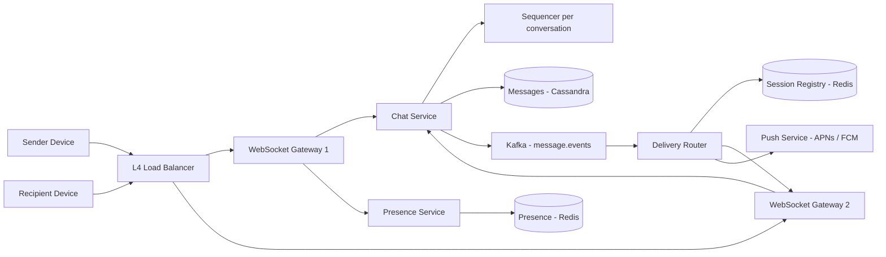

# Chat System

**Category:** System Design
**Difficulty:** 🟡 Medium
**Seniority:** senior
**Companies:** Meta, WhatsApp, Slack, Discord, Microsoft, Amazon, Telegram
**Tags:** websockets, message-ordering, presence, delivery-receipts, real-time, wide-column-storage
**Time:** 45 min

---

## Problem Statement

Design a real-time chat system like WhatsApp or Facebook Messenger supporting one-to-one chats and small group chats (up to a few hundred members). Users send text messages that are delivered instantly to online recipients and stored for offline recipients, with sent/delivered/read receipts and online presence.

The interviewer hints at ~500M daily active users, each sending ~40 messages per day, across mobile and web clients that may hold connections from multiple devices. Messages must never be lost and must appear in the correct order within a conversation.

## Clarifying Questions

- 1:1 only, or groups too? *Both; groups capped at 500 members.*
- Scale? *500M DAU, ~40 messages/user/day, peak concurrent connections ~100M.*
- Message types? *Text up to 4 KB; media handled via upload to object storage, message carries a URL.*
- Multi-device? *Yes, phone + web/desktop, all kept in sync.*
- Message retention? *Stored server-side indefinitely (Messenger-style); WhatsApp-style delete-after-delivery is a variant.*
- Receipts and presence? *Sent, delivered, read receipts; online/last seen presence.*
- End-to-end encryption? *Mention it; assume server stores ciphertext but otherwise the design is the same.*
- Ordering requirement? *Strict order within a conversation; no global ordering needed.*

## Requirements

### Functional
- Send and receive 1:1 and group messages in real time.
- Offline delivery: messages stored and delivered on reconnect.
- Message history with pagination, synced across devices.
- Delivery and read receipts; online presence and last seen.
- Push notification when the recipient is offline.

### Non-Functional
- Low latency: p99 < 300 ms end-to-end for online recipients in the same region.
- Durability: no message loss once the sender gets an ack.
- Per-conversation ordering; exactly-once display (dedupe retries).
- Highly available, ~100M concurrent long-lived connections.

### Out of Scope
- Voice/video calls, message search, bots, large broadcast channels (> 500 members).

## Capacity Estimation

| Metric | Arithmetic | Result |
|---|---|---|
| Messages/day | 500M x 40 | 20B/day |
| Message QPS | 20B / 86,400 | ~230K/s avg, ~700K/s peak |
| Deliveries (group fan-out avg 3x) | 230K x 3 | ~700K deliveries/s avg |
| Storage/day | 20B x 200 B (text + metadata) | ~4 TB/day |
| Storage/year | 4 TB x 365 | ~1.5 PB (x3 replication) |
| Concurrent connections | given | ~100M WebSockets |
| Gateway servers | 100M / ~500K connections per tuned server | ~200 servers (run ~400 for headroom) |
| Connection memory | 100M x ~10 KB per connection | ~1 TB across the gateway fleet |
| Presence heartbeats | 100M / 30 s interval | ~3.3M/s (batched, aggregated) |

## API Design

```text
// Connection
WSS /v1/connect?device_id=d_1      (auth via token in header; one socket per device)

// Client -> server frames
{ "type": "send", "client_msg_id": "uuid", "conversation_id": "c_42", "body": "hi", "sent_at_client": 1717000000 }
{ "type": "ack",  "message_id": "m_901" }                       // delivered to this device
{ "type": "read", "conversation_id": "c_42", "up_to_seq": 1207 }
{ "type": "heartbeat" }

// Server -> client frames
{ "type": "send_ack", "client_msg_id": "uuid", "message_id": "m_901", "seq": 1207, "server_ts": ... }
{ "type": "message",  "conversation_id": "c_42", "message_id": "m_901", "seq": 1207, "sender_id": 7, "body": "hi" }
{ "type": "receipt",  "conversation_id": "c_42", "user_id": 9, "status": "read", "up_to_seq": 1207 }
{ "type": "presence", "user_id": 9, "status": "online" | "offline", "last_seen": ... }

// REST (history, sync, management)
GET  /v1/conversations?cursor=...                              -> list with last message and unread count
GET  /v1/conversations/{id}/messages?before_seq=1200&limit=50  -> history page
GET  /v1/sync?since_inbox_seq=88123                            -> missed messages across conversations after reconnect
POST /v1/conversations  { "member_ids": [...], "type": "group", "name": "..." }
POST /v1/media/upload-url -> pre-signed S3 URL
```

## Data Model

```text
messages (Cassandra / ScyllaDB)
  PRIMARY KEY ((conversation_id, bucket), seq)   CLUSTERING ORDER BY seq DESC
  conversation_id, bucket (e.g. month), seq BIGINT, message_id, sender_id, body, type, created_at

conversations (MySQL / PostgreSQL, sharded by conversation_id)
  conversation_id, type (direct | group), name, created_at, last_seq

conversation_members (sharded by conversation_id; inverse index by user_id)
  conversation_id, user_id, role, joined_at, last_read_seq, last_delivered_seq

user_inbox (Cassandra)                     -- per-user ordered log for multi-device sync
  PRIMARY KEY (user_id, inbox_seq)
  user_id, inbox_seq, conversation_id, message_id

sessions (Redis)                           -- connection registry
  session:{user_id} -> HASH { device_id: gateway_node_id }   TTL refreshed by heartbeat

presence (Redis)
  presence:{user_id} -> { status, last_seen }                 TTL 60 s
```

- **Cassandra/ScyllaDB** for messages: huge write volume (230K/s), append-only, read by conversation and recent range. Partitioning by `(conversation_id, bucket)` bounds partition size for long-lived chats (Discord uses this pattern).
- **Relational DB** for conversations and membership: small, needs transactional updates.
- **Redis** for ephemeral session routing and presence with TTLs.

## High-Level Design



**Send path**
1. Sender's device sends a `send` frame over its WebSocket to Gateway 1, which forwards it to the Chat Service.
2. Chat Service checks membership, dedupes by `client_msg_id`, gets the next `seq` for the conversation, and writes the message to Cassandra (`QUORUM`).
3. Returns `send_ack` (single check mark) to the sender only after the durable write.
4. Publishes the event to Kafka, partitioned by `conversation_id` to preserve order.

**Delivery path**
1. Delivery Router consumes the event, looks up members, and for each member's devices queries the session registry.
2. Online devices: forwards the message to the owning gateway node (gRPC), which pushes it down the socket. The device replies `ack`; router records `delivered` and sends a receipt to the sender.
3. Offline devices: appends to `user_inbox` (always done) and sends a push notification via APNs/FCM.
4. On reconnect, the device calls `/v1/sync?since_inbox_seq=...` to fetch everything missed, in order.

## Deep Dives

### Ordering and sequencing

- Client timestamps are unreliable; server-assigned per-conversation sequence numbers define order.
- Sequencer: `INCR seq:{conversation_id}` in Redis (persisted to `conversations.last_seq`), or route all sends for a conversation to one Chat Service owner (consistent hashing) that increments in memory.
- Clients render by `seq`, detect gaps (e.g. got 1205 then 1207), and fetch missing ranges via history API.

```text
FUNCTION handleSend(frame, senderId):
    REQUIRE isMember(senderId, frame.conversationId)
    SET existing ← dedupCache.get(senderId + ":" + frame.clientMsgId)
    IF existing IS NOT NULL:
        RETURN sendAck(existing)                                // client retry, same result
    SET seq ← sequencer.next(frame.conversationId)              // atomic per conversation
    SET msg ← Message(id = snowflake(), seq, frame.conversationId, senderId, frame.body, now())
    cassandra.insert(messages, msg, consistency = QUORUM)
    dedupCache.set(senderId + ":" + frame.clientMsgId, msg, ttl = 24h)
    kafka.publish("message.events", key = frame.conversationId, value = msg)
    RETURN sendAck(msg)
```

### Connection management at scale

- WebSockets over TLS; gateways are tuned (epoll, small buffers) to hold ~500K connections each; WhatsApp famously ran ~2M per Erlang server.
- L4 load balancer (not L7) for long-lived connections; clients reconnect with exponential backoff and jitter to avoid thundering herds after a gateway restart.
- Session registry maps `user -> {device -> gateway}`; gateways register on connect and deregister on close; TTL cleans up crashed nodes.
- Gateways are thin (auth, framing, heartbeats); business logic lives in stateless Chat Service so gateways rarely need redeploys.

### Delivery guarantees and receipts

- At-least-once end-to-end: sender retries until `send_ack`; router retries until device `ack`; `client_msg_id` and `message_id` dedupe on both sides.
- Receipts are per-user high-water marks (`last_delivered_seq`, `last_read_seq`) rather than per-message rows, reducing writes.
- In groups, read receipts are aggregated ("read by 12") and sent lazily to avoid N^2 traffic.

### Group chats and presence

- Group fan-out at 500 members: the router fans out to each member's sessions; with ~700K deliveries/s this is manageable. Larger channels would switch to pull (clients fetch by `seq`).
- Presence: heartbeats every 30 s refresh a 60 s TTL in Redis. Presence changes are published only to users who currently have that contact's chat open or are in their contact list and online, using pub/sub channels per user.
- Debounce flapping (mobile network switches) by delaying "offline" broadcasts ~10-30 s.

## Scaling & Reliability

- **Sharding:** messages by `(conversation_id, bucket)`; membership by `conversation_id` with an inverse index by `user_id`; Kafka partitions by `conversation_id`.
- **Replication:** Cassandra RF=3 with `QUORUM` writes; Kafka RF=3, `acks=all`; Redis replicas (session/presence loss is recoverable via reconnect).
- **Multi-region:** users homed to a region; cross-region conversations route events via cross-region Kafka replication (MirrorMaker); gateways in every region.
- **Failure handling:** gateway crash -> clients reconnect elsewhere and `sync` from last inbox seq; router crash -> Kafka redelivers from committed offset; dedupe prevents duplicates.
- **Hot conversations:** very active groups hit one partition; rate-limit per conversation and per sender.
- **Monitoring:** send-to-deliver latency p99, connection count per gateway, reconnect storms, Kafka lag, undelivered inbox depth, push failure rate.

## Trade-offs

| Decision | Option A | Option B | Choice & Why |
|---|---|---|---|
| Transport | HTTP long polling | WebSockets | WebSockets: bidirectional, low overhead per message, fewer connections |
| Message store | MySQL sharded | Cassandra / ScyllaDB | Wide-column: 230K writes/s, time-ordered partitions, linear scaling |
| Ordering | Client timestamps | Server per-conversation seq | Server seq: consistent order across devices, gap detection |
| Fan-out | Write to every recipient inbox copy | Store once, route IDs | Store message once by conversation; per-user inbox holds pointers for sync |
| Delivery semantics | At-most-once | At-least-once + idempotent IDs | At-least-once with dedupe: no loss, no visible duplicates |

## Follow-up Questions

1. **How do you support end-to-end encryption?** Signal protocol with per-device keys; the server stores and routes ciphertext only; group messages use sender keys; multi-device needs per-device encryption.
2. **How would you implement message search?** Without E2EE, index into Elasticsearch per user via Kafka consumers; with E2EE, search must be on-device.
3. **How do you scale to 100K-member channels?** Stop pushing message bodies to all; push lightweight "new activity" signals and let clients pull by seq; rate-limit posting.
4. **What happens if a user is online on phone and laptop?** Session registry holds both; deliver to each; read on one device updates `last_read_seq` and syncs to the other.
5. **How do you handle a gateway deploy without dropping 500K users?** Drain gradually: stop accepting new connections, send a reconnect hint, close sockets in batches with jittered reconnects.

## Common Mistakes

- Ordering messages by client timestamp.
- Acking the sender before the message is durably stored.
- Using HTTP polling at 100M concurrent users without justifying cost.
- Putting heavy business logic in stateful gateways.
- Ignoring multi-device sync and offline delivery.
- Broadcasting presence to all contacts on every change, creating massive fan-out.

## Key Takeaways

- Separate stateful connection gateways from stateless chat logic, linked by a session registry.
- Per-conversation server sequence numbers give ordering and gap detection.
- Durable write first, then async fan-out via Kafka; at-least-once plus idempotent IDs.
- Wide-column storage partitioned by conversation and time bucket handles the write volume.
