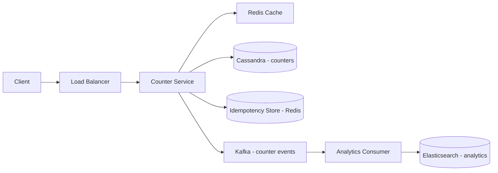

# Counter Service

**Category:** System Design
**Difficulty:** 🟢 Easy
**Seniority:** Junior
**Companies:** Reddit, Twitter
**Tags:** caching, sharding, idempotency
**Time:** 30-45 min

---

## Problem Statement

Design a distributed counter service similar to Reddit's upvote/downvote system or Twitter's like/retweet counters. The service must track counts for millions of entities (e.g., posts, comments, tweets) and handle high concurrent increments/decrements while ensuring accuracy.

The interviewer mentions billions of entities, with hot entities receiving thousands of updates per second (e.g., a viral post). The service must support increment, decrement, and get operations, with eventual consistency acceptable for the UI (showing "1.2K likes" is fine even if the exact count is 1,234).

## Clarifying Questions

- How many entities? *Assume 10B entities (posts, comments, etc.).*
- How many operations per second? *Assume 100K writes/s avg, 500K/s peak.*
- Read:write ratio? *About 5:1 (views trigger reads).*
- What's the counter range? *Up to billions (64-bit integer).*
- Do we need to track who voted/liked? *No, just the count. Tracking individual votes is a separate service.*
- How accurate must the count be? *Within 1-2% is acceptable for display; exact counts for analytics.*
- Do counters ever reset? *No, they only increase or decrease.*
- Do we need rate limiting? *Yes, to prevent abuse (e.g., spamming likes).*

## Requirements

### Functional
- Increment a counter for an entity.
- Decrement a counter for an entity.
- Get the current count for an entity.
- Batch get counts for multiple entities.

### Non-Functional
- High throughput: handle 500K writes/s.
- Low latency: p99 < 50 ms for writes, < 20 ms for reads.
- High availability: 99.9%+.
- Eventual consistency acceptable for display; strong consistency for critical operations.

### Out of Scope
- User authentication, individual vote tracking, undo operations, rate limiting details.

## Capacity Estimation

| Metric | Arithmetic | Result |
|---|---|---|
| Entities | 10B | 10B counters |
| Write QPS | 500K/s peak | 500K/s |
| Read QPS | 2.5M/s peak (5:1) | 2.5M/s |
| Storage per counter | entity_id (16B) + count (8B) + metadata (8B) | ~32 B |
| Total storage | 10B x 32 B | ~320 GB |
| Daily new entities | 100M/day | 100M/day |
| Daily storage growth | 100M x 32 B | ~3.2 GB/day |

Storage is manageable; the challenge is handling hot-spot entities (viral posts) with thousands of concurrent updates.

## API Design

```text
POST /api/v1/counters/increment
  Body:    { "entity_id": "post:12345", "delta": 1 }
  200 ->   { "entity_id": "post:12345", "count": 1234 }

POST /api/v1/counters/decrement
  Body:    { "entity_id": "post:12345", "delta": 1 }
  200 ->   { "entity_id": "post:12345", "count": 1233 }

GET /api/v1/counters/{entity_id}
  200 ->   { "entity_id": "post:12345", "count": 1234 }

POST /api/v1/counters/batch
  Body:    { "entity_ids": ["post:12345", "post:67890", ...] }
  200 ->   { "counts": { "post:12345": 1234, "post:67890": 567, ... } }
```

For idempotency, include an optional `request_id` to deduplicate duplicate requests.

## Data Model

```text
Table: counters (Cassandra / DynamoDB)
  entity_id   STRING  PRIMARY KEY
  count       BIGINT
  version     INT     (for optimistic locking)

Redis (cache):
  Key: counter:{entity_id}
  Value: count (as integer)
  TTL: 60-300 seconds
```

- **Primary storage:** Cassandra or DynamoDB for horizontal scalability and high write throughput. Partition key: `entity_id`.
- **Cache layer:** Redis for hot counters to reduce load on the database.
- **Idempotency:** Use a separate table or Redis set to track processed `request_id`s with a short TTL (e.g., 5 minutes).

## High-Level Design



**Write path (increment/decrement)**
1. Client calls `POST /api/v1/counters/increment` with `entity_id` and optional `request_id`.
2. Counter Service checks idempotency store; if `request_id` seen, return cached result.
3. Updates Redis cache using `INCR` (atomic).
4. Asynchronously writes to Cassandra using a lightweight transaction or a batched writer.
5. Returns the new count from Redis (eventually consistent with DB).
6. Publishes the event to Kafka for analytics.

**Read path**
1. Client calls `GET /api/v1/counters/{entity_id}`.
2. Counter Service checks Redis cache; on hit, returns the count.
3. On miss, reads from Cassandra and populates Redis with a TTL.
4. Returns the count.

## Deep Dives

### Handling hot-spot entities

A viral post can receive thousands of updates per second, overwhelming a single database shard.

**Strategies:**
- **Sharding by entity_id:** If `entity_id` is evenly distributed (e.g., UUID), load spreads naturally. However, a single hot entity still hits one shard.
- **Multi-layer counting:** Use a "sharded counter" approach. Split each logical counter into N physical counters (e.g., `counter:post:12345:0` to `counter:post:12345:9`). On read, sum all shards.
- **Local buffering:** Each service instance maintains a local buffer of increments; flushes to the database in batches every 100 ms or 1,000 operations.

```text
FUNCTION increment(entityId, delta):
    SET shardIndex ← hash(entityId, requestId) MOD 10
    SET shardKey ← "counter:{entityId}:{shardIndex}"
    INCR Redis[shardKey] delta
    ASYNC flushToDB(shardKey)

FUNCTION getCount(entityId):
    SET total ← 0
    FOR i IN 0..9:
        SET shardKey ← "counter:{entityId}:{i}"
        SET total ← total + GET Redis[shardKey]
    RETURN total
```

### Idempotency

Clients may retry requests due to network failures. To prevent double-counting:

```text
FUNCTION incrementWithIdempotency(entityId, delta, requestId):
    SET idempotencyKey ← "idempotency:{requestId}"
    IF EXISTS Redis[idempotencyKey]:
        RETURN GET Redis[idempotencyKey]  // cached result
    SET result ← increment(entityId, delta)
    SET Redis[idempotencyKey] ← result  // TTL: 300 seconds
    RETURN result
```

For stronger guarantees, use a Cassandra table with `(request_id, entity_id)` as primary key and a TTL.

### Batched writes to database

Writing every increment to Cassandra immediately is expensive. Instead:

- **Write-behind:** Redis is the write-ahead cache; a background worker batches updates (e.g., every 100 ms or 1,000 updates) and writes to Cassandra.
- **Compensation:** If Redis crashes before flushing, some updates are lost. For many use cases (likes, views), this is acceptable. For critical counters (financial), use a write-through cache with Cassandra.

### Consistency model

- **Read-your-writes:** Use sticky sessions or read from the same Redis shard that received the write.
- **Eventual consistency:** Accept that the UI may show a slightly stale count. Background sync ensures eventual consistency.
- **Strong consistency (optional):** For critical operations, read from Cassandra with `LOCAL_QUORUM` after a write.

## Scaling & Reliability

- **Sharding:** Cassandra consistent hashing by `entity_id`; add nodes to scale linearly.
- **Replication:** RF=3 for durability; multi-region replication for global availability.
- **Redis cluster:** Use Redis Cluster for horizontal scaling; hot counters can be replicated across multiple shards.
- **Rate limiting:** Limit increments per user/IP (e.g., 100 likes/min) using Redis token buckets.
- **Monitoring:** Redis hit ratio, Cassandra write latency, hot-spot detection, error rates.
- **Failover:** Redis Sentinel or Cluster auto-failover; Cassandra replica promotion on failure.

## Trade-offs

| Decision | Option A | Option B | Choice & Why |
|---|---|---|---|
| Primary storage | Cassandra | PostgreSQL | Cassandra: handles high write throughput, scales horizontally |
| Cache strategy | Write-through | Write-behind | Write-behind: higher throughput, accepts small data loss |
| Hot-spot handling | Single counter | Sharded counter | Sharded: distributes load for viral entities |
| Consistency | Strong | Eventual | Eventual: acceptable for likes/views; higher throughput |
| Idempotency | Redis | Cassandra table | Redis: fast, short TTL sufficient for retries |

## Follow-up Questions

1. **How would you handle a counter that must never lose a single increment (e.g., financial transactions)?** Use write-through cache with Cassandra, enable lightweight transactions for atomic updates, and use a dedicated idempotency table with no TTL.
2. **How do you support decrement operations without going negative?** Use a conditional update in Cassandra (`IF count >= delta`) or a Lua script in Redis to check before decrementing.
3. **How would you add rate limiting per user?** Use Redis token buckets per user ID; reject requests that exceed the limit.
4. **What if a client sends the same request_id for different entities?** Include `entity_id` in the idempotency key (`idempotency:{request_id}:{entity_id}`) to avoid collisions.
5. **How do you handle a Redis partition?** Fall back to direct Cassandra reads/writes; accept higher latency during the outage.

## Common Mistakes

- Using a relational database with row-level locks, which doesn't scale for high-concurrency updates.
- Not handling hot-spot entities, leading to a single overloaded shard.
- Forgetting idempotency, causing double-counting on retries.
- Using strong consistency everywhere when eventual consistency is acceptable, limiting throughput.
- Not monitoring for hot entities and missing performance degradation.

## Key Takeaways

- Distributed counters are a write-heavy workload; choose a database optimized for high write throughput (Cassandra, DynamoDB).
- Hot-spot entities (viral content) require special handling: sharded counters or local buffering.
- Idempotency is critical for retry-safe APIs; use a short-lived store (Redis) for deduplication.
- Eventual consistency is often acceptable for social counters; prioritize throughput over strong consistency.
- Layered architecture (cache → database) balances latency, throughput, and durability.
