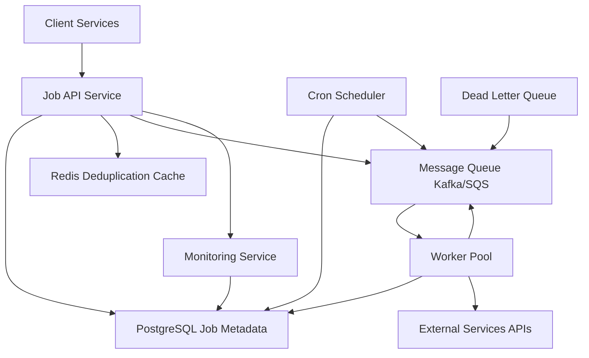

# Distributed Job Scheduler

**Category:** System Design
**Difficulty:** 🟡 Medium
**Seniority:** mid-level
**Companies:** Airbnb, Uber, Amazon, Netflix, Google, Stripe
**Tags:** scheduling, idempotency, retries, distributed-systems, queues
**Time:** 60-90 min

---

## Problem Statement

Design a distributed job scheduler that can execute millions of background jobs across a fleet of worker nodes. Jobs include periodic tasks (data cleanup, report generation), delayed tasks (send email 24 hours after signup), and one-off tasks (image processing, PDF generation). The system must handle job failures with retries, support job deduplication, provide visibility into job status, and scale horizontally.

The interviewer mentions ~10M jobs/day with peak bursts of 5x, jobs ranging from milliseconds to hours, and requirements for at-least-once delivery with idempotent job handlers.

## Clarifying Questions

- What types of jobs? *CPU-bound (image processing), I/O-bound (API calls, emails), and long-running workflows.*
- Job volume? *10M jobs/day, peak ~50M during events, average job duration 30 seconds.*
- SLA requirements? *95% of jobs complete within their scheduled time; failed jobs retry with backoff.*
- Job priorities? *Yes: critical (payments), normal (emails), low (analytics).*
- Dependencies between jobs? *Simple chains (A→B→C) in v1; complex DAGs later.*
- Job payload size? *Up to 1 KB for parameters; large data stored externally (S3).*
- Monitoring needs? *Job status API, retry counts, failure reasons, queue depths.*

## Requirements

### Functional

- Schedule jobs for immediate execution, delayed execution (run at T), or periodic execution (cron).
- Support job priorities and worker pools with different capabilities (GPU workers, high-memory workers).
- Retry failed jobs with exponential backoff and dead-letter queue for permanently failed jobs.
- Job deduplication: if the same logical job is submitted multiple times, execute once.
- Query job status, list jobs by queue, and cancel pending jobs.
- Support job chains: schedule B after A succeeds or fails.

### Non-Functional

- Scalability: handle 10M+ jobs/day with horizontal scaling of workers.
- Availability: 99.9% for job submission and execution.
- Durability: no lost jobs; survive worker and queue failures.
- Latency: p95 scheduling latency < 100 ms; job starts within SLA after scheduled time.
- Fault tolerance: workers can crash; jobs are re-queued automatically.

### Out of Scope

- Complex workflow orchestration (Temporal, Airflow), job visualization UI, cost optimization.

## Capacity Estimation

| Metric | Arithmetic | Result |
|---|---|---|
| Jobs/day | given | 10M |
| Avg TPS | 10M / 86,400 | ~115 TPS |
| Peak TPS | 5x | ~575 TPS |
| Concurrent jobs | 575 TPS x 30 s avg duration | ~17,250 in-flight |
| Worker capacity | 50 jobs/worker (concurrent) | ~350 workers at peak |
| Queue storage | 10M x 1 KB | ~10 GB/day, retention 7 days = ~70 GB |
| Job metadata | 10M x 500 B | ~5 GB/day |
| Cron schedules | ~1,000 periodic jobs | Negligible |

A distributed message queue (Kafka, SQS, or Redis Streams) handles the throughput. Workers are stateless and autoscale based on queue depth.

## API Design

```text
POST /v1/jobs
  body: { "type": "send_welcome_email",
          "payload": { "userId": "u_123", "email": "user@example.com" },
          "scheduleAt": "2024-01-15T10:00:00Z",  // optional, null = immediate
          "deduplicationKey": "email:u_123",      // optional
          "priority": "normal",
          "timeoutSeconds": 300,
          "maxRetries": 3 }
  resp: 201 { "jobId": "job_abc123", "status": "QUEUED", "scheduledAt": "..." }

POST /v1/jobs/recurring
  body: { "type": "daily_report",
          "cron": "0 9 * * *",  // 9 AM daily
          "payload": { ... },
          "timezone": "America/New_York" }
  resp: 201 { "recurringJobId": "rec_456" }

GET  /v1/jobs/{jobId}
  resp: { "jobId", "status", "attempts", "lastError", "queuedAt", "startedAt", "completedAt" }

DELETE /v1/jobs/{jobId}           // cancel if not started
POST   /v1/jobs/{jobId}/retry     // manual retry from DLQ

POST /v1/jobs/batch               // bulk submit up to 1000 jobs
  body: { "jobs": [...] }
  resp: 201 { "jobIds": [...], "failed": [] }

GET  /v1/queues/{queueName}       // queue stats
  resp: { "depth", "processing", "completed", "failed" }
```

## Data Model

**PostgreSQL (metadata) + Redis/Message Queue (execution)**

```sql
-- Job metadata and state
job
  job_id            UUID PK
  type              TEXT NOT NULL
  payload           JSONB
  status            ENUM(QUEUED, PROCESSING, COMPLETED, FAILED, CANCELLED, DEAD_LETTER)
  priority          ENUM(CRITICAL, NORMAL, LOW) DEFAULT NORMAL
  queue             TEXT NOT NULL
  deduplication_key TEXT UNIQUE
  scheduled_at      TIMESTAMP
  started_at        TIMESTAMP
  completed_at      TIMESTAMP
  attempts          INT DEFAULT 0
  max_retries       INT DEFAULT 3
  last_error        TEXT
  worker_id         TEXT
  created_at        TIMESTAMP DEFAULT NOW()
  updated_at        TIMESTAMP DEFAULT NOW()

-- Recurring job definitions
recurring_job
  recurring_id      UUID PK
  type              TEXT
  payload           JSONB
  cron_expression   TEXT
  timezone          TEXT
  queue             TEXT
  enabled           BOOLEAN DEFAULT TRUE
  last_run_at       TIMESTAMP
  next_run_at       TIMESTAMP
  created_at        TIMESTAMP

-- Job execution history (append-only)
job_attempt
  attempt_id        BIGSERIAL PK
  job_id            UUID FK
  worker_id         TEXT
  started_at        TIMESTAMP
  completed_at      TIMESTAMP
  status            ENUM(SUCCESS, FAILURE, TIMEOUT)
  error_message     TEXT
  retry_after       TIMESTAMP
```

**Redis (for deduplication and rate limiting):**
- `dedup:{key}` → job_id (TTL: 24 hours)
- `rate_limit:{queue}` → token bucket for submission rate limiting

**Message Queue (Kafka/SQS/Redis Streams):**
- Topics/Queues per priority: `jobs-critical`, `jobs-normal`, `jobs-low`
- Partitioned by job_id for ordering per job

## High-Level Design



**Job submission path:**
1. Client submits job via API with optional deduplication key.
2. API checks Redis for existing deduplication key; if found, returns existing job.
3. API persists job metadata to PostgreSQL with status QUEUED.
4. API publishes job message to appropriate priority queue.
5. Workers consume from queues, claim job, update status to PROCESSING.
6. Worker executes job handler; on success, mark COMPLETED; on failure, increment attempts and retry with backoff.
7. After max retries, move to DLQ for manual inspection.

**Cron scheduling:**
1. Scheduler service runs every minute, queries recurring jobs due.
2. For each due job, creates a new job instance and enqueues it.
3. Updates next_run_at based on cron expression.

## Deep Dives

### Job deduplication

Prevent duplicate work for idempotent operations (e.g., sending the same welcome email twice).

```text
FUNCTION submitJob(job):
    IF job.deduplicationKey EXISTS:
        existing ← Redis.get("dedup:" + job.deduplicationKey)
        IF existing:
            RETURN { jobId: existing, status: "ALREADY_EXISTS" }

    job_id ← uuid()
    BEGIN TRANSACTION
        INSERT job(job_id, ..., status = QUEUED)
    COMMIT

    Redis.setex("dedup:" + job.deduplicationKey, 86400, job_id)
    Queue.publish(job.queue, { job_id, type, payload, priority })
    RETURN { jobId: job_id, status: "QUEUED" }
```

Deduplication keys have TTL (24 hours) to prevent unbounded growth. For permanent deduplication, use a database unique constraint.

### Retry strategy with exponential backoff

```text
FUNCTION handleFailure(job, error):
    job.attempts ← job.attempts + 1
    IF job.attempts >= job.maxRetries:
        job.status ← DEAD_LETTER
        job.lastError ← error
        UPDATE job
        DLQ.publish(job)
        RETURN

    retryDelay ← MIN(2^job.attempts * 1000, 60000)  // cap at 1 minute
    job.retryAfter ← NOW() + retryDelay
    job.status ← QUEUED
    job.lastError ← error
    UPDATE job

    // Schedule delayed retry via delayed queue or TTL
    delayedQueue.publish(job, delay = retryDelay)
```

For systems without native delayed queues, use a "scheduled jobs" table polled by workers, or Redis sorted sets with score = execution time.

### Worker scaling and queue processing

Workers are stateless and auto-scale based on queue depth metrics:

```text
FUNCTION workerLoop():
    WHILE true:
        messages ← Queue.batchFetch(queue, maxWait = 5s, maxMessages = 10)
        FOR msg IN messages:
            job ← JobDB.get(msg.job_id)
            IF job.status != QUEUED: CONTINUE  // claimed by another worker

            BEGIN TRANSACTION
                UPDATE job SET status = PROCESSING, worker_id = SELF.id
                    WHERE job_id = job.id AND status = QUEUED
                IF ROW_COUNT = 0: ROLLBACK; CONTINUE  // lost race
            COMMIT

            TRY:
                result ← executeHandler(job.type, job.payload)
                UPDATE job SET status = COMPLETED, completed_at = NOW()
            CATCH error:
                handleFailure(job, error)
```

Horizontal scaling: add more workers when queue depth > threshold. Vertical scaling: allocate workers with appropriate resources (GPU for image processing, high memory for data processing).

### Job chains and dependencies

Simple chain: schedule job B after A completes.

```text
FUNCTION submitChain(jobs):
    FOR i, job IN enumerate(jobs):
        IF i == 0:
            submitJob(job)
        ELSE:
            job.dependsOn ← jobs[i-1].jobId
            job.status ← BLOCKED
            INSERT job

FUNCTION onJobComplete(parentJob):
    children ← SELECT * FROM job WHERE dependsOn = parentJob.jobId AND status = BLOCKED
    FOR child IN children:
        child.status ← QUEUED
        UPDATE child
        Queue.publish(child.queue, child)
```

For complex DAGs, consider a workflow engine (Temporal, Cadence) instead of building custom dependency resolution.

### Cron scheduling accuracy

Scheduler runs as a distributed service with leader election to prevent duplicate scheduling:

```text
FUNCTION schedulerLoop():
    WHILE true:
        IF NOT isLeader(): SLEEP(10); CONTINUE

        now ← NOW()
        dueJobs ← SELECT * FROM recurring_job
            WHERE enabled = TRUE AND next_run_at <= now
            LIMIT 1000

        FOR rj IN dueJobs:
            job ← { type: rj.type, payload: rj.payload, queue: rj.queue }
            job_id ← submitJob(job)

            UPDATE recurring_job
                SET last_run_at = now, next_run_at = calculateNextRun(rj.cron, now)
                WHERE recurring_id = rj.recurring_id
```

Use a cron library that handles timezone conversions and edge cases (leap seconds, daylight saving).

## Scaling & Reliability

- **Queue durability:** Use Kafka with replication factor 3 or SQS for built-in durability. Messages are not acknowledged until job is persisted.
- **Worker fault tolerance:** Workers crash mid-job; job remains in PROCESSING. A "reaper" process finds jobs stuck in PROCESSING > timeout and re-queues them.
- **Database scaling:** PostgreSQL with read replicas for status queries; partition by created_at for historical data. At extreme scale, shard by job_id hash.
- **Multi-region deployment:** Active-active with region-pinned queues; cross-region job fanout for global tasks.
- **Monitoring:** Queue depth per queue, worker CPU/memory, job success rate, retry distribution, dead-letter queue size, scheduler lag.
- **Rate limiting:** Per-tenant submission rate limits using Redis token buckets to prevent abuse.

## Trade-offs

| Decision | Option A | Option B | Choice & Why |
|---|---|---|---|
| Queue implementation | Redis Streams | Kafka / SQS | Kafka/SQS — better durability and scaling at volume; Redis simpler for small scale |
| Job payload storage | In message | External reference (S3) | External reference — messages stay small; large data doesn't bloat queue |
| Retry mechanism | Application-level | Queue-native (DLQ + redrive) | Application-level — more control over backoff and retry conditions |
| Cron scheduling | Database polling | Dedicated scheduler service | Scheduler service — more accurate, separates concerns |
| Worker scaling | Manual | Auto-scale based on queue depth | Auto-scale — responds to traffic patterns automatically |
| Job deduplication | Database unique constraint | Redis cache | Redis cache — faster, handles TTL naturally; DB constraint as fallback |

## Follow-up Questions

1. **How do you handle long-running jobs (hours to days)?** Split into a workflow with checkpoints; job persists progress to DB and can resume from any checkpoint. Use a separate "long-running" queue with fewer, larger workers.
2. **How do you ensure exactly-once execution?** True exactly-once is impossible without distributed transactions; use idempotent job handlers and deduplication keys for at-most-once semantics with retries.
3. **How do you handle job priority inversion?** Use separate queues per priority with dedicated worker pools; critical workers always process critical queue first. Implement queue draining during overload.
4. **How do you debug a failing job?** Capture full error stack traces, input parameters, and worker logs. Store job attempt history with timestamps and error context. Provide a "replay with debug logging" feature.
5. **How would you add job timeouts?** Workers set a deadline per job; if handler exceeds timeout, kill the worker process (or use context cancellation in Go) and mark job as TIMED_OUT with retry.

## Common Mistakes

- Not making job handlers idempotent, causing side effects on retries.
- Storing large payloads in queue messages instead of external storage.
- Using a single queue for all priorities, causing critical jobs to wait behind low-priority batch jobs.
- Forgetting to handle worker crashes, leaving jobs stuck in PROCESSING forever.
- Implementing cron with a single scheduler instance (single point of failure).
- Not limiting retry backoff, causing retry storms for permanently failing jobs.

## Key Takeaways

- Separate job metadata (durable database) from execution (message queue) for reliability and visibility.
- Idempotency and deduplication are essential for safe retries in distributed systems.
- Use exponential backoff with caps for retries; move permanently failed jobs to a DLQ.
- Workers should be stateless and auto-scale based on queue depth metrics.
- Cron scheduling needs leader election and timezone-aware calculations.
- Monitor queue depths, retry patterns, and dead-letter queues to detect systemic issues early.
