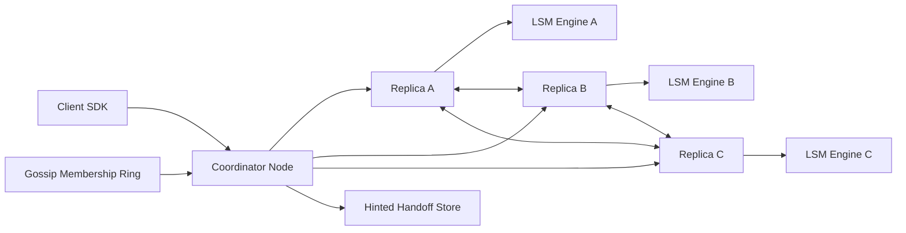

# Distributed Key-Value Store

**Category:** System Design
**Difficulty:** 🔴 Hard
**Seniority:** staff
**Companies:** Amazon, Google, Meta, Microsoft, Apple, Databricks, Stripe
**Tags:** consistent-hashing, replication, quorum, cap-theorem, lsm-tree, gossip-protocol, partitioning
**Time:** 60 min

---

## Problem Statement

Design a distributed key-value store (like Amazon Dynamo, Cassandra, or Riak) that supports `put(key, value)` and `get(key)` across hundreds of commodity nodes. The store must scale horizontally to petabytes, survive node and datacenter failures, and offer tunable consistency.

The interviewer expects you to reason about partitioning, replication, consistency models, conflict resolution, failure detection, and the storage engine — essentially the Dynamo paper with modern refinements.

## Clarifying Questions

- What is the value size? *Small: keys < 256 B, values < 100 KB (p99 ~10 KB).*
- Operations? *get, put, delete; no range scans or transactions in v1.*
- Consistency vs. availability? *Default to high availability (AP) with tunable quorum for stronger reads.*
- Scale? *10 PB total, 1M ops/s, 500+ nodes, multiple datacenters.*
- Latency targets? *p99 < 10 ms for reads and writes within a region.*
- Durability? *No acknowledged write lost if fewer than R/W replicas fail.*
- Is the workload read- or write-heavy? *Mixed, ~70/30 read/write.*
- TTL support? *Yes, per-key TTL.*

## Requirements

### Functional

- `put(key, value, [ttl])`, `get(key)`, `delete(key)`.
- Tunable consistency per request (ONE, QUORUM, ALL, LOCAL_QUORUM).
- Automatic data partitioning and rebalancing when nodes join/leave.

### Non-Functional

- Horizontal scalability to 1,000 nodes, linear throughput growth.
- High availability: writes accepted even during network partitions (always-writable).
- Durability: replication factor 3 across racks/AZs.
- Low latency: p99 < 10 ms.
- Eventual consistency by default; read-your-writes achievable via quorum.
- Operational simplicity: decentralized, no single point of failure.

### Out of Scope

- Multi-key transactions, secondary indexes, range queries.

## Capacity Estimation

| Metric | Arithmetic | Result |
|---|---|---|
| Throughput | given | 1M ops/s (700K reads, 300K writes) |
| Raw data | given | 10 PB logical |
| Replicated | 10 PB x RF 3 | 30 PB physical |
| Per node storage | 8 TB NVMe usable, ~60% fill target | ~5 TB/node |
| Nodes for storage | 30 PB / 5 TB | ~6,000 nodes (or denser nodes: 20 TB -> ~1,500) |
| Ops per node | 1M x 3 replicas (writes) / 1,500 nodes | ~1.3K ops/s/node — comfortable |
| Write bandwidth | 300K x 10 KB x 3 | ~9 GB/s cluster-wide |
| Memtable memory | 256 MB-1 GB per node | flushes every few seconds to minutes |
| Bloom filters | 10 bits/key, ~1B keys/node | ~1.25 GB RAM/node |

Storage, not throughput, drives node count — so dense nodes and compaction efficiency matter.

## API Design

```text
// Client library or gRPC
rpc Get(GetRequest{ key, consistency = QUORUM })
    returns GetResponse{ value, version: VectorClock or Timestamp, found }

rpc Put(PutRequest{ key, value, ttlSec, consistency = QUORUM,
                    context: VersionContext })   // context from prior Get
    returns PutResponse{ version }

rpc Delete(DeleteRequest{ key, consistency, context })
    returns DeleteResponse{ ok }

// Internal node-to-node
rpc ReplicaWrite(key, value, version, hintFor?)
rpc ReplicaRead(key) returns (value, version)
rpc Gossip(membershipDigest) returns membershipDelta
rpc MerkleSync(range, treeLevel) returns hashes
```

## Data Model

The store itself is the data model. Each record on disk:

```text
record
  key         BYTES          // partitioned by hash(key)
  value       BYTES
  version     VectorClock | HybridLogicalClock timestamp
  ttl_expiry  TIMESTAMP?
  tombstone   BOOL           // deletes are tombstones until GC
```

**Partition key:** `token = Murmur3(key)` mapped onto a 2^64 ring. Each physical node owns ~256 virtual nodes (token ranges).

**Cluster metadata** (ring membership, token ownership, node status) is gossiped among all nodes and persisted locally; optionally an etcd/ZooKeeper cluster stores the authoritative ring for safer rebalancing.

**Storage engine:** LSM tree (RocksDB-like) — commit log (WAL) + memtable + immutable SSTables with Bloom filters and sparse indexes. Chosen because it turns random writes into sequential I/O, which suits write-heavy distributed stores.

## High-Level Design



**Write path:**

1. Client (token-aware SDK) sends `put` to any node; that node becomes the coordinator (ideally a replica itself).
2. Coordinator hashes the key, walks the ring clockwise to find the N=3 preference list (distinct physical nodes, distinct racks/AZs).
3. It sends the write to all 3 replicas in parallel and waits for W acks (W=2 for QUORUM).
4. Each replica appends to its commit log (fsync batched every ~10 ms), inserts into the memtable, and acks.
5. If a replica is down, the coordinator writes a hint to another healthy node (hinted handoff) so W is still met (sloppy quorum).

**Read path:**

1. Coordinator sends the read to R replicas (R=2 for QUORUM) — often one full read + digest reads for the others.
2. If versions disagree, it returns the newest (LWW) or all siblings (vector clocks), and triggers read repair asynchronously.
3. Each replica reads memtable -> Bloom filters -> SSTables (newest first), merging results.

With R + W > N (2 + 2 > 3), every read quorum overlaps the latest write quorum.

## Deep Dives

### Partitioning with consistent hashing and virtual nodes

Modulo hashing (`hash(key) mod N`) remaps nearly all keys when N changes. Consistent hashing only moves ~1/N of keys. Virtual nodes (e.g. 256 tokens per node) smooth out load imbalance and let heterogeneous hardware take proportional shares.

```text
FUNCTION preferenceList(key, N):
    SET token ← murmur3_64(key)
    SET list ← []
    SET pos ← ring.ceiling(token)            // first vnode clockwise
    WHILE size(list) < N:
        SET node ← ring.ownerOf(pos)
        IF node NOT IN list AND rackOf(node) NOT IN racksOf(list):
            list.add(node)
        SET pos ← ring.next(pos)
    RETURN list
```

When a node joins, it takes over token ranges and streams the corresponding SSTables from current owners; reads continue to be served by old owners until streaming completes.

### Consistency, versioning, and conflict resolution

- **Quorum tuning:** N=3. W=1/R=1 for lowest latency (eventual); W=2/R=2 for read-your-writes; W=3 for highest durability at availability cost. Multi-DC uses LOCAL_QUORUM to avoid cross-region latency (~70 ms).
- **Last-write-wins (LWW):** each write carries a hybrid logical clock timestamp; highest wins. Simple (Cassandra), but clock skew can silently drop concurrent writes.
- **Vector clocks:** each write carries `{nodeId: counter}`; if neither clock dominates, keep both siblings and let the client merge (Dynamo shopping cart). Truncate clocks beyond ~10 entries.
- **CRDTs** (counters, sets) offer automatic merges for specific data types.

```text
FUNCTION resolve(versions):
    SET winners ← []
    FOR v IN versions:
        IF no other w IN versions WHERE w.clock dominates v.clock:
            winners.add(v)
    IF size(winners) = 1: RETURN winners[0]
    RETURN siblings(winners)        // client merges and writes back with merged clock
```

### Failure detection and recovery

- **Gossip:** every second each node exchanges heartbeat counters with ~3 random peers; membership converges in O(log N) rounds. Phi-accrual failure detector marks a node suspect when phi > 8, avoiding fixed timeouts.
- **Temporary failures:** sloppy quorum + hinted handoff; hints replay when the node returns (kept up to ~3 h).
- **Permanent divergence:** anti-entropy using Merkle trees per token range. Replicas compare root hashes, descend only into differing subtrees, and stream only mismatched keys — bandwidth proportional to differences, not data size.
- **Read repair:** on quorum reads, stale replicas are updated in the background.
- **Datacenter outage:** replicas placed in multiple DCs; LOCAL_QUORUM in surviving DC continues serving.

### Storage engine: LSM tree

```text
FUNCTION write(key, value, version):
    commitLog.append(key, value, version)        // sequential, group-fsync
    memtable.put(key, (value, version))          // skip list
    IF memtable.size > 512 MB:
        flushToSSTable(memtable)                 // immutable, sorted, with Bloom filter

FUNCTION read(key):
    IF memtable.contains(key): RETURN memtable.get(key)
    FOR sst IN sstables ORDER BY newest:
        IF sst.bloom.mightContain(key):          // ~1% false positive
            SET r ← sst.lookup(key)               // sparse index + one disk seek
            IF r EXISTS: RETURN r
    RETURN NOT_FOUND
```

Compaction merges SSTables, drops overwritten values and expired tombstones (after `gc_grace` ~10 days, longer than max repair interval so deleted data does not resurrect). Size-tiered compaction favors writes; leveled compaction bounds read amplification (~10% space overhead) for read-heavy tables.

## Scaling & Reliability

- **Scaling out:** add nodes; they claim vnodes and stream data. Throttle streaming (e.g. 200 MB/s per node) to protect foreground latency.
- **Hot keys:** detect via per-key sampling; mitigate with client-side caching, request coalescing, or key salting for write-hot counters.
- **Replication placement:** rack/AZ-aware so a single AZ loss never removes a quorum.
- **Backups:** periodic SSTable snapshots to S3 (immutable files make incremental backup cheap).
- **Tail latency:** speculative retry — if a replica doesn't respond within p99, send the read to another replica.
- **Monitoring:** per-node p99 latency, pending compactions, SSTables per read, hint backlog, gossip convergence, disk usage, repair progress.

## Trade-offs

| Decision | Option A | Option B | Choice & Why |
|---|---|---|---|
| CAP posture | CP (Raft per shard, e.g. TiKV) | AP (Dynamo-style quorums) | AP with tunable quorum — requirement is always-writable; offer QUORUM for stronger needs. |
| Conflict resolution | Last-write-wins | Vector clocks / siblings | LWW by default for simplicity; vector clocks or CRDTs for data where lost updates matter. |
| Partitioning | Range partitioning | Consistent hashing | Hashing — even load, no hotspots on sequential keys; range only if scans are needed. |
| Storage engine | B-tree | LSM tree | LSM — sequential writes, good compression; accept read/compaction amplification. |
| Membership | Central coordinator (ZooKeeper) | Gossip | Gossip for liveness (no SPOF); optional consensus store for authoritative ring changes. |

## Follow-up Questions

1. **How would you provide strong consistency (linearizability)?** Run Raft/Paxos per partition (like TiKV, CockroachDB, Spanner); writes go through the leader, costing a round trip and availability during leader elections.
2. **How do you support range queries?** Use order-preserving range partitioning with dynamic split/merge of ranges (Bigtable/HBase style), accepting potential hotspots.
3. **How does a deleted key come back to life, and how do you prevent it?** A replica that missed the tombstone can reintroduce data after tombstone GC; run repair more frequently than `gc_grace_seconds`.
4. **How do you handle a node with a slow disk?** Dynamic snitching routes reads away from slow replicas based on latency scores; speculative retries hide tail latency.
5. **How do you do multi-region active-active?** Async cross-DC replication with LOCAL_QUORUM per DC, LWW or CRDT conflict resolution, and per-DC hint queues.

## Common Mistakes

- Using `hash mod N` and forgetting the massive reshuffle on membership change.
- Claiming strong consistency while using sloppy quorums and hinted handoff.
- Ignoring clock skew when proposing last-write-wins.
- Forgetting anti-entropy — hinted handoff alone doesn't heal long outages.
- Skipping the storage engine; the LSM design is central to write performance.
- Placing all replicas in the same rack or AZ.

## Key Takeaways

- Consistent hashing with virtual nodes provides even, incremental partitioning.
- Quorums (R + W > N) give tunable consistency; sloppy quorum + hinted handoff give availability.
- Conflict resolution (LWW vs. vector clocks vs. CRDTs) is an explicit product decision.
- Gossip, phi-accrual detection, read repair, and Merkle-tree anti-entropy keep a decentralized cluster healthy.
- LSM trees with Bloom filters and compaction are the standard engine for write-heavy KV stores.
