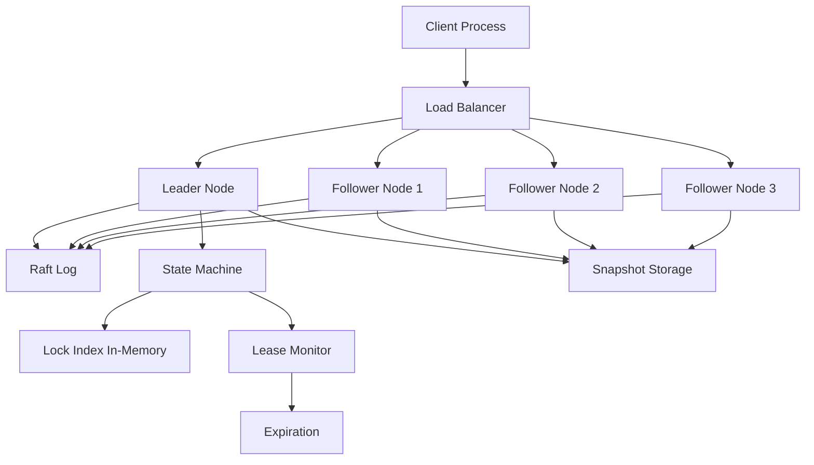

# Distributed Lock Service

**Category:** System Design
**Difficulty:** 🔴 Hard
**Seniority:** Senior
**Companies:** Google, ZooKeeper
**Tags:** consensus, leader election, fencing tokens
**Time:** 90-120 min

---

## Problem Statement

Design a distributed lock service (like Chubby, ZooKeeper, or etcd) that provides mutual exclusion across a cluster of processes. Clients must be able to acquire locks, release locks, and handle failures (crashed clients holding locks). The service must prevent split-brain scenarios where multiple clients believe they hold the same lock, and should support leader election for distributed systems.

The interviewer expects you to reason about consensus algorithms (Paxos/Raft), lease mechanisms, fencing tokens for safety, handling network partitions, and the trade-offs between consistency and availability.

## Clarifying Questions

- What is the scale? *10K locks active simultaneously, 100K lock operations/sec.*
- What are the lock semantics? *Exclusive locks (mutex) in v1; read-write locks later.*
- What's the lock duration? *Short-lived (milliseconds to seconds) for coordination; some long-lived (minutes).*
- Failure handling? *Auto-expire locks if client crashes or network partition.*
- Do we need re-entrancy? *Same client can re-acquire its own lock.*
- Do we need lock hierarchy/transactions? *No in v1; simple acquire/release.*
- What's the consistency model? *Strong consistency; no two clients can hold the same lock.*
- Latency requirements? *p99 < 50 ms for lock acquisition.*

## Requirements

### Functional

- `acquire(lock_name, client_id, ttl)` - acquire lock with time-to-live.
- `release(lock_name, client_id, fencing_token)` - release lock with verification.
- `renew(lock_name, client_id, fencing_token)` - extend lock TTL.
- Leader election using lock primitives (first to acquire becomes leader).
- Watch/notification when lock is released (for waiting clients).

### Non-Functional

- Safety: at most one client holds a lock at any time (no split-brain).
- Liveness: lock acquisition eventually succeeds under normal conditions.
- Availability: system remains available during minority node failures.
- Fault tolerance: tolerate F node failures in a 2F+1 cluster.
- Low latency: p99 < 50 ms for operations within a datacenter.
- Scalability: horizontal scaling via sharding for lock namespaces.

### Out of Scope

- Distributed transactions across multiple locks.
- Read-write locks (upgrade/downgrade).
- Lock transfer between clients.

## Capacity Estimation

| Metric | Arithmetic | Result |
|---|---|---|
| Active locks | given | 10K |
| Operations/sec | given | 100K ops/s |
| Lock state size | ~100 B per lock (name, owner, token, expiry) | ~1 MB active |
| Raft log entries | 100K ops/s × 200 B | ~20 MB/s log |
| Log retention | 1 GB per node for replay | ~5 min at peak |
| Cluster size | 2F+1 for F=2 | 5 nodes |
| Cross-DC latency | 50-100 ms | impacts leader election |

Operations are the primary constraint; a 5-node Raft cluster can handle 100K ops/s with proper batching and pipelining.

## API Design

```text
// Lock operations
rpc AcquireLock(AcquireRequest {
  string lock_name;
  string client_id;
  int32 ttl_ms;           // auto-expire if not renewed
  bool wait;              // block until acquired or timeout
  int32 timeout_ms;
}) returns (AcquireResponse {
  bool acquired;
  int64 fencing_token;    // monotonically increasing per lock
  int64 lease_expiry_ms;
})

rpc ReleaseLock(ReleaseRequest {
  string lock_name;
  string client_id;
  int64 fencing_token;    // must match current owner
}) returns (ReleaseResponse {
  bool released;
})

rpc RenewLock(RenewRequest {
  string lock_name;
  string client_id;
  int64 fencing_token;
  int32 ttl_ms;
}) returns (RenewResponse {
  bool renewed;
  int64 new_lease_expiry_ms;
})

// Watch for lock availability
rpc WatchLock(WatchRequest {
  string lock_name;
}) returns (stream WatchEvent {
  string lock_name;
  string owner_id;
  int64 fencing_token;
})

// Leader election helper
rpc ElectLeader(ElectionRequest {
  string election_name;   // e.g., "/leader/db-shard-1"
  string candidate_id;
}) returns (stream LeaderEvent {
  string leader_id;
  bool is_leader;
})
```

## Data Model

**Lock State (stored in Raft log):**

```text
lock_state {
  lock_name: string;
  owner_id: string;
  fencing_token: int64;    // increments on each acquisition
  lease_expiry_ms: int64;
  version: int64;          // for optimistic concurrency
}

// In-memory index for fast lookups
lock_index: map<lock_name, lock_state>
```

**Raft Log Entry:**

```text
log_entry {
  index: int64;
  term: int64;
  command: enum(ACQUIRE, RELEASE, RENEW);
  lock_name: string;
  client_id: string;
  fencing_token: int64;
  ttl_ms: int32;
}
```

**Fencing Token Generation:**

```text
// Per-lock monotonically increasing token
// Stored as part of lock state, persisted via Raft
// Token = previous_token + 1 on each successful acquire
```

## High-Level Design



**Lock acquisition flow:**

1. Client sends `AcquireLock` to any node (load-balanced).
2. If node is follower, forwards to leader via Raft consensus.
3. Leader proposes `ACQUIRE` command to Raft log.
4. Once committed (majority acknowledgement), leader applies to state machine.
5. State machine checks if lock is available or expired.
6. If available: assigns new fencing token, sets owner, returns success.
7. If held: returns failure (or blocks if wait=true).
8. Lease monitor tracks expirations; expired locks are auto-released.

**Fencing token flow:**

1. Each lock maintains a monotonically increasing fencing token.
2. Token increments on every successful acquisition.
3. Client must provide fencing token for release/renew operations.
4. Downstream services (e.g., database) can use fencing token to reject stale operations.

## Deep Dives

### Raft consensus implementation

The lock service uses Raft for strong consistency across the cluster:

```text
// Leader receives AcquireLock request
FUNCTION handleAcquire(lockName, clientId, ttl):
  SET entry ← {
    command: ACQUIRE,
    lock_name: lockName,
    client_id: clientId,
    ttl_ms: ttl
  }
  SET result ← raft.propose(entry)  // blocks until committed
  RETURN result

// Raft propose
FUNCTION propose(entry):
  entry.index = log.lastIndex + 1
  entry.term = currentTerm
  log.append(entry)
  FOR each follower:
    send(AppendEntries{term, leaderId, prevLogIndex, prevLogTerm, entries[], commitIndex})
  WAIT until entry.index <= commitIndex
  RETURN entry

// On commit, apply to state machine
FUNCTION apply(entry):
  IF entry.command == ACQUIRE:
    SET lock ← stateMachine.locks[entry.lock_name]
    IF lock IS NULL OR lock.lease_expiry < now():
      SET newToken ← (lock?.fencing_token ?? 0) + 1
      stateMachine.locks[entry.lock_name] ← {
        owner_id: entry.client_id,
        fencing_token: newToken,
        lease_expiry: now() + entry.ttl_ms
      }
      RETURN {acquired: true, fencing_token: newToken}
    ELSE:
      RETURN {acquired: false}
```

**Leader election:**
- Followers start election if no heartbeat within election timeout.
- Candidate requests votes; votes granted if candidate's log is at least as up-to-date.
- First to majority becomes leader; steps down if discovers higher term.

### Lease mechanism and expiration

To prevent deadlocks from crashed clients:

```text
// Lease monitor runs on leader
FUNCTION monitorLeases():
  WHILE true:
    FOR each lock IN stateMachine.locks:
      IF lock.lease_expiry < now():
        propose(EXPIRE, lock.lock_name)
    SLEEP(100 ms)

// Expire command
FUNCTION applyExpire(lockName):
  DELETE stateMachine.locks[lockName]
  NOTIFY watchers(lockName)
```

**Client-side renewal:**
- Clients must renew locks before TTL expires (e.g., at TTL/2).
- Use background thread with jitter to avoid thundering herd.
- If renewal fails, client assumes lock lost and aborts operations.

### Fencing tokens for safety

Fencing tokens prevent split-brain in downstream systems:

```text
// Scenario: Client A holds lock with token=100, network partition occurs
// Client B acquires lock with token=101 after A's lease expires
// Client A reconnects and tries to write to storage with token=100
// Storage rejects because token=100 < current token=101

// Storage service checks fencing token
FUNCTION storageWrite(key, value, fencingToken):
  SET currentToken ← metadataStore.get(key).fencingToken
  IF fencingToken < currentToken:
    THROW StaleClientError("fencing token expired")
  metadataStore.put(key, {value, fencingToken: fencingToken})
```

This pattern is used by HDFS NameNode, distributed databases, and file systems.

### Handling network partitions

Raft provides safety during partitions but affects availability:

```text
// Partition scenario: 3 nodes, leader + 1 follower in majority, 1 follower minority
// Majority partition continues serving (leader elected if needed)
// Minority partition cannot commit writes (no majority)

// Client behavior with retries
FUNCTION acquireWithRetry(lockName, clientId, ttl, maxRetries):
  FOR i FROM 1 TO maxRetries:
    TRY:
      RETURN acquire(lockName, clientId, ttl)
    CATCH NotLeaderError:
      UPDATE leader hint from response
    CATCH TimeoutError:
      IF i == maxRetries: THROW
      SLEEP(backoff(i))
  THROW UnavailableError
```

**Trade-off:** During partitions, clients in minority partition are unavailable. This is acceptable for lock service (CP in CAP).

### Sharding for scalability

For higher throughput, shard locks across multiple Raft groups:

```text
// Hash-based sharding
FUNCTION getShard(lockName):
  SET shardId ← hash(lockName) % numShards
  RETURN raftGroups[shardId]

// Each shard is independent Raft cluster (5 nodes)
// Hot locks can be manually moved to dedicated shards
```

Sharding adds complexity (cross-shard operations not atomic) but enables horizontal scaling.

## Scaling & Reliability

- **Horizontal scaling:** Shard locks across multiple Raft groups for higher throughput.
- **Fault tolerance:** 2F+1 cluster tolerates F failures; automatic leader election.
- **Backpressure:** Client-side backoff on retries; rate limiting per client.
- **Snapshotting:** Periodic snapshots to disk; compact Raft log to prevent unbounded growth.
- **Monitoring:** Leader election frequency, commit latency, lock contention, lease expiration rate.
- **Cross-DC deployment:** Multi-region Raft with higher latency; or per-region locks with async replication.
- **Security:** mTLS authentication, ACLs per lock namespace, TLS encryption, audit logging.

**Consistency & Availability:**
- Strong consistency via Raft consensus (linearizable operations).
- Available during minority failures; unavailable during majority partitions (CP in CAP).
- Reads from leader ensure fresh state; followers may serve stale reads with lease-based optimization.

## Trade-offs

| Decision | Option A | Option B | Choice & Why |
|---|---|---|---|
| Consensus algorithm | Raft | Paxos | Raft — easier to understand and implement; equivalent safety properties. |
| Lease mechanism | Server-side TTL | Client-side heartbeat | Server-side TTL — simpler, no client dependency; heartbeat allows faster detection. |
| Fencing tokens | Per-lock counter | Global counter | Per-lock — simpler, no single point; global prevents cross-lock correlation issues. |
| Read optimization | Read from leader | Lease-based reads from followers | Leader-only — simpler; lease-based reads add complexity for minor latency gain. |
| Sharding | Single cluster | Multiple Raft groups | Single cluster for v1; shard if throughput exceeds 100K ops/s. |

## Follow-up Questions

1. **How would you implement read-write locks?** Add reader count to lock state; multiple readers allowed if no writer; writer waits for readers to drain. Use separate read/write fencing tokens.
2. **How do you handle clock skew for lease expiration?** Use monotonic clocks; add safety margin to TTL; clients renew well before expiration.
3. **How would you add lock transfer between clients?** Implement transfer command that atomically changes owner with fencing token increment; both clients must cooperate.
4. **How do you prevent herd effect when a popular lock is released?** Use fair queue (FIFO) for waiting clients; notify only the next waiter instead of broadcast.
5. **How would you deploy this across multiple datacenters?** Use multi-primary Raft with cross-DC replication; higher latency but global consistency; or per-DC locks with async replication for eventual consistency.

## Common Mistakes

- Using simple TTL without fencing tokens, allowing split-brain in downstream systems.
- Forgetting to handle network partitions, leading to multiple leaders.
- Assuming clients are well-behaved and always release locks (need auto-expiration).
- Using client-generated timestamps for ordering (clock skew issues).
- Not considering the thundering herd problem when a lock becomes available.
- Implementing locks in a single-node database (no fault tolerance).

## Key Takeaways

- Raft consensus provides strong consistency and fault tolerance for distributed locks.
- Leases with auto-expiration prevent deadlocks from crashed clients.
- Fencing tokens are critical for safety in downstream systems; they reject stale operations.
- Network partitions affect availability (CP system); clients must handle unavailability gracefully.
- Sharding across multiple Raft groups enables horizontal scaling for high throughput.
- Leader election can be built on top of lock primitives (first to acquire lock becomes leader).
- Monitor lease expiration, Raft leadership changes, and client retry patterns for operational health.
