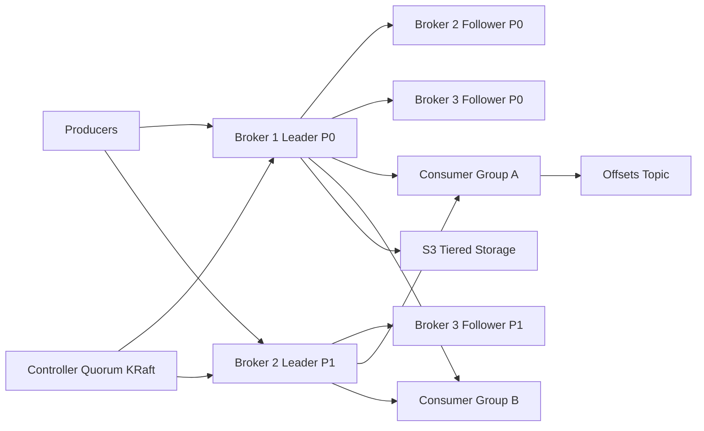

# Distributed Message Queue

**Category:** System Design
**Difficulty:** 🔴 Hard
**Seniority:** staff
**Companies:** LinkedIn, Amazon, Confluent, Uber, Netflix, Microsoft, Google
**Tags:** pub-sub, append-only-log, partitioning, replication, delivery-semantics, consumer-groups, durability
**Time:** 60 min

---

## Problem Statement

Design a distributed message queue / event streaming platform (like Apache Kafka, Amazon Kinesis, or Pulsar). Producers publish messages to named topics; consumers read them independently, at their own pace, with configurable delivery guarantees.

The interviewer expects a design that handles millions of messages per second, retains data for days, preserves ordering within a partition, survives broker failures without losing acknowledged messages, and supports many independent consumer groups replaying the same data.

## Clarifying Questions

- Queue semantics or log semantics? *Log: messages persist after consumption for the retention period and can be replayed.*
- Message size? *Typically 1 KB, max 1 MB.*
- Throughput? *Peak 2M messages/s in, 3x fan-out to consumers.*
- Ordering? *Ordered within a partition (per key), not globally.*
- Delivery guarantee? *At-least-once by default; exactly-once as a configurable option.*
- Retention? *7 days by default, configurable per topic; compacted topics for keyed state.*
- Latency? *p99 end-to-end < 100 ms.*
- Multi-tenant? *Yes, many teams share clusters; quotas needed.*

## Requirements

### Functional

- Create topics with N partitions and replication factor.
- Producers publish messages (optionally keyed) to topics.
- Consumers subscribe via consumer groups; each partition consumed by one member per group.
- Consumers commit offsets and can rewind/replay.
- Retention by time/size and log compaction by key.

### Non-Functional

- Throughput: 2M msg/s in (~2 GB/s), 6 GB/s out.
- Durability: no loss of acknowledged messages with `acks=all` when up to RF-1 replicas fail.
- Availability: 99.99%; leader failover in seconds.
- Ordering within partition; at-least-once or exactly-once semantics.
- Horizontal scalability by adding brokers and partitions.

### Out of Scope

- Complex routing (AMQP exchanges), per-message priorities, delayed delivery (discussed as follow-ups).

## Capacity Estimation

| Metric | Arithmetic | Result |
|---|---|---|
| Ingress | 2M msg/s x 1 KB | ~2 GB/s |
| Replication traffic | 2 GB/s x (RF 3 - 1) | ~4 GB/s inter-broker |
| Egress | 3 consumer groups x 2 GB/s | ~6 GB/s |
| Daily storage | 2 GB/s x 86,400 | ~173 TB/day raw |
| 7-day retention with RF 3 | 173 TB x 7 x 3 | ~3.6 PB (~1.2 PB with 3x compression) |
| Per broker | ~100 MB/s sustained in, 12 x 4 TB disks | ~20 brokers by throughput; ~100 by storage — or tiered storage |
| Partitions | target ~10 MB/s per partition | ~200-400 partitions for the busiest topics |

Storage dominates; tiered storage (old segments offloaded to S3) cuts broker disk needs by ~80%.

## API Design

```text
// Producer
rpc Produce(ProduceRequest{
      topic, partition?, key?, records[], acks: 0|1|all,
      producerId, epoch, baseSequence })        // for idempotence
    returns ProduceResponse{ partition, baseOffset, error }

// Consumer
rpc Fetch(FetchRequest{ topic, partition, offset, maxBytes, maxWaitMs })
    returns FetchResponse{ records[], highWatermark }

rpc CommitOffset(group, topic, partition, offset, metadata)
rpc JoinGroup(group, memberId, subscriptions) returns (generation, assignment)
rpc Heartbeat(group, memberId, generation)

// Admin (REST)
POST /v1/topics   { "name": "orders", "partitions": 64, "replicationFactor": 3,
                    "retentionMs": 604800000, "cleanupPolicy": "delete" }
GET  /v1/topics/orders/partitions   -> leader, ISR, offsets per partition
```

## Data Model

**On-disk partition log (per broker, per partition replica):**

```text
/data/orders-17/
    00000000000000000000.log        // segment: append-only record batches
    00000000000000000000.index      // sparse offset -> file position
    00000000000000000000.timeindex  // timestamp -> offset
    00000000000052428800.log        // next segment, rolled at 1 GB or 1 h

record batch
    baseOffset, producerId, epoch, baseSequence, crc,
    compression (lz4/zstd), records[ {offsetDelta, timestamp, key, value, headers} ]
```

Partition is the unit of ordering, parallelism, and replication. Key -> partition: `murmur2(key) mod partitions`.

**Cluster metadata — Raft-based controller quorum (KRaft) or ZooKeeper:** topics, partition assignment, leader, ISR (in-sync replicas), leader epoch, broker liveness.

**Consumer offsets — internal compacted topic** `__consumer_offsets`, keyed by `(group, topic, partition)`, so offset storage scales with the log itself.

## High-Level Design



**Produce path:**

1. Producer fetches metadata (partition leaders) and batches records per partition (`linger.ms` 5 ms, `batch.size` 64-256 KB, zstd compression).
2. It sends the batch to the partition leader, which appends to the active segment (page cache write, sequential I/O).
3. Followers fetch from the leader continuously; once all ISR members have the batch, the high watermark advances.
4. With `acks=all`, the leader responds only after ISR replication; `min.insync.replicas=2` prevents acknowledging when only the leader is alive.

**Consume path:**

1. Consumers join a group; the group coordinator assigns partitions (range/sticky/cooperative).
2. Each consumer long-polls `Fetch` from its partition leaders (or nearest follower for rack-aware reads) starting at its committed offset.
3. Brokers serve data via zero-copy `sendfile` from page cache — the hottest data is usually still in memory.
4. Consumers process and commit offsets to `__consumer_offsets` (after processing for at-least-once).
5. Only records below the high watermark are visible, so consumers never read data that could be lost on failover.

## Deep Dives

### Why an append-only log is fast

- Sequential disk writes achieve hundreds of MB/s even on HDDs; random writes do not.
- Relying on the OS page cache avoids double-buffering in the JVM heap.
- Zero-copy (`sendfile`) moves bytes from page cache to socket without user-space copies.
- Batching + compression amortizes per-message overhead: ~1 KB messages in 256 KB batches.
- Consumers track their own offset — the broker keeps no per-message ack state, unlike traditional queues (RabbitMQ), which is what enables massive fan-out and replay.

### Replication, ISR, and leader election

Each partition has a leader and RF-1 followers. The ISR is the set of replicas caught up within `replica.lag.time.max.ms` (~30 s).

```text
FUNCTION onFollowerFetch(follower, fetchOffset):
    IF fetchOffset >= leader.logEndOffset:
        SET follower.lastCaughtUp ← now()
    SET hw ← min(r.fetchOffset FOR r IN ISR)
    IF hw > partition.highWatermark:
        SET partition.highWatermark ← hw
        completePendingProduces(upTo = hw)        // acks=all requests

FUNCTION shrinkIsrPeriodically():
    FOR r IN ISR:
        IF now() - r.lastCaughtUp > LAG_MAX: ISR.remove(r)

FUNCTION onLeaderFailure(partition):              // run by controller
    SET candidate ← first live replica IN partition.ISR
    IF candidate EXISTS:
        electLeader(candidate); partition.leaderEpoch += 1
    ELSE IF uncleanElectionEnabled:
        electLeader(any live replica)             // possible data loss
    ELSE:
        markOffline(partition)                    // prefer consistency
```

Leader epochs let a returning old leader truncate its log to the point of divergence, preventing split-brain histories.

### Delivery semantics and exactly-once

- **At-most-once:** commit offset before processing.
- **At-least-once:** process, then commit; duplicates possible after crashes — consumers should be idempotent.
- **Idempotent producer:** broker deduplicates retries using `(producerId, epoch, sequence)` per partition.
- **Transactions (exactly-once within the platform):** a transaction coordinator writes commit/abort markers atomically across partitions, including the consumer offset commit. Consumers with `isolation.level=read_committed` skip aborted data. This gives exactly-once for read-process-write pipelines (Kafka Streams, Flink); side effects to external systems still need idempotency keys or the outbox pattern.

### Consumer groups and rebalancing

Partitions are the max parallelism per group: 64 partitions -> at most 64 active consumers. Eager rebalancing (stop-the-world) pauses all consumers; cooperative incremental rebalancing moves only the partitions that need to change. Static membership (`group.instance.id`) avoids rebalances on rolling restarts. Lag (`logEndOffset - committedOffset`) is the key autoscaling signal.

## Scaling & Reliability

- **Scale-out:** add brokers and reassign partitions (throttled data movement); add partitions for throughput, noting that it changes key -> partition mapping.
- **Tiered storage:** keep ~1 day on local NVMe, older segments on S3; brokers become lighter and recover faster.
- **Rack awareness:** spread replicas over 3 AZs; with `min.insync.replicas=2`, one AZ loss keeps partitions writable.
- **Multi-region:** MirrorMaker 2 / Cluster Linking for async DR replication with offset translation.
- **Quotas:** per-client produce/fetch byte-rate quotas protect multi-tenant clusters.
- **Failure handling:** controller detects broker loss via heartbeats (~6-10 s), elects new leaders from ISR; clients refresh metadata and retry.
- **Monitoring:** under-replicated partitions, offline partitions, ISR shrink rate, request latency p99, consumer lag, disk usage, controller health.

## Trade-offs

| Decision | Option A | Option B | Choice & Why |
|---|---|---|---|
| Storage model | Per-message ack queue (RabbitMQ/SQS) | Append-only log with offsets | Log — cheap fan-out, replay, and very high throughput. |
| Replication ack | `acks=1` | `acks=all` with min ISR 2 | `acks=all` for durability-critical topics; `acks=1` for metrics/logs where latency matters more. |
| Metadata | ZooKeeper | Built-in Raft controller (KRaft) | KRaft — one system to operate, faster failover, millions of partitions. |
| Ordering | Global ordering | Per-partition ordering | Per-partition — global ordering forces a single partition and kills throughput. |
| Unclean leader election | Enabled (availability) | Disabled (consistency) | Disabled by default — never silently lose acknowledged writes. |
| Retention | Broker local disks only | Tiered storage to S3 | Tiered — long retention at object-storage prices. |

## Follow-up Questions

1. **How would you implement delayed or scheduled messages?** Use per-delay-level topics or a timer service (hierarchical timing wheel) that holds messages and republishes when due.
2. **How do you handle poison messages?** After N retries, route to a dead-letter topic with error metadata and alert; continue processing the partition.
3. **How would you support per-message acks like SQS?** Add a visibility-timeout layer tracking in-flight messages per consumer (Pulsar shared subscriptions), at the cost of more broker state.
4. **What happens if a consumer is slower than producers?** Lag grows; scale consumers up to partition count, increase partitions, or apply backpressure — data is safe until retention expires.
5. **How do you guarantee ordering when retries happen?** Idempotent producer with `max.in.flight.requests <= 5` keeps per-partition order because the broker rejects out-of-sequence batches.

## Common Mistakes

- Designing a broker that tracks acks per message per consumer — kills fan-out scale.
- Promising global ordering and high throughput at the same time.
- Advancing visible offsets before replication (consumers read data later lost).
- Ignoring the "exactly-once" boundary — it does not extend to arbitrary external side effects.
- Forgetting consumer group rebalancing and the partition count limit on parallelism.
- Not sizing storage for retention x replication factor.

## Key Takeaways

- The partitioned, replicated, append-only log is the core abstraction: ordering, parallelism, and replication are all per partition.
- Sequential I/O, page cache, zero-copy, and batching explain the throughput.
- ISR + high watermark + leader epochs deliver durability without per-message consensus.
- Delivery semantics come from where offsets are committed plus idempotent producers and transactions.
- Tiered storage and quotas make long retention and multi-tenancy practical.
