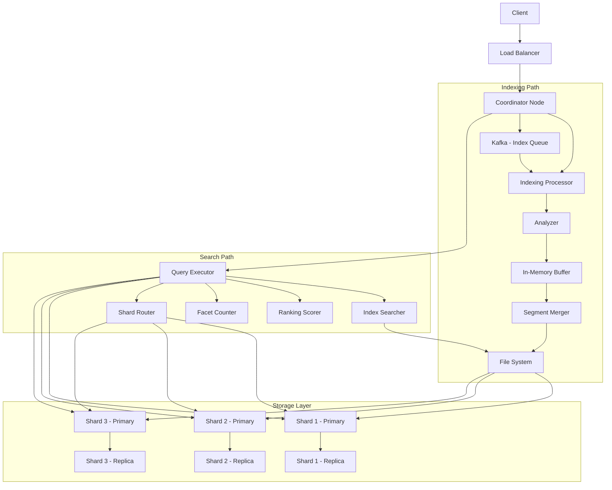

# Distributed Search Engine

**Category:** System Design
**Difficulty:** 🔴 Hard
**Seniority:** senior
**Companies:** Elasticsearch, Algolia
**Tags:** inverted index, sharding, ranking
**Time:** 90-120 min

---

## Problem Statement

Design a distributed search engine like Elasticsearch or Algolia. The system must index billions of documents, support full-text search with relevance ranking, handle high query throughput (thousands of queries per second), and provide near real-time indexing (documents searchable within seconds). The search engine should support filtering, faceting, pagination, and be horizontally scalable.

The interviewer expects you to design the inverted index structure, document indexing pipeline, query execution engine, sharding strategy, and ranking algorithm. Focus on scalability, performance, and the trade-offs between indexing speed and query latency.

## Clarifying Questions

- How many documents? *10B documents, average 5 KB each.*
- Query rate? *10K QPS average, 50K QPS peak.*
- Indexing rate? *100K documents/second average.*
- Query types? *Full-text search, exact match, range queries, filters, faceting.*
- Freshness requirements? *Documents searchable within 1-5 seconds.*
- Ranking requirements? *Relevance scoring (TF-IDF, BM25), custom ranking fields.*
- Document updates? *High update rate (10% of documents updated daily).*
- Geographic distribution? *Global users, need low query latency worldwide.*

## Requirements

### Functional

- Index documents with text and structured fields.
- Full-text search with relevance ranking.
- Filter by field values (exact match, range).
- Faceted search (count by category, date ranges).
- Pagination (cursor-based for stability).
- Update and delete documents.
- Bulk indexing operations.
- Multi-language support (basic).

### Non-Functional

- Query latency p99 < 100 ms.
- Indexing latency p99 < 5 seconds.
- High availability (99.9% uptime).
- Horizontal scalability to 100+ nodes.
- Near real-time: documents searchable within seconds.
- Consistency: eventual consistency acceptable for search results.

### Out of Scope

- Natural language processing, spell correction, autocomplete, analytics dashboards.

## System Architecture



**Indexing path:**

1. Client sends document to Coordinator Node.
2. Coordinator determines target shard based on document ID or routing key.
3. Document sent to primary shard.
4. Analyzer tokenizes text, applies filters (lowercase, stem, stop words).
5. Inverted index entries written to in-memory buffer.
6. Buffer periodically flushed to disk as immutable segment (every 1-5 seconds).
7. Background merge process combines small segments into larger ones.
8. Replication: segment copied to replica shards.

**Search path:**

1. Client sends search query to Coordinator.
2. Query parsed and analyzed (same pipeline as indexing).
3. Coordinator fans out to all relevant shards (primary or replicas).
4. Each shard executes query locally:
   - Look up term postings in inverted index.
   - Apply filters using doc values.
   - Calculate relevance scores (BM25).
   - Collect top K results per shard.
5. Coordinator merges results from all shards:
   - Re-rank and sort by score.
   - Apply pagination.
   - Calculate facets.
6. Return results to client.

## Data Model

```text
// Document structure (stored)
{
  "_id": "doc_123",
  "_source": {
    "title": "Product Name",
    "content": "Full text content...",
    "category": "tech",
    "price": 99.99,
    "timestamp": "2024-01-15T10:30:00Z"
  },
  "_version": 1
}

// Inverted index (in-memory + on-disk)
term → [posting_list]
  "search" → [
    { doc_id: 1, positions: [5, 20], tf: 2 },
    { doc_id: 5, positions: [10], tf: 1 },
    { doc_id: 100, positions: [3, 15, 30], tf: 3 }
  ]

// Stored fields (for retrieval)
doc_id → _source (compressed)

// Doc values (for sorting, faceting)
field → [value per doc_id]
  "category" → [doc_1: "tech", doc_2: "news", ...]
  "price" → [doc_1: 99.99, doc_2: 49.99, ...]

// Segment metadata
segment_id → {
  document_count: 1000000,
  size_bytes: 52428800,
  terms_dictionary: "...",
  postings_file: "...",
  stored_fields_file: "...",
  doc_values_file: "..."
}

// Index metadata
index_id → {
  primary_shards: 10,
  replica_shards: 20,
  routing_key: "user_id",
  mappings: {...}
}
```

## API Design

```text
// Indexing operations
POST /v1/indexes/{index}/documents
  Body: { "id": "doc_123", "title": "...", "content": "...",
          "category": "tech", "price": 99.99, "timestamp": "..." }
  201 → { "document_id", "indexed_at" }

POST /v1/indexes/{index}/documents/_bulk
  Body: [
    { "index": { "_id": "doc_123" } },
    { "title": "...", "content": "..." },
    { "index": { "_id": "doc_456" } },
    { "title": "...", "content": "..." }
  ]
  200 → { "indexed": 2, "errors": 0 }

PUT /v1/indexes/{index}/documents/{id}
  Body: { "title": "updated title", ... }
  200 → { "document_id", "version": 2 }

DELETE /v1/indexes/{index}/documents/{id}
  200 → { "deleted": true }

// Search operations
POST /v1/indexes/{index}/search
  Body: {
    "query": "search terms",
    "filters": { "category": "tech", "price": { "gte": 50, "lte": 200 } },
    "facets": ["category", "price_range"],
    "sort": [{ "field": "timestamp", "order": "desc" }],
    "size": 20,
    "cursor": "<opaque>"
  }
  200 → {
    "hits": [
      { "document_id", "score", "highlight": { "title": "..." },
        "_source": { "title", "content", ... } }
    ],
    "total": 12345,
    "facets": { "category": { "tech": 5000, "news": 3000 } },
    "next_cursor": "..."
  }

GET /v1/indexes/{index}/documents/{id}
  200 → { "document_id", "_source": {...} }

// Index management
PUT /v1/indexes/{index}
  Body: { "mappings": { "properties": { ... } } }
  200 → { "acknowledged": true }

DELETE /v1/indexes/{index}
  200 → { "acknowledged": true }
```

## Scalability

- **Sharding strategy:**
  - Hash-based sharding by document ID.
  - Custom routing for data locality.
  - Re-sharding with split/merge for load balancing.

- **Replication:**
  - Primary-replica model.
  - RF=2 or RF=3 for durability.
  - Replica placement across racks/AZs.

- **Caching:**
  - Query cache: cache results for identical queries.
  - Field data cache: cache doc values in memory.
  - File system cache: OS page cache for segments.
  - Request cache: cache pagination results.

- **Load balancing:**
  - Query: round-robin across replicas.
  - Index: all writes to primary.
  - Coordinator nodes for query fanout.

- **Failure handling:**
  - Node failure: promote replica to primary.
  - Segment corruption: recover from replica.
  - Split brain: quorum-based primary election.

- **Monitoring:**
  - Query latency (p50, p95, p99).
  - Indexing latency (time to searchable).
  - Segment merge progress.
  - Cache hit rates.
  - JVM heap usage, GC pauses.

## Consistency & Availability

- **Consistency model:**
  - Eventual consistency for search results (documents appear within refresh interval).
  - Strong consistency for document retrieval by ID.
  - Read-your-writes achievable via refresh tuning.

- **Availability strategies:**
  - Replica shards for query load balancing.
  - Automatic failover: promote replica to primary on failure.
  - Multi-region deployment with cross-region replication.
  - Graceful degradation: serve stale results if index unavailable.

- **Data consistency:**
  - Primary shard handles all writes.
  - Write-ahead translog for durability.
  - In-sync replicas for acknowledged writes.
  - Version-based optimistic concurrency control.

- **Index consistency:**
  - Immutable segments ensure consistent reads.
  - Translog replay for crash recovery.
  - Segment merge cleans up deleted documents.
  - Cluster state consensus for metadata.

## Security

- **Authentication:**
  - API keys or JWT tokens for access.
  - Role-based access control (RBAC).
  - Service-to-service authentication (mTLS).
  - Multi-tenant isolation with tenant-specific credentials.

- **Authorization:**
  - Index-level permissions (read, write, admin).
  - Document-level security (row-level security).
  - Field-level security (mask sensitive fields).
  - Audit logging for all operations.

- **Data protection:**
  - Encryption at rest (disk encryption).
  - Encryption in transit (TLS 1.3).
  - Secure key management (KMS).
  - PII data redaction in logs.

- **Network security:**
  - VPC isolation for cluster nodes.
  - Security groups with whitelisted IPs.
  - DDoS protection at edge.
  - Rate limiting per API key.

- **Compliance:**
  - GDPR compliance with right to deletion.
  - Data retention policies.
  - Regional data residency controls.
  - Audit trail for regulatory requirements.

## Trade-offs

| Decision | Option A | Option B | Choice & Why |
|---|---|---|
| Sharding | Hash-based | Range-based | Hash: even distribution, no hotspots |
| Refresh interval | 1 second | 5 seconds | 1 second: NRT requirement; configurable per use case |
| Segment size | 5 MB | 50 MB | 5-50 MB: balance merge overhead vs file count |
| Replication | Sync | Async | Sync for durability; async for performance (tunable) |
| Scoring | BM25 | Learning to rank | BM25: baseline; ML ranking as extension |
| Compression | None | LZ4 | LZ4: good compression, fast decompression |

## Follow-up Questions

1. **How do you handle index updates?** Use document versioning. Updates mark old document as deleted, add new version. Merge process cleans up deleted documents.
2. **How do you support autocomplete?** Use n-gram index or edge n-gram tokenizer. Separate index for suggestions with higher refresh rate.
3. **How do you handle multi-tenant search?** Separate index per tenant or single index with tenant filter. Routing by tenant ID for isolation.
4. **How do you implement spell correction?** Use edit distance, phonetic matching, or query expansion based on term frequency.
5. **How do you handle large result sets?** Cursor-based pagination (scroll API). Deep pagination with search_after for efficiency.
6. **How do you optimize for mobile search?** Smaller result sets, simplified ranking, cached common queries, edge deployment.

## Common Mistakes

- Ignoring segment merge overhead (causes performance degradation).
- Too many small shards (overhead, poor performance).
- No caching strategy (high latency for repeated queries).
- Synchronous replication (hurting indexing throughput).
- Ignoring doc values for faceting (slow aggregations).
- Not considering index refresh interval (NRT vs throughput trade-off).
- Poor shard sizing (too large or too small).

## Key Takeaways

- Inverted index with postings list is the core data structure for full-text search.
- Segments (immutable) enable efficient indexing without locking.
- BM25 is the standard relevance scoring algorithm.
- Sharding by document hash provides even distribution.
- Primary-replica model separates write and read scaling.
- Near real-time achieved via frequent refresh (in-memory segments).
- Doc values enable efficient filtering, sorting, and faceting.
- Segment merging is critical for long-term performance.
- Caching at multiple levels (query, field data, file system) is essential.
- Trade-off between indexing latency and throughput via refresh interval.
