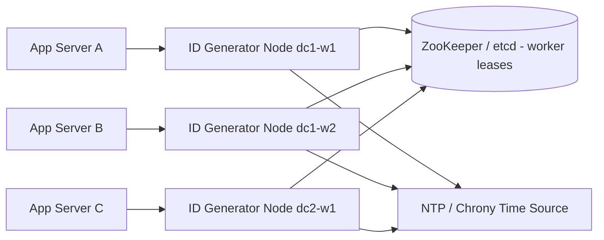

# Distributed Unique ID Generator

**Category:** System Design
**Difficulty:** 🟢 Easy
**Seniority:** mid
**Companies:** Twitter, Instagram, Discord, Amazon, Uber, Stripe
**Tags:** snowflake, clock-synchronization, sharding, coordination, high-throughput
**Time:** 45 min

---

## Problem Statement

Design a service (or library) that generates globally unique IDs for a distributed system, such as IDs for tweets, orders, or messages, across many data centers and thousands of application servers.

The interviewer specifies that IDs must be numeric, fit in 64 bits, be roughly sortable by creation time, and that the system must generate well over 10,000 IDs per second with no single point of failure.

## Clarifying Questions

- What are the uniqueness requirements? *IDs must be globally unique, never reused.*
- Must IDs be numeric and 64-bit? *Yes, they are stored as BIGINT primary keys.*
- Must IDs be strictly ordered? *No; roughly time-ordered (k-sortable) is fine. Strict global ordering is not required.*
- What throughput? *At least 10K IDs/s per data center at peak, up to millions/s overall.*
- How many data centers and machines? *Up to 32 data centers, up to 32 generator nodes each.*
- Can IDs be predictable/guessable? *Acceptable for internal IDs; public-facing IDs are not security tokens.*
- What latency? *Sub-millisecond; ID generation sits on the write path.*
- How long must the scheme last? *At least 50 years.*

## Requirements

### Functional
- Generate a unique 64-bit numeric ID on request.
- IDs are roughly sortable by creation time.
- Allow extracting the creation timestamp from an ID.

### Non-Functional
- Uniqueness guaranteed even under node failures and restarts.
- Highly available: no central coordinator on the hot path.
- Low latency (< 1 ms) and high throughput (> 4M IDs/s per node theoretical).
- Lasts 50+ years without changing the format.

### Out of Scope
- Cryptographically random tokens (use UUIDv4/CSPRNG for those).
- Strict, gapless sequence numbers (e.g. invoice numbers).

## Capacity Estimation

| Metric | Arithmetic | Result |
|---|---|---|
| Peak demand | Given | ~1M IDs/s across all DCs |
| Per-node capacity (Snowflake) | 4,096 sequence values per ms x 1,000 ms | ~4.1M IDs/s per node |
| Nodes needed | 1M / 4.1M | 1 in theory; run 3+ per DC for HA |
| Timestamp lifetime | 2^41 ms / (1000 x 3600 x 24 x 365) | ~69.7 years |
| Max workers | 2^10 | 1,024 (32 DC x 32 machines) |
| Storage per ID | 64 bits | 8 bytes (vs 16 for UUID) |
| Bandwidth | 1M IDs/s x 8 B | ~8 MB/s (negligible) |

The 64-bit constraint drives the bit allocation; storage and bandwidth are trivial.

## API Design

```text
// As a network service (gRPC)
rpc NextId(NextIdRequest{}) returns (NextIdResponse { int64 id })
rpc NextIds(NextIdsRequest{ int32 count }) returns (NextIdsResponse { repeated int64 ids })   // batch, count <= 4096
rpc Parse(ParseRequest{ int64 id }) returns (ParseResponse { int64 timestamp_ms, int32 datacenter_id, int32 worker_id, int32 sequence })

// As an embedded library (preferred, avoids a network hop)
IdGenerator.init(datacenter_id, worker_id, epoch_ms)
IdGenerator.next() -> int64
```

Batch endpoints amortize RPC overhead for bulk inserts.

## Data Model

The generator itself is stateless apart from configuration; the only persistent state is worker-ID assignment.

```text
64-bit Snowflake layout
  | 1 bit sign (0) | 41 bits timestamp ms since custom epoch | 5 bits datacenter | 5 bits worker | 12 bits sequence |

Worker registry (ZooKeeper / etcd)
  /idgen/workers/{dc_id}/{worker_id}  -> ephemeral node { host, lease_expiry }

Per-node local state (in memory, optional persisted)
  last_timestamp_ms   INT64
  sequence            INT12
```

- **Coordination store:** ZooKeeper or etcd, chosen for linearizable writes and ephemeral nodes/leases, so two live processes never hold the same worker ID.
- Custom epoch (e.g. 2024-01-01) maximizes the 69-year lifetime.
- No sharding needed for the generator; consumers' DBs can shard on the ID (or on its lower bits).

## High-Level Design



**Startup path**
1. A generator node starts and reads its datacenter ID from config.
2. It claims a free worker ID by creating an ephemeral node / lease in ZooKeeper/etcd.
3. It loads `last_timestamp_ms` (if persisted) and refuses to start if the clock is behind it.

**ID generation path (hot path, no coordination)**
1. App server calls `next()` (in-process library or gRPC to a local sidecar).
2. Node reads current time in ms, increments sequence within that ms, composes bits, returns the ID.
3. No network or disk I/O on the hot path: generation is a few hundred nanoseconds.

## Deep Dives

### Approach comparison

- **UUIDv4 (128-bit random):** no coordination, but 128 bits, not sortable, poor B-tree index locality.
- **DB auto-increment with multi-master** (step = N, offset = k, Flickr ticket servers): simple, but DB is on the hot path, hard to add servers, and not time-sortable across servers.
- **Range allocation** (fetch 10K IDs from a DB): fast, but not time-ordered; gaps on crash.
- **Snowflake (chosen):** 64-bit, k-sortable, coordination-free hot path. Cost: dependency on clocks and worker-ID assignment.
- **UUIDv7 / ULID:** time-ordered 128-bit; good choice when 64 bits isn't required.

### Generation algorithm

```text
CLASS SnowflakeGenerator
    SET EPOCH ← 1704067200000            // 2024-01-01 UTC in ms
    SET lastTs ← -1
    SET seq ← 0

    FUNCTION next():
        LOCK mutex
        SET ts ← currentTimeMillis()
        IF ts < lastTs:
            IF lastTs - ts <= 5:
                WAIT until currentTimeMillis() >= lastTs      // small skew, wait it out
                SET ts ← currentTimeMillis()
            ELSE:
                RAISE ClockMovedBackwardsError                // large skew: fail fast, alert
        IF ts == lastTs:
            SET seq ← (seq + 1) AND 0xFFF
            IF seq == 0:                                      // 4096 IDs used this ms
                WAIT until currentTimeMillis() > lastTs
                SET ts ← currentTimeMillis()
        ELSE:
            SET seq ← 0
        SET lastTs ← ts
        UNLOCK mutex
        RETURN ((ts - EPOCH) << 22) OR (dcId << 17) OR (workerId << 12) OR seq
```

A lock-free variant packs `(lastTs, seq)` into one 64-bit atomic and uses compare-and-swap.

### Clock skew and drift

- NTP can step the clock backwards. Mitigations: run chrony in slew mode (adjusts gradually, never steps), wait out small regressions, fail fast and remove the node from rotation for large ones.
- Persist `lastTs` periodically (e.g. every second, writing `now + 1s`) so after a restart with a bad clock the node does not reissue IDs.
- Ordering across nodes is only as good as clock sync (typically within a few ms), hence "roughly" sortable.

### Worker ID assignment

- Static config is error-prone: two hosts configured with the same ID produce duplicates.
- Dynamic leases: on startup, claim the lowest free `/idgen/workers/{dc}/{n}` as an ephemeral znode or etcd lease with TTL (e.g. 10 s, renewed every 3 s).
- If a node loses its lease (network partition), it must stop generating immediately, before the lease can be reassigned. Make the lease TTL longer than the self-fence timeout.
- In Kubernetes, StatefulSet ordinals can be used as worker IDs as a simpler alternative.

## Scaling & Reliability

- **Horizontal scaling:** add workers up to 1,024; if more are needed, rebalance bits (e.g. 8 bits DC / 12 bits worker / 10 bits sequence) before launch, as layout changes are painful later.
- **Embedded library vs service:** embedding removes a network hop and an availability dependency; a sidecar or service centralizes worker-ID management. Many companies embed it.
- **Failure handling:** a dead node simply stops issuing; clients retry on another node. No state to recover besides the lease.
- **Multi-DC:** DC ID bits make cross-region generation independent; no cross-region coordination at all.
- **Monitoring:** clock offset (chrony tracking), clock-backwards events, sequence-exhaustion waits per ms, lease renewal failures, and duplicate-key errors in downstream DBs (should be zero).

## Trade-offs

| Decision | Option A | Option B | Choice & Why |
|---|---|---|---|
| ID format | UUID 128-bit | Snowflake 64-bit | Snowflake: fits BIGINT, time-sortable, smaller indexes |
| Hot-path coordination | Central DB / ticket server | Local generation | Local: no SPOF, sub-microsecond latency |
| Worker ID assignment | Static config | ZooKeeper/etcd leases | Leases: prevents human-error duplicates |
| Clock regression | Wait / block | Fail and alert | Wait for small skew (< 5 ms), fail fast for large |
| Deployment | Separate service | Embedded library | Library for latency; service if many languages need one implementation |

## Follow-up Questions

1. **What if you need more than 4,096 IDs per ms on one node?** Borrow bits from worker ID or timestamp, or run more workers; alternatively spin until the next ms (cap is ~4M/s per node).
2. **How do you avoid leaking business volume through sequential IDs?** Expose an obfuscated public ID (e.g. encrypted with a block cipher or Hashids) while keeping Snowflake internally.
3. **Why does time-ordering matter for databases?** Monotonic-ish keys append to the right side of B-trees, reducing page splits and improving write throughput versus random UUIDs.
4. **How would you handle a leap second?** Use smeared time (Google/AWS leap smear) via NTP so the clock never repeats or jumps.
5. **What happens during a network partition with ZooKeeper?** The partitioned node self-fences after missing renewals; healthy nodes keep generating with their own leases.

## Common Mistakes

- Ignoring clock moving backwards, which silently produces duplicates.
- Putting a central database on every ID request, creating a bottleneck and SPOF.
- Proposing UUIDv4 without acknowledging the 64-bit and sortability requirements.
- Not computing bit-allocation lifetime (41 bits ms ≈ 69 years) and worker capacity.
- Assuming IDs are strictly globally ordered across nodes.
- Hand-assigning worker IDs without a mechanism to prevent duplicates.

## Key Takeaways

- Snowflake splits 64 bits into timestamp, location, and sequence to get uniqueness without coordination.
- The only coordination is assigning worker IDs once, off the hot path.
- Clock correctness is the main risk; handle regressions explicitly.
- Choose bit allocation from requirements (lifetime, nodes, per-ms throughput) and justify it with arithmetic.
