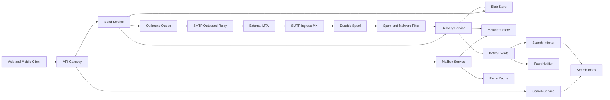

# Email Service

**Category:** System Design
**Difficulty:** 🟡 Medium
**Seniority:** senior
**Companies:** Google, Microsoft, Yahoo, Proton, Amazon, Zoho
**Tags:** smtp, mailbox-storage, full-text-search, blob-storage, spam-filtering, write-heavy
**Time:** 45 min

---

## Problem Statement

Design the backend of a web email service like Gmail or Outlook.com. Users send and receive email to and from any address on the internet, organize messages into threads and labels, search their entire mailbox instantly, and attach files. Inbound mail arrives over SMTP from other mail servers and must pass through spam and malware filtering before landing in a mailbox.

The interviewer hints at consumer scale: over a billion users, mailboxes that grow for a decade and reach tens of gigabytes, and a hard requirement that an accepted email is never lost.

## Clarifying Questions

- Scale? *1B users, 300M daily active; each user receives ~40 emails/day and sends ~5.*
- Mailbox size? *Average 5 GB, quota 15 GB; most bytes are attachments.*
- Protocols? *Web/mobile clients use our HTTP API; IMAP/POP3 are a follow-up. Inbound and outbound with the internet use SMTP.*
- Search? *Full-text search over subject, body, sender, and attachment filenames across the whole mailbox, results in < 500 ms.*
- Attachment limit? *25 MB per message; larger files go via a cloud-drive link.*
- Spam? *Treat the classifier as a pluggable service; design the hook and feedback loop, not the model.*
- Durability? *Once we return SMTP 250 OK, the message must never be lost.*
- Threading and labels? *Yes, Gmail-style: labels instead of folders, conversation threading.*

## Requirements

### Functional

- Receive email from the internet over SMTP; deliver it to recipients' mailboxes.
- Send email to internal and external recipients, with attachments.
- List mailbox by label (Inbox, Sent, custom) with conversation threading, unread counts.
- Mark read/unread, star, apply/remove labels, archive, delete.
- Full-text search across the mailbox.
- Spam and malware filtering with user "report spam / not spam" feedback.

### Non-Functional

- Durability: zero loss after SMTP acceptance (11 nines for stored data).
- Availability 99.99% for reading and sending; inbound SMTP can queue on sender side briefly (SMTP retries for days).
- Inbox list p99 < 200 ms; new mail visible < 5 s after acceptance.
- Strong per-mailbox consistency for state changes (read flags, labels) as seen by the same user.
- Cost-efficient storage: petabytes of mostly cold data.

### Out of Scope

- Calendar, contacts, chat; IMAP server; email client UI.

## Capacity Estimation

| Metric | Arithmetic | Result |
|---|---|---|
| Inbound emails/day | 1B users x 40 | 40B/day, ~460K/s avg, ~1M/s peak |
| Outbound emails/day | 1B x 5 | 5B/day, ~60K/s |
| Avg message size | headers+body ~50 KB, 20% have attachments ~500 KB | ~150 KB avg |
| Daily new storage | 45B x 150 KB | ~6.75 PB/day raw |
| After dedup + compression | attachments dedup ~30%, body compression ~3x | ~3 PB/day |
| Total stored | 1B x 5 GB | ~5 EB logical |
| Metadata per message | ids, labels, flags, snippet ~1 KB | 45B x 1 KB = 45 TB/day |
| Inbox reads | 300M DAU x 20 list calls/day | 6B/day, ~70K QPS avg, ~200K peak |
| Search queries | 300M x 2/day | ~7K QPS avg |

Takeaways: storage dominates, ingest is write-heavy, and most mail is never read after the first week, so tiering is essential.

## API Design

```text
POST   /v1/messages/send
       { to[], cc[], bcc[], subject, bodyHtml, attachmentIds[], inReplyTo? }
       -> 202 { messageId, threadId }

POST   /v1/attachments            (resumable upload, chunked)
       -> 201 { attachmentId, sha256, size }

GET    /v1/threads?label=INBOX&pageToken=...&limit=50
       -> 200 { threads: [{ threadId, subject, snippet, participants, unread, lastTs, labels }], nextPageToken }

GET    /v1/threads/{threadId}
       -> 200 { messages: [{ messageId, from, to, ts, bodyRef, attachments[] }] }

GET    /v1/messages/{messageId}/raw        -> 302 to signed blob URL (RFC 5322 source)

PATCH  /v1/messages/{messageId}
       { addLabels[], removeLabels[], read? }  -> 200

GET    /v1/search?q=from:alice has:attachment invoice&pageToken=...
       -> 200 { messageIds[], threads[], nextPageToken }

GET    /v1/sync?historyId=123456          (incremental changes since historyId)
       -> 200 { changes: [{ type, messageId, labels }], newHistoryId }

Internal: SMTP port 25 inbound (MX), port 587 submission, SMTP outbound relays.
```

The `historyId` sync API lets mobile clients pull only deltas instead of re-listing; push is a WebSocket/FCM nudge "mailbox changed".

## Data Model

**Metadata store — Bigtable / Cassandra (wide-column), partitioned by `user_id`.** All mailbox queries are scoped to one user, so a single partition serves them with sorted range scans.

```text
messages            PK (user_id, message_id)
  thread_id, from, to[], subject, snippet(200 chars), ts, size,
  body_blob_ref, attachment_refs[], spam_score, rfc822_message_id

label_index         PK (user_id, label_id, ts DESC, message_id)   -- inbox listing
threads             PK (user_id, thread_id)  -> message_ids[], last_ts, labels union
label_counts        PK (user_id, label_id)   -> total, unread    (counters)
history             PK (user_id, history_id) -> change record    (sync log, TTL 30 days)
```

**Blob store — S3/GCS-like object store** for message bodies (compressed MIME) and attachments, keyed by content hash `sha256` so identical attachments sent to 10K recipients are stored once (reference-counted).

**Search index — per-user inverted index** (Elasticsearch/Lucene segments or a custom engine), sharded by `user_id`.

**Outbound queue — Kafka** topics for outbound delivery and spam-feedback events.

Why wide-column: billions of rows, append-heavy, simple per-user access patterns, linear horizontal scaling; no cross-user joins needed. A relational DB would struggle with exabyte-scale partitioning.

## High-Level Design



1. **Inbound write path:** an external MTA resolves our MX record and connects to an SMTP ingress node. Ingress performs connection-level checks (IP reputation, rate limits, SPF/DKIM/DMARC), streams the message to a replicated spool (3 replicas across zones), then replies `250 OK`. Durability is guaranteed from here.
2. Spool workers run the spam/malware pipeline, resolve recipients (aliases, groups), and hand to the Delivery Service.
3. Delivery writes the body/attachments to the blob store (content-addressed), then writes metadata rows per recipient (`messages`, `label_index`, `threads`, counters, `history`) and emits a `MessageDelivered` event to Kafka.
4. Consumers: the Search Indexer adds the message to the user's index; the Push Notifier wakes connected clients.
5. **Read path:** client lists `INBOX` -> Mailbox Service reads `label_index` range for the user (top 50 by ts), batches `messages` lookups, with recent pages cached in Redis. Bodies are fetched lazily from blob storage via signed URLs.
6. **Send path:** client uploads attachments first, then calls send. Send Service stores the message in the sender's Sent label, delivers locally for internal recipients (bypassing SMTP), and enqueues external recipients to the outbound queue. Relays sign with DKIM and deliver with retry/backoff.

## Deep Dives

### SMTP Ingest and Never Losing Mail

SMTP gives us a natural contract: the sender keeps retrying (typically up to 5 days) until we return `250`. So we must not return `250` until the message is durably stored.

```text
FUNCTION handleSmtpSession(conn):
    IF ipReputation(conn.ip) is BLOCKED: REPLY 554; CLOSE
    IF rateLimiter.exceeded(conn.ip): REPLY 421 "try later"     // sender retries
    READ MAIL FROM, RCPT TO list
    FOR rcpt IN rcptList:
        IF NOT directory.exists(rcpt): REPLY 550 for rcpt         // reject early, avoid backscatter
    STREAM DATA into buffer (reject if > 35 MB)
    SET authResults ← verify SPF, DKIM, DMARC
    SET spoolId ← spool.writeReplicated(buffer, rcpts, authResults, quorum = 2 of 3)
    IF write failed: REPLY 451 "temporary failure"               // sender retries
    REPLY 250 OK spoolId
```

- Reject unknown recipients during the session (550) rather than accept-then-bounce, which would make us a backscatter spam source.
- The spool is a replicated log (Kafka with `acks=all`, or a custom replicated queue). Downstream processing is idempotent keyed by `spoolId + recipient`, so redelivery after a crash does not create duplicates.

### Mailbox Storage: Metadata vs Blobs and Tiering

- Separate small, hot, mutable **metadata** (labels, flags) from large, immutable **content**. Label changes never rewrite bodies.
- **Attachment dedup:** content hash as the blob key; a newsletter with a 2 MB PDF sent to 1M users stores 2 MB, not 2 TB. Reference counting with a delayed GC sweep handles deletes.
- **Tiering:** bodies < 30 days on SSD-backed hot storage; older move to erasure-coded cold storage (e.g., Reed-Solomon 6+3, 1.5x overhead vs 3x replication). Reads of old mail tolerate 100-200 ms extra.
- **Small-body inlining:** bodies under ~4 KB can be stored inline in the metadata row to avoid a blob round-trip for the common short message.
- **Threading:** assign `thread_id` by `In-Reply-To`/`References` headers, falling back to normalized subject + participants within a time window.

### Per-User Search

A global index across 1B users would be huge and every query would need a `user_id` filter anyway. Instead, index per user:

- Shard the search cluster by `user_id`; each user's documents live on one shard (small users co-located; heavy users get their own segment set).
- Index fields: from, to, subject, body text (HTML stripped), attachment filenames, and extracted text for PDFs/Office docs (async OCR/extraction worker), labels, date.
- Indexing is asynchronous from Kafka; target < 10 s freshness. Recently delivered mail not yet indexed can be merged in by scanning the last few minutes of `label_index`.
- **Cold users:** 70% of users search rarely. Keep their index segments on cheaper storage and load on demand; the first search may take ~1 s, subsequent ones are fast.
- Query operators (`from:`, `has:attachment`, `before:`) map to structured filters; free text goes to BM25 ranking with recency boost.

### Spam Hook and Feedback Loop

```text
FUNCTION classify(msg, authResults):
    SET score ← 0
    IF authResults.dmarc = FAIL AND senderDomain has p=reject: RETURN REJECT
    SET score ← score + reputation.domain(msg.fromDomain) + reputation.ip(msg.ip)
    SET score ← score + mlModel.predict(features(msg))       // body, URLs, headers
    IF urlScanner.anyMalicious(msg.urls) OR avScanner.infected(msg.attachments):
        RETURN QUARANTINE
    IF userRules(msg.recipient).matches(msg): APPLY user filter
    RETURN score > THRESHOLD ? LABEL_SPAM : LABEL_INBOX
```

- The filter is a stateless service fed by reputation stores (Redis/Bigtable) updated in near-real-time.
- "Report spam" / "Not spam" clicks publish to Kafka; they update sender reputation within minutes and feed nightly model retraining.
- Spam is delivered to the Spam label (auto-deleted after 30 days), not dropped, so false positives are recoverable.

## Scaling & Reliability

- **Sharding:** everything keyed by `user_id` — metadata, search, cache — so a user's mailbox is local to one shard group. Hot shards from bulk senders are smoothed because fan-out writes spread across recipients.
- **Large distribution lists:** a message to 100K recipients is one blob plus 100K metadata writes, processed by parallel delivery workers with backpressure.
- **Replication:** metadata replicated 3x across zones with cross-region async replication; blobs erasure-coded across zones.
- **Outbound reputation:** dedicated IP pools per traffic type (transactional vs bulk), warm-up of new IPs, honoring recipient-domain rate limits and 4xx deferrals with exponential backoff.
- **Abuse limits:** per-account send quotas (e.g., 500 recipients/day for new accounts) to stop compromised accounts.
- **Failure handling:** if the metadata store is degraded, spool keeps accepting and delivery lags; SMTP ingress returns 421 only if the spool itself is unhealthy.
- **Monitoring:** spool depth, accept-to-inbox latency, bounce and spam-complaint rates per outbound IP, search freshness lag, blob GC backlog.

## Trade-offs

| Decision | Option A | Option B | Choice & Why |
|---|---|---|---|
| Content storage | Body inline in DB | Blob store with refs | Blob store, inline only < 4 KB; keeps metadata rows small and fast |
| Attachment storage | Copy per recipient | Content-addressed dedup | Dedup; huge savings for bulk mail, cost is refcount GC complexity |
| Search index | One global index | Per-user sharded index | Per-user; every query is user-scoped, enables cold-user tiering |
| Folders vs labels | Folders, one location | Labels, many-to-many | Labels; a `label_index` row per label is cheap and enables multi-categorization |
| Bad recipient handling | Accept then bounce | Reject in SMTP session | Reject in session; avoids backscatter and wasted processing |
| Durability point | Ack after full delivery | Ack after spool replication | Ack after spool; low SMTP latency, idempotent downstream retries |

## Follow-up Questions

1. **How would you support IMAP?** Run an IMAP gateway that maps labels to folders and maintains per-folder UIDs and UIDVALIDITY in a separate table; the hard part is stable UIDs across label changes.
2. **How does a user delete their account (GDPR)?** Tombstone metadata, delete the search shard, decrement blob refcounts; GC removes unreferenced blobs within the retention window, including backups by crypto-shredding per-user keys.
3. **How do you make undo send work?** Hold outbound messages in a delayed queue for 5-30 s before the relay picks them up; cancel removes the entry.
4. **How do you handle a celebrity inbox receiving 1M emails/day?** That user's partition is hot; split their `label_index` by time bucket and give them a dedicated search shard.
5. **Encryption at rest?** Envelope encryption with per-user data keys wrapped by KMS; dedup across users then requires convergent encryption or dedup only within a user, a privacy/cost trade-off.
6. **How do you keep unread counts correct?** Update counters in the same per-user transaction/batch as flag changes, plus a periodic reconciliation job that recounts from `label_index`.

## Common Mistakes

- Returning `250 OK` before the message is durably replicated, risking silent loss.
- Storing attachments in the database or duplicating them per recipient.
- Designing one global search index with a user filter instead of per-user sharding.
- Ignoring SPF/DKIM/DMARC and outbound IP reputation, so sent mail lands in others' spam folders.
- Modeling folders as the primary structure, making labels and threading awkward.
- Forgetting incremental sync, forcing mobile clients to re-download the inbox.

## Key Takeaways

- SMTP's retry semantics define the durability boundary: ack only after replicated spooling, then process idempotently.
- Split hot mutable metadata (wide-column, keyed by user) from cold immutable content (deduplicated blob store with tiering).
- Everything is user-scoped, so shard storage, cache, and search by `user_id`.
- Spam filtering is a pipeline of auth checks, reputation, ML, and user feedback, delivered to a recoverable Spam label.
