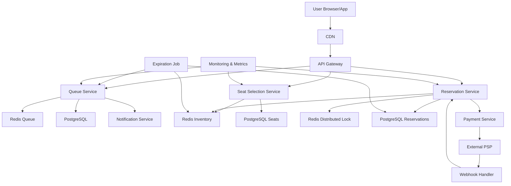

# Flash Sale Seat Reservation

**Category:** System Design
**Difficulty:** 🟡 Medium
**Seniority:** mid-level
**Companies:** Ticketmaster, StubHub, Eventbrite, Live Nation
**Tags:** concurrency, idempotency, overselling, rate-limiting, queueing, inventory-management
**Time:** 60-90 min

---

## Problem Statement

Design a seat reservation system for flash sales of high-demand events (e.g., Taylor Swift concert, World Cup finals). Millions of users compete for limited seats within seconds. The system must prevent overselling, handle extreme concurrency, provide fair access, and gracefully degrade when demand exceeds capacity.

The key challenge: when 100,000 users try to buy 10,000 tickets simultaneously, how do you ensure exactly 10,000 tickets are sold without double-booking, while giving users a good experience?

## Clarifying Questions

- What's the scale? *100K concurrent users for 10K tickets in a popular event; average 10K concurrent for typical events.*
- Are seats assigned immediately or held temporarily? *Hold for 10-15 minutes during checkout; if not completed, release back to inventory.*
- Can users select specific seats or just sections? *Specific seat selection in v1; section-only for general admission.*
- How long is the flash sale window? *Tickets go on sale at a specific time; popular events sell out in seconds.*
- Do we need anti-bot measures? *Yes, CAPTCHAs, rate limiting, and queue systems to prevent scalpers.*
- What happens when demand exceeds supply? *Users enter a virtual waiting room; FIFO queue with some randomness for fairness.*
- Payment integration? *Yes, integrate with PSP; payment completes the reservation.*
- Do we support transfers/resales? *Not in v1; focus on initial sale.*

## Requirements

### Functional

- Real-time seat inventory management with seat-level granularity.
- Hold seats temporarily during checkout; auto-release on timeout.
- Queue system for high-demand events with waiting room.
- Prevent overselling and double-booking under extreme concurrency.
- Support seat selection and section-based views.
- Integrate with payment system; complete reservation on successful payment.
- Handle cancellations and inventory restoration.

### Non-Functional

- Correctness: no overselling, no double-booking, accurate inventory.
- Fairness: FIFO queue with some randomness to prevent gaming.
- Availability: 99.9% during flash sales; degrade gracefully under overload.
- Latency: seat selection response < 500ms; checkout completion < 2s.
- Scalability: handle 100K concurrent users for popular events.
- Security: prevent bot attacks, scalping, and unauthorized access.

### Out of Scope

- Dynamic pricing, ticket transfers, resale marketplace, loyalty programs.

## Capacity Estimation

| Metric | Arithmetic | Result |
|---|---|---|
| Events/month | given | 500 |
| Tickets/event (avg) | given | 5,000 |
| Tickets/month | 500 × 5,000 | 2.5M |
| Peak concurrent users | given | 100K |
| Peak reservation requests/sec | 100K users / 60s | ~1,700 TPS |
| Seat hold duration | given | 10 min |
| Concurrent holds | 1,700 × 600 | ~1M holds at peak |
| Seat inventory records | 2.5M × 5,000 | ~12.5M seats/year |
| Inventory storage | 12.5M × 200 B | ~2.5 GB/year |
| Reservation records | 2.5M × 500 B | ~1.25 GB/year |

Peak concurrency is the main challenge; we need fast inventory checks and a queue system to throttle demand.

## API Design

```text
POST /v1/events/{eventId}/queue
  body: { "userId": "u_123" }
  resp: 200 { "queuePosition": 4521, "estimatedWaitMinutes": 12 }
       409 { "error": "already_in_queue" }
       410 { "error": "sold_out" }

GET  /v1/events/{eventId}/queue/status
  resp: 200 { "status": "WAITING", "position": 1200 }
       200 { "status": "READY", "accessToken": "jwt_..." }

GET  /v1/events/{eventId}/seats
  headers: Authorization: Bearer {accessToken}
  query: section, priceRange
  resp: 200 { "sections": [...], "availableSeats": [...], "heldSeats": [...] }

POST /v1/events/{eventId}/reservations
  headers: Idempotency-Key, Authorization
  body: { "seatIds": ["s_1", "s_2"], "userId": "u_123" }
  resp: 201 { "reservationId": "r_abc", "expiresAt": "2024-01-01T12:15:00Z", "total": 15000 }
       409 { "error": "seats_unavailable" }

POST /v1/reservations/{reservationId}/complete
  headers: Idempotency-Key
  body: { "paymentMethodToken": "tok_..." }
  resp: 200 { "reservationId": "r_abc", "status": "CONFIRMED", "tickets": [...] }
       402 { "error": "payment_failed" }

DELETE /v1/reservations/{reservationId}
  resp: 200 { "message": "reservation_cancelled", "seatsReleased": true }

GET  /v1/events/{eventId}/inventory
  resp: 200 { "totalSeats": 10000, "available": 4500, "held": 1200, "sold": 4300 }
```

## Data Model

**Redis** for high-speed inventory and seat locks (sub-millisecond operations). **PostgreSQL** for persistent reservations and events.

```text
// Redis - fast inventory and locks
seat:{eventId}:{seatId}
  hash: { "status": "AVAILABLE|HELD|SOLD", "userId": "u_123", "expiresAt": "timestamp" }

event:{eventId}:inventory
  hash: { "total": 10000, "available": 4500, "held": 1200, "sold": 4300 }

event:{eventId}:queue
  sorted_set: { userId -> timestamp }  // FIFO by timestamp

user:{userId}:queue:{eventId}
  string: { "position": 4521, "status": "WAITING" }

// PostgreSQL - persistent data
events
  event_id         UUID PK
  name             TEXT
  venue_id         UUID
  event_date       TIMESTAMP
  sale_start_time  TIMESTAMP
  total_seats      INT
  created_at, updated_at

venues
  venue_id         UUID PK
  name             TEXT
  sections JSONB   // { "A": { "rows": 10, "seatsPerRow": 20 }, ... }

seats
  seat_id          UUID PK
  event_id         UUID FK
  section          TEXT
  row              INT
  seat_number      INT
  price_minor      INT
  status           ENUM(AVAILABLE, HELD, SOLD)
  UNIQUE(event_id, section, row, seat_number)

reservations
  reservation_id   UUID PK
  user_id          UUID
  event_id         UUID FK
  seat_ids         UUID[]           // array of seat_ids
  total_minor      INT
  status           ENUM(HELD, CONFIRMED, CANCELLED, EXPIRED)
  expires_at       TIMESTAMP
  payment_id       UUID
  created_at, updated_at
```

Redis handles the hot path (seat availability checks, holds, queue). PostgreSQL stores the source of truth for reporting and reconciliation.

## High-Level Design



**Queue flow (high-demand events):**

1. Users enter the virtual waiting room by calling `POST /queue`.
2. Queue Service assigns a position in Redis sorted set (FIFO by timestamp).
3. Periodic job admits users from queue based on available capacity.
4. When admitted, user receives an access token to proceed to seat selection.

**Seat selection flow:**

1. User with access token calls `GET /seats` to see available seats.
2. Seat Selection Service reads from Redis inventory (fast reads).
3. User selects seats and calls `POST /reservations`.
4. Reservation Service uses distributed lock in Redis to atomically check and hold seats.
5. If successful, seats marked as HELD with expiration timestamp.
6. Reservation record created in PostgreSQL.

**Checkout completion:**

1. User calls `POST /reservations/{id}/complete` with payment.
2. Payment Service processes payment via PSP.
3. On success, Reservation Service updates seats to SOLD in Redis and PostgreSQL.
4. On failure or timeout, seats released back to AVAILABLE.

## Deep Dives

### Preventing overselling with distributed locks

The core challenge: multiple users trying to hold the same seat simultaneously.

```text
FUNCTION holdSeats(eventId, seatIds, userId, holdDurationMinutes):
    FOR EACH seatId IN seatIds:
        lockKey = "lock:{eventId}:{seatId}"
        // Try to acquire lock with timeout
        lockAcquired = redis.set(lockKey, userId, "NX", "EX", holdDurationMinutes * 60)
        IF NOT lockAcquired:
            // Rollback any previously acquired locks
            releaseHeldSeats(eventId, seatIds[0:current], userId)
            RETURN { "success": false, "error": "seat_unavailable", "seatId": seatId }

    // All locks acquired - update seat status
    FOR EACH seatId IN seatIds:
        redis.hset("seat:{eventId}:{seatId}", {
            "status": "HELD",
            "userId": userId,
            "expiresAt": now() + holdDurationMinutes * 60
        })

    // Persist reservation intent
    reservationId = generateUUID()
    db.transaction:
        INSERT reservations(reservation_id, user_id, event_id, seat_ids, status, expires_at)
        UPDATE seats SET status = 'HELD' WHERE seat_id IN seatIds

    RETURN { "success": true, "reservationId": reservationId, "expiresAt": ... }
```

Key points:
- Redis SET with NX (only if not exists) provides atomic lock acquisition.
- Lock expiration ensures held seats are eventually released even if process crashes.
- Database transaction ensures persistent record matches Redis state.
- On partial failure, rollback all acquired locks.

### Queue system and waiting room

For popular events, we need to throttle demand and provide fair access.

```text
FUNCTION joinQueue(eventId, userId):
    // Check if user already in queue
    if redis.exists("user:{userId}:queue:{eventId}"):
        RETURN { "error": "already_in_queue" }

    // Check if event sold out
    inventory = redis.hgetall("event:{eventId}:inventory")
    if inventory["available"] == 0 and inventory["held"] == 0:
        RETURN { "error": "sold_out" }

    // Add to queue (sorted by timestamp for FIFO)
    position = redis.zadd("event:{eventId}:queue", now(), userId)
    redis.set("user:{userId}:queue:{eventId}", json({
        "position": position,
        "status": "WAITING",
        "joinedAt": now()
    }))

    // Estimate wait time (rough heuristic)
    queueLength = redis.zcard("event:{eventId}:queue")
    admissionRate = 100  // users/minute based on capacity
    estimatedWait = queueLength / admissionRate

    RETURN { "queuePosition": position, "estimatedWaitMinutes": estimatedWait }

FUNCTION admitUsersFromQueue(eventId, batchSize):
    // Get users at front of queue
    usersToAdmit = redis.zrange("event:{eventId}:queue", 0, batchSize - 1)
    FOR EACH userId IN usersToAdmit:
        // Generate access token (JWT with short expiry)
        accessToken = generateJWT({ "userId": userId, "eventId": eventId }, expiry = 15min)
        redis.set("user:{userId}:queue:{eventId}", json({
            "status": "READY",
            "accessToken": accessToken
        }))
        // Notify user via WebSocket/push
        notificationService.send(userId, "Your turn! Access token: ...")

    // Remove admitted users from queue
    redis.zremrangebyrank("event:{eventId}:queue", 0, batchSize - 1)
```

Anti-gaming measures:
- Add small random jitter to admission order (top 100 positions randomized).
- Rate limit queue joins per IP/user.
- CAPTCHA before joining queue.
- Detect and block queue jumpers (multiple accounts from same IP).

### Handling expiration and timeout

Held seats must be released if checkout is not completed.

```text
FUNCTION releaseExpiredHolds():
    // Find all held seats past expiration
    expiredSeats = redis.scan(match="seat:*", count=1000)
    FOR EACH seatKey IN expiredSeats:
        seat = redis.hgetall(seatKey)
        IF seat["status"] == "HELD" and seat["expiresAt"] < now():
            // Release seat
            redis.hset(seatKey, { "status": "AVAILABLE", "userId": "", "expiresAt": "" })
            redis.del("lock:{seatKey}")

            // Update inventory counters
            eventId = extractEventId(seatKey)
            redis.hincrby("event:{eventId}:inventory", "held", -1)
            redis.hincrby("event:{eventId}:inventory", "available", 1)

            // Update database (eventual consistency OK here)
            asyncUpdateSeatStatus(extractSeatId(seatKey), "AVAILABLE")

    // Expire reservations in database
    db.execute("""
        UPDATE reservations
        SET status = 'EXPIRED'
        WHERE status = 'HELD' AND expires_at < NOW()
    """)
```

This job runs every minute. For large scale, use Redis streams or a dedicated expiration worker pool.

### Idempotency for reservation operations

Network failures cause retries; we must prevent duplicate reservations.

```text
FUNCTION createReservation(req, idempotencyKey):
    // Check idempotency key
    existing = db.query("""
        SELECT * FROM reservations
        WHERE idempotency_key = $1
    """, idempotencyKey)

    IF existing:
        IF existing.status == 'CONFIRMED':
            RETURN { "reservationId": existing.reservation_id, "status": "CONFIRMED" }
        ELSE IF existing.status == 'HELD' and existing.expires_at > now():
            RETURN { "reservationId": existing.reservation_id, "status": "HELD", "expiresAt": existing.expires_at }
        ELSE:
            // Expired or failed - allow retry with same key
            db.execute("DELETE FROM reservations WHERE reservation_id = $1", existing.reservation_id)

    // Proceed with new reservation
    result = holdSeats(req.eventId, req.seatIds, req.userId, 15)
    IF NOT result.success:
        RETURN result

    db.transaction:
        INSERT reservations(
            reservation_id, user_id, event_id, seat_ids, total_minor,
            status, expires_at, idempotency_key
        ) VALUES (
            result.reservationId, req.userId, req.eventId, req.seatIds,
            calculateTotal(req.seatIds), 'HELD', now() + 15min, idempotencyKey
        )

    RETURN result
```

## Scaling & Reliability

- **Redis clustering:** shard by event_id for inventory; each event's data on a single shard for atomic operations.
- **Database sharding:** shard reservations by event_id; seats by event_id.
- **Circuit breakers:** protect Redis and PostgreSQL from overload during flash sales.
- **Rate limiting:** per-IP, per-user limits on queue joins and reservation attempts.
- **CDN caching:** cache static venue/section data; dynamic inventory always from Redis.
- **Multi-region deployment:** active-passive with DNS failover; Redis cross-region replication for DR.
- **Monitoring:** queue length, admission rate, hold expiration backlog, overselling alerts (should never trigger), Redis memory usage.
- **Graceful degradation:** if Redis unavailable, fall back to database with degraded performance; if queue overwhelmed, show "high demand" message.

## Trade-offs

| Decision | Option A | Option B | Choice & Why |
|---|---|---|---|
| Inventory storage | Database only | Redis + Database | Redis + Database — Redis for sub-ms operations; DB for persistence and reconciliation. |
| Lock mechanism | Database row locks | Redis distributed locks | Redis locks — faster, less contention on DB; expiration handles crashes. |
| Queue implementation | Simple counter | Sorted set with position | Sorted set — gives users visibility into wait time; prevents gaming. |
| Seat hold duration | Fixed 10 min | Dynamic based on demand | Fixed 10 min — simpler; predictable; dynamic adds complexity without clear benefit. |
| Admission from queue | Strict FIFO | FIFO with randomization | FIFO with randomization — prevents first-second advantage; still fair. |
| Payment timing | Pay immediately | Pay after seat hold | Pay after hold — gives users time to complete checkout; reduces abandoned payments. |

## Follow-up Questions

1. **How do you handle section-based general admission?** Use inventory counters per section instead of seat-level tracking; allocate seats from section pool at confirmation time.
2. **What if Redis fails during a flash sale?** Fall back to database with pessimistic locking; degraded performance but still correct; use Redis Sentinel for automatic failover.
3. **How do you prevent scalpers using bots?** CAPTCHA before queue, rate limiting per IP, device fingerprinting, behavioral analysis (mouse movements), queue position randomization.
4. **How would you support ticket transfers?** Add transfer table with approval workflow; update seat ownership in Redis and DB; maintain audit trail.
5. **How do you handle venue seating changes?** Version the venue layout; migrate existing reservations; use event sourcing for seat history.

## Common Mistakes

- Using database row locks for seat holds (too slow under high concurrency).
- Not implementing proper expiration for held seats (inventory leaks).
- Allowing users to bypass queue (unfair access).
- Not using idempotency keys (duplicate reservations on retry).
- Ignoring the difference between "held" and "sold" inventory.
- Forgetting to update both Redis and database (eventual inconsistency).

## Key Takeaways

- Use fast in-memory data stores (Redis) for hot path inventory operations.
- Distributed locks with expiration prevent race conditions and handle crashes.
- Queue systems with waiting rooms throttle demand and provide fair access.
- Idempotency at API level prevents duplicate operations on retry.
- Always have a fallback strategy when fast path fails.
- Monitor for the impossible (overselling) and alert immediately.
