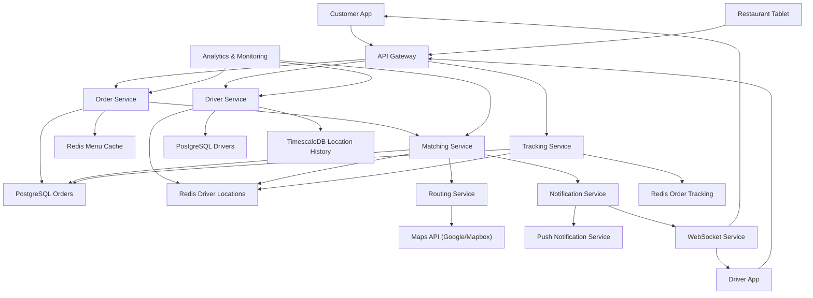

# Food Delivery Platform

**Category:** System Design
**Difficulty:** 🟡 Medium
**Seniority:** mid-level
**Companies:** DoorDash, Uber Eats, Grubhub, Deliveroo, Zomato
**Tags:** matching, real-time, location, geospatial, dispatch, scheduling, ETA
**Time:** 60-90 min

---

## Problem Statement

Design a food delivery platform that connects customers, restaurants, and drivers. Customers browse restaurants, place orders, and track deliveries in real-time. Drivers receive delivery requests, navigate to restaurants, and deliver food to customers. The system must handle real-time location updates, efficient driver-order matching, accurate ETA calculations, and handle peak demand during lunch/dinner rushes.

Key challenges: matching orders to nearby drivers efficiently, real-time location tracking with high frequency updates, handling driver availability changes, and ensuring fair dispatch while optimizing for delivery speed.

## Clarifying Questions

- What's the scale? *1M daily orders, 100K active drivers, peak 10K orders/hour during lunch rush.*
- Geographic scope? *Single city in v1; multiple cities later.*
- Order types? *Restaurant delivery only; grocery, alcohol later.*
- How does matching work? *Automatic matching based on proximity and capacity; drivers can accept/reject.*
- Real-time requirements? *Customer sees driver location every 5-10s; driver location updates every 10-30s.*
- Payment flow? *Customer pays upfront; restaurant paid after delivery; driver paid weekly.*
- Do we support scheduling? *On-demand only in v1; scheduled orders later.*
- What about multiple orders per driver? *Yes, drivers can take up to 2 orders simultaneously if routes are efficient.*

## Requirements

### Functional

- Restaurant management: menu, availability, operating hours.
- Order placement: browse, customize, checkout.
- Driver management: availability, location, status (online/offline/delivering).
- Order-driver matching: automatic dispatch based on proximity, capacity, and ETA.
- Real-time tracking: customer sees driver location, ETA updates.
- Multi-order batching: combine nearby orders for efficiency.
- Status updates: order confirmed, preparing, ready, picked up, delivered.
- Rating system: customers rate drivers and restaurants.

### Non-Functional

- Low latency: matching decision within 2-3 seconds.
- Real-time: location updates within 10-30 seconds.
- High availability: 99.9% for order placement and tracking.
- Scalability: handle 10K orders/hour peak.
- Fairness: balance driver earnings and customer wait times.
- Accuracy: ETA predictions within ±5 minutes.

### Out of Scope

- Restaurant inventory management, complex promotions, loyalty programs, customer support chat.

## Capacity Estimation

| Metric | Arithmetic | Result |
|---|---|---|
| Daily orders | given | 1M |
| Peak orders/hour | 1M × 20% / 2 hours | 100K/hour |
| Peak orders/second | 100K / 3600 | ~28 TPS |
| Active drivers | given | 100K |
| Driver location updates | 100K × 6/min | 10K updates/sec |
| Customer tracking requests | 1M × 5 updates/order | 5K requests/sec |
| Order records/day | 1M × 1 KB | ~1 GB/day |
| Location events/day | 100K × 8640 updates | ~864M events |
| Location storage | 864M × 100 B | ~86 GB/day |

Driver location updates are the highest volume; need efficient geospatial indexing and time-series storage.

## API Design

```text
// Customer APIs
GET  /v1/restaurants
  query: latitude, longitude, radius, cuisine
  resp: 200 { "restaurants": [{ "id": "r_1", "name": "...", "rating": 4.5, "eta": 25, "deliveryFee": 299 }] }

GET  /v1/restaurants/{restaurantId}/menu
  resp: 200 { "categories": [...], "items": [...] }

POST /v1/orders
  headers: Idempotency-Key
  body: { "restaurantId": "r_1", "items": [...], "deliveryAddress": {...}, "tip": 500 }
  resp: 201 { "orderId": "o_123", "status": "CONFIRMED", "eta": 35 }

GET  /v1/orders/{orderId}
  resp: 200 { "orderId": "o_123", "status": "DELIVERING", "driver": {...}, "location": {...}, "eta": 12 }

// Driver APIs
POST /v1/drivers/location
  body: { "latitude": 37.7749, "longitude": -122.4194, "heading": 45 }
  resp: 200

POST /v1/drivers/{driverId}/availability
  body: { "status": "ONLINE|OFFLINE" }
  resp: 200

GET  /v1/drivers/{driverId}/offers
  resp: 200 { "offers": [{ "orderId": "o_123", "pickup": {...}, "dropoff": {...}, "earnings": 750 }] }

POST /v1/drivers/{driverId}/offers/{offerId}/accept
  resp: 200 { "orderId": "o_123", "status": "ASSIGNED" }

POST /v1/drivers/{driverId}/orders/{orderId}/status
  body: { "status": "PICKED_UP|DELIVERED", "location": {...}, "photo": "..." }
  resp: 200

// Restaurant APIs
GET  /v1/restaurants/{restaurantId}/orders
  query: status
  resp: 200 { "orders": [...] }

POST /v1/restaurants/{restaurantId}/orders/{orderId}/status
  body: { "status": "PREPARING|READY_FOR_PICKUP" }
  resp: 200
```

## Data Model

**PostgreSQL** for relational data (orders, users, restaurants). **Redis** for real-time driver locations and caching. **TimescaleDB** for location history. **PostGIS** for geospatial queries.

```text
// PostgreSQL - core data
users
  user_id         UUID PK
  type            ENUM(CUSTOMER, DRIVER, RESTAURANT_ADMIN)
  name            TEXT
  email           TEXT UNIQUE
  phone           TEXT
  created_at

restaurants
  restaurant_id   UUID PK
  name            TEXT
  address         TEXT
  latitude        DECIMAL(9,6)
  longitude       DECIMAL(9,6)
  cuisine_type    TEXT[]
  rating          DECIMAL(3,2)
  operating_hours JSONB  // { "monday": { "open": "09:00", "close": "22:00" }, ... }
  created_at

menu_items
  item_id         UUID PK
  restaurant_id   UUID FK
  name            TEXT
  description     TEXT
  price_minor     INT
  available       BOOLEAN
  category        TEXT

orders
  order_id        UUID PK
  customer_id     UUID FK
  restaurant_id   UUID FK
  driver_id       UUID FK NULLABLE
  status          ENUM(CONFIRMED, PREPARING, READY, ASSIGNED, PICKED_UP, DELIVERED, CANCELLED)
  items           JSONB
  total_minor     INT
  delivery_fee    INT
  tip_minor       INT
  pickup_address  JSONB
  delivery_address JSONB
  pickup_lat      DECIMAL(9,6)
  pickup_lng      DECIMAL(9,6)
  delivery_lat    DECIMAL(9,6)
  delivery_lng    DECIMAL(9,6)
  estimated_pickup_time TIMESTAMP
  estimated_delivery_time TIMESTAMP
  actual_pickup_time TIMESTAMP NULLABLE
  actual_delivery_time TIMESTAMP NULLABLE
  created_at, updated_at

drivers
  driver_id       UUID PK
  user_id         UUID FK
  vehicle_type    ENUM(CAR, BICYCLE, SCOOTER)
  current_lat     DECIMAL(9,6)
  current_lng     DECIMAL(9,6)
  status          ENUM(ONLINE, OFFLINE, BUSY)
  current_order_id UUID NULLABLE
  rating          DECIMAL(3,2)
  total_deliveries INT
  created_at, updated_at

// TimescaleDB (PostgreSQL extension) - location history
driver_locations
  time            TIMESTAMPTZ
  driver_id       UUID
  latitude        DECIMAL(9,6)
  longitude       DECIMAL(9,6)
  heading         DECIMAL(5,2)
  speed           DECIMAL(5,2)
  status          TEXT

// Redis - real-time data
driver:{driver_id}:location
  hash: { "lat": 37.7749, "lng": -122.4194, "heading": 45, "updatedAt": "timestamp" }

driver:{driver_id}:status
  string: "ONLINE|OFFLINE|BUSY"

order:{order_id}:tracking
  hash: { "driverId": "...", "driverLat": "...", "driverLng": "...", "eta": 12 }

available_drivers:geo
  geospatial index: (lat, lng) -> driver_id

restaurant:{restaurant_id}:queue
  list: [order_id, order_id, ...]  // orders awaiting pickup
```

## High-Level Design



**Order placement flow:**

1. Customer browses restaurants (cached in Redis).
2. Customer places order; Order Service validates and creates order record.
3. Order Service pushes to Matching Service.
4. Matching Service finds nearby available drivers using geospatial query.
5. Drivers receive push notification with offer details.
6. First driver to accept gets assigned; others notified of assignment.

**Real-time tracking flow:**

1. Driver app sends location updates every 10-30s to Driver Service.
2. Driver Service updates Redis (current location) and TimescaleDB (history).
3. Tracking Service subscribes to location updates via pub/sub.
4. Customer app polls or receives WebSocket updates with driver location and ETA.

**Matching algorithm:**

1. Query Redis geospatial index for drivers within 5km of restaurant.
2. Filter by driver status (ONLINE, not BUSY).
3. Calculate ETA for each driver (pickup + delivery time).
4. Score drivers based on: ETA, driver rating, historical acceptance rate.
5. Send offers to top N drivers (e.g., top 3).
6. Assign to first acceptor; if all reject, expand search radius and retry.

## Deep Dives

### Geospatial driver matching

Efficiently finding nearby drivers is critical for low-latency matching.

```text
FUNCTION findNearbyDrivers(restaurantLat, restaurantLng, radiusKm):
    // Redis GEOSEARCH for drivers within radius
    driverIds = redis.geosearch(
        "available_drivers:geo",
        fromlonlat = [restaurantLng, restaurantLat],
        byradius = [radiusKm, "km"]
    )

    nearbyDrivers = []
    FOR EACH driverId IN driverIds:
        driver = redis.hgetall("driver:{driverId}:location")
        status = redis.get("driver:{driver_id}:status")

        IF status == "ONLINE":
            nearbyDrivers.append({
                "driverId": driverId,
                "lat": driver["lat"],
                "lng": driver["lng"],
                "heading": driver["heading"]
            })

    RETURN nearbyDrivers

FUNCTION calculateETA(driverLat, driverLng, pickupLat, pickupLng, dropoffLat, dropoffLng):
    // Call routing API for accurate ETA
    routeToPickup = mapsApi.getDirections(driverLat, driverLng, pickupLat, pickupLng)
    routeToDropoff = mapsApi.getDirections(pickupLat, pickupLng, dropoffLat, dropoffLng)

    pickupDuration = routeToPickup.duration
    deliveryDuration = routeToDropoff.duration
    restaurantPrepTime = getRestaurantPrepTime(restaurantId)

    totalETA = pickupDuration + restaurantPrepTime + deliveryDuration
    RETURN {
        "pickupETA": pickupDuration,
        "deliveryETA": totalETA,
        "distance": routeToPickup.distance + routeToDropoff.distance
    }

FUNCTION scoreDriver(driver, order):
    eta = calculateETA(driver.lat, driver.lng, order.pickupLat, order.pickupLng,
                       order.deliveryLat, order.deliveryLng)

    // Score components (lower is better)
    etaScore = eta.deliveryETA / 60  // normalize to minutes
    ratingScore = (5 - driver.rating) * 5  // higher rating = lower score
    acceptanceScore = (1 - driver.acceptanceRate) * 10

    totalScore = etaScore * 0.6 + ratingScore * 0.2 + acceptanceScore * 0.2
    RETURN { "driver": driver, "score": totalScore, "eta": eta }
```

### Real-time location updates

High-frequency location updates must be handled efficiently.

```text
FUNCTION updateDriverLocation(driverId, lat, lng, heading, speed):
    // Update Redis (fast, for real-time queries)
    redis.hset("driver:{driverId}:location", {
        "lat": lat,
        "lng": lng,
        "heading": heading,
        "updatedAt": now()
    })

    // Update geospatial index
    redis.geoadd("available_drivers:geo", lng, lat, driverId)

    // Async write to TimescaleDB (for history and analytics)
    asyncInsertLocation(driverId, lat, lng, heading, speed)

    // Publish to pub/sub for tracking subscribers
    redis.publish("driver_location:{driverId}", json({
        "lat": lat,
        "lng": lng,
        "heading": heading,
        "timestamp": now()
    }))

    RETURN 200

FUNCTION asyncInsertLocation(driverId, lat, lng, heading, speed):
    // Batch insert for efficiency
    locationBatch.append({
        "time": now(),
        "driver_id": driverId,
        "latitude": lat,
        "longitude": lng,
        "heading": heading,
        "speed": speed
    })

    IF locationBatch.size >= 100:
        db.execute("""
            INSERT INTO driver_locations (time, driver_id, latitude, longitude, heading, speed)
            VALUES ($1, $2, $3, $4, $5, $6)
        """, locationBatch)
        locationBatch.clear()
```

### Multi-order batching

To maximize driver efficiency, allow batching nearby orders.

```text
FUNCTION canBatchWithExistingOrder(existingOrder, newOrder):
    // Check if pickup locations are close (< 1km)
    pickupDistance = haversine(
        existingOrder.pickupLat, existingOrder.pickupLng,
        newOrder.pickupLat, newOrder.pickupLng
    )
    IF pickupDistance > 1.0: RETURN false

    // Check if delivery locations are close (< 2km)
    deliveryDistance = haversine(
        existingOrder.deliveryLat, existingOrder.deliveryLng,
        newOrder.deliveryLat, newOrder.deliveryLng
    )
    IF deliveryDistance > 2.0: RETURN false

    // Check time constraints
    route = mapsApi.getOptimalRoute([
        {existingOrder.pickupLat, existingOrder.pickupLng},
        {newOrder.pickupLat, newOrder.pickupLng},
        {existingOrder.deliveryLat, existingOrder.deliveryLng},
        {newOrder.deliveryLat, newOrder.deliveryLng}
    ])

    // Ensure both orders can be delivered within time windows
    IF route.duration > 45: RETURN false  // max 45 min for batched delivery

    RETURN true

FUNCTION assignBatchedOrders(driverId, orders):
    // Calculate optimal route
    waypoints = []
    FOR EACH order IN orders:
        waypoints.append({ "lat": order.pickupLat, "lng": order.pickupLng, "type": "pickup" })
        waypoints.append({ "lat": order.deliveryLat, "lng": order.deliveryLng, "type": "dropoff" })

    optimizedRoute = mapsApi.getOptimalRoute(waypoints)

    // Update orders with sequence
    FOR i, waypoint IN enumerate(optimizedRoute.waypoints):
        IF waypoint.type == "pickup":
            updateOrder(waypoint.orderId, { "pickupSequence": i })
        ELSE:
            updateOrder(waypoint.orderId, { "deliverySequence": i })

    // Send to driver with route
    notificationService.send(driverId, {
        "type": "BATCHED_ASSIGNMENT",
        "orders": orders,
        "route": optimizedRoute
    })
```

### ETA calculation and updates

Accurate ETA predictions are critical for customer experience.

```text
FUNCTION calculateOrderETA(order):
    IF order.status == "CONFIRMED":
        // Estimate before driver assignment
        nearbyDrivers = findNearbyDrivers(order.pickupLat, order.pickupLng, 5)
        IF nearbyDrivers.empty:
            // Use historical average
            avgPickupTime = getHistoricalAverage("pickup_time", order.restaurantId)
            avgDeliveryTime = getHistoricalAverage("delivery_time", order.restaurantId)
            prepTime = getRestaurantPrepTime(order.restaurantId)
            RETURN avgPickupTime + prepTime + avgDeliveryTime
        ELSE:
            // Use best available driver
            bestDriver = min(nearbyDrivers, key=lambda d: calculateETA(d, order))
            RETURN calculateETA(bestDriver, order).deliveryETA

    ELSE IF order.status == "ASSIGNED" or order.status == "PREPARING":
        driver = getDriver(order.driver_id)
        currentETA = calculateETA(
            driver.current_lat, driver.current_lng,
            order.pickupLat, order.pickupLng,
            order.deliveryLat, order.deliveryLng
        )
        RETURN currentETA.deliveryETA

    ELSE IF order.status == "PICKED_UP":
        driver = getDriver(order.driver_id)
        route = mapsApi.getDirections(
            driver.current_lat, driver.current_lng,
            order.deliveryLat, order.deliveryLng
        )
        RETURN route.duration

FUNCTION updateOrderETA(orderId):
    order = getOrder(orderId)
    newETA = calculateOrderETA(order)

    // Update database
    db.execute("""
        UPDATE orders
        SET estimated_delivery_time = NOW() + (newETA || ' minutes')::INTERVAL
        WHERE order_id = $1
    """, orderId)

    // Update cache
    redis.hset("order:{orderId}:tracking", { "eta": newETA })

    // Notify customer if ETA changed significantly (> 2 min)
    oldETA = redis.hget("order:{orderId}:tracking", "eta")
    IF abs(newETA - oldETA) > 2:
        notificationService.send(order.customer_id, {
            "type": "ETA_UPDATE",
            "orderId": orderId,
            "newETA": newETA
        })
```

## Scaling & Reliability

- **Redis clustering:** shard driver locations by geographic region; use Redis GEO for spatial queries.
- **Database sharding:** shard orders by restaurant_id or geographic region.
- **Load balancing:** matching service horizontally scalable; each request independent.
- **Circuit breakers:** protect external Maps API from excessive calls; cache route results.
- **Rate limiting:** prevent abuse of location updates and order placement.
- **Multi-region deployment:** deploy closer to users; geospatial data partitioned by region.
- **Monitoring:** matching latency, driver acceptance rate, ETA accuracy, location update lag, order cancellation rate.
- **Graceful degradation:** if Maps API down, use Haversine distance + average speed for ETA; if Redis down, fall back to database queries.

## Trade-offs

| Decision | Option A | Option B | Choice & Why |
|---|---|---|---|
| Location storage | Redis only | Redis + TimescaleDB | Redis + TimescaleDB — Redis for real-time, TimescaleDB for history/analytics. |
| Matching strategy | Assign immediately | Send offers to multiple drivers | Multiple offers — increases acceptance rate; reduces matching time. |
| ETA calculation | Simple distance | Maps API routing | Maps API — more accurate; worth the cost for customer experience. |
| Order batching | Single order only | Allow batching | Batching — improves driver efficiency; increases platform earnings. |
| Location update frequency | Every 5s | Every 30s | Every 10-30s — balance accuracy with cost; adaptive based on order status. |
| Real-time updates | Polling | WebSocket | WebSocket — lower latency, better UX; polling as fallback. |

## Follow-up Questions

1. **How do you handle driver no-shows or cancellations?** Timeout after 5 min of no response; auto-reassign order; track driver reliability and downscore in matching.
2. **How would you support scheduled orders?** Add scheduled_delivery_time field; matching runs closer to scheduled time; queue orders and match in batch.
3. **How do you prevent fraud (fake deliveries)?** Require photo proof at pickup/delivery; use geofencing to verify location; customer confirmation on delivery.
4. **How would you expand to multiple cities?** Shard data by city/region; separate Redis clusters per region; city-specific dispatch services.
5. **How do you handle surge pricing?** Dynamic pricing algorithm based on supply-demand ratio; adjust delivery fee; show surge multiplier to customers.

## Common Mistakes

- Using simple distance instead of actual routing for ETA (inaccurate).
- Not batching orders (inefficient driver utilization).
- Storing all location history in Redis (memory explosion).
- Single-threaded matching service (bottleneck under load).
- Not handling driver cancellations gracefully (poor customer experience).
- Ignoring traffic patterns in ETA calculation (systematic errors).

## Key Takeaways

- Geospatial indexing (Redis GEO, PostGIS) is essential for location-based services.
- Real-time systems need fast in-memory storage with durable backing store.
- Matching algorithms balance multiple factors: ETA, fairness, efficiency.
- ETA accuracy requires actual routing, not just distance calculations.
- Batching improves efficiency but adds complexity to routing and coordination.
- External dependencies (Maps API) need circuit breakers and fallbacks.
- Monitor the right metrics: matching latency, acceptance rate, ETA accuracy.
