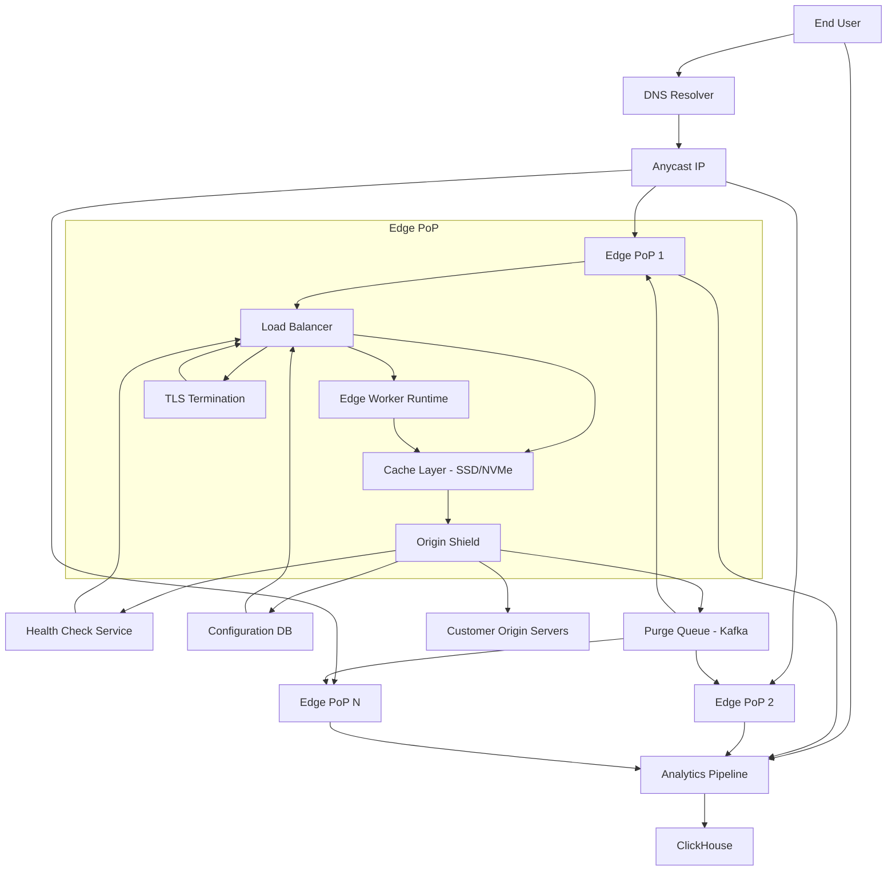

# Global CDN

**Category:** System Design
**Difficulty:** 🔴 Hard
**Seniority:** senior
**Companies:** Cloudflare, Akamai, Fastly, AWS CloudFront, Google Cloud CDN
**Tags:** caching, edge-computing, routing, anycast, tls-termination
**Time:** 90-120 min

---

## Problem Statement

Design a global Content Delivery Network (CDN) like Cloudflare or Akamai. The CDN caches and serves static and dynamic content from thousands of origin servers to millions of end users worldwide with low latency, high availability, and protection against DDoS attacks.

The interviewer hints at massive scale: millions of domains, petabytes of daily traffic, thousands of edge locations across 100+ countries, and the need to handle both static assets (images, videos, JS/CSS) and dynamic content (API responses, HTML) with varying cache policies.

## Clarifying Questions

- How many edge locations? *Assume 250+ PoPs (Points of Presence) across the globe.*
- How many domains/customers? *Assume 5M+ domains, 500K+ paying customers.*
- Traffic volume? *Assume 100 Tbps peak egress, 10 PB daily transfer.*
- Content types? *Static assets (images, videos, static HTML), dynamic content (API responses, edge-computed responses), live streaming.*
- Cache hit ratio target? *Aim for 90%+ static, 60-70% dynamic.*
- DDoS protection requirements? *Must absorb volumetric attacks up to 1 Tbps per customer.*
- Edge computing capabilities? *Support serverless functions at the edge (Cloudflare Workers model).*
- TLS termination? *Full TLS termination at the edge with automatic certificate management.*
- Purge/invalidation requirements? *Near-instant purges (sub-second) for critical content.*

## Requirements

### Functional

- Cache and serve HTTP/HTTPS content from origin servers.
- Support multiple cache policies (TTL, stale-while-revalidate, cache keys with custom headers).
- Edge computing: run user code (JavaScript/WASM) at the edge for dynamic responses.
- TLS termination with automatic certificate provisioning (Let's Encrypt integration).
- DDoS protection and rate limiting.
- Content purging and invalidation.
- Real-time analytics and logging.

### Non-Functional

- Low latency: p95 < 50 ms from edge to user globally.
- High availability: 99.99%+ for cached content, 99.9% for origin fetch.
- Massive scale: handle 100+ Tbps peak traffic.
- Fast cache invalidation: propagate purges globally within 1-5 seconds.
- Security: protect against DDoS, XSS, SQL injection at the edge.
- Cost efficiency: minimize origin bandwidth and compute costs.

### Out of Scope

- Video streaming protocols (HLS/DASH specific optimizations), DNS hosting, load balancing for origin servers (beyond basic health checks).

## Capacity Estimation

| Metric | Arithmetic | Result |
|---|---|---|
| Peak egress bandwidth | 100 Tbps | 100 Tbps |
| Daily transfer | 100 Tbps x 86,400 s / 8 | ~1 PB/day |
| Edge locations | Global coverage | 250+ PoPs |
| Per-PoP capacity | 100 Tbps / 250 | ~400 Gbps avg, 1 Tbps large PoPs |
| Cache storage | 10 PB total across edges | ~40 TB per PoP avg |
| Requests per second | Assume 10M RPS avg, 50M peak | 10M avg, 50M peak |
| Per-PoP RPS | 50M / 250 | ~200K RPS avg per PoP |
| Cache hit ratio | 90% static, 70% dynamic | Overall ~80% |
| Origin bandwidth saved | 80% hit ratio | Origin serves 20 Tbps instead of 100 Tbps |
| Unique objects | Assume 10B unique objects | 10B objects cached globally |

## API Design

```text
// Customer configuration API
POST  /api/v1/zones
  body: { "domain": "example.com", "origin": "https://origin.example.com" }
  resp: 201 { "zoneId": "z_abc123", "nameservers": ["ns1.cdn.net", ...] }

PUT   /api/v1/zones/{zoneId}/cache-settings
  body: { "defaultTTL": 3600, "bypassCacheFor": ["/api/*"],
          "cacheKey": { "includeHeaders": ["x-user-id"] } }

POST  /api/v1/zones/{zoneId}/purge
  body: { "urls": ["https://example.com/image.jpg"],
          "tags": ["user-1234"], "purgeEverything": false }
  resp: 202 { "purgeId": "p_xyz789" }

POST  /api/v1/zones/{zoneId}/workers
  body: { "script": "export default { fetch: (req) => ... }" }
  resp: 201 { "workerId": "w_def456" }

// Edge worker API (user code)
export default {
  async fetch(request, env, ctx) {
    const url = new URL(request.url);
    if (url.pathname.startsWith('/api/')) {
      // Dynamic edge computation
      return Response.json({ data: await compute(request) });
    }
    // Cache pass-through
    return fetch(request);
  }
};

// Analytics query API
GET   /api/v1/zones/{zoneId}/analytics?from=2024-01-01&to=2024-01-02
  resp: 200 { "requests": 123456789, "bandwidthBytes": 456789012345,
              "cacheHitRatio": 0.87, "topCountries": [...] }
```

## Data Model

**Zone/Customer configuration — PostgreSQL (sharded by zone_id):**

```text
zones
  zone_id          UUID  PRIMARY KEY
  customer_id      UUID
  domain           VARCHAR(255)
  origin_url       TEXT
  created_at       TIMESTAMP

cache_settings
  zone_id          UUID  PRIMARY KEY
  default_ttl      INT
  stale_ttl        INT
  cache_key_config JSONB  -- headers, query string handling
  bypass_rules     JSONB  -- path patterns

tls_certificates
  zone_id          UUID  PRIMARY KEY
  certificate      TEXT
  private_key      TEXT  -- encrypted at rest
  expires_at       TIMESTAMP
  auto_renew       BOOLEAN
```

**Edge cache metadata — Distributed KV store (Cassandra/Scylla) per PoP:**

```text
cache_metadata
  object_key       STRING  PRIMARY KEY  -- hash of (zone_id, url, cache_key)
  zone_id          STRING
  url              STRING
  size_bytes       BIGINT
  ttl              INT
  created_at       TIMESTAMP
  last_accessed    TIMESTAMP
  content_hash     STRING  -- for validation
```

**Purge queue — Kafka (global topic, partitioned by zone_id):**

```text
purge_events
  purge_id         STRING
  zone_id          STRING  -- partition key
  object_key       STRING  -- null for purge-all
  tag              STRING  -- null for URL-based purge
  timestamp        TIMESTAMP
```

**Analytics — ClickHouse (columnar for time-series aggregation):**

```text
requests_log
  timestamp        DateTime
  zone_id          String
  edge_pop         String
  country_code     String
  cache_status     Enum(HIT, MISS, STALE, BYPASS)
  status_code      UInt16
  bytes_served     UInt64
  latency_ms       UInt32
```

## System Architecture



**Request flow (cache hit):**

1. User resolves domain via DNS; anycast routes to nearest edge PoP.
2. Edge PoP terminates TLS (SNI-based certificate selection).
3. Load balancer checks cache key (URL + headers + query string config).
4. Cache hit: serve response immediately with cache headers.
5. Emit analytics event asynchronously.

**Request flow (cache miss):**

1. Cache miss: fetch from origin shield (regional aggregation layer).
2. Origin shield checks its cache; if miss, fetch from customer origin.
3. Response cached at edge with configured TTL.
4. Stale-while-revalidate: serve stale content async while refreshing.
5. If origin is unhealthy, serve stale content (if within grace period).

**Purge propagation:**

1. Customer calls purge API → writes to Kafka purge topic.
2. Each edge PoP consumes purge events for its zones.
3. Edge invalidates matching objects from local cache.
4. Acknowledgment sent back; purge marked complete when all edges ack.

## Deep Dives

### Anycast routing and edge selection

Anycast announces the same IP prefix from all edge PoPs. BGP routes traffic to the nearest PoP based on AS path length and ISP peering relationships. For finer-grained control:

```text
FUNCTION selectEdgePop(clientIP, zoneId):
  // GeoIP + latency database
  SET candidatePops ← geoIPToPops(clientIP)
  SET bestPop ← NULL
  SET bestLatency ← ∞
  FOR pop IN candidatePops:
    IF pop.isHealthy(zoneId) AND pop.hasCapacity():
      SET latency ← latencyDB.get(clientIP_subnet, pop.id)
      IF latency < bestLatency:
        SET bestLatency ← latency
        SET bestPop ← pop
  RETURN bestPop OR fallbackPop
```

Edge PoPs continuously publish health and capacity to a central coordination service; DNS can also return different IPs for latency-based routing (EDNS Client Subnet).

### Cache key generation and variation

Cache keys must respect customer configuration while maximizing hit ratio:

```text
FUNCTION generateCacheKey(request, zoneConfig):
  SET key ← zoneConfig.zoneId + "|" + request.url
  
  // Query string handling
  IF zoneConfig.ignoreAllQueryParams:
    key ← key.split("?")[0]
  ELSE IF zoneConfig.ignoreSpecificParams:
    key ← removeParams(key, zoneConfig.ignoreParams)
  
  // Header-based cache keys
  FOR header IN zoneConfig.varyByHeaders:
    key ← key + "|" + request.headers.get(header)
  
  // Device type (mobile/desktop) if configured
  IF zoneConfig.varyByDevice:
    key ← key + "|" + detectDevice(request.userAgent)
  
  RETURN hash(key)  // consistent hash for distribution
```

Common vary headers: `Accept-Encoding` (gzip vs brotli), `Accept-Language`, `Cookie` (rare, for per-user content), `Authorization` (for private content).

### Edge computing (Workers)

Serverless functions run in V8 isolates or WebAssembly sandboxes at the edge:

```text
// Worker lifecycle
FUNCTION handleRequest(request):
  SET worker ← workerPool.get(zoneId, scriptVersion)
  SET env ← { KV: edgeKV, R2: objectStorage, D1: database }
  SET ctx ← { waitUntil: backgroundTasks }
  
  TRY:
    SET response ← worker.fetch(request, env, ctx)
    // Cache worker responses if cacheable
    IF response.headers.get("Cache-Control"):
      cache.set(cacheKey, response, ttl)
    RETURN response
  CATCH error:
    RETURN errorResponse(500, "Worker error")
```

Workers enable dynamic content without origin round-trips: A/B testing, header rewriting, authentication, API aggregation, image optimization.

### TLS termination at scale

Each edge PoP terminates TLS for millions of domains:

- **Certificate storage:** ECDSA certificates (smaller than RSA) stored in memory, sharded by SNI.
- **OCSP stapling:** Pre-fetch and cache OCSP responses to avoid extra round-trips.
- **Session tickets:** Stateless session resumption using encrypted tickets.
- **TLS 1.3:** Prioritize for faster handshake (0-RTT data).
- **Certificate provisioning:** ACME (Let's Encrypt) automation with DNS validation for wildcard certs.

```text
FUNCTION handleTLS(clientHello):
  SET serverName ← clientHello.sni
  SET cert ← certStore.get(serverName)
  IF cert == NULL:
    RETURN defaultCert  // or generate on-the-fly for Let's Encrypt
  SET session ← tls13Handshake(cert, clientHello)
  RETURN session
```

### DDoS protection and rate limiting

Multi-layer defense:

1. **Network layer:** Scrubbing centers for volumetric attacks (UDP amplification, SYN floods). Drop packets at edge before hitting servers.
2. **Transport layer:** SYN cookies, connection rate limiting per IP/subnet.
3. **Application layer:** WAF rules (SQL injection, XSS), rate limiting per URL/API key.

```text
FUNCTION rateLimit(request, zoneConfig):
  SET key ← zoneId + "|" + request.clientIP + "|" + request.url
  SET count ← redis.incr(key)
  IF count == 1:
    redis.expire(key, 60)  // 1-minute window
  
  SET limit ← zoneConfig.getLimit(request.url)
  IF count > limit:
    RETURN 429  // Too Many Requests
  RETURN NULL
```

For sophisticated attacks, use behavioral analysis: detect anomalous traffic patterns, challenge suspicious clients (JS challenge, CAPTCHA), and auto-learn rules.

### Cache invalidation strategies

Fast purge propagation is critical for dynamic content:

```text
// 1. Immediate invalidation (for critical content)
FUNCTION purgeByUrl(zoneId, url):
  SET objectKey ← generateCacheKey(url, zoneConfig)
  SET purgeId ← uuid()
  kafka.produce("purges", { zoneId, objectKey, purgeId })
  RETURN purgeId

// 2. Tag-based invalidation (bulk)
FUNCTION purgeByTag(zoneId, tag):
  kafka.produce("purges", { zoneId, tag, purgeId: uuid() })
  // Each edge maintains tag → objectKeys index

// 3. Stale-while-revalidate (soft invalidation)
FUNCTION markStale(zoneId, url):
  SET objectKey ← generateCacheKey(url, zoneConfig)
  cache.setMetadata(objectKey, { stale: true })
  // Next fetch refreshes in background
```

Edge PoPs maintain an in-memory index of cached objects with tags. For purge-all, a generation counter increments; objects from old generations are considered stale.

## Scalability

- **Horizontal scaling:** Add more edge PoPs; anycast automatically distributes traffic.
- **Per-PoP scaling:** Stateless cache servers behind L4/L7 load balancers; add nodes as traffic grows.
- **Cache storage:** SSD/NVMe for hot data, tiered to HDD for cold. Consistent hashing for object distribution.
- **Configuration propagation:** Customer config pushed via Kafka to all edges within seconds.
- **Origin shield:** Regional aggregation layer reduces origin load by collapsing duplicate misses.
- **Multi-tenant isolation:** Resource quotas per zone, priority queues for paid customers.

## Consistency & Availability

- **Eventual consistency:** Cache updates propagate within seconds; stale-while-revalidate masks inconsistencies.
- **Origin health checks:** Active health checks to customer origins; failover to backup origins or stale cache.
- **Graceful degradation:** Serve stale content (with Warning header) if origin is down.
- **Quorum for purges:** Purge marked complete when majority of edges ack; can tune for speed vs consistency.
- **Geo-redundancy:** Critical configuration (certificates, zone settings) replicated across regions.

## Security

- **TLS everywhere:** Enforce HTTPS with HSTS; redirect HTTP to HTTPS.
- **WAF:** Rule-based WAF for OWASP Top 10; custom rules per zone.
- **Bot detection:** Identify and rate-limit scrapers, bad bots; allow good bots (Googlebot).
- **DDoS mitigation:** Multi-layer defense as described above.
- **Certificate security:** Private keys encrypted at rest; hardware security modules (HSMs) for key operations.
- **Edge isolation:** Worker sandboxing (V8 isolates, seccomp filters, cgroups) to prevent tenant escape.

## Trade-offs

| Decision | Option A | Option B | Choice & Why |
|---|---|---|---|
| Cache storage | In-memory (Redis) | SSD/NVMe disk cache | SSD/NVMe — larger capacity, cheaper per GB, still fast enough for p95 < 50ms |
| Purge propagation | Synchronous RPC to all edges | Async Kafka + eventual consistency | Async Kafka — scales better, edges can be temporarily unavailable |
| TLS termination | Per-zone dedicated IPs | SNI-based shared IPs | SNI shared — scales to millions of domains, reduces IP exhaustion |
| Cache invalidation | Time-based only | Event-based purges | Event-based — required for dynamic content, time-based as fallback |
| Edge compute | Containers | V8 isolates / WASM | V8/WASM — faster cold start, better isolation, lower overhead |

## Follow-up Questions

1. **How do you handle cache stampede (thundering herd) when a popular object expires?** Use request coalescing: only one request fetches from origin while others wait; serve stale content during refresh; probabilistic early refresh.
2. **How would you implement image optimization at the edge?** Transform images on-the-fly using edge workers: resize, convert format (WebP/AVIF), adjust quality; cache transformed variants with different cache keys.
3. **How do you handle private/cacheable content per user?** Use cache keys with user ID or session token; edge-side includes (ESI) for partial caching; or use edge workers to assemble per-user responses from cached fragments.
4. **What happens during a BGP route leak or anycast misconfiguration?** Monitor BGP announcements; have backup DNS with manual failover; work with ISPs to filter invalid routes; multi-CDN setup for redundancy.
5. **How would you implement edge-side rate limiting without a central coordination point?** Use hierarchical token buckets: local limits per edge, with periodic synchronization to prevent abuse across edges; or use a centralized Redis cluster for global limits.

## Common Mistakes

- Not considering cache key variation (headers, query strings) leading to poor hit ratios.
- Synchronous cache invalidation that doesn't scale to thousands of edges.
- Ignoring the complexity of TLS termination for millions of domains.
- Underestimating DDoS protection requirements at the network layer.
- Not designing for cache stampede/thundering herd scenarios.
- Forgetting about origin health checks and graceful degradation.

## Key Takeaways

- Anycast routing + geo-distributed edge PoPs is the foundation of global CDNs.
- Cache key generation and variation policies directly impact hit ratio and origin load.
- TLS termination at scale requires SNI, certificate sharding, and automation.
- Async purge propagation via Kafka balances speed with scalability.
- Edge computing enables dynamic content without origin round-trips.
- Multi-layer DDoS protection is essential for a public-facing CDN.
- Stale-while-revalidate and request coalescing improve resilience and performance.
