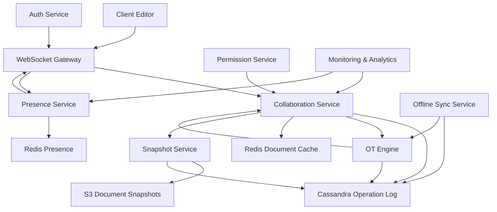

# Google Docs Backend

**Category:** System Design
**Difficulty:** 🟡 Medium
**Seniority:** senior
**Companies:** Google, Microsoft, Dropbox, Notion, Atlassian
**Tags:** OT, CRDT, conflict resolution, real-time, collaboration, operational-transformation, version-control
**Time:** 90-120 min

---

## Problem Statement

Design the backend for a real-time collaborative document editor like Google Docs or Microsoft Office Online. Multiple users can edit the same document simultaneously, seeing each other's changes in real-time. The system must handle conflict resolution when users edit the same content concurrently, maintain a complete version history, support offline editing with sync, and scale to millions of documents with thousands of concurrent editors per document.

Key challenges: real-time synchronization, conflict-free concurrent editing, operational transformation vs CRDTs, handling network partitions, and maintaining consistency across distributed clients.

## Clarifying Questions

- What's the scale? *100M documents, 1M daily active users, peak 1,000 concurrent editors on a single document.*
- Document types? *Text documents in v1; spreadsheets, presentations later.*
- Conflict resolution strategy? *Operational Transformation (OT) or CRDTs — we'll discuss both.*
- Offline support? *Yes, users can edit offline; sync when reconnected.*
- Version history? *Yes, unlimited history with ability to restore any version.*
- Real-time latency? *Sub-100ms for editor updates to appear on other clients.*
- Permissions? *View, comment, edit, owner; sharing via links or explicit invites.*
- Rich text support? *Yes, bold, italic, links, images, comments in v1.*

## Requirements

### Functional

- Real-time collaborative editing with multiple users.
- Conflict resolution for concurrent edits.
- Operational transformation or CRDT-based synchronization.
- Document version history with restore capability.
- Offline editing with automatic sync on reconnection.
- Rich text formatting and embedded content.
- Comments and suggestions mode.
- Fine-grained permissions and sharing.
- Presence indicators (showing who is viewing/editing).

### Non-Functional

- Low latency: < 100ms for edit propagation.
- High availability: 99.9% for document access.
- Strong consistency: all users see the same document state.
- Scalability: handle 1,000 concurrent editors per document.
- Durability: no data loss; all changes persisted.
- Security: access control, encryption at rest.

### Out of Scope

- Spell check, grammar suggestions, AI features, export to PDF, complex formatting (tables, equations).

## Capacity Estimation

| Metric | Arithmetic | Result |
|---|---|---|
| Total documents | given | 100M |
| Daily active users | given | 1M |
| Active documents/day | 1M × 5 docs/user | 5M |
| Concurrent editors per doc (peak) | given | 1,000 |
| Edits per second (peak) | 1,000 × 10 edits/user | 10,000 ops/sec |
| Avg document size | given | 50 KB |
| Document storage | 100M × 50 KB | ~5 TB |
| Edit operations/day | 5M docs × 100 edits | 500M ops/day |
| Operation storage | 500M × 200 B | ~100 GB/day |
| Version history | 500M ops × 365 days | ~36 TB/year (compressed) |

Edit operations are the high-volume data point; need efficient storage and compression for version history.

## API Design

```text
// Document APIs
GET  /v1/documents/{documentId}
  resp: 200 { "documentId": "doc_123", "title": "...", "content": {...}, "version": 42 }

POST /v1/documents
  body: { "title": "My Document", "content": {...} }
  resp: 201 { "documentId": "doc_123", "version": 1 }

PUT  /v1/documents/{documentId}
  body: { "title": "...", "content": {...}, "expectedVersion": 42 }
  resp: 200 { "documentId": "doc_123", "version": 43 }
       409 { "error": "version_conflict" }

GET  /v1/documents/{documentId}/versions
  resp: 200 { "versions": [{ "version": 40, "timestamp": "...", "author": "..." }, ...] }

POST /v1/documents/{documentId}/versions/{version}/restore
  resp: 200 { "documentId": "doc_123", "version": 44 }

// Real-time collaboration (WebSocket)
WS   /v1/documents/{documentId}/collaborate
  Client -> Server: { "type": "op", "operation": {...}, "clientVersion": 42 }
  Server -> Client: { "type": "op", "operation": {...}, "serverVersion": 43 }
  Server -> Client: { "type": "presence", "users": [{ "userId": "...", "cursor": {...} }] }
  Server -> Client: { "type": "ack", "clientVersion": 42, "serverVersion": 43 }

// Operational Transformation APIs
POST /v1/documents/{documentId}/transform
  body: { "operation": {...}, "clientVersion": 42 }
  resp: 200 { "transformedOperation": {...}, "serverVersion": 43 }

// Offline sync
POST /v1/documents/{documentId}/sync
  body: { "operations": [...], "lastSyncVersion": 40 }
  resp: 200 { "serverOperations": [...], "newVersion": 45, "conflicts": [...] }

// Presence
POST /v1/documents/{documentId}/presence
  body: { "cursor": { "position": 100, "selection": [100, 150] } }
  resp: 200

GET  /v1/documents/{documentId}/presence
  resp: 200 { "users": [{ "userId": "u_1", "name": "Alice", "cursor": {...}, "lastSeen": "..." }] }
```

## Data Model

**PostgreSQL** for document metadata and permissions. **Cassandra/ScyllaDB** for operation log (time-series, high write throughput). **Redis** for real-time presence and caching. **S3** for document snapshots.

```text
// PostgreSQL - metadata
documents
  document_id     UUID PK
  owner_id        UUID
  title           TEXT
  created_at      TIMESTAMP
  updated_at      TIMESTAMP
  current_version BIGINT
  is_deleted      BOOLEAN

document_permissions
  permission_id   UUID PK
  document_id     UUID FK
  user_id         UUID
  permission_type ENUM(VIEW, COMMENT, EDIT, OWNER)
  granted_at      TIMESTAMP
  UNIQUE(document_id, user_id)

document_snapshots
  snapshot_id     UUID PK
  document_id     UUID FK
  version         BIGINT
  content         JSONB
  created_at      TIMESTAMP
  UNIQUE(document_id, version)

// Cassandra - operation log (append-only)
document_operations
  document_id     TEXT  // partition key
  version         BIGINT // clustering key (ASC)
  operation       BLOB  // serialized operation
  user_id         TEXT
  timestamp       TIMESTAMP
  PRIMARY KEY ((document_id), version)

// Redis - real-time data
document:{document_id}:current_version
  string: "42"

document:{document_id}:active_users
  set: ["user_1", "user_2", ...]

user:{user_id}:cursor:{document_id}
  hash: { "position": 100, "selectionStart": 100, "selectionEnd": 150, "updatedAt": "..." }

document:{document_id}:lock
  string: "locked_by_user_id" (for document-level operations)

// Operation format (OT-based)
Operation {
  type: "insert" | "delete" | "retain" | "format"
  position: integer
  length?: integer
  content?: string
  attributes?: { bold: true, color: "red" }
  userId: string
  timestamp: integer
}
```

## High-Level Design



**Real-time editing flow (OT-based):**

1. Client connects via WebSocket to Collaboration Service.
2. Client sends operation with client version: `{ "op": insert("hello", 10), "clientVersion": 42 }`.
3. Collaboration Service fetches current document state (version 43 from cache).
4. OT Engine transforms client operation against server operations (version 42 → 43).
5. Transformed operation applied to document state.
6. Operation appended to Cassandra log with version 44.
7. Broadcast transformed operation to all connected clients.
8. Client acknowledges receipt; server updates presence.

**Conflict resolution with OT:**

When two clients edit concurrently:
- Client A sends op at version 10: insert("X", 5)
- Client B sends op at version 10: delete(3, 5)
- Server receives A's op first, applies at version 11
- Server receives B's op, transforms against version 11 → delete(3, 6) (shifted by A's insert)
- Both clients receive transformed operations and converge to same state.

**Snapshot creation:**

Every N operations (e.g., 100), create a snapshot:
- Current document state serialized to JSON.
- Stored in S3 with version number.
- Metadata in PostgreSQL for quick lookup.
- Old operations can be archived or deleted.

## Deep Dives

### Operational Transformation (OT) algorithm

OT transforms operations to resolve conflicts when concurrent edits occur.

```text
// Basic OT operations
FUNCTION transform(op1, op2, priority):
    // op1 is the incoming operation, op2 is the concurrent operation
    // priority determines which operation "wins" in conflicting cases

    IF op1.type == "insert" AND op2.type == "insert":
        IF op1.position <= op2.position:
            // op1 comes before op2, no conflict
            RETURN op1
        ELSE:
            // op1 comes after op2, shift position
            RETURN { op1 with position: op1.position + op2.length }

    ELSE IF op1.type == "insert" AND op2.type == "delete":
        IF op1.position < op2.position:
            // Insert before delete, no conflict
            RETURN op1
        ELSE IF op1.position >= op2.position + op2.length:
            // Insert after delete, shift position
            RETURN { op1 with position: op1.position - op2.length }
        ELSE:
            // Insert inside deleted range
            RETURN { op1 with position: op2.position }

    ELSE IF op1.type == "delete" AND op2.type == "insert":
        IF op1.position <= op2.position:
            // Delete before insert, no conflict
            RETURN op1
        ELSE:
            // Delete after insert, shift position
            RETURN { op1 with position: op1.position + op2.length }

    ELSE IF op1.type == "delete" AND op2.type == "delete":
        IF op1.position + op1.length <= op2.position:
            // op1 before op2, no overlap
            RETURN op1
        ELSE IF op1.position >= op2.position + op2.length:
            // op1 after op2, shift position
            RETURN { op1 with position: op1.position - op2.length }
        ELSE:
            // Overlapping deletes - merge them
            newStart = min(op1.position, op2.position)
            newEnd = max(op1.position + op1.length, op2.position + op2.length)
            RETURN { type: "delete", position: newStart, length: newEnd - newStart }

FUNCTION transformAgainstHistory(op, historyOps):
    // Transform operation against all operations since client version
    transformedOp = op
    FOR EACH historyOp IN historyOps:
        transformedOp = transform(transformedOp, historyOp, priority = "server")
    RETURN transformedOp
```

### Alternative: CRDT (Conflict-free Replicated Data Types)

CRDTs guarantee convergence without a central server for transformation.

```text
// LWW-Element-Set (Last-Write-Wins) for text
// Each character is a CRDT element with unique ID and timestamp

Character {
  id: UUID          // globally unique (userId + counter)
  value: string     // the character
  timestamp: bigint // Lamport timestamp or hybrid logical clock
  deleted: boolean  // tombstone for deletions
}

FUNCTION applyRemoteOperation(remoteOp, localDoc):
    FOR EACH char IN remoteOp.characters:
        existing = localDoc.find(char.id)
        IF existing == NULL:
            localDoc.insert(char)
        ELSE IF char.timestamp > existing.timestamp:
            localDoc.replace(char.id, char)
        // else: local version wins, ignore remote

FUNCTION generateInsertOperation(userId, position, text):
    chars = []
    FOR i, ch IN enumerate(text):
        chars.append({
            "id": generateUUID(userId, localCounter),
            "value": ch,
            "timestamp": getLamportClock(),
            "deleted": false
        })
    RETURN { "type": "insert", "chars": chars, "position": position }

FUNCTION generateDeleteOperation(userId, range):
    chars = localDoc.getCharsInRange(range)
    FOR EACH char IN chars:
        char.deleted = true
        char.timestamp = getLamportClock()
    RETURN { "type": "delete", "chars": chars }
```

**Trade-off: OT vs CRDT**
- OT: Requires central server for transformation, more complex algorithm, but smaller operation size.
- CRDT: No central coordination needed, simpler convergence, but larger operation size (full character IDs).

### Real-time synchronization with WebSocket

```text
// Server-side WebSocket handler
FUNCTION handleWebSocketConnection(ws, documentId, userId):
    // Verify permissions
    IF NOT hasPermission(userId, documentId, "EDIT"):
        ws.close(403, "Forbidden")
        RETURN

    // Get current document state
    currentVersion = redis.get("document:{documentId}:current_version")
    document = getDocumentFromCacheOrDB(documentId, currentVersion)

    // Send initial state
    ws.send(json({
        "type": "init",
        "document": document,
        "version": currentVersion
    }))

    // Add to presence
    redis.sadd("document:{documentId}:active_users", userId)
    broadcastPresence(documentId)

    // Handle incoming operations
    ws.on("message", (message) => {
        data = json.parse(message)

        IF data.type == "op":
            handleOperation(ws, documentId, userId, data)
        ELSE IF data.type == "cursor":
            handleCursorUpdate(documentId, userId, data.cursor)
        ELSE IF data.type == "ack":
            handleAck(documentId, userId, data.clientVersion)
    })

    // Handle disconnect
    ws.on("close", () => {
        redis.srem("document:{documentId}:active_users", userId)
        broadcastPresence(documentId)
    })

FUNCTION handleOperation(ws, documentId, userId, data):
    // Get operations since client version
    historyOps = getOperationsSince(documentId, data.clientVersion)

    // Transform operation
    transformedOp = transformAgainstHistory(data.operation, historyOps)

    // Apply operation
    newVersion = applyOperation(documentId, transformedOp, userId)

    // Broadcast to all clients
    broadcastToDocument(documentId, {
        "type": "op",
        "operation": transformedOp,
        "serverVersion": newVersion,
        "userId": userId
    }, exclude = [ws])

    // Acknowledge sender
    ws.send(json({
        "type": "ack",
        "clientVersion": data.clientVersion,
        "serverVersion": newVersion
    }))
```

### Offline editing and sync

```text
// Client-side offline operation log
FUNCTION applyLocalOperation(operation):
    // Apply to local document immediately
    localDoc.apply(operation)

    // Add to pending operations
    pendingOps.append({
        "operation": operation,
        "clientVersion": localDoc.version,
        "timestamp": now()
    })

    localDoc.version += 1

FUNCTION syncOnReconnect(documentId):
    IF NOT isOnline(): RETURN

    // Get last known server version
    lastServerVersion = getLastSyncedVersion(documentId)

    // Send pending operations
    response = http.post("/v1/documents/{documentId}/sync", {
        "operations": pendingOps,
        "lastSyncVersion": lastServerVersion
    })

    // Apply server operations to local doc
    FOR EACH serverOp IN response.serverOperations:
        transformed = transformAgainstHistory(serverOp, localOpsSince(lastServerVersion))
        localDoc.apply(transformed)

    // Handle conflicts (if any)
    FOR EACH conflict IN response.conflicts:
        resolveConflict(conflict)

    // Clear pending operations
    pendingOps.clear()
    lastSyncedVersion = response.newVersion

FUNCTION resolveConflict(conflict):
    // Simple strategy: server wins, show conflict UI to user
    localDoc.apply(conflict.serverOperation)
    showConflictNotification(conflict)
```

### Version history and snapshots

```text
FUNCTION createSnapshot(documentId):
    currentVersion = redis.get("document:{documentId}:current_version")
    document = reconstructDocumentFromOperations(documentId, currentVersion)

    // Store snapshot in S3
    snapshotKey = "snapshots/{documentId}/v{currentVersion}.json"
    s3.put(snapshotKey, json.serialize(document))

    // Store metadata in PostgreSQL
    db.execute("""
        INSERT INTO document_snapshots (snapshot_id, document_id, version, content, created_at)
        VALUES ($1, $2, $3, $4, NOW())
    """, [generateUUID(), documentId, currentVersion, document])

    // Archive old operations (optional)
    IF currentVersion % 1000 == 0:
        archiveOperationsBefore(documentId, currentVersion - 10000)

FUNCTION reconstructDocumentFromOperations(documentId, targetVersion):
    // Find latest snapshot before target version
    snapshot = db.query("""
        SELECT * FROM document_snapshots
        WHERE document_id = $1 AND version <= $2
        ORDER BY version DESC LIMIT 1
    """, [documentId, targetVersion])

    document = snapshot.content

    // Apply operations from snapshot version to target
    ops = cassandra.query("""
        SELECT operation FROM document_operations
        WHERE document_id = $1 AND version > $2 AND version <= $3
    """, [documentId, snapshot.version, targetVersion])

    FOR EACH op IN ops:
        document.apply(op)

    RETURN document
```

## Scaling & Reliability

- **WebSocket connection pooling:** use connection managers like Socket.IO or raw WebSocket with stateless services.
- **Document sharding:** shard documents by document_id; each document's operations on a single Cassandra partition.
- **Operation log compaction:** periodically compact operations into snapshots to reduce log size.
- **Multi-region deployment:** Cassandra multi-DC for operation log; eventual consistency acceptable for OT with proper vector clocks.
- **Circuit breakers:** protect Cassandra and S3 from overload during high edit volume.
- **Presence scaling:** use Redis pub/sub for presence broadcasts; shard by document for high-concurrency docs.
- **Monitoring:** operation latency, WebSocket connection count, conflict rate, sync success rate, snapshot creation lag.
- **Graceful degradation:** if WebSocket unavailable, fall back to HTTP polling; if OT service down, queue operations for later sync.

## Trade-offs

| Decision | Option A | Option B | Choice & Why |
|---|---|---|---|
| Conflict resolution | Operational Transformation | CRDT | OT — smaller operation size, better for text; CRDTs add overhead per character. |
| Operation storage | Cassandra | PostgreSQL | Cassandra — better for append-only time-series with high write throughput. |
| Real-time transport | WebSocket | HTTP polling | WebSocket — lower latency, better UX; polling as fallback. |
| Snapshot strategy | Every 100 ops | Every 1000 ops | Every 100 ops — faster reconstruction, more snapshots but acceptable storage cost. |
| Offline sync | Client-side OT | Server-side reconciliation | Client-side OT — better UX, immediate local updates; server reconciliation as backup. |
| Presence implementation | Redis pub/sub | Database polling | Redis pub/sub — real-time, low latency; polling not acceptable for presence. |

## Follow-up Questions

1. **How would you handle large documents (100K+ characters)?** Use lazy loading, virtual scrolling, and differential sync (send only changed regions). Consider splitting document into blocks.
2. **How do you handle network partitions during editing?** OT with version vectors to detect conflicts; auto-resolve when possible; show conflict UI for manual resolution.
3. **How would you support real-time collaborative cursors?** Broadcast cursor positions via WebSocket; use exponential backoff for frequent updates; render cursors on all clients.
4. **How do you handle permission changes during active editing?** Check permissions on each operation; revoke access immediately; notify disconnected users.
5. **How would you extend this to spreadsheets?** Use 2D CRDTs or OT for cell-level operations; more complex conflict resolution for formula dependencies.

## Common Mistakes

- Using simple last-write-wins for text (loses data).
- Not handling operation transformation order (divergent state).
- Storing full document on every operation (storage explosion).
- Not implementing proper version vectors (causality violations).
- Ignoring offline sync (poor UX on unreliable networks).
- Single-threaded WebSocket handler (bottleneck for high-concurrency docs).

## Key Takeaways

- Operational Transformation and CRDTs are the two main approaches to conflict resolution.
- OT requires a central coordinator but has smaller operation size; CRDTs are peer-to-peer but larger.
- Version vectors or Lamport clocks are essential for tracking causality.
- Real-time collaboration needs WebSockets with presence and broadcast.
- Operation log with periodic snapshots balances storage and reconstruction time.
- Offline editing requires client-side operation log and sync on reconnection.
- Sharding by document_id isolates hot documents; Cassandra handles high write throughput.
- Monitor conflict rate and operation latency as key health metrics.
