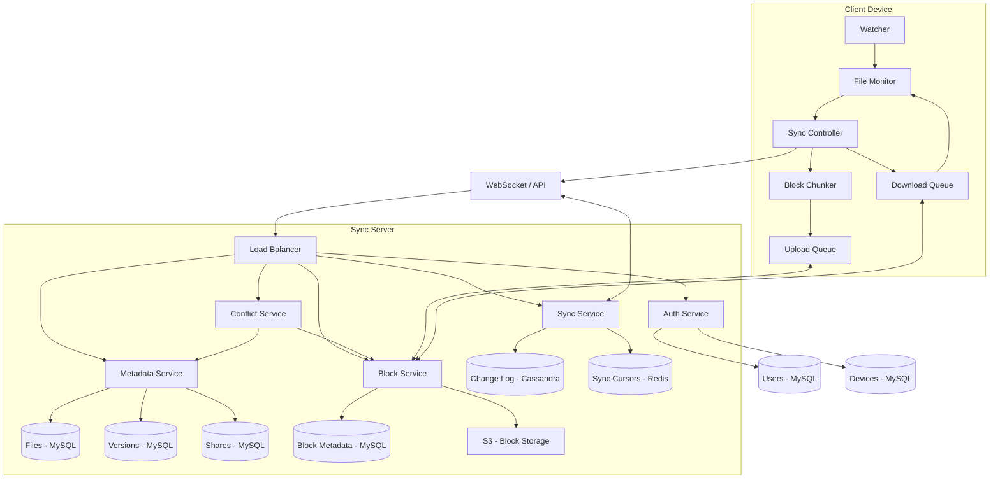

# Google Drive File Sync

**Category:** System Design
**Difficulty:** 🔴 Hard
**Seniority:** senior
**Companies:** Google, Dropbox
**Tags:** file sync, conflict resolution, delta sync
**Time:** 90-120 min

---

## Problem Statement

Design a file synchronization service like Google Drive or Dropbox. Users install a client application on their devices that automatically syncs files and folders to the cloud. Changes made on any device should propagate to all other devices in near real-time. The system must handle millions of users, billions of files, and concurrent edits across multiple devices with robust conflict resolution.

The interviewer expects you to design the client-server sync protocol, conflict resolution strategy, storage architecture, and mechanisms for efficient delta synchronization (only transferring changed parts of files).

## Clarifying Questions

- How many users and files? *100M users, 10B files total, average 100 files/user.*
- File size distribution? *80% < 10 MB, 15% 10-100 MB, 5% > 100 MB (up to 5 GB).*
- Sync frequency? *Real-time: within seconds of changes for small files.*
- Concurrent devices? *Average 3 devices/user, up to 10.*
- Conflict scenarios? *Same file edited offline on multiple devices.*
- Versioning requirements? *Keep all versions with 30-day history for free users.*
- Sharing requirements? *Basic folder sharing (read/write permissions).*
- Platform support? *Desktop (Windows, macOS, Linux), mobile (iOS, Android), web.*

## Requirements

### Functional

- Upload, download, delete, move, and rename files and folders.
- Automatic sync across all user devices.
- Conflict resolution when same file edited concurrently.
- File versioning with history and restore capability.
- Folder sharing with permissions (owner, editor, viewer).
- Offline support with sync when reconnected.
- Selective sync (choose which folders to sync locally).
- Delta sync (only transfer changed blocks for large files).

### Non-Functional

- Sync latency p95 < 10 seconds for small files (< 10 MB).
- High availability (99.9% uptime).
- Strong consistency for file metadata, eventual for content propagation.
- Efficient bandwidth usage (delta sync, compression).
- Scalable to 100M users, 10B files, 100 PB storage.
- Secure: encryption at rest and in transit, access control.

### Out of Scope

- Real-time collaboration (Google Docs-style), advanced sharing (public links, expiration), content search, preview generation.

## System Architecture



**Sync protocol (bidirectional):**

1. Client connects with device_id and auth token.
2. Server authenticates and returns server_cursor (last known state).
3. Client sends local changes since last sync.
4. Server processes changes, updates metadata, writes to change_log.
5. Server returns remote changes since client's cursor.
6. Client applies remote changes, updates local cursor.
7. Connection kept alive (WebSocket) for real-time push of changes.

**Block-based upload (delta sync):**

1. Client chunks file into fixed-size blocks (e.g., 4 MB).
2. For each block, compute hash and check if already exists on server.
3. Upload only new blocks (deduplication).
4. For modified files, upload only changed blocks.
5. Commit file with list of block_ids and overall file hash.

**Conflict resolution:**

1. Server detects concurrent edits (same file, different versions).
2. Generates conflict copy: "filename (conflict copy 2024-01-15).pdf"
3. Preserves both versions; user manually resolves.
4. Alternative: merge for text files (diff3 algorithm).

## Data Model

```text
users (MySQL)
  user_id, email, storage_quota, storage_used,
  created_at, subscription_tier

devices (MySQL)
  device_id, user_id, device_name, device_type,
  last_sync_cursor, last_seen

files (MySQL + cache)
  file_id, user_id, parent_folder_id, name,
  file_hash, size, mime_type, current_version,
  is_deleted, created_at, modified_at

file_versions (MySQL)
  version_id, file_id, version_number,
  file_hash, size, created_at, created_by_device

file_blocks (MySQL)
  file_id, version_id, block_index, block_id, block_hash
  Composite key: (file_id, version_id, block_index)

blocks (object store + metadata)
  block_id, block_hash, size, ref_count,
  storage_path (S3 key), created_at

folders (MySQL)
  folder_id, user_id, parent_folder_id, name,
  is_deleted, created_at

shares (MySQL)
  share_id, file_id, owner_id, shared_with_user_id,
  permission (owner/editor/viewer), created_at

sync_cursors (Redis)
  key: cursor:{user_id}:{device_id}
  value: last_processed_change_id

change_log (Cassandra)
  change_id (Snowflake), user_id, file_id,
  change_type (create/modify/delete/move),
  version_number, created_at
  Primary key: (user_id, change_id DESC) for time-ordered queries
```

## API Design

```text
// Client-Server sync protocol (WebSocket or long-polling)

Client → Server: HELLO { device_id, user_auth_token, cursor }
Server → Client: HELLO_ACK { server_cursor, changes_since_cursor }

Client → Server: NOTIFY_CHANGES { changes: [
  { type: "create", path: "/docs/report.pdf", size: 1024000,
    hash: "sha256:abc123...", blocks: [...] },
  { type: "modify", file_id: "f_123", blocks_changed: [0, 5, 10],
    new_hash: "sha256:def456..." },
  { type: "delete", file_id: "f_456" },
  { type: "move", file_id: "f_789", new_path: "/archive/" }
]}

Server → Client: CHANGES { changes: [...], new_cursor }

// Block upload (for delta sync)
POST /v1/blocks/upload
  Body: binary block data
  201 → { "block_id": "b_abc123", "block_hash": "sha256:..." }

POST /v1/files/commit
  Body: { "file_id", "block_ids": ["b_abc123", ...],
          "file_hash": "sha256:...", "version": 5 }
  201 → { "file_id", "version": 6, "server_cursor" }

GET /v1/files/{file_id}/blocks
  200 → { "block_ids": [...], "block_hashes": [...] }

GET /v1/blocks/{block_id}
  200 → binary block data

// Metadata operations
GET /v1/files/list?path=/docs&cursor=...
  200 → { "files": [...], "cursor" }

GET /v1/files/{file_id}/versions
  200 → { "versions": [{ "version", "created_at", "size" }] }

POST /v1/shares
  Body: { "file_id", "email", "permission": "editor" }
  201 → { "share_id" }
```

## Scalability

- **Sharding strategy:**
  - Files: by user_id (hash)
  - Change log: by user_id (Cassandra)
  - Blocks: by block_id hash (S3)
  - Metadata: by user_id (MySQL sharded)

- **Replication:**
  - MySQL: master-slave with read replicas
  - Cassandra: RF=3 across AZs
  - S3: multi-region replication
  - Redis: cluster with replicas

- **Caching:**
  - File metadata: Redis (TTL: 5 minutes)
  - Block existence: Redis Bloom filter
  - Sync cursors: Redis (persistent)
  - User preferences: Redis

- **Connection management:**
  - WebSocket connection pool per server
  - Connection state in Redis (for failover)
  - Heartbeat every 30 seconds
  - Reconnection with exponential backoff

- **Failure handling:**
  - Block upload retry with exponential backoff
  - File commit idempotent (same block list = same version)
  - Change log write-ahead before metadata update
  - Graceful degradation: serve older version if latest unavailable

- **Monitoring:**
  - Sync latency (time from change to propagation)
  - Upload/download success rates
  - Conflict rate
  - Storage utilization per user
  - WebSocket connection count
  - Block deduplication ratio

## Consistency & Availability

- **Consistency model:**
  - Strong consistency for file metadata (MySQL with synchronous replication).
  - Eventual consistency for content propagation across devices (within seconds).
  - Linearizability for single-device operations (read-your-writes).

- **Availability strategies:**
  - Multi-region deployment with active-active configuration.
  - Offline support with local change queue.
  - Graceful degradation: serve older version if latest unavailable.
  - Circuit breakers to prevent cascading failures.

- **Data consistency:**
  - Change log as source of truth for sync state.
  - Version vectors for conflict detection.
  - Idempotent operations for retry safety.
  - Transactional metadata updates.

- **Conflict handling:**
  - Optimistic concurrency control with version numbers.
  - Conflict copies preserve both versions.
  - User-initiated merge for resolution.
  - Automatic merge for text files (diff3).

## Security

- **Authentication:**
  - OAuth 2.0 / JWT tokens for API access.
  - Device registration and management.
  - Session tokens with expiration.
  - Multi-factor authentication for sensitive operations.

- **Authorization:**
  - Access control lists (ACLs) for files and folders.
  - Share permissions (owner, editor, viewer).
  - Resource-level permissions checks.
  - Audit logging for access.

- **Data protection:**
  - Client-side encryption option (zero-knowledge).
  - Server-side encryption at rest (S3 encryption).
  - Encryption in transit (TLS 1.3).
  - Secure key management (KMS).

- **Privacy:**
  - Data isolation per user.
  - PII data redaction in logs.
  - GDPR compliance with right to deletion.
  - Data retention policies.

- **Abuse prevention:**
  - Rate limiting per user/IP.
  - Quota enforcement (storage, bandwidth).
  - Malware scanning in upload pipeline.
  - DDoS protection.

## Trade-offs

| Decision | Option A | Option B | Choice & Why |
|---|---|---|
| Sync protocol | Polling | WebSocket | WebSocket: real-time, lower latency, efficient |
| Block size | 1 MB | 4 MB | 4 MB: balance between granularity and overhead |
| Conflict resolution | Auto-merge | Conflict copy | Conflict copy: safe for all file types, explicit user action |
| Version storage | Full copies | Delta storage | Full copies: simpler, faster restore; delta for storage savings |
| Change log retention | 7 days | 30 days | 30 days: supports offline devices, reasonable storage |
| Metadata store | MySQL | Cassandra | MySQL: strong consistency, simpler queries; Cassandra for change log |

## Follow-up Questions

1. **How do you handle large files (> 1 GB)?** Chunked upload with resumability. Client uploads blocks in parallel, server tracks progress. Resume from last successful block on failure.
2. **How do you implement sharing?** Copy file metadata to shared user's namespace with reference to original blocks. Permission checks on access. Change log includes shared file changes.
3. **How do you handle encryption?** Client-side encryption for sensitive data. Key management service (KMS) for key storage. Server cannot decrypt user data.
4. **How do you detect malicious files?** Integrate virus scanning in upload pipeline. Quarantine suspicious files. Async scanning to not block sync.
5. **How do you handle storage quotas?** Track storage per user (sum of unique blocks). Enforce on upload. Graceful degradation: read-only when over quota.
6. **How do you optimize for mobile devices?** Adaptive block size (smaller on mobile). Throttle uploads based on network conditions. Battery-aware sync scheduling.

## Common Mistakes

- Full file upload on every change (wastes bandwidth).
- No conflict resolution strategy (data loss).
- Strong consistency everywhere (unnecessary, hurts performance).
- Polling instead of push (high latency, wasted resources).
- Storing full file copies for versions (storage explosion).
- No offline support (poor UX on flaky networks).
- Ignoring mobile constraints (battery, data caps).

## Key Takeaways

- Block-level deduplication is essential for storage and bandwidth efficiency.
- Bidirectional sync protocol with conflict detection is the core challenge.
- Change log with sync cursors enables reliable, resumable synchronization.
- WebSocket push provides real-time sync without polling overhead.
- Conflict resolution must be explicit (conflict copies) to avoid data loss.
- Offline support requires local change queue and reconnection logic.
- Metadata and content storage should be separated for different scaling needs.
- Reference counting for blocks enables efficient deduplication and cleanup.
