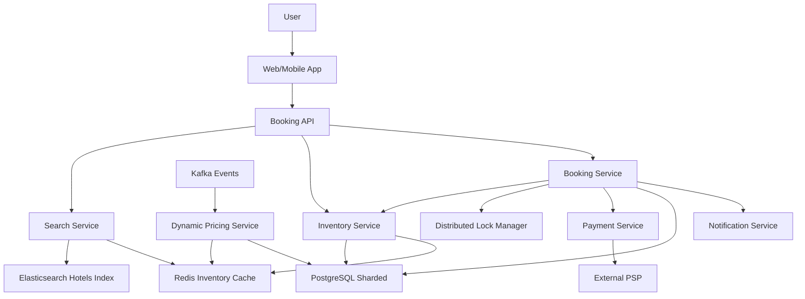

# Hotel Booking System

**Category:** System Design
**Difficulty:** 🟡 Medium
**Seniority:** mid-level
**Companies:** Booking.com, Airbnb, Expedia, Hotels.com, Marriott
**Tags:** transactions, availability, concurrency, inventory-management, distributed-locking
**Time:** 60-90 min

---

## Problem Statement

Design a hotel booking system that allows users to search for hotels, check availability for specific dates, and make reservations. The system must handle high concurrency during peak booking periods (holidays, events), prevent overbooking (selling more rooms than available), support different room types and pricing tiers, and provide a consistent user experience across multiple devices.

The interviewer emphasizes the challenge of inventory management: multiple users viewing the same room simultaneously, with the need to ensure that once a booking is confirmed, the room is no longer available to others. The system handles ~1M bookings/day with peak loads of 10x during events.

## Clarifying Questions

- Transaction volume? *1M bookings/day, peak ~10M during events; 100K concurrent users browsing.*
- Hotel/room scale? *1M hotels, 10M rooms total, average 50 rooms per hotel.*
- Booking flow? *Search → Select room → Enter guest details → Confirm payment → Booking confirmed.*
- Cancellation policy? *Free cancellation up to 24 hours before check-in; refunds handled separately.*
- Pricing model? *Dynamic pricing based on demand, season, and lead time.*
- Payment integration? *Integrate with external PSP; payment confirmation triggers booking.*
- Consistency requirements? *No overbooking; strong consistency for inventory; eventual consistency for search.*

## Requirements

### Functional

- Search hotels by location, dates, guests, amenities, and price range.
- Display real-time availability and pricing for room types.
- Reserve a room temporarily during checkout (hold inventory).
- Confirm booking upon successful payment.
- Handle cancellations and refunds (release inventory back).
- Support different room types with varying capacity and amenities.
- Implement dynamic pricing based on demand and seasonality.

### Non-Functional

- High concurrency: handle 100K concurrent users without overbooking.
- Low latency: search results within 500 ms, booking confirmation within 2 seconds.
- Availability: 99.9% for booking flow; 99.99% for search.
- Scalability: handle 10x peak traffic during events.
- Data consistency: no double bookings, accurate inventory counts.
- Durability: all bookings persisted; no lost reservations.

### Out of Scope

- Payment processing internals (assume PSP integration), loyalty program, reviews/ratings, hotel onboarding.

## Capacity Estimation

| Metric | Arithmetic | Result |
|---|---|---|---|
| Bookings/day | given | 1M |
| Peak bookings/day | 10x | 10M |
| Avg TPS | 1M / 86,400 | ~12 TPS |
| Peak TPS | 10M / 86,400 | ~115 TPS |
| Search queries/day | 10M bookings x 20 searches/booking | 200M |
| Peak search QPS | 200M / 86,400 x 3 | ~7,000 QPS |
| Hotels | given | 1M |
| Rooms | 1M x 10 avg | 10M |
| Inventory records | 10M rooms x 365 days | ~3.65B records |
| Booking records | 1M/day x 365 days | ~365M/year, archived after 7 years |

Search is read-heavy and can use denormalized indexes. Booking is write-heavy and requires strong consistency with database transactions.

## API Design

```text
GET /v1/hotels/search
  query: location=Paris&checkIn=2024-06-01&checkOut=2024-06-05&guests=2
  resp: 200 {
    "hotels": [
      {
        "hotelId": "h_123",
        "name": "Grand Hotel Paris",
        "location": { "lat": 48.85, "lon": 2.35 },
        "rooms": [
          {
            "roomTypeId": "rt_456",
            "name": "Deluxe King",
            "available": 5,
            "pricePerNight": 250,
            "currency": "EUR"
          }
        ],
        "rating": 4.5,
        "amenities": ["wifi", "pool", "spa"]
      }
    ],
    "total": 150
  }

POST /v1/bookings/hold
  body: {
    "hotelId": "h_123",
    "roomTypeId": "rt_456",
    "checkIn": "2024-06-01",
    "checkOut": "2024-06-05",
    "guests": 2
  }
  resp: 200 {
    "holdId": "hold_abc123",
    "expiresAt": "2024-01-15T10:15:00Z",  // 15 minutes from now
    "price": { "total": 1000, "currency": "EUR", "breakdown": [...] }
  }

POST /v1/bookings/confirm
  body: {
    "holdId": "hold_abc123",
    "guestDetails": { "name": "John Doe", "email": "john@example.com" },
    "paymentToken": "tok_visa_xyz"
  }
  resp: 201 {
    "bookingId": "bk_789",
    "status": "CONFIRMED",
    "confirmationCode": "ABC123XYZ"
  }

DELETE /v1/bookings/{bookingId}
  resp: 200 { "status": "CANCELLED", "refundAmount": 1000 }

GET /v1/bookings/{bookingId}
  resp: 200 { "bookingId", "status", "hotel", "dates", "price", "guestDetails" }
```

## Data Model

**PostgreSQL (sharded by hotel_id or region):**

```sql
hotel
  hotel_id UUID PK
  name TEXT NOT NULL
  location_lat FLOAT
  location_lon FLOAT
  address TEXT
  amenities JSONB
  rating FLOAT
  created_at TIMESTAMP

room_type
  room_type_id UUID PK
  hotel_id UUID FK
  name TEXT NOT NULL
  capacity INT NOT NULL
  base_price_cents INT NOT NULL
  amenities JSONB
  description TEXT

inventory
  inventory_id BIGSERIAL PK
  hotel_id UUID
  room_type_id UUID
  date DATE NOT NULL
  total_rooms INT NOT NULL
  available_rooms INT NOT NULL
  price_cents INT NOT NULL  // dynamic price for this date
  UNIQUE(hotel_id, room_type_id, date)

booking
  booking_id UUID PK
  hotel_id UUID FK
  room_type_id UUID FK
  user_id UUID FK
  check_in DATE NOT NULL
  check_out DATE NOT NULL
  status ENUM(PENDING, CONFIRMED, CANCELLED, NO_SHOW)
  total_price_cents INT NOT NULL
  guest_details JSONB
  payment_id TEXT
  created_at TIMESTAMP
  updated_at TIMESTAMP

booking_hold
  hold_id UUID PK
  hotel_id UUID
  room_type_id UUID
  check_in DATE
  check_out DATE
  user_id UUID
  expires_at TIMESTAMP NOT NULL
  status ENUM(ACTIVE, RELEASED, CONVERTED)
  created_at TIMESTAMP
```

**Redis (for caching and distributed locking):**

```text
// Inventory cache (read-through)
inventory:{hotel_id}:{room_type_id}:{date} → HASH { available, price, version }

// Distributed lock for booking
lock:booking:{hotel_id}:{room_type_id}:{date} → SET with TTL

// Hold cache
hold:{hold_id} → HASH { hotel_id, room_type_id, dates, user_id, expires_at }

// Search cache (geo + date)
search:{location_hash}:{check_in}:{check_out} → LIST of hotel_ids (TTL: 5 min)
```

## High-Level Design



**Search flow:**
1. User searches for hotels by location and dates.
2. Search Service queries Elasticsearch for hotels in the location.
3. For each hotel, check inventory cache for availability and pricing.
4. Return results sorted by relevance, price, and availability.

**Booking flow:**
1. User selects a room and clicks "Book".
2. Booking Service creates a temporary hold (15 minutes) on inventory.
3. User enters guest details and payment info.
4. Booking Service acquires distributed lock, confirms availability, processes payment.
5. On payment success, deduct inventory, create booking record, release lock.
6. Send confirmation notification.

**Cancellation flow:**
1. User cancels booking (if within policy).
2. Booking Service updates booking status to CANCELLED.
3. Inventory Service releases rooms back to available pool.
4. Trigger refund via payment service.

## Deep Dives

### Inventory management and concurrency

Prevent overbooking using database transactions with row-level locking:

```text
FUNCTION holdInventory(hotelId, roomTypeId, checkIn, checkOut, userId):
  holdId ← uuid()
  expiresAt ← NOW() + 15 minutes

  BEGIN TRANSACTION
    // Check availability for each date in the range
    FOR date IN dateRange(checkIn, checkOut):
      SELECT available_rooms, version
        FROM inventory
        WHERE hotel_id = hotelId AND room_type_id = roomTypeId AND date = date
        FOR UPDATE  // row-level lock

      IF available_rooms < 1:
        ROLLBACK
        RETURN { error: "NO_AVAILABILITY" }

    // Create hold record
    INSERT booking_hold(hold_id, hotel_id, room_type_id, check_in, check_out,
                        user_id, expires_at, status = ACTIVE)

    // Optionally, soft-deduct available_rooms (with version check)
    // Or keep available_rooms unchanged until confirm (optimistic)
  COMMIT

  // Cache the hold
  Redis.setex("hold:" + holdId, 900, serialize({ hotelId, roomTypeId, dates, userId }))
  RETURN { holdId, expiresAt }
```

Using `FOR UPDATE` locks the inventory rows for the duration of the transaction, preventing concurrent bookings from seeing inconsistent state.

### Confirming booking with payment

```text
FUNCTION confirmBooking(holdId, guestDetails, paymentToken):
  hold ← Redis.get("hold:" + holdId)
  IF NOT hold OR hold.expiresAt < NOW():
    RETURN { error: "HOLD_EXPIRED" }

  // Acquire distributed lock for additional safety
  lockKey ← "lock:booking:" + hold.hotelId + ":" + hold.roomTypeId + ":" + hold.checkIn
  IF NOT Redis.set(lockKey, "1", NX=True, EX=30):
    RETURN { error: "CONCURRENT_BOOKING" }

  TRY:
    BEGIN TRANSACTION
      // Verify hold still exists and is active
      SELECT * FROM booking_hold WHERE hold_id = holdId AND status = ACTIVE FOR UPDATE
      IF NOT FOUND: ROLLBACK; RETURN { error: "HOLD_INVALID" }

      // Deduct inventory
      FOR date IN dateRange(hold.checkIn, hold.checkOut):
        UPDATE inventory
          SET available_rooms = available_rooms - 1, version = version + 1
          WHERE hotel_id = hold.hotelId AND room_type_id = hold.roomTypeId
            AND date = date AND available_rooms > 0
            AND version = currentVersion  // optimistic concurrency check

        IF ROW_COUNT = 0:
          ROLLBACK; RETURN { error: "INVENTORY_CHANGED" }

      // Process payment
      paymentResult ← PaymentService.charge(paymentToken, amount)
      IF paymentResult.status != SUCCESS:
        ROLLBACK; RETURN { error: "PAYMENT_FAILED" }

      // Create booking
      bookingId ← uuid()
      INSERT booking(booking_id, hotel_id, room_type_id, user_id, check_in, check_out,
                     status = CONFIRMED, total_price_cents, guest_details, payment_id)

      // Update hold status
      UPDATE booking_hold SET status = CONVERTED WHERE hold_id = holdId
    COMMIT

    Redis.del(lockKey)
    Redis.del("hold:" + holdId)
    RETURN { bookingId, confirmationCode }

  CATCH error:
    ROLLBACK
    Redis.del(lockKey)
    RETURN { error: "BOOKING_FAILED" }
```

The distributed lock provides an additional safety layer beyond database locks, especially useful when the database is sharded.

### Handling hold expiration

Holds that expire without conversion must release the soft-reserved inventory:

```text
FUNCTION expireHolds():
  expiredHolds ← SELECT * FROM booking_hold
    WHERE status = ACTIVE AND expires_at < NOW()
    LIMIT 1000

  FOR hold IN expiredHolds:
    BEGIN TRANSACTION
      UPDATE booking_hold SET status = RELEASED WHERE hold_id = hold.hold_id
      // If we soft-deducted on hold, increment available_rooms back
    COMMIT

    Redis.del("hold:" + hold.holdId)
```

Run this as a periodic job (every minute). For systems that don't soft-deduct on hold, expiration only deletes the hold record.

### Search with availability filtering

Search needs to filter hotels that have availability for the requested dates:

```text
FUNCTION searchHotels(location, checkIn, checkOut, guests):
  // Step 1: Geo search for hotels in location
  hotelIds ← Elasticsearch.geoQuery(location, radius=10km)

  // Step 2: Check availability for each hotel (batched)
  availableHotels ← []
  FOR batch IN chunks(hotelIds, 100):
    inventoryData ← Redis.mget(
      "inventory:{hotelId}:{roomTypeId}:{date}" FOR hotelId IN batch, date IN dateRange
    )

    FOR hotelId IN batch:
      IF hasAvailability(hotelId, inventoryData, checkIn, checkOut):
        availableHotels.append(hotelId)

  // Step 3: Fetch hotel details and room types
  hotels ← PostgreSQL.batchFetch(availableHotels)

  // Step 4: Sort and paginate
  RETURN sortAndPaginate(hotels, price, rating)
```

Optimization: Pre-compute availability for popular date ranges and cache the results. Use a bitmap index for fast availability checks.

### Dynamic pricing

Prices change based on demand, season, and lead time:

```text
FUNCTION calculatePrice(hotelId, roomTypeId, date):
  basePrice ← SELECT base_price_cents FROM room_type WHERE room_type_id = roomTypeId

  // Demand multiplier (from historical booking data)
  demandMultiplier ← PricingService.getDemandMultiplier(hotelId, date)

  // Seasonal multiplier
  seasonalMultiplier ← PricingService.getSeasonalMultiplier(date)

  // Lead time multiplier (book early = discount, last minute = premium)
  leadTimeDays ← date - TODAY
  leadTimeMultiplier ← PricingService.getLeadTimeMultiplier(leadTimeDays)

  finalPrice ← basePrice * demandMultiplier * seasonalMultiplier * leadTimeMultiplier
  RETURN ROUND(finalPrice)
```

Pricing service runs as a batch job nightly to compute prices for the next 90 days, updating both database and cache. Real-time demand spikes can trigger immediate price adjustments.

## Scaling & Reliability

- **Database sharding:** Shard by hotel_id or geographic region to distribute load. Use consistent hashing for even distribution.
- **Read replicas:** Search queries hit read replicas; booking writes go to primary.
- **Caching:** Multi-level caching for inventory (Redis) and search results (CDN edge cache for static data).
- **Rate limiting:** Per-user rate limits on search and booking to prevent abuse.
- **Circuit breakers:** If payment service is down, fail gracefully and don't hold inventory indefinitely.
- **Idempotency:** Booking API uses idempotency keys to prevent duplicate charges on retry.
- **Monitoring:** Inventory accuracy (daily reconciliation), booking success rate, hold expiration rate, cache hit rate, payment latency.
- **Graceful degradation:** If inventory cache is down, fall back to database queries (slower but functional).

## Trade-offs

| Decision | Option A | Option B | Choice & Why |
|---|---|---|---|
| Inventory locking | Pessimistic (FOR UPDATE) | Optimistic (version check) | Pessimistic for booking (correctness critical); optimistic for search (performance) |
| Hold implementation | Soft-deduct inventory | No deduct until confirm | No deduct — simpler, but risk of race conditions; soft-deduct with expiration for safety |
| Search technology | PostgreSQL + PostGIS | Elasticsearch | Elasticsearch — better geo search and filtering at scale |
| Pricing update | Real-time on demand | Batch nightly | Batch nightly — stable prices, predictable; real-time for demand spikes |
| Distributed lock | Redis | Zookeeper | Redis — simpler, lower latency; Zookeeper for stronger consistency if needed |
| Caching strategy | Write-through | Write-behind | Write-through for inventory (consistency); write-behind for analytics |

## Follow-up Questions

1. **How do you handle bookings that span multiple room types?** Create a separate booking record per room type, linked by a parent reservation ID. Use a transaction to ensure all room types are available or none are booked.
2. **How would you support waitlists when rooms are sold out?** Maintain a waitlist queue per hotel/date. When a cancellation occurs, automatically offer the room to the first waitlisted user with a time-limited hold.
3. **How do you handle timezone differences for check-in/check-out?** Store all dates in UTC in the database. Convert to hotel's local timezone for display and business logic (e.g., check-in after 3 PM local time).
4. **How would you add support for package deals (flight + hotel)?** Create a composite booking type with additional inventory for flights. Use a saga pattern to coordinate bookings across services with compensating transactions on failure.
5. **How do you prevent users from gaming the system (creating holds to block inventory)?** Limit holds per user (e.g., 3 active holds). Implement CAPTCHA for suspicious behavior. Monitor hold-to-booking conversion rate.

## Common Mistakes

- Not using row-level locks, leading to race conditions and overbooking.
- Holding inventory for too long (long hold times reduce availability for legitimate users).
- Not handling hold expiration, causing inventory to be permanently reserved.
- Using eventual consistency for inventory (acceptable for search, not for booking).
- Forgetting to account for timezone differences in date calculations.
- Not implementing idempotency in booking API, causing duplicate charges on retry.

## Key Takeaways

- Inventory management requires strong consistency; use database transactions with row-level locks.
- Temporary holds with expiration balance user experience with inventory availability.
- Distributed locks add safety across database shards but add latency; use judiciously.
- Search is read-heavy and can use denormalized indexes and caching for performance.
- Dynamic pricing should be computed asynchronously and cached to avoid impacting booking latency.
- Monitor inventory accuracy continuously and implement reconciliation to detect drift.
- Design for graceful degradation: if cache fails, fall back to database; if payment fails, release holds.
