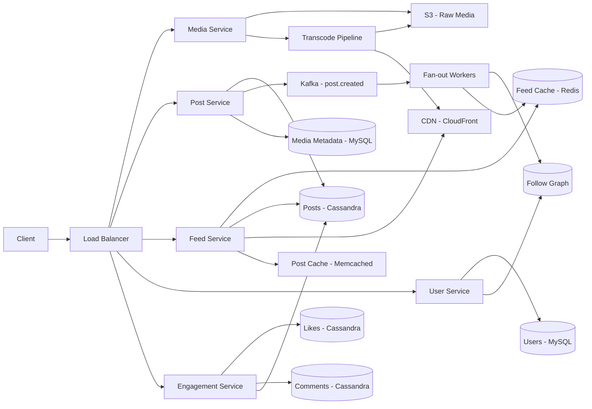

# Instagram Backend

**Category:** System Design
**Difficulty:** 🟡 Medium
**Seniority:** senior
**Companies:** Instagram, Meta
**Tags:** feed generation, media storage, social graph
**Time:** 90-120 min

---

## Problem Statement

Design the backend infrastructure for Instagram, a photo and video sharing social network. Users can upload media (photos and videos), follow other users, like and comment on posts, and view a personalized feed of content from people they follow. The system must handle billions of photos and videos, support real-time feed generation, and provide low-latency access to media content globally.

The interviewer expects you to design systems for media storage and delivery, feed generation, social graph management, and engagement features (likes, comments). Focus on scalability, performance, and the unique challenges of a media-heavy social platform.

## Clarifying Questions

- How many users and how active? *1B+ MAU, 500M DAU; each user uploads ~3 posts/week, opens feed ~15 times/day.*
- Media specifications? *Photos up to 10 MB (compressed to 1-2 MB), videos up to 5 min (compressed to 50-200 MB).*
- Follow graph? *Average 150 followees; celebrity accounts with 100M+ followers.*
- Feed ordering? *Reverse-chronological initially; ranking algorithm as extension.*
- Engagement features? *Likes, comments, saves, shares; focus on likes for v1.*
- Freshness requirements? *New posts appear in followers' feeds within 5-10 seconds.*
- Geographic distribution? *Global users; need CDN for media delivery.*
- Storage retention? *All media retained indefinitely; no auto-deletion.*

## Requirements

### Functional

- Upload photos and videos with metadata (caption, location, tags).
- Follow/unfollow users.
- View personalized feed (posts from followees).
- Like/unlike posts.
- Comment on posts.
- View user profiles and their posts.
- Search for users and hashtags (basic).

### Non-Functional

- Media upload latency p99 < 5 seconds (excluding upload time).
- Feed load latency p99 < 200 ms.
- Support 100M+ daily uploads.
- High availability (99.9% uptime).
- Media delivery latency p95 < 100 ms globally via CDN.
- Eventual consistency acceptable for feed generation (posts may appear up to 10 seconds late).
- Strong consistency for likes/comments count.

### Out of Scope

- Stories, Reels, IGTV, direct messaging, ads, analytics, content moderation pipeline.

## System Architecture



**Write path (upload + post):**

1. Client uploads media to Media Service via presigned S3 URL (direct to S3 for large files).
2. Media Service triggers transcode pipeline: generate thumbnails, compress images, transcode videos to multiple resolutions.
3. Processed media stored in S3 with CDN distribution enabled.
4. Client calls `POST /v1/posts` with upload_id; Post Service creates post record, assigns Snowflake ID, writes to Cassandra.
5. Post Service publishes `post.created` event to Kafka.
6. Fan-out workers consume event, fetch author's followers, and push post_id to each active follower's Redis feed cache.
7. For celebrity accounts (>1M followers), skip fan-out; pull at read time.

**Read path (feed):**

1. Feed Service reads post IDs from Redis `feed:{user_id}` (sorted set).
2. For celebrity followees, fetch recent post IDs from `user_posts` (cached).
3. Merge and hydrate post IDs from Post Cache (Memcached) or Cassandra.
4. Return media URLs pointing to CDN.

**Engagement (likes):**

1. Client sends like request to Engagement Service.
2. Service writes to Cassandra and increments counter in Post record (eventually consistent).
3. Optionally publish to Kafka for real-time notifications.

## Data Model

```text
users (MySQL + cache)
  user_id (Snowflake), username, email, bio, profile_pic_id,
  follower_count, following_count, post_count, created_at

posts (Cassandra)
  post_id (Snowflake), author_id, media_id, caption, location,
  like_count, comment_count, created_at

media (S3 + metadata in MySQL)
  media_id, user_id, original_url, thumbnail_url,
  compressed_urls (multiple resolutions), media_type,
  file_size, width, height, duration (video), created_at

follows (sharded MySQL / graph DB)
  follower_id, followee_id, created_at
  Index on follower_id (who I follow)
  Index on followee_id (who follows me)

likes (Cassandra)
  post_id, user_id, created_at
  Primary key: (post_id, user_id) for efficient count queries

comments (Cassandra)
  comment_id (Snowflake), post_id, user_id, text, created_at
  Primary key: (post_id, created_at DESC) for timeline queries

feed_cache (Redis)
  key: feed:{user_id}
  sorted set: member = post_id, score = post_id (time) or rank score
  trimmed to 500 entries

user_posts (Cassandra)
  author_id, post_id
  Primary key: (author_id, post_id DESC) for user profile timeline
```

## API Design

```text
POST /v1/media/upload
  Body: multipart/form-data (media file, metadata)
  202 -> { "upload_id": "up_123", "status": "processing" }

POST /v1/posts
  Body: { "upload_id": "up_123", "caption": "...", "location": {...} }
  201 -> { "post_id": "p_abc123", "created_at": "..." }

GET /v1/feed?limit=20&cursor=<opaque>
  200 -> { "items": [{ "post_id", "media_url", "caption", "author",
                      "like_count", "comment_count", "created_at" }],
           "next_cursor": "..." }

POST /v1/posts/{post_id}/like
  204

DELETE /v1/posts/{post_id}/like
  204

POST /v1/posts/{post_id}/comments
  Body: { "text": "..." }
  201 -> { "comment_id": "c_xyz", "text", "author", "created_at" }

POST /v1/users/{user_id}/follow
  204

DELETE /v1/users/{user_id}/follow
  204

GET /v1/users/{user_id}/posts?cursor=...
  200 -> { "items": [...], "next_cursor": "..." }

GET /v1/users/{user_id}
  200 -> { "user_id", "username", "bio", "follower_count",
           "following_count", "post_count", "profile_pic_url" }
```

## Scalability

- **Sharding strategy:**
  - Posts: by post_id (hash)
  - Users: by user_id (hash)
  - Follows: by follower_id and followee_id (dual tables)
  - Likes: by post_id (hash) for count queries
  - Comments: by post_id (hash)

- **Replication:**
  - Cassandra: RF=3 across availability zones
  - MySQL: master-slave with read replicas
  - Redis: cluster with replicas

- **Caching layers:**
  - CDN: media files (TTL: 1 year)
  - Redis: feed timelines, like counters (TTL: 1-24 hours)
  - Memcached: post objects, user profiles (TTL: 5-60 minutes)

- **Async processing:**
  - Kafka for fan-out, notifications, analytics
  - Worker pools with autoscaling based on queue depth

- **Failure handling:**
  - S3 multi-region replication for durability
  - Transcode pipeline retries with exponential backoff
  - Feed cache rebuild on Redis failure (pull from followees)
  - Graceful degradation: serve lower-resolution media if transcode lags

- **Monitoring:**
  - Upload success rate, transcode latency, feed p99, CDN hit rate
  - Redis memory usage, Cassandra read/write latency
  - Fan-out lag (time from post to feed visibility)

## Consistency & Availability

- **Consistency model:**
  - Strong consistency for likes/comments (counter updates).
  - Eventual consistency for feed generation (posts appear within 5-10 seconds).
  - Strong consistency for user profile data (MySQL with synchronous replication).

- **Availability strategies:**
  - Multi-region deployment with active-active configuration.
  - Graceful degradation: serve cached feed if fan-out lags.
  - Circuit breakers to prevent cascading failures.
  - Health checks and automatic failover.

- **Data consistency:**
  - Follow graph: dual writes with eventual consistency.
  - Post metadata: single source of truth in Cassandra.
  - Media storage: immutable objects with versioning.

## Security

- **Authentication:**
  - OAuth 2.0 / JWT tokens for API access.
  - Session management with refresh tokens.
  - Multi-factor authentication for sensitive operations.

- **Authorization:**
  - Role-based access control (RBAC).
  - Resource-level permissions (post ownership, follow relationships).
  - Privacy checks for private accounts.

- **Data protection:**
  - Encryption at rest (S3 server-side encryption).
  - Encryption in transit (TLS 1.3).
  - PII data redaction in logs.
  - GDPR compliance with right to deletion.

- **Abuse prevention:**
  - Rate limiting per user/IP.
  - Content moderation pipeline (ML-based detection).
  - Spam detection and account suspension.
  - DDoS protection with Cloudflare/AWS Shield.

## Trade-offs

| Decision | Option A | Option B | Choice & Why |
|---|---|---|
| Media upload | Via app servers | Direct to S3 (presigned URL) | Direct to S3: offloads bandwidth, scales independently |
| Feed generation | Pure push | Hybrid push-pull | Hybrid: handles celebrities, reduces cache size |
| Like storage | In post record | Separate counter table | Separate: reduces contention on hot posts |
| Video delivery | Single file | Adaptive bitrate (HLS) | HLS: better UX on variable networks |
| Post ID | UUID | Snowflake | Snowflake: time-ordered, efficient pagination |
| Consistency | Strong | Eventual | Eventual for feed, strong for counts |

## Follow-up Questions

1. **How do you handle media deletion?** Soft delete in metadata, mark S3 objects for deletion after 30-day grace period (for undo). CDN cache invalidation on delete.
2. **How do you implement search?** Use Elasticsearch for username/hashtag search with inverted index. Real-time sync via Kafka.
3. **How do you prevent duplicate uploads?** Hash-based deduplication (perceptual hash for images). Check before processing.
4. **How do you handle copyright?** Integration with content ID services (YouTube-style fingerprinting) during transcode.
5. **How do you rank the feed?** Use a machine learning model with features: engagement rate, recency, relationship strength, media type. Pre-compute scores for candidate posts.
6. **How do you handle stories (ephemeral content)?** Separate storage with TTL, different delivery pipeline, no fan-out to feed cache.

## Common Mistakes

- Uploading media through app servers (bottleneck).
- Storing full post objects in feed cache (wastes memory, hard to update).
- Pure push model without celebrity handling (write amplification).
- Storing videos as single files (poor UX on slow networks).
- Ignoring CDN costs (optimize compression, caching).
- Strong consistency everywhere (unnecessary for social feeds).
- No graceful degradation when transcode pipeline lags.

## Key Takeaways

- Media-heavy platforms need direct-to-cloud storage with CDN delivery.
- Hybrid push-pull feed generation balances read/write amplification.
- Social graph requires dual indexing (followers and followees).
- Async processing (Kafka) decouples write-heavy operations from user-facing latency.
- Multi-resolution media storage optimizes delivery across devices and networks.
- Eventual consistency is acceptable for social features; strong consistency for counters.
- Cache aggressively but design for cache misses and rebuilds.
