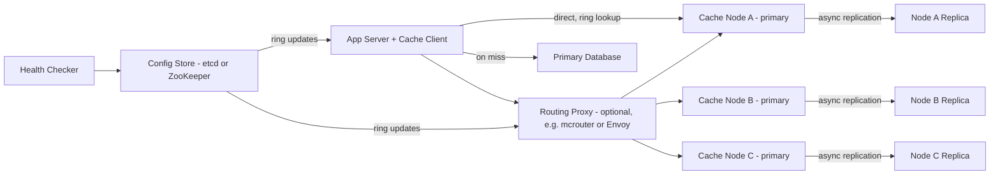

# Key-Value Cache

**Category:** System Design
**Difficulty:** 🟢 Easy
**Seniority:** mid
**Companies:** Amazon, Google, Meta, Microsoft, Netflix, Uber
**Tags:** caching, lru, ttl, consistent-hashing, replication, in-memory
**Time:** 45 min

---

## Problem Statement

Design an in-memory key-value cache (think Memcached or Redis) that sits in front of a slower database to cut read latency and database load. Start with a single node that supports `get`, `set` with TTL, and `delete`, with a bounded memory budget and an eviction policy. Then scale it out into a distributed cache cluster.

The interviewer hints at a large consumer application: ~1M reads per second at peak, a ~90%+ hit-rate target, sub-millisecond server-side latency, and a working set of a few terabytes. The cache is NOT the source of truth: losing data is acceptable, but losing a whole node must not overload the database.

## Clarifying Questions

- Is the cache a source of truth or a pure cache? *Pure cache; the database is authoritative, so data loss on failure is acceptable.*
- What is the read/write ratio? *Read-heavy, roughly 10:1; ~1M reads/s and ~100K writes/s at peak.*
- Typical key and value sizes? *Keys ~50 bytes, values ~1 KB on average, max 1 MB.*
- Working set size? *~2 TB of hot data.*
- What consistency do clients need? *Eventual consistency is fine; a stale read for a few seconds is acceptable, but TTLs must be honored.*
- Which eviction policy? *LRU by default; per-item TTL also supported.*
- Who populates the cache? *Applications use cache-aside: read DB on miss, then `set`.*
- Single region or multi-region? *Single region with multiple AZs; each region has its own independent cluster.*

## Requirements

### Functional
- `get(key)`, `set(key, value, ttl)`, `delete(key)`.
- Expire items after their TTL; never return expired values.
- Evict items when memory is full (LRU).
- Distribute keys across many nodes transparently to clients.

### Non-Functional
- p99 server-side latency < 1 ms; end-to-end < 2-3 ms in the same AZ.
- High availability: a node failure should cost only a fraction of the hit rate, not cause an outage.
- Horizontal scalability: adding nodes should move only ~1/N of keys.
- Memory efficiency: low per-item overhead.

### Out of Scope
- Durable persistence, transactions, rich data structures (lists, sets).
- Cross-region replication.

## Capacity Estimation

| Quantity | Arithmetic | Result |
|---|---|---|
| Read QPS | given | ~1M/s |
| Write QPS | 1M / 10 | ~100K/s |
| Item size with overhead | 50 B key + 1 KB value + ~60 B metadata (pointers, TTL, hash links) | ~1.1 KB |
| Items in working set | 2 TB / 1.1 KB | ~1.8B items |
| Usable RAM per node | 64 GB box, ~50 GB for data (fragmentation, OS, replication buffers) | 50 GB |
| Primary nodes for memory | 2 TB / 50 GB | ~40 nodes |
| Nodes with 1 replica each | 40 x 2 | ~80 nodes |
| Per-node QPS | 1M / 40 primaries (reads can also hit replicas) | ~25K/s, well under ~100K+/s a node can do |
| Bandwidth | 1M x 1 KB | ~1 GB/s cluster-wide, ~25 MB/s per node |

Memory, not CPU, is the sizing constraint. One well-tuned node can serve 100K-1M ops/s, so the node count comes from RAM.

## API Design

```text
// Binary or text protocol over TCP (like the memcached/RESP protocols); shown as RPC
GET     key                         -> value | MISS
SET     key value ttl_seconds       -> OK
          [flags: NX (only if absent), XX (only if present)]
DELETE  key                         -> OK | NOT_FOUND
MGET    key1 key2 ... keyN          -> [value | MISS ...]   // batch to save round trips
CAS     key value ttl version       -> OK | CONFLICT        // optional optimistic update

// Admin
GET  /cluster/topology   -> { ring_version, nodes: [{id, addr, vnodes, role}] }
GET  /node/stats         -> { hits, misses, evictions, used_memory, items }
```

## Data Model

Per node, all in RAM:

```text
HashTable: key -> Entry           // open hashing, incremental rehash
Entry {
  key        bytes
  value      bytes
  expires_at uint32 (epoch seconds, 0 = never)
  prev, next pointer              // doubly linked LRU list
  version    uint64               // for CAS
}
LRU list: head = most recent, tail = eviction candidate
Slab allocator: size classes 64 B, 128 B, ... 1 MB  // limits fragmentation
```

- No database: the cache is the storage engine. A custom hash table plus slab allocator (Memcached style) keeps per-item overhead around 50-60 bytes.
- Partition key: `hash(key)` on a consistent-hash ring with ~100-200 virtual nodes per physical node.
- The cluster topology (ring and node roles) lives in a small coordination store (ZooKeeper or etcd) and is pushed to clients/proxies.

## High-Level Design



1. **Read path (cache-aside):** the client hashes the key, looks up the owning node on its local copy of the ring, and sends `GET`. On a hit it returns the value. On a miss it reads the database and does `SET key value ttl`.
2. **Write path:** the application writes to the database first, then **deletes** the cache key (not updates), so the next read fills it with fresh data. This avoids races between two writers that update the cache in the wrong order.
3. **Replication:** each primary streams writes asynchronously to a replica in another AZ. Replicas can serve reads for hot keys and are promoted on failure.
4. **Topology:** a health checker marks nodes as down in etcd. Clients and proxies watch for ring changes and reroute within seconds.

## Deep Dives

### Single-node LRU with TTL

Use a hash map plus a doubly linked list so `get`, `set`, and evict are all O(1).

```text
FUNCTION get(key)
    SET e ← table.lookup(key)
    IF e IS NULL RETURN MISS
    IF e.expires_at != 0 AND e.expires_at <= now()
        remove(e)                       // lazy expiry
        RETURN MISS
    move_to_head(e)                     // mark most recently used
    RETURN e.value

FUNCTION set(key, value, ttl)
    IF table.contains(key) THEN remove(table.lookup(key))
    WHILE used_memory + size(key, value) > max_memory
        remove(lru_tail)                // evict least recently used
    SET e ← new Entry(key, value, now() + ttl)
    table.insert(key, e)
    push_head(e)
```

- **Expiry:** lazy expiry on access plus an **active sampler** (the Redis approach). Ten times a second, sample 20 keys that have TTLs and delete the expired ones. If more than 25% were expired, repeat. This bounds the memory wasted by dead keys without scanning everything.
- **Concurrency:** a global lock limits throughput. Options are lock striping by hash bucket (Memcached), or single-threaded event loops with one shard per core (Redis is single-threaded, KeyDB/Dragonfly are multi-threaded shared-nothing).
- **LRU cost:** moving to the head on every read means a write to shared memory. Memcached only bumps an item if it has not been bumped in the last 60 s. Redis uses **approximate LRU**: it samples 5 keys and evicts the oldest, which avoids keeping list pointers at all.
- **Policy alternatives:** LFU (Redis `allkeys-lfu`) or W-TinyLFU (Caffeine) resist scan pollution, where a one-off bulk read flushes the hot set.

### Partitioning with consistent hashing

- `node = ring.successor(hash(key))` using a fast hash such as MurmurHash3 or xxHash. Ketama-style rings with ~160 vnodes per node keep load within ~5-10% of the mean.
- When a node is added or removed, only ~1/N of keys move. With `hash mod N`, almost all keys would move and the database would see a full cold-cache stampede.
- **Client-side routing** (smart client) saves a network hop. A **proxy tier** (mcrouter, Twemproxy, Envoy) centralizes topology, connection pooling, and failover policy, at the cost of ~0.1-0.3 ms. Large deployments (Meta's mcrouter) use proxies because they have many languages and huge connection fan-out.
- Redis Cluster uses an alternative: 16,384 fixed **hash slots** assigned to nodes. Rebalancing moves whole slots, which makes ownership explicit.

### Replication and failover

- Asynchronous primary to replica replication. A cache does not need synchronous quorum writes: a lost write just becomes a miss.
- On primary failure, the health checker or Redis Sentinel promotes the replica within ~5-15 s, and the ring/slot map is updated. Without replicas, the node's ~1/N share of keys goes cold and its traffic falls through to the database.
- **Warm-up:** a new or replacement node can first be filled from a peer, or added at low weight, so it does not create a burst of misses.
- **Split-brain risk:** a stale primary may accept writes for a moment. That is acceptable for a cache because the DB-first write plus delete pattern and TTLs bound the staleness.

### Thundering herd and hot keys

- **Stampede on a popular key's expiry:** thousands of clients miss at the same moment and all query the database. Fixes:
  - **Request coalescing / lease:** the first miss gets a lease token and fills the key, and other clients wait briefly or get the stale value (Meta's memcache leases).
  - **Probabilistic early refresh:** refresh before the TTL ends with a probability that rises as expiry gets closer.
  - **TTL jitter** (for example ±10%) so keys written together do not expire together.
- **Hot keys** (a celebrity profile at 200K reads/s) overload one node. Fixes include a small in-process L1 cache on app servers (1-5 s TTL), reading from replicas, or key splitting (`key#1..key#k` copies spread across nodes).

```text
FUNCTION read_through(key)
    SET v ← cache.get(key)
    IF v != MISS RETURN v
    IF cache.set(key + ":lock", 1, ttl=5s, NX)   // won the lease
        SET v ← db.read(key)
        cache.set(key, v, ttl = base_ttl * random(0.9, 1.1))
        cache.delete(key + ":lock")
        RETURN v
    sleep(20ms)                                 // someone else is filling
    RETURN cache.get(key) OR db.read(key)
```

## Scaling & Reliability

- **Scale out** by adding nodes to the ring in small steps. Expect a temporary hit-rate dip on the ~1/N keys that move.
- **Spread failure domains:** put each primary and its replica in different AZs, and keep per-AZ capacity headroom (~30%) so losing one AZ does not evict the hot set.
- **Protect the database:** client-side circuit breakers and concurrency limits on misses. A cache outage must degrade into slower responses, not a database meltdown.
- **Connections:** use persistent pooled TCP connections and pipelining/`MGET` batching. Limit fan-out per request: a page needing 100 keys across 40 nodes is a tail-latency risk.
- **Monitoring:** hit ratio per keyspace, evictions/s, memory used vs max, p99 latency, connection count, replication lag, hot-key detection from sampled access logs.
- **Security:** private network only, TLS in transit, and ACLs/AUTH. Never expose the cache to the public internet (memcached UDP amplification attacks).

## Trade-offs

| Decision | Option A | Option B | Choice & Why |
|---|---|---|---|
| Eviction | Exact LRU (linked list) | Sampled / approximate LRU or LFU | Approximate: near-identical hit rate with less memory and lock contention |
| Routing | Smart client | Proxy tier | Client for low latency with few languages; proxy at large scale for central control |
| Write handling | Update cache on write | Delete (invalidate) on write | Invalidate: avoids out-of-order writes leaving stale data permanently |
| Replication | Synchronous | Asynchronous | Async: the cache is not the source of truth, and latency matters more |
| Partitioning | `hash mod N` | Consistent hashing / hash slots | Consistent hashing: only ~1/N keys move on topology change |

## Follow-up Questions

1. **How do you keep cache and DB consistent?** Write the DB first, then delete the cache key. For stricter needs, tail the DB change log (CDC via Debezium) to invalidate, and use short TTLs as a safety net.
2. **How would you support multi-region?** Run an independent cluster per region and broadcast invalidations from the DB replication stream to every region. Do not replicate cache values across regions.
3. **What if values are large (e.g. 5 MB)?** Chunk them or store them in S3 and cache a pointer. Large values hurt slab efficiency and block single-threaded event loops.
4. **How do you restart nodes without cold caches?** Do rolling restarts with replica promotion, or persist snapshots (Redis RDB) to warm up from disk.
5. **How do you detect hot keys?** Sample requests on each node and keep a top-K heavy-hitter sketch (Count-Min Sketch). Push hot keys to the clients' L1 caches.

## Common Mistakes

- Treating the cache as durable storage or designing quorum writes for it.
- Using `hash mod N`, so every scaling event flushes the whole cache.
- Updating instead of invalidating on writes, which creates race conditions and permanent staleness.
- Ignoring stampedes and hot keys, which are the real failure modes in production.
- Sizing by QPS instead of memory, and forgetting per-item overhead and fragmentation.
- Relying only on lazy TTL expiry, so memory fills with dead keys that are never read.

## Key Takeaways

- A single-node cache is a hash map plus an LRU list with O(1) operations, lazy plus sampled TTL expiry, and a memory-bounded allocator.
- Distribute with consistent hashing (vnodes or hash slots) and replicate asynchronously, since the database is the source of truth.
- Cache-aside with delete-on-write is the default pattern. Add TTL jitter and leases to prevent stampedes.
- Size the cluster by RAM. The hard production problems are hot keys, stampedes, and protecting the database when a node fails.
