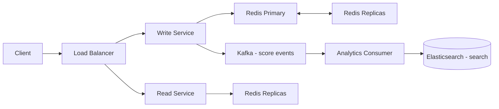

# Leaderboard

**Category:** System Design
**Difficulty:** 🟢 Easy
**Seniority:** Junior
**Companies:** LeetCode, HackerRank
**Tags:** caching, sorting, real-time
**Time:** 30-45 min

---

## Problem Statement

Design a real-time leaderboard system like those used by LeetCode or HackerRank. Users compete in coding challenges and earn points based on their performance. The system must maintain a global ranking of all users that updates in near real-time as scores change.

The interviewer mentions millions of users, frequent score updates (hundreds per second), and many read requests (users viewing their rank and the top N players). The leaderboard must be queryable by rank (e.g., "show top 100") and by user (e.g., "what is user X's rank?").

## Clarifying Questions

- How many users? *Assume 10M users.*
- How often do scores update? *Assume 500 updates/s avg, 2,000/s peak.*
- How many read requests? *Assume 5,000/s avg, 20,000/s peak (10:1 read:write).*
- What's the score range? *0 to 10,000 points, integer.*
- Do we need multiple leaderboards (e.g., by region, time period)? *Start with a single global leaderboard.*
- How many ranks do we typically return? *Top 100 for the leaderboard view; user's rank + surrounding 10 for individual queries.*
- How fresh must the data be? *Within 1-2 seconds is acceptable.*
- Do we need historical scores? *No, only current scores matter.*

## Requirements

### Functional
- Update a user's score (increment or set).
- Retrieve the top N users by rank.
- Retrieve a specific user's rank and score.
- Retrieve users around a given rank (e.g., ranks 95-105).

### Non-Functional
- Low latency: p99 < 100 ms for reads.
- High availability: 99.9%+.
- Real-time updates: scores visible within 1-2 seconds.
- Handle 2,000 writes/s and 20,000 reads/s.

### Out of Scope
- User authentication, challenge submission logic, historical score tracking, complex tie-breaking rules.

## Capacity Estimation

| Metric | Arithmetic | Result |
|---|---|---|
| Users | 10M | 10M entries |
| Write QPS | 2,000/s peak | 2,000/s |
| Read QPS | 20,000/s peak | 20,000/s |
| Storage per user | user_id (8B) + score (4B) + metadata (20B) | ~32 B |
| Total storage | 10M x 32 B | ~320 MB (tiny) |
| Cache size | Top 10,000 users + hot set | ~1 MB |

Storage is trivial; the challenge is maintaining sorted order under concurrent updates.

## API Design

```text
POST /api/v1/scores
  Body:    { "user_id": "12345", "score": 1500 }
  200 ->   { "user_id": "12345", "score": 1500, "rank": 4231 }

PUT /api/v1/scores/{user_id}
  Body:    { "score": 1600 }  or  { "delta": 100 }
  200 ->   { "user_id": "12345", "score": 1600, "rank": 3892 }

GET /api/v1/leaderboard?limit=100&offset=0
  200 ->   { "entries": [{ "user_id": "1", "score": 10000, "rank": 1 }, ...], "total": 10000000 }

GET /api/v1/users/{user_id}/rank
  200 ->   { "user_id": "12345", "score": 1600, "rank": 3892 }

GET /api/v1/leaderboard/around/{rank}?window=10
  200 ->   { "entries": [...], "center_rank": 3892 }
```

## Data Model

```text
Sorted Set (Redis ZSET): leaderboard
  Member: user_id
  Score: user_score

Hash (Redis): user_metadata
  Key: user_id
  Fields: { "username": "...", "avatar": "..." }
```

- **Primary data structure:** Redis sorted set (ZSET) provides O(log N) updates and O(log N + M) range queries by rank.
- **Metadata storage:** Separate Redis hash for user profile data (username, avatar) to keep the leaderboard lightweight.
- **Persistence:** Redis AOF (Append Only File) for durability; RDB snapshots for faster restarts.
- **Backup:** Daily RDB snapshots to S3 or network-attached storage.

## High-Level Design



**Write path**
1. Client calls `POST /api/v1/scores` or `PUT /api/v1/scores/{user_id}`.
2. Write Service validates the request and updates the Redis ZSET using `ZADD` or `ZINCRBY`.
3. Returns the new score and rank (using `ZREVRANK`).
4. Asynchronously publishes the score change to Kafka for analytics.

**Read path**
1. Client calls `GET /api/v1/leaderboard` or `GET /api/v1/users/{user_id}/rank`.
2. Read Service queries a Redis replica for eventual consistency (replication lag < 100 ms).
3. For top N: uses `ZREVRANGE` with `WITHSCORES`.
4. For user rank: uses `ZREVRANK` and `ZSCORE`.
5. Fetches metadata from the user metadata hash.
6. Returns the response.

## Deep Dives

### Sorted set operations

Redis ZSET is implemented as a skip list + hash table, giving O(log N) for updates and O(log N + M) for range queries.

```text
FUNCTION updateScore(userId, newScore):
    ZADD leaderboard newScore userId
    SET rank ← ZREVRANK leaderboard userId
    RETURN { userId, newScore, rank }

FUNCTION getTopN(limit, offset):
    SET entries ← ZREVRANGE leaderboard offset offset+limit-1 WITHSCORES
    FOR each (userId, score) IN entries:
        SET meta ← HGET user_metadata userId
        entries[i] ← { userId, score, rank: offset+i, ...meta }
    RETURN entries

FUNCTION getUserRank(userId):
    SET score ← ZSCORE leaderboard userId
    SET rank ← ZREVRANK leaderboard userId
    RETURN { userId, score, rank }
```

### Handling ties

When scores are equal, Redis sorts by member (user_id) lexicographically. To make ties fair:
- Use a composite score: `score + (timestamp / 1e13)` where timestamp is the last update time.
- Or, on read, fetch all users with the same score and sort by a secondary criterion (e.g., time achieved).

### Scaling beyond single Redis

A single Redis instance can handle millions of operations per second, but if needed:
- **Sharding by score range:** Partition users into multiple ZSETs (e.g., 0-1000, 1001-2000). Query top N by merging results from the highest-score shard.
- **Sharding by user_id hash:** Each shard holds a subset of users; to get global top N, query all shards and merge-sort (expensive for top queries).
- **Read replicas:** Scale reads with multiple replicas; writes go to primary.

For this scale (10M users, 2K writes/s), a single Redis cluster with replicas is sufficient.

### Persistence and recovery

- **AOF (Append Only File):** Every write is logged; on restart, Redis replays the log. Set `appendfsync everysec` for a good balance of durability and performance.
- **RDB snapshots:** Fork process and write memory to disk every 5 minutes. Faster recovery but may lose up to 5 minutes of data.
- **Backup strategy:** Copy RDB files to S3 nightly; enable multi-AZ replication for disaster recovery.

### Cache invalidation

The leaderboard is the source of truth; no additional caching layer is needed. Redis itself is the cache. If using read replicas, accept small replication lag (tens of milliseconds).

## Scaling & Reliability

- **Redis Cluster:** Use Redis Cluster for horizontal scaling if needed; 16384 hash slots distributed across nodes.
- **Replication:** Each primary has 1-2 replicas for failover; Sentinel or Redis Cluster auto-failover.
- **Connection pooling:** Use connection pools in services to avoid connection churn.
- **Rate limiting:** Limit write API per user (e.g., 10 updates/min) to prevent abuse.
- **Monitoring:** Redis memory usage, command latency, replication lag, evictions (if memory is full).
- **Failover:** On primary failure, a replica is promoted; clients reconnect with a brief hiccup (< 1 s).

## Trade-offs

| Decision | Option A | Option B | Choice & Why |
|---|---|---|---|
| Data structure | Redis ZSET | SQL with ORDER BY | ZSET: O(log N) updates vs O(N) for SQL re-sort |
| Consistency | Strong (primary only) | Eventual (replicas) | Eventual for reads; 100 ms lag acceptable |
| Persistence | AOF only | AOF + RDB | Both: AOF for durability, RDB for fast recovery |
| Tie-breaking | Lexicographic user_id | Composite score with timestamp | Composite: fairer, more predictable |
| Sharding strategy | Score range | User_id hash | Score range: efficient top-N queries |

## Follow-up Questions

1. **How would you support multiple leaderboards (e.g., by region, weekly challenge)?** Create separate ZSETs per leaderboard (e.g., `leaderboard:global`, `leaderboard:us`, `leaderboard:weekly:2025-W01`). Sharding may be needed if there are thousands of leaderboards.
2. **How do you handle a user viewing their rank when they're not in the top 10,000?** `ZREVRANK` is O(log N) regardless of position, so it's fast. For "around rank" queries, use `ZREVRANGE` with the computed offset.
3. **What if Redis runs out of memory?** Set `maxmemory` and an eviction policy (e.g., `allkeys-lru`). However, for a leaderboard, we cannot evict entries. Instead, provision sufficient memory or shard.
4. **How would you add pagination for "all users"?** Use `ZREVRANGE` with offset/limit. For very large offsets, consider cursor-based pagination using score boundaries.
5. **How do you ensure fair tie-breaking across regions?** Store a tie-breaker field (e.g., timestamp of first achieving the score) in the metadata and sort on read.

## Common Mistakes

- Using a relational database with `ORDER BY score` for every query, which is O(N) and doesn't scale.
- Forgetting that Redis ZSET members must be unique; user_id works perfectly.
- Not considering replication lag when reading from replicas.
- Over-engineering with complex sharding when a single Redis instance suffices for the given scale.
- Ignoring persistence configuration and losing data on restart.

## Key Takeaways

- Leaderboards are a classic use case for sorted data structures; Redis ZSET is purpose-built for this.
- The challenge is not storage (it's tiny) but maintaining sorted order under concurrent updates.
- O(log N) updates and O(log N + M) range queries make ZSET ideal for real-time leaderboards.
- Read replicas scale read traffic; AOF + RDB balances durability and recovery speed.
- For this scale (10M users, 2K writes/s), a single Redis cluster with replicas is sufficient—no complex sharding needed.
