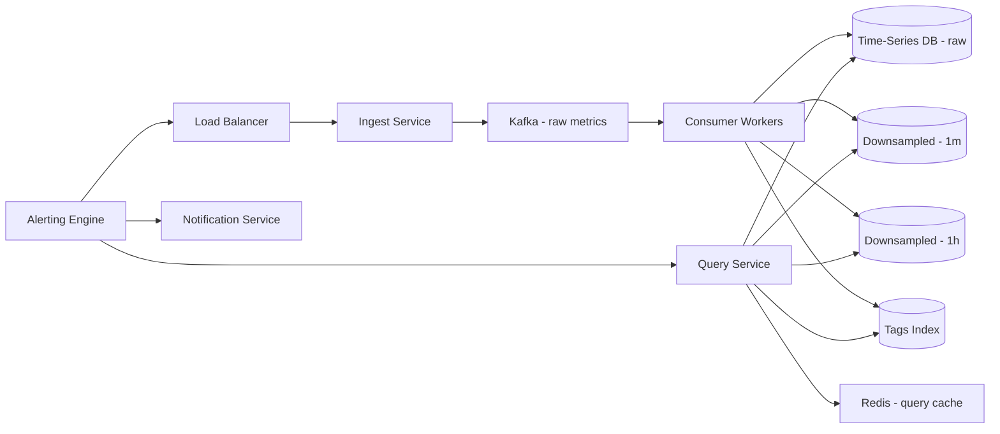

# Metrics and Monitoring System

**Category:** System Design
**Difficulty:** 🟡 Medium
**Seniority:** Mid-level
**Companies:** Datadog, New Relic
**Tags:** time-series, aggregation, retention
**Time:** 60-90 min

---

## Problem Statement

Design a metrics and monitoring system like Datadog or New Relic. Applications send time-series metrics (e.g., CPU usage, request latency, error rates) to the system, which stores, aggregates, and visualizes them for users. The system must handle high ingest rates, support complex queries (e.g., "average CPU across all web servers in the last hour"), and retain data for varying periods (raw data for short term, downsampled data for long term).

The interviewer mentions millions of metrics, with each metric reporting every 10 seconds, leading to billions of data points per day. Queries range from real-time dashboards to historical analysis spanning months.

## Clarifying Questions

- How many metrics? *Assume 10M active metrics (e.g., 1M hosts x 10 metrics each).*
- How often do metrics report? *Assume every 10 seconds (10s resolution).*
- How many data points per day? *10M metrics x 8,640 intervals/day = 86.4B points/day.*
- What's the retention policy? *Raw data for 7 days, 1-minute downsampled for 30 days, 1-hour downsampled for 1 year.*
- What query types? *Aggregations (sum, avg, max, min, percentile), time range queries, group by tags.*
- How many concurrent queries? *Assume 1,000 queries/s avg, 5,000/s peak.*
- Do we need alerting? *Yes, alerting on thresholds is a key feature.*
- What's the data format? *Each point has: metric name, timestamp, value, and tags (e.g., host, region).*

## Requirements

### Functional
- Ingest time-series metric data points.
- Store raw and downsampled data with configurable retention.
- Query metrics with time range, aggregation, and tag filtering.
- Support real-time dashboards and historical analysis.
- Alerting based on metric thresholds.

### Non-Functional
- High ingest throughput: handle 1M points/s (86.4B/day).
- Low query latency: p99 < 500 ms for typical dashboard queries.
- High availability: 99.95%+.
- Scalable storage: handle petabytes of data over time.

### Out of Scope
- Log collection, distributed tracing, UI/UX details, authentication/authorization.

## Capacity Estimation

| Metric | Arithmetic | Result |
|---|---|---|
| Metrics | 10M | 10M active time series |
| Data points per day | 10M x 8,640 | 86.4B points/day |
| Ingest QPS | 86.4B / 86,400 | ~1M points/s avg, ~3M/s peak |
| Size per point | metric_name (32B) + timestamp (8B) + value (8B) + tags (32B) | ~80 B |
| Raw data per day | 86.4B x 80 B | ~6.9 TB/day |
| Raw data (7 days) | 6.9 TB x 7 | ~48 TB |
| Downsampled 1m (30 days) | 86.4B / 10 x 80 B x 30 | ~20.7 TB |
| Downsampled 1h (1 year) | 86.4B / 360 x 80 B x 365 | ~7 TB |
| Total storage | 48 + 20.7 + 7 | ~76 TB |
| Query QPS | 5,000/s peak | 5,000/s |

Storage is significant; downsampling and tiered storage are essential.

## API Design

```text
POST /api/v1/metrics
  Body:    { "series": [
             { "metric": "cpu.usage", "points": [[1634567890, 45.2], [1634567900, 47.1]],
               "tags": { "host": "web-1", "region": "us-east-1" } }
           ]}
  202 ->   { "accepted": 1000, "errors": 0 }

GET /api/v1/query
  Query:   ?query=avg:cpu.usage{region:us-east-1}&from=1634567890&to=1634571490
  200 ->   { "query": "...", "from": 1634567890, "to": 1634571490,
             "series": [{ "metric": "cpu.usage", "tags": {...}, "points": [...] }] }

GET /api/v1/metrics/{metric_name}
  Query:   ?from=1634567890&to=1634571490&aggregation=avg&by=host
  200 ->   { "metric": "cpu.usage", "aggregation": "avg", "group_by": ["host"],
             "results": [{ "tags": {"host": "web-1"}, "points": [...] }] }

POST /api/v1/alerts
  Body:    { "name": "High CPU", "query": "avg:cpu.usage > 80", "window": "5m" }
  201 ->   { "alert_id": "alert-123" }
```

## Data Model

```text
Time-series database (e.g., InfluxDB, TimescaleDB, Prometheus + Thanos, or custom on Cassandra)

Schema (conceptual):
  metric_name  STRING
  tags         MAP<STRING, STRING>  (e.g., host, region, env)
  timestamp    TIMESTAMP
  value        DOUBLE

Primary key: (metric_name, tags_hash, timestamp)
Secondary index: tags for filtering

Downsampled tables:
  metrics_1m: (metric_name, tags_hash, timestamp, avg, max, min, count)
  metrics_1h: (metric_name, tags_hash, timestamp, avg, max, min, count)

Tags index:
  tag_index: (tag_key, tag_value) -> set of metric_name + tags_hash
```

- **Time-series database:** Use a purpose-built TSDB (InfluxDB, TimescaleDB) or build on Cassandra with a time-series pattern. The choice depends on query complexity and team expertise.
- **Tag indexing:** Tags are critical for filtering (e.g., "all hosts in us-east-1"). Maintain an inverted index mapping tag values to time series.
- **Downsampling:** Background jobs aggregate raw data into coarser resolutions (1m, 1h) and store in separate tables/collections.

## High-Level Design



**Ingest path**
1. Agents/apps send metrics via `POST /api/v1/metrics` (batched for efficiency).
2. Ingest Service validates and writes to Kafka for durability and buffering.
3. Consumer workers read from Kafka and write to the time-series database (raw table).
4. Workers also update the tags index for filtering.
5. Background downsampling jobs periodically aggregate raw data into 1m and 1h tables.

**Query path**
1. User queries via `GET /api/v1/query` or dashboard UI.
2. Query Service parses the query, checks the tags index to identify relevant time series.
3. Routes to the appropriate storage tier based on time range (raw for < 7 days, downsampled for older).
4. Executes the query with aggregation (sum, avg, etc.).
5. Caches results in Redis (TTL based on time range).
6. Returns the time-series data.

**Alerting path**
1. Alerting Engine runs continuously, evaluating alert queries at configured intervals.
2. Uses the Query Service to fetch metric data.
3. Triggers Notification Service (email, Slack, PagerDuty) on threshold breach.

## Deep Dives

### Time-series database choice

**Options:**
- **InfluxDB:** Purpose-built TSDB, excellent for time-series queries, built-in downsampling. Single-node by default; clustering is enterprise.
- **TimescaleDB:** PostgreSQL extension, leverages SQL ecosystem, good for complex queries. Requires PostgreSQL expertise.
- **Prometheus + Thanos:** Pull-based metrics, strong ecosystem, but designed for operational metrics, not multi-tenant SaaS.
- **Cassandra + custom schema:** Highly scalable, but requires custom query engine and downsampling logic.

**Choice:** TimescaleDB for this design (SQL-based, good query flexibility, multi-tenant support). Alternatively, InfluxDB if the team prefers a native TSDB.

### Downsampling strategy

Raw data is expensive to store and query for long time ranges. Downsampling reduces storage and improves query performance.

```text
FUNCTION downsampleRawTo1m():
  FOR each (metric_name, tags_hash) IN last_hour:
    SELECT timestamp_bucket, AVG(value), MAX(value), MIN(value), COUNT(value)
    FROM metrics_raw
    WHERE metric_name = ? AND tags_hash = ? AND timestamp > now() - 1h
    GROUP BY timestamp_bucket(1m)
    INSERT INTO metrics_1m
```

- **Rollup jobs:** Run every minute to downsample the previous minute's data.
- **Retention policies:** TimescaleDB has built-in drop chunks; configure 7-day retention for raw, 30-day for 1m, 1-year for 1h.
- **Percentiles:** For percentile queries (p95, p99), store approximate histograms (t-digest) during downsampling.

### Tag indexing and filtering

Tags are multi-dimensional (e.g., `host=web-1`, `region=us-east-1`, `env=prod`). Filtering by tags requires an inverted index.

```text
Table: tag_index
  tag_key     STRING
  tag_value   STRING
  series_id   STRING  (metric_name + tags_hash)
  PRIMARY KEY (tag_key, tag_value, series_id)

Query example:
  SELECT series_id FROM tag_index
  WHERE tag_key = 'region' AND tag_value = 'us-east-1'
  INTERSECT
  SELECT series_id FROM tag_index
  WHERE tag_key = 'env' AND tag_value = 'prod'
```

- **Intersection:** For multiple tag filters, intersect the series_id sets.
- **Caching:** Cache tag filter results in Redis (TTL: 5-10 minutes) since tag cardinality changes slowly.

### Query optimization

- **Time-based routing:** Queries for recent data (< 7 days) hit the raw table; older queries hit downsampled tables.
- **Parallel execution:** Split large time ranges into chunks, query in parallel, merge results.
- **Query cache:** Cache identical queries (same query string, time range) in Redis with a short TTL (e.g., 30 seconds for real-time, 5 minutes for historical).
- **Pre-aggregation:** For common dashboard queries, pre-compute and store results (materialized views).

### Alerting engine

Alerts must evaluate continuously and trigger notifications promptly.

```text
FUNCTION evaluateAlert(alert):
  SET data ← queryService.executeQuery(alert.query, alert.window)
  IF data matches alert.condition:
    notificationService.send(alert.notification_channels, data)
```

- **Evaluation interval:** Run every 30-60 seconds for most alerts; higher frequency for critical alerts.
- **Deduplication:** Group alerts by severity to avoid notification spam.
- **State tracking:** Track alert state (OK, WARNING, CRITICAL) to avoid re-triggering on the same condition.

## Scaling & Reliability

- **Ingest scaling:** Kafka partitions scale horizontally; consumer workers auto-scale based on lag.
- **Storage scaling:** TimescaleDB partitioning by time (hypertables) and by metric_name/tags_hash. Add nodes or use PostgreSQL streaming replication for read scaling.
- **Query scaling:** Read replicas for query service; connection pooling; query timeouts.
- **Multi-region:** Ingest in local region, replicate to central region for global queries; or use multi-active TimescaleDB.
- **Failover:** PostgreSQL failover with Patroni; Kafka replication; Redis Sentinel.
- **Monitoring:** Ingest lag, query latency, storage growth, alert evaluation time, error rates.

## Trade-offs

| Decision | Option A | Option B | Choice & Why |
|---|---|---|---|
| TSDB | InfluxDB | TimescaleDB | TimescaleDB: SQL-based, multi-tenant, flexible queries |
| Ingest | Direct write | Kafka buffer | Kafka: decouples ingest from storage, handles backpressure |
| Downsampling | Real-time | Batch jobs | Batch jobs: simpler, predictable load |
| Tag index | In TSDB | Separate index | Separate: faster tag filtering, independent scaling |
| Query cache | None | Redis | Redis: reduces load for repeated dashboard queries |

## Follow-up Questions

1. **How would you handle high-cardinality tags (e.g., request_id)?** Reject or limit high-cardinality tags at ingest; use a separate system for tracing (e.g., Jaeger) instead of metrics.
2. **How do you support percentile queries (p95, p99)?** Store approximate histograms (t-digest, HDR histogram) during downsampling; query the histogram for percentiles.
3. **What if a customer wants 5-second resolution for a year?** This is expensive (6x more data). Offer it as a premium tier with dedicated storage or use columnar storage (ClickHouse) for compression.
4. **How do you handle query timeouts for large time ranges?** Limit max time range per query (e.g., 90 days), require downsampling for longer ranges, or use async queries with results stored for later retrieval.
5. **How would you add anomaly detection?** Use machine learning models on time-series data; run as a separate service consuming from Kafka, flagging anomalies in a dedicated table.

## Common Mistakes

- Not planning for downsampling, leading to unbounded storage growth.
- Using a relational database without time-series optimizations, resulting in poor performance.
- Ignoring tag cardinality, allowing high-cardinality tags that explode storage and query time.
- Not buffering ingest (Kafka), causing backpressure to drop data during spikes.
- Forgetting about alerting state management, leading to notification spam.

## Key Takeaways

- Time-series data requires specialized storage (TSDB) with efficient time-based partitioning and compression.
- Downsampling is essential: raw data for short term, aggregated data for long term.
- Tags enable powerful filtering but require an inverted index; manage cardinality carefully.
- Ingest must be buffered (Kafka) to handle spikes and decouple from storage.
- Query optimization includes time-based routing, parallel execution, and caching.
- Alerting is a continuous evaluation process; track state to avoid spam.
- Multi-tier storage (raw → downsampled → cold storage) balances cost and performance.
