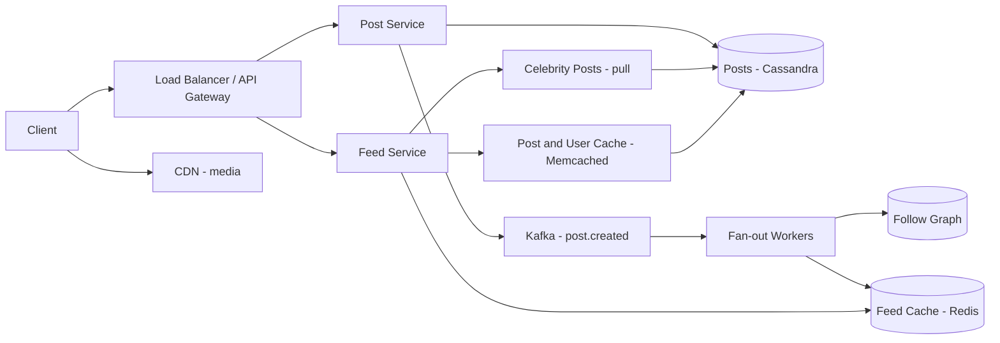

# News Feed

**Category:** System Design
**Difficulty:** 🟡 Medium
**Seniority:** senior
**Companies:** Meta, Twitter, LinkedIn, Instagram, Pinterest, Snap, Reddit
**Tags:** fan-out, timeline, caching, ranking, social-graph, read-heavy
**Time:** 45 min

---

## Problem Statement

Design the news feed for a social network like Facebook, Instagram, or Twitter. Users publish posts, follow other users, and open a feed showing recent posts from people they follow, newest or best-ranked first, with infinite scroll.

The interviewer hints at ~500M daily active users, an average of a few hundred followees per user, and celebrity accounts with tens of millions of followers. Feed loads must be fast (they are the app's home screen), while post publishing can tolerate a few seconds of delay before appearing in followers' feeds.

## Clarifying Questions

- How many users and how active? *500M DAU; each opens the feed ~10 times/day; 1 in 10 posts once per day.*
- Follow graph shape? *Average 200 followees; median followers ~100; celebrities up to 100M followers.*
- Ordering? *Start with reverse-chronological; discuss ranking as an extension.*
- Post content? *Text plus media (images/video) stored separately; feed returns post IDs + hydrated content.*
- Freshness? *New posts should appear in followers' feeds within ~5 s for normal users.*
- Feed length? *Users scroll back up to ~800 items; older content fetched on demand.*
- Do we include ads, groups, or pages? *Out of scope; only followed users' posts.*

## Requirements

### Functional
- Create a post (text, media references).
- Follow / unfollow users.
- Get a paginated feed of posts from followees, newest first (ranking as a stretch).

### Non-Functional
- Feed read latency p99 < 200 ms.
- Highly available; eventual consistency acceptable (a post may appear a few seconds late).
- Scales to celebrity accounts without write storms.
- Read-heavy: optimize the read path.

### Out of Scope
- Media upload pipeline details, ads, notifications, comments threading.

## Capacity Estimation

| Metric | Arithmetic | Result |
|---|---|---|
| Post writes | 50M posts/day / 86,400 | ~600/s avg, ~2K/s peak |
| Feed reads | 500M x 10 / 86,400 | ~58K/s avg, ~150K/s peak |
| Fan-out writes (push model) | 600 posts/s x 200 avg followers | ~120K timeline inserts/s avg |
| Post storage | 50M x 1 KB metadata/text | 50 GB/day, ~18 TB/year |
| Media | 50M x 20% with media x 500 KB | ~5 TB/day to S3/CDN |
| Feed cache per user | 800 post IDs x 8 B (+ score/author ~16 B) | ~20 KB |
| Feed cache total | 500M DAU x 20 KB | ~10 TB of Redis (keep only active users, trim to 800) |
| Feed read bandwidth | 150K/s x 20 posts x 1 KB | ~3 GB/s hydrated (served from caches) |

The 10 TB timeline cache is distributed over ~100+ Redis nodes; we only keep timelines for users active in the last ~30 days.

## API Design

```text
POST /v1/posts
  Body: { "text": "...", "media_ids": ["m_123"], "visibility": "public" | "followers" }
  201 -> { "post_id": "1790...", "created_at": "..." }

GET /v1/feed?limit=20&cursor=<opaque>
  200 -> { "items": [ { "post_id", "author": { "id", "name", "avatar_url" },
                        "text", "media": [...], "like_count", "created_at" } ],
           "next_cursor": "eyJtYXhfaWQiOjE3OTB9" }

POST   /v1/users/{id}/follow     -> 204
DELETE /v1/users/{id}/follow     -> 204
GET    /v1/users/{id}/posts?cursor=...   -> author's own timeline
```

Cursor encodes the last seen post ID (Snowflake IDs are time-sortable), giving stable pagination even as new posts arrive; offset pagination would skip/duplicate items.

## Data Model

```text
posts (Cassandra or sharded MySQL)          partition key: post_id
  post_id (Snowflake), author_id, text, media_ids, created_at, visibility

user_posts (Cassandra)                       partition key: author_id, clustering: post_id DESC
  author_id, post_id                         -- author's own timeline, used for pull

follows (sharded MySQL / TAO-like graph store)
  follower_id, followee_id, created_at
  index A: by follower_id  -> "whom do I follow"
  index B: by followee_id  -> "who follows me" (for fan-out)

feed_cache (Redis Cluster)                   key: feed:{user_id}
  sorted set: member = post_id, score = post_id (time) or rank score; trimmed to 800

users (MySQL + cache)                        user_id, name, avatar_url, follower_count, is_celebrity
```

- Posts are immutable-ish and keyed by ID: Cassandra handles high write volume and simple key lookups.
- The follow graph needs both directions; store as two tables sharded by `follower_id` and by `followee_id` respectively.
- Feed cache holds IDs only, not content, so edits/deletes do not require rewriting millions of timelines.

## High-Level Design



**Write path (publish)**
1. Client calls `POST /v1/posts`; Post Service assigns a Snowflake ID, writes to `posts` and `user_posts`, publishes `post.created` to Kafka, returns 201.
2. Fan-out workers consume the event. If the author is not a celebrity, they page through the author's followers and `ZADD` the post ID into each active follower's `feed:{id}`, then `ZREMRANGEBYRANK` to keep 800.
3. Celebrity posts (followers > ~1M) are not fanned out; they are pulled at read time.

**Read path (feed load)**
1. Feed Service reads `feed:{user}` from Redis (top N IDs after the cursor).
2. Fetches recent posts of celebrities the user follows (from `user_posts`, heavily cached), merges by post ID.
3. Hydrates IDs into full posts and author profiles via a multi-get on Memcached (falling back to DB), filters deleted/blocked content.
4. Returns 20 items and the next cursor; media URLs point to the CDN.

## Deep Dives

### Fan-out on write vs fan-out on read

- **Push (fan-out on write):** precompute each follower's feed. Reads are O(1) cache lookups; writes are O(followers). Breaks for celebrities: one post from a 100M-follower account = 100M Redis writes.
- **Pull (fan-out on read):** at read time, query recent posts of all ~200 followees and merge. Writes are cheap; reads are expensive and slow at 150K QPS.
- **Hybrid (chosen):** push for normal authors, pull for celebrities and for inactive users' feeds.

```text
FUNCTION getFeed(userId, cursor, limit = 20):
    SET pushed ← redis.ZREVRANGEBYSCORE("feed:" + userId, cursor.maxId, -inf, LIMIT limit * 2)
    IF pushed IS EMPTY AND cacheMiss(userId):
        SET pushed ← rebuildFeed(userId)            // inactive user: pull from followees
    SET celebs ← followGraph.celebritiesFollowedBy(userId)    // cached, usually < 50
    SET pulled ← []
    FOR c IN celebs:
        APPEND pulled ← recentPostsCache(c, before = cursor.maxId, n = limit)
    SET merged ← topK(mergeByIdDesc(pushed, pulled), limit)
    SET posts ← hydrate(merged)                     // multi-get post + author caches
    SET posts ← filter(posts, notDeleted AND notBlocked(userId))
    RETURN (posts, nextCursor = last(merged).postId)
```

### Celebrity / hot-key problem

- Celebrity threshold by follower count (e.g. > 1M) or dynamic by fan-out cost.
- Their recent posts are read by millions; cache `user_posts:{celeb}` in Memcached with replicas across many nodes and in-process caches on Feed Service hosts.
- Even for normal fan-out, a user with 500K followers creates bursts; fan-out workers process followers in pages of 1K, parallelized across partitions, with backpressure.

### Feed cache management

- Only fan out to active users (logged in within 30 days); for others, rebuild the feed on next login via pull, then resume push.
- Trim each feed to 800 entries; older pages fall back to pull from followees' `user_posts`.
- Unfollow: lazily filter at read time (check author still followed) instead of scanning the cache; optionally remove async.
- Deletes: post marked deleted in `posts`; hydration filters it, so millions of feed entries need no rewrite.

### Ranking (extension)

- Candidate generation: the merged ~500 recent post IDs.
- Feature fetch: author affinity, engagement counts, post age, media type.
- Score with a lightweight model (e.g. gradient-boosted trees or a two-tower model) in a ranking service, budget ~50 ms; sort and return top 20.
- Ranked feeds break pure ID cursors; use a session snapshot of ranked IDs cached for pagination.

## Scaling & Reliability

- **Sharding:** posts by `post_id`; `user_posts` by `author_id`; feed cache by `user_id` across a Redis Cluster; follow graph by follower and followee.
- **Replication:** Cassandra RF=3; Redis with replicas. Feed cache is a derived view: if lost, rebuild from `user_posts` + graph.
- **Caching layers:** Redis (timelines of IDs), Memcached (post objects, user profiles; Meta-style lease-based to avoid thundering herds), CDN for media.
- **Async fan-out:** Kafka partitioned by author_id; consumer lag is the freshness SLO; autoscale workers on lag.
- **Degradation:** if fan-out lags, Feed Service can pull recent posts for top followees; if ranking is down, fall back to chronological.
- **Monitoring:** feed p99 latency, cache hit rates, fan-out lag (post-to-visible time), Redis memory, empty-feed rate.

## Trade-offs

| Decision | Option A | Option B | Choice & Why |
|---|---|---|---|
| Feed generation | Fan-out on write | Fan-out on read | Hybrid: push for normal users, pull for celebrities and inactive users |
| Feed cache contents | Full post objects | Post IDs only | IDs: small, edits/deletes need no rewrite; hydrate from object cache |
| Pagination | Offset-based | Cursor (post ID) | Cursor: stable under inserts, efficient range queries |
| Post store | Sharded MySQL | Cassandra | Cassandra: high write throughput, easy horizontal scale; MySQL fine with good sharding |
| Consistency | Strong | Eventual (seconds) | Eventual: users tolerate a slight delay; enables async fan-out |

## Follow-up Questions

1. **How do you pick the celebrity threshold?** Based on fan-out cost vs read amplification; tune dynamically (e.g. > 1M followers or > X fan-out writes/s) and monitor both paths' load.
2. **How do new posts appear without a refresh?** Long-poll/WebSocket "new posts available" signal or periodic polling of `feed:{user}` head; client shows a "new posts" pill.
3. **A user follows someone new — when do their posts appear?** Inject the followee's recent ~20 posts into the feed cache asynchronously on follow.
4. **How do you handle privacy (blocked users, followers-only posts)?** Enforce at hydration time with a per-viewer visibility check, since cached IDs can be stale.
5. **How would you shard Redis feeds if a region fails?** Feeds are derived data; fail over to another region's replica or rebuild on demand via pull; posts and graph are replicated across regions.

## Common Mistakes

- Pure fan-out on write without addressing celebrities.
- Pure pull model without estimating 150K QPS x 200 followee queries.
- Storing full post bodies in every follower's timeline.
- Offset pagination on a constantly changing feed.
- Fanning out to inactive users, wasting most cache memory.
- Forgetting deletes, blocks, and unfollows on cached timelines.

## Key Takeaways

- The core decision is fan-out on write vs read; the hybrid model is the standard answer.
- Cache post IDs per user, hydrate from a shared object cache at read time.
- Feeds are derived data: they can be trimmed, lost, and rebuilt.
- Kafka-based async fan-out trades seconds of staleness for fast reads and resilient writes.
