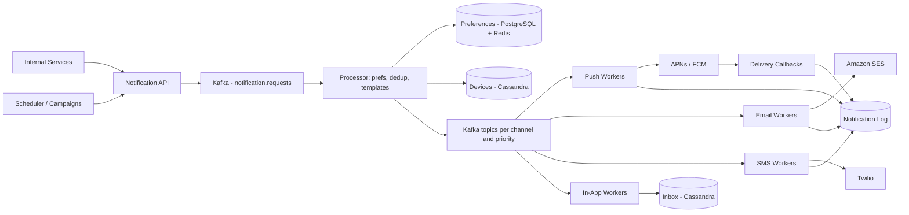

# Notification System

**Category:** System Design
**Difficulty:** 🟡 Medium
**Seniority:** senior
**Companies:** Amazon, Meta, Uber, LinkedIn, Airbnb, DoorDash, Slack
**Tags:** message-queue, push-notifications, fan-out, idempotency, retries, third-party-integration
**Time:** 45 min

---

## Problem Statement

Design a notification system that lets internal services send notifications to users over multiple channels: mobile push (APNs/FCM), SMS, email, and in-app. Examples include order updates, security alerts (OTP), social activity, and marketing campaigns.

The interviewer hints at a large consumer app: ~100M daily active users, ~1B notifications per day, bursty campaign traffic, and third-party providers with their own rate limits and failures. Users must be able to control preferences and not be spammed.

## Clarifying Questions

- Which channels? *iOS push (APNs), Android push (FCM), SMS (Twilio), email (SES/SendGrid), in-app inbox.*
- Volume? *~1B notifications/day total: 700M push, 200M email, 50M in-app, 5M SMS.*
- Latency expectations? *Transactional (OTP, security) < 5 s end-to-end; social < 30 s; marketing can take hours.*
- Delivery guarantee? *At-least-once to providers, with deduplication so users rarely see duplicates.*
- Who triggers notifications? *Internal services via API, plus scheduled/bulk campaigns to segments of millions of users.*
- User preferences? *Per-channel and per-category opt-out, quiet hours, time zones.*
- Templating and localization? *Yes, templates with variables in ~30 languages.*
- Do we need delivery tracking? *Yes: sent, delivered, opened, clicked, where providers support it.*

## Requirements

### Functional
- Send API for single and bulk notifications with category, priority, and channels.
- Resolve user devices/contacts, apply preferences, render templates.
- Deliver via APNs, FCM, SMS, email, and in-app inbox.
- Scheduling, retries, and delivery status tracking.
- Per-user frequency caps and quiet hours.

### Non-Functional
- High availability: accept notifications even if a provider is down (durable queuing).
- Low latency for high-priority notifications regardless of marketing backlog.
- Scalable to 1B/day with 10x campaign bursts.
- At-least-once delivery with idempotency to avoid duplicates.

### Out of Scope
- Building our own push transport (we use APNs/FCM), campaign segmentation UI.

## Capacity Estimation

| Metric | Arithmetic | Result |
|---|---|---|
| Average send rate | 1B / 86,400 | ~11.6K/s |
| Peak (campaign bursts 10x) | 11.6K x 10 | ~120K/s |
| Push per second avg | 700M / 86,400 | ~8K/s |
| SMS per second avg | 5M / 86,400 | ~60/s (provider limits matter) |
| Notification log size | 1B x 1 KB (payload + status) | 1 TB/day |
| Log retention 90 days | 1 TB x 90 | ~90 TB (Cassandra, TTL) |
| Device tokens | 100M DAU x ~1.5 devices x 200 B | ~30 GB |
| Preferences | 500M users x ~200 B | ~100 GB (cache hot portion in Redis) |
| Kafka throughput | 120K/s x 1 KB | ~120 MB/s peak |

## API Design

```text
POST /v1/notifications
  Headers: Idempotency-Key: <uuid>
  Body: {
    "user_ids": [123, 456],                 // or "segment_id" for bulk
    "category": "order_update",              // maps to preferences and priority
    "template_id": "order_shipped_v3",
    "params": { "order_id": "A-981", "eta": "Tue" },
    "channels": ["push", "email"],           // optional; else category defaults
    "priority": "high" | "normal" | "low",
    "send_at": "2025-01-01T09:00:00Z"?,      // optional scheduling
    "ttl_sec": 3600                          // drop if not delivered in time
  }
  202 -> { "notification_id": "n_8f2a...", "status": "accepted" }

GET  /v1/notifications/{id}                -> { "id", "per_channel_status": { "push": "delivered", "email": "opened" } }
PUT  /v1/users/{id}/preferences            -> { "email": { "marketing": false }, "quiet_hours": { "start": "22:00", "end": "07:00", "tz": "Europe/Berlin" } }
POST /v1/devices                           -> { "user_id", "platform": "ios", "token": "...", "app_version" }
GET  /v1/users/{id}/inbox?cursor=...        -> in-app notifications, paginated
```

## Data Model

```text
devices (Cassandra / DynamoDB)                 partition key: user_id
  user_id, device_id, platform, push_token, app_version, last_seen, is_active

user_preferences (PostgreSQL + Redis cache)     PK: user_id
  user_id, channel, category, enabled, quiet_start, quiet_end, timezone, locale

templates (PostgreSQL)                          PK: (template_id, version, locale)
  template_id, version, locale, channel, subject, body, created_by

notification_log (Cassandra, TTL 90 days)       partition key: notification_id
  notification_id, user_id, channel, status, provider_msg_id, attempts, created_at, updated_at

inbox (Cassandra)                               partition key: user_id, clustering: created_at DESC
  user_id, created_at, notification_id, title, body, deep_link, read

dedup keys (Redis)                              key: dedup:{idempotency_key}:{user_id}:{channel}  TTL 24h
```

- **Cassandra** for write-heavy, append-mostly logs and inboxes (1 TB/day, time-ordered by user); **PostgreSQL** for relational, low-volume config (templates, preferences) with Redis caching; **Redis** for dedup and frequency-cap counters.

## High-Level Design



**Send path**
1. A service calls `POST /v1/notifications`; API authenticates the caller, validates, checks the idempotency key, writes to Kafka `notification.requests`, returns 202.
2. Processor consumes, fans out per user and channel: loads preferences (Redis), drops opted-out channels, checks frequency caps and quiet hours (reschedule if quiet), looks up device tokens / email / phone.
3. Renders the localized template and publishes one message per (user, channel, device) to a channel+priority topic, e.g. `push.high`, `email.low`.
4. Channel workers call providers with per-provider rate limiting, retries with backoff, and write status to the notification log.
5. Providers' webhooks (SES/Twilio delivery receipts, open/click tracking) update status asynchronously.

**Bulk campaign path**
1. Scheduler resolves a segment (e.g. 20M users) into batches of 1,000 user IDs and enqueues them on low-priority topics, throttled so campaigns never starve transactional traffic.

## Deep Dives

### Priority isolation

- Separate Kafka topics and worker pools per priority: `high` (OTP, security), `normal` (social, orders), `low` (marketing).
- High-priority workers are over-provisioned and never shared; a 50M-user campaign backlog cannot delay an OTP.
- TTL on each message: drop expired notifications (an OTP after 10 min is useless; "your ride is here" after 30 min is harmful).

### Reliability, retries, and idempotency

```text
FUNCTION handle(msg):
    SET dedupKey ← "dedup:" + msg.idempotencyKey + ":" + msg.userId + ":" + msg.channel
    IF NOT redis.SET(dedupKey, "1", NX, EX = 86400):
        ACK msg; RETURN                               // already processed
    IF now() > msg.expiresAt:
        log(msg, "expired"); ACK msg; RETURN
    TRY:
        SET resp ← provider.send(msg)                 // timeout 2 s
        log(msg, "sent", resp.providerMsgId)
    CATCH RetryableError (5xx, 429, timeout):
        redis.DEL(dedupKey)
        IF msg.attempts < 5:
            publish(retryTopic(msg.attempts), msg, delay = 2^attempts seconds + jitter)
        ELSE:
            publish("dlq." + msg.channel, msg)
    CATCH PermanentError (invalid token, unsubscribed):
        IF error == InvalidToken: devices.markInactive(msg.deviceId)
        log(msg, "failed_permanent")
    ACK msg
```

- Kafka gives at-least-once; Redis `SET NX` dedups per (request, user, channel). Some providers accept idempotency keys too (e.g. FCM collapse keys, SES message tags).
- Retry topics with increasing delays avoid blocking the main partition (head-of-line blocking).

### Third-party provider limits and failover

- APNs uses persistent HTTP/2 connections with many concurrent streams; FCM HTTP v1 API has per-project quotas. Workers keep connection pools and token-bucket limiters per provider.
- SMS providers limit per sender number (e.g. 1 msg/s per long code); use short codes or number pools.
- Circuit breaker per provider; on sustained failures, fail over to a secondary (Twilio -> Vonage, SES -> SendGrid).
- Remove invalid push tokens on APNs `410 Unregistered` / FCM `UNREGISTERED` to keep the token table clean.

### User experience controls

- Frequency caps: Redis counters `cap:{user}:{category}:{day}`; e.g. max 3 marketing pushes/day.
- Quiet hours by user time zone: low/normal notifications are delayed to the end of the window; high priority bypasses.
- Aggregation/digest: "Alice and 12 others liked your post" by buffering social events per user for a short window (e.g. 5 min) before sending.

## Scaling & Reliability

- **Kafka partitioning** by `user_id` keeps per-user ordering and lets workers scale to partition count (e.g. 256 partitions per hot topic).
- **Stateless workers** autoscaled on consumer lag; channel pools scale independently.
- **Durability:** Kafka RF=3, `acks=all`; API returns 202 only after the write is acknowledged, so accepted notifications survive crashes.
- **Caching:** preferences and device tokens in Redis (hit rate > 95%); invalidate on update.
- **Multi-region:** API and Kafka per region; users homed to a region; providers are global.
- **Monitoring:** end-to-end latency per priority (p50/p99), consumer lag, provider error rates and 429s, DLQ size, delivery/open rates, opt-out spikes (sign of spam).

## Trade-offs

| Decision | Option A | Option B | Choice & Why |
|---|---|---|---|
| Ingestion | Synchronous send in API | Queue then async workers | Async via Kafka: absorbs bursts, survives provider outages |
| Delivery semantics | At-most-once | At-least-once + dedup | At-least-once with Redis dedup: missing an OTP is worse than a rare duplicate |
| Priority handling | Single shared queue | Separate topics and pools | Separate: campaigns cannot starve transactional messages |
| Log storage | PostgreSQL | Cassandra with TTL | Cassandra: 1 TB/day write-heavy, simple access patterns |
| Templates | Rendered by callers | Central template service | Central: consistent localization, versioning, compliance |

## Follow-up Questions

1. **How do you send a campaign to 50M users without overwhelming systems?** Batch segment resolution, throttle enqueue rate, low-priority topics, and spread sends over time zones.
2. **How do you guarantee ordering, e.g. "order shipped" before "order delivered"?** Partition by user_id for per-user ordering, include a sequence/version, and let clients drop stale ones; across channels ordering is best-effort.
3. **How would you track opens and clicks?** Tracking pixel and redirect links for email; push open events reported by the app SDK; all flow into an analytics pipeline (Kafka -> ClickHouse).
4. **A provider has a 30-minute outage — what happens?** Circuit breaker opens, messages go to delayed retry topics or a fallback provider; TTL drops ones that become irrelevant.
5. **How do you handle a user with 5 devices?** Fan out to all active tokens; use collapse keys so the latest replaces older ones; mark read across devices via in-app sync.

## Common Mistakes

- Calling APNs/SMS providers synchronously from the API request path.
- One queue for everything, letting marketing delay OTPs.
- Ignoring idempotency, so retries cause duplicate notifications.
- Forgetting user preferences, quiet hours, and frequency caps.
- Not cleaning up invalid device tokens, wasting capacity and hurting provider reputation.
- Retrying permanent errors forever instead of using a DLQ.

## Key Takeaways

- Decouple ingestion from delivery with a durable queue; return 202 immediately.
- Isolate by priority and by channel so each scales and fails independently.
- At-least-once delivery plus dedup keys and TTLs is the practical guarantee.
- Third-party providers are the bottleneck: rate-limit, retry with backoff, and fail over.
