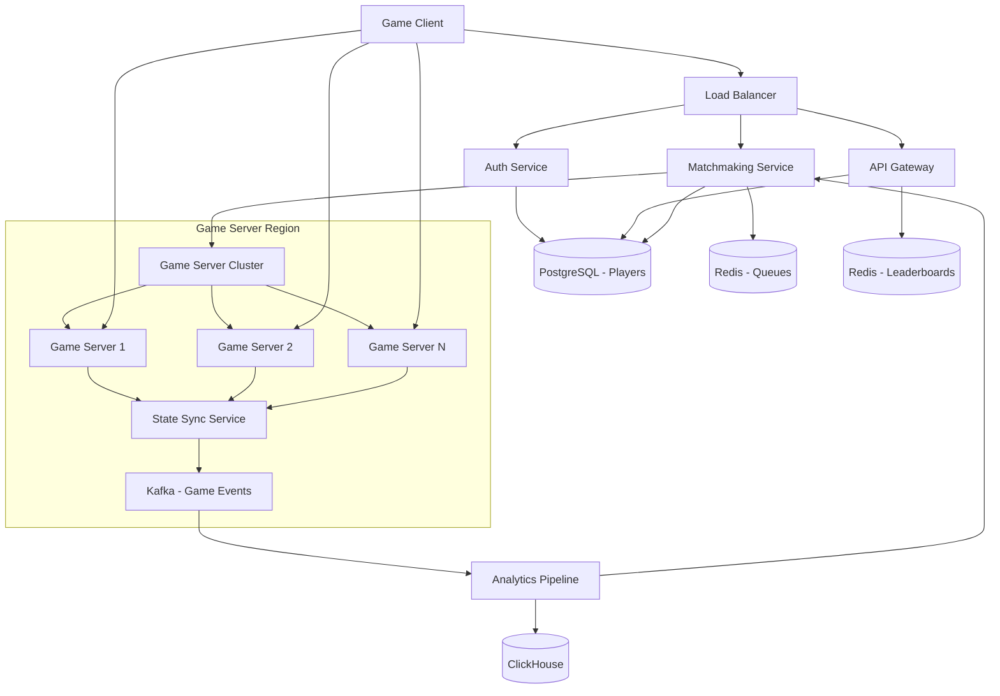

# Online Multiplayer Game Backend

**Category:** System Design
**Difficulty:** 🔴 Hard
**Seniority:** senior
**Companies:** Epic Games, Unity, Roblox, Valve, Riot Games, Activision
**Tags:** real-time, state-sync, matchmaking, latency, consistency, websockets
**Time:** 90-120 min

---

## Problem Statement

Design the backend for an online multiplayer game (e.g., battle royale, FPS, or MOBA) supporting millions of concurrent players in real-time matches. Players connect, are matched into sessions, and the game state must be synchronized with low latency (typically < 100ms) across all participants.

The interviewer hints at Fortnite/Valorant-like scale: 10M+ concurrent players, matches with 100 players each, real-time position updates at 20-60 ticks per second, and the need to handle network issues, cheating, and regional deployments.

## Clarifying Questions

- Player scale? *Assume 10M concurrent players, 50M DAU.*
- Match size? *Assume 100 players per match (battle royale style).*
- Tick rate? *Assume 20 server ticks/second for state updates.*
- Game type? *Real-time action game with position, health, inventory; turn-based out of scope.*
- Regions? *Global deployment: NA, EU, Asia, SA; players matched within region.*
- Latency target? *< 100ms server round-trip for nearby players.*
- Persistence requirements? *Match results, player stats, inventory; real-time state is ephemeral.*
- Anti-cheat? *Server-authoritative with client prediction and validation.*
- Spectating? *Support for observers/delayed spectating (optional).*
- Voice chat? *P2P WebRTC or relayed through servers (optional).*

## Requirements

### Functional

- Player authentication and session management.
- Matchmaking: group players into matches based on skill, region, latency.
- Real-time game state synchronization (position, actions, events).
- Server-authoritative game logic with client prediction.
- Match results and statistics persistence.
- Leaderboards and rankings.
- Reconnect handling for temporary disconnects.

### Non-Functional

- Low latency: p95 < 100ms for state updates within region.
- High availability: 99.9% for matchmaking, 99.99% for in-game sessions.
- Scalability: handle 10M concurrent players, 100K concurrent matches.
- Consistency: server-authoritative state with conflict resolution.
- Cheating prevention: validate all client actions server-side.
- Regional deployment: edge servers near players.

### Out of Scope

- Game client logic, graphics, physics engine (focus on backend).
- Voice chat implementation details.
- Tournament/matchmaking nuances (draft modes, team composition).
- In-game purchases/economy (beyond basic inventory persistence).

## Capacity Estimation

| Metric | Arithmetic | Result |
|---|---|---|
| Concurrent players | 10M | 10M |
| Concurrent matches | 10M / 100 | 100K matches |
| Players per region | 10M / 4 regions | 2.5M per region |
| Matches per region | 2.5M / 100 | 25K matches per region |
| State updates per second | 100K matches x 20 ticks x 100 players | 200M updates/s |
| Update size | Position (12B) + velocity (12B) + action (4B) | ~32B per update |
| Egress bandwidth | 200M x 32B | ~6.4 GB/s (~51 Gbps) |
| Matchmaking QPS | Assume 50K matches start/min | ~833 matches/s |
| API QPS (auth, stats) | 50M DAU x 10 actions / 86,400 | ~5.8K QPS |
| Daily matches | 50K x 60 x 24 | ~72M matches/day |
| Events per match | Assume 15 min avg, 20 ticks x 100 x 900 s | 180K events/match |
| Daily events | 72M x 180K | ~13 quadrillion events (sample for analytics) |

## API Design

```text
// Authentication
POST  /api/v1/auth/login
  body: { "username", "password" } OR { "provider": "steam", "token": "..." }
  resp: 200 { "playerId": "p_abc123", "sessionToken": "jwt...", "playerData": {...} }

POST  /api/v1/auth/refresh
  body: { "refreshToken" }
  resp: 200 { "sessionToken": "jwt..." }

// Matchmaking
POST  /api/v1/matchmaking/join
  headers: Authorization: Bearer <token>
  body: { "region": "na", "queue": "battle_royale", "preferences": {...} }
  resp: 202 { "ticketId": "t_xyz789" }

GET   /api/v1/matchmaking/status/{ticketId}
  resp: 200 { "status": "matched", "matchId": "m_def456",
              "server": "game-server-123.na.example.com:9000" }

// Real-time game protocol (WebSocket or UDP)
// Client → Server (input)
{
  "tick": 1234,
  "inputs": { "move": { "x": 0.5, "y": -0.3 }, "action": "shoot", "target": {...} }
}

// Server → Client (state)
{
  "tick": 1234,
  "state": {
    "players": [
      { "id": "p_abc", "position": { "x": 100, "y": 200 }, "health": 85, ... },
      ...
    ],
    "events": [ { "type": "player_hit", "source": "p_abc", "target": "p_def", "damage": 15 } ]
  }
}

// Player stats
GET   /api/v1/players/{playerId}/stats
  resp: 200 { "matchesPlayed": 1234, "wins": 234, "kdRatio": 2.5, ... }

GET   /api/v1/leaderboards/{region}/{queue}
  resp: 200 { "rankings": [{ "rank": 1, "playerId": "...", "rating": 2500 }, ...] }

// Reconnect
POST  /api/v1/matches/{matchId}/reconnect
  headers: Authorization: Bearer <token>
  resp: 200 { "server": "...", "reconnectToken": "..." }
```

## Data Model

**Player data — PostgreSQL (sharded by player_id):**

```text
players
  player_id        UUID  PRIMARY KEY
  username         VARCHAR(32)  UNIQUE
  email            VARCHAR(255)
  created_at       TIMESTAMP
  last_login       TIMESTAMP

player_stats
  player_id        UUID  PRIMARY KEY
  matches_played   INT
  wins             INT
  kills            INT
  deaths           INT
  rating           INT  -- ELO/MMR
  region           VARCHAR(8)

inventory
  player_id        UUID  PRIMARY KEY
  items            JSONB  -- skins, weapons, etc.
  currency         INT
```

**Match results — Cassandra (time-series, partitioned by region + date):**

```text
matches
  match_id         UUID  PRIMARY KEY
  region           VARCHAR(8)
  started_at       TIMESTAMP
  ended_at         TIMESTAMP
  game_mode        VARCHAR(32)
  participants     LIST<UUID>  -- player_ids
  winner_id        UUID

match_participants
  match_id         UUID
  player_id        UUID
  placement        INT
  kills            INT
  damage_dealt     INT
  survived_time_sec INT
  PRIMARY KEY (match_id, player_id)
```

**Real-time state — In-memory per game server (ephemeral):**

```text
// Game state structure (not persisted)
GameState {
  tick: int
  players: Map<playerId, PlayerState>
  projectiles: List<Projectile>
  events: List<GameEvent>
}

PlayerState {
  position: Vector3
  velocity: Vector3
  health: int
  inventory: Item[]
  last_input_tick: int
}
```

**Matchmaking queue — Redis (sorted sets for MMR-based matching):**

```text
matchmaking_queue:{region}:{queue}
  -- ZSET: score = MMR, member = playerId:timestamp
```

## System Architecture



**Matchmaking flow:**

1. Player requests to join queue via API.
2. Matchmaking service validates player, adds to Redis sorted set (score = MMR).
3. Background job periodically scans for matchable groups (MMR within threshold, same region).
4. When match found: allocate game server instance, create match record, notify all players.
5. Players connect to assigned game server via WebSocket/UDP.

**In-game flow:**

1. Client sends input packets at client tick rate (e.g., 60 Hz).
2. Game server processes inputs, updates authoritative state at server tick rate (20 Hz).
3. Server sends state deltas to all clients in the match.
4. Clients predict local state for responsiveness, reconcile with server state.
5. Game events (kills, damage) published to Kafka for analytics and anti-cheat.

**Reconnect flow:**

1. Player disconnects; game server preserves state for 30-60 seconds.
2. Player calls reconnect API with match ID.
3. Server validates reconnect token, resumes session with current state.
4. If timeout, player marked as disconnected/AFK.

## Deep Dives

### Matchmaking algorithm

Match players based on MMR, region, and latency:

```text
FUNCTION findMatch(region, queue):
  SET queueKey ← "matchmaking_queue:" + region + ":" + queue
  SET candidates ← redis.zrangebyscore(queueKey, minMMR, maxMMR)
  
  // Group by skill bands
  SET bands ← groupByMMR(candidates, bandSize = 100)
  
  FOR band IN bands:
    IF band.size >= PLAYERS_PER_MATCH:
      SET selected ← selectTopN(band, PLAYERS_PER_MATCH)
      SET matchId ← createMatch(region, queue, selected)
      FOR player IN selected:
        redis.zrem(queueKey, player.id)
        notifyPlayer(player.id, matchId)
      RETURN matchId
  
  // Partial match: wait for more players
  SET partial ← findPartialMatch(candidates)
  IF partial:
    addToWaitingRoom(partial)
  RETURN NULL
```

**Advanced considerations:**
- Party matching: keep pre-made teams together.
- Latency balancing: measure ping to candidate servers, prefer low-latency.
- Time-based expansion: widen MMR range as wait time increases.
- Priority queues: paid players get faster matching.

### State synchronization and client prediction

**Server-authoritative with client prediction:**

```text
// Client side
FUNCTION clientTick():
  SET localState ← predictState(localState, localInput)
  sendInputToServer(localInput)
  render(localState)

FUNCTION onServerState(serverState):
  SET localState ← reconcile(localState, serverState)
  // Smooth correction to avoid snapping

FUNCTION reconcile(local, server):
  SET diff ← server.tick - local.lastServerTick
  // Replay local inputs on top of server state
  SET reconciled ← server
  FOR i FROM local.lastServerTick + 1 TO server.tick:
    reconciled ← predictState(reconciled, local.inputs[i])
  RETURN reconciled

// Server side
FUNCTION serverTick():
  FOR each player IN match.players:
    processInput(player.input)
  updatePhysics()
  detectCollisions()
  SET stateDelta ← computeDelta(previousState, currentState)
  broadcast(stateDelta)
```

**Optimizations:**
- Delta compression: send only changed fields.
- Interest management: clients only receive state for nearby entities.
- Tick interpolation: render between server ticks for smoothness.
- Lag compensation: rewind server state for hit detection based on client latency.

### Game server architecture

Each game server is a dedicated process handling one match:

```text
GameServer {
  matchId: UUID
  players: Map<playerId, PlayerConnection>
  state: GameState
  tick: int
  
  FUNCTION run():
    WHILE match.active:
      processInputs()  // from network buffer
      updateGameLogic()  // physics, rules
      broadcastState()
      sleep(TICK_INTERVAL)  // 50ms for 20 Hz
      tick++
}

PlayerConnection {
  playerId: UUID
  socket: WebSocket/UDP
  lastInputTick: int
  inputBuffer: Queue[Input]
  
  FUNCTION sendState(delta):
    socket.send(serialize(delta))
}
```

**Deployment:**
- Dedicated game server machines (not containers) for performance.
- One match per server process for isolation and predictability.
- Orchestration: Kubernetes with custom game controller, or custom scheduler.
- Autoscaling: scale game servers based on queue length and historical patterns.

### Anti-cheat system

Multi-layer approach:

```text
// Server-side validation
FUNCTION validateInput(player, input):
  // Movement validation
  IF distance(player.position, input.position) > MAX_SPEED * dt:
    RETURN false  // speed hack
  
  // Action validation
  IF input.action == "shoot" AND player.weapon.cooldown > 0:
    RETURN false  // rate hack
  
  // State validation
  IF player.health <= 0 AND input.action != "respawn":
    RETURN false
  
  RETURN true

// Statistical detection
FUNCTION detectAnomalies(playerStats):
  IF playerStats.headshotRatio > 0.8:
    flagForReview(player.id, "suspicious accuracy")
  IF playerStats.averageReactionTime < 100ms:
    flagForReview(player.id, "inhuman reaction")
```

**Additional measures:**
- Server-authoritative everything (no client trust).
- Heuristic detection: impossible movements, perfect aim.
- Machine learning: detect patterns from known cheaters.
- Client-side obfuscation: encrypt packets, anti-debugging.
- Hardware bans: fingerprint machines, not just accounts.

### Regional deployment and latency optimization

Deploy game servers in regions close to players:

```text
Region {
  id: "na"
  datacenter: "us-east-1"
  gameServers: List<GameServer>
  matchmakingQueue: Redis
  
  FUNCTION assignPlayer(player):
    SET latency ← measurePing(player.ip, datacenter)
    IF latency < MAX_LATENCY:
      RETURN this
    RETURN NULL
}
```

**Edge computing:**
- Game servers in edge locations (AWS Local Zones, Cloudflare Workers).
- For cross-region play: use central authority with edge proxies.
- Network optimization: UDP for game traffic, custom reliability layer.

### Event streaming and analytics

Game events streamed to Kafka for real-time and batch analytics:

```text
// Event schema
GameEvent {
  matchId: UUID
  tick: int
  eventType: enum(kill, death, damage, pickup, ...)
  playerId: UUID
  targetId: UUID?  // for kill/damage
  data: JSON
  timestamp: long
}

// Kafka topics
game-events.{region}  -- partitioned by matchId
match-results         -- for leaderboards, MMR updates
anti-cheat-alerts     -- for security team
```

**Consumers:**
- Real-time leaderboards (Redis).
- MMR adjustment (ELO calculation).
- Anti-cheat detection.
- Business analytics (retention, balance).

## Scalability

- **Horizontal scaling:** Add more game server machines; matchmaking assigns to available capacity.
- **Sharding by region:** Each region has independent matchmaking and game servers.
- **Stateless services:** Auth, API, matchmaking are stateless; scale with load balancers.
- **Game server isolation:** One match per process; add processes as matches increase.
- **Database sharding:** Player data sharded by player_id; match results by region/date.
- **Caching:** Redis for matchmaking queues, leaderboards, session data.

## Consistency & Availability

- **Game state:** Strong consistency within a match (single authoritative server).
- **Cross-match:** Eventual consistency for stats, leaderboards (Kafka pipeline).
- **Matchmaking:** Best-effort consistency; queue in Redis with replication.
- **Player data:** Strong consistency for authentication, inventory (PostgreSQL).
- **High availability:** Game servers can fail; match results still recorded via event replay.
- **Graceful degradation:** If region fails, redirect players to nearest region (higher latency).

## Security

- **Authentication:** JWT with short expiry; refresh tokens for long sessions.
- **Authorization:** Validate player owns the account before joining matches.
- **Rate limiting:** Prevent matchmaking abuse, API spamming.
- **DDoS protection:** Protect game servers from direct attacks (Cloudflare, AWS Shield).
- **Input validation:** All client inputs validated server-side.
- **Encryption:** TLS for control channel; custom encryption for UDP packets.
- **Anti-cheat:** As described above.

## Trade-offs

| Decision | Option A | Option B | Choice & Why |
|---|---|---|---|
| Transport protocol | TCP (WebSocket) | UDP with custom reliability | UDP — lower latency, packet loss acceptable for action games |
| Tick rate | 60 Hz | 20 Hz | 20 Hz — balances responsiveness with server load; client-side prediction smooths |
| State sync | Full state every tick | Delta compression | Delta compression — reduces bandwidth by 80%+ |
| Match persistence | Full state replay | Event log only | Event log only — storage efficient; replay reconstructed if needed |
| Anti-cheat | Client-side only | Server-authoritative | Server-authoritative — essential for fair play; client-side as supplement |
| Regional deployment | Single global region | Multi-region | Multi-region — required for < 100ms latency globally |

## Follow-up Questions

1. **How do you handle lag compensation for hit detection?** Server rewinds state to the client's perceived time when processing their shot; validate the shot against historical positions; apply damage if valid.
2. **What happens if a game server crashes mid-match?** Detect crash via health checks; restart match on new server with event replay from Kafka; or end match and refund players based on state at crash.
3. **How would you implement spectating?** Delayed spectator mode: stream state with 30-60 second delay to prevent stream sniping; or dedicated observer slots in the match.
4. **How do you balance teams in competitive modes?** Use MMR/ELO rating; consider party MMR as average; adjust for role preferences; use Hungarian algorithm for optimal team assignment.
5. **How would you handle a sudden player influx (e.g., after a streamer promotes the game)?** Auto-scale game servers aggressively; use spot instances for cost efficiency; implement queue system with wait times; temporarily relax MMR matching.

## Common Mistakes

- Trusting client-side state (easy to hack).
- Using TCP for real-time game traffic (head-of-line blocking).
- Not designing for regional deployment (latency issues).
- Underestimating bandwidth requirements for state sync.
- Forgetting about reconnect handling.
- Not considering anti-cheat from the start.
- Single-threaded game server design (need multi-threading for 100 players).

## Key Takeaways

- Server-authoritative state with client prediction is the standard for real-time multiplayer games.
- UDP with custom reliability layer is preferred over TCP for low-latency action games.
- Matchmaking is a queueing problem with skill, region, and latency constraints.
- Game servers are stateful per match but can be horizontally scaled across instances.
- Anti-cheat requires multi-layer defense: validation, heuristics, and ML.
- Regional deployment is essential for global latency targets.
- Event streaming (Kafka) enables analytics, replay, and cross-service communication.
- Reconnect handling and graceful degradation improve player experience.
