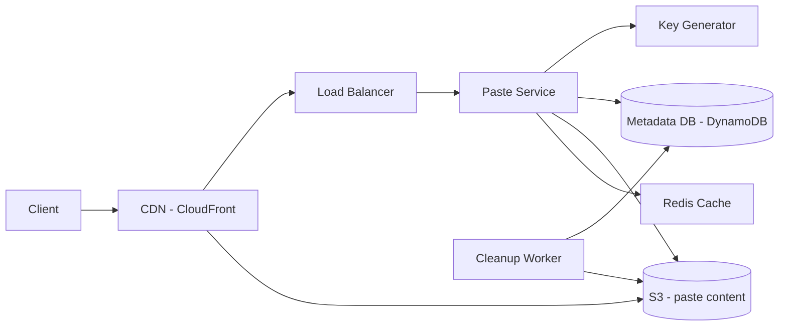

# Pastebin

**Category:** System Design
**Difficulty:** 🟢 Easy
**Seniority:** mid
**Companies:** Amazon, Microsoft, Google, Dropbox, GitHub, Atlassian
**Tags:** object-storage, blob-metadata-split, caching, cdn, expiration
**Time:** 45 min

---

## Problem Statement

Design a service like Pastebin or GitHub Gist where users paste a block of text (code, logs, notes) and receive a unique URL to share it. Anyone with the link can view the paste until it expires.

The interviewer suggests millions of new pastes per day, pastes up to 10 MB, and a read-heavy workload. Unlike a URL shortener, the payload is large, so the design must separate content storage from metadata.

## Clarifying Questions

- How many new pastes per day? *Assume 5M/day.*
- Read:write ratio? *About 10:1.*
- Max paste size? *10 MB; average ~10 KB.*
- Do pastes expire? *User chooses: 10 min, 1 day, 1 month, never (default 1 year for anonymous).*
- Do we need user accounts and private pastes? *Optional accounts; pastes can be public or unlisted, optionally password-protected.*
- Can pastes be edited? *No, immutable. Edits create a new paste.*
- Syntax highlighting? *Done client-side; we only store a language hint.*
- Any search? *Out of scope.*

## Requirements

### Functional
- Create a paste (text + optional title, language, expiry, visibility) and return a unique URL.
- View a paste by URL (rendered page and raw text).
- Pastes expire automatically.
- Optional custom alias and deletion by owner.

### Non-Functional
- High availability for reads (99.95%+).
- Low latency: p99 < 200 ms for small pastes.
- Durability: pastes must not be lost before expiry (11 nines via S3).
- Unique, non-guessable keys for unlisted pastes.

### Out of Scope
- Full-text search, collaborative editing, comments.

## Capacity Estimation

| Metric | Arithmetic | Result |
|---|---|---|
| Write QPS | 5M / 86,400 | ~60/s avg, ~200/s peak |
| Read QPS | 60 x 10 | ~600/s avg, ~2,000/s peak |
| Content storage per day | 5M x 10 KB | 50 GB/day |
| Content over 5 years | 50 GB x 365 x 5 | ~91 TB (fits easily in S3) |
| Metadata per paste | ~500 B | 5M x 500 B = 2.5 GB/day, ~4.5 TB / 5 yr |
| Total pastes / 5 yr | 5M x 1,825 | ~9B keys |
| Read bandwidth | 600 x 10 KB | ~6 MB/s avg |
| Cache | 20% of daily reads: 0.2 x 50M reads x 10 KB | ~100 GB (but CDN absorbs most) |

Key length: base62 with 8 chars = 62^8 ≈ 218T, far above 9B, so random keys have negligible collision probability.

## API Design

```text
POST /api/v1/pastes
  Body:    { "content": "...", "title": "...", "language": "python",
             "expire_in": "1d" | "1m" | "never", "visibility": "public" | "unlisted",
             "password": "..."?, "custom_alias": "..."? }
  201 ->   { "key": "Xk92LmPq", "url": "https://paste.example/Xk92LmPq", "expires_at": "..." }
  413 ->   content too large (> 10 MB)

GET /{key}                  -> 200 HTML page (rendered, highlight client-side)
GET /raw/{key}              -> 200 text/plain (served via CDN)
GET /api/v1/pastes/{key}    -> 200 { "key", "title", "language", "created_at", "expires_at", "content_url" }
  404 not found | 410 expired | 401 password required

DELETE /api/v1/pastes/{key} -> 204 (owner only)
```

For large pastes (> 1 MB), the API can return a pre-signed S3 upload URL so clients upload content directly.

## Data Model

```text
Table: pastes (metadata)  -- PostgreSQL, sharded by key, or DynamoDB
  key           VARCHAR(16) PRIMARY KEY
  user_id       BIGINT NULL
  title         VARCHAR(256)
  language      VARCHAR(32)
  size_bytes    INT
  content_path  VARCHAR(256)      -- s3://pastes/{key}
  visibility    ENUM(public, unlisted)
  password_hash VARCHAR(100) NULL -- bcrypt
  created_at    TIMESTAMP
  expires_at    TIMESTAMP NULL    -- indexed for cleanup

Object storage: S3 bucket "pastes"
  key: {key}  value: gzip-compressed text
  lifecycle rule / object tags for expiration
```

- **Metadata/content split:** the DB stores small, queryable rows; S3 stores large immutable blobs cheaply (~$0.023/GB-month) with high durability. Storing 10 MB blobs in a DB row bloats it and hurts cache efficiency.
- **Metadata DB:** DynamoDB (key lookup, TTL attribute for expiry) or PostgreSQL if we need "list my pastes" queries (index on `user_id`). Partition key: `key`.
- Small pastes (< 4 KB) could be inlined in metadata to save an S3 round-trip.

## High-Level Design



**Write path**
1. Client sends `POST /api/v1/pastes`; Paste Service validates size and rate limits by IP/user.
2. Service generates a random 8-char base62 key (or validates a custom alias).
3. Uploads gzip-compressed content to `s3://pastes/{key}`.
4. Writes metadata with a conditional put (`attribute_not_exists(key)`); on collision regenerate the key.
5. Returns the URL. Upload happens before metadata write, so a crash leaves only an orphan blob (cleaned later), never a dangling pointer.

**Read path**
1. `GET /raw/{key}` hits the CDN; public pastes are cached at the edge with `Cache-Control` max-age bounded by expiry.
2. On CDN miss, Paste Service checks Redis for metadata, falls back to DynamoDB.
3. Checks expiry/password, then streams content from S3 (or redirects to a short-lived pre-signed URL).
4. HTML view page is a static shell; content is fetched and highlighted client-side.

## Deep Dives

### Key generation

- **Random base62 keys** (chosen): 8 chars over 218T space; at 9B keys the probability a new key collides is ~0.004%, handled by a conditional write and retry.
- Alternatives: counter + base62 (like URL shortener) is predictable, which is bad for unlisted pastes; hashing content would make identical pastes share a key and leak existence.

```text
FUNCTION createPaste(req):
    FOR attempt IN 1..3:
        SET key ← randomBase62(8)             // CSPRNG
        PUT s3://pastes/{key} ← gzip(req.content)
        IF metadataDB.putIfAbsent(key, meta(req, key)):
            RETURN key
        DELETE s3://pastes/{key}              // rare collision cleanup
    RAISE InternalError
```

### Expiration and cleanup

- DynamoDB TTL on `expires_at` deletes metadata lazily (within ~48 h), so reads must also check `expires_at` and return 410.
- DynamoDB Streams trigger a Lambda/worker to delete the matching S3 object; alternatively S3 lifecycle rules by tag (`expiry=1d`, `expiry=30d`) delete blobs in bulk.
- CDN TTL must never exceed remaining life: `max-age = min(3600, expires_at - now)`. Deletions issue a CDN invalidation.
- A daily reconciliation job removes orphan blobs with no metadata.

### Caching and CDN

- Reads are 10:1 and content is immutable, ideal for CDN caching; hit rates of 80-90% for public pastes are typical.
- Redis caches metadata (small, hot) and optionally small paste bodies (< 100 KB) with LRU eviction.
- Password-protected pastes bypass the CDN (`Cache-Control: private, no-store`).

### Abuse and security

- Rate-limit creates per IP (e.g. 10/min anonymous) with a token bucket in Redis.
- Scan content asynchronously for credentials leaks and malware; allow takedown.
- Serve raw content from a separate cookieless domain with `Content-Type: text/plain` and `X-Content-Type-Options: nosniff` to prevent stored XSS.

## Scaling & Reliability

- **Stateless Paste Service**, autoscaled; write volume is low, so scaling focuses on reads (CDN + cache).
- **Storage:** S3 scales automatically; DynamoDB on-demand mode or partitioned PostgreSQL (by key hash) with read replicas.
- **Replication:** S3 cross-region replication for DR; DynamoDB global tables for multi-region reads.
- **Large pastes:** pre-signed direct uploads to S3 keep 10 MB bodies off app servers; enforce size via `content-length-range` policy.
- **Failure handling:** if S3 is degraded, return 503 for creates rather than storing partial state; reads served from CDN continue.
- **Monitoring:** CDN hit ratio, S3 4xx/5xx, p99 latency per size bucket, orphan blob count, abuse report rate.

## Trade-offs

| Decision | Option A | Option B | Choice & Why |
|---|---|---|---|
| Content storage | In DB rows | Object storage (S3) | S3: cheap, durable, handles 10 MB blobs; DB stays small and fast |
| Key generation | Sequential counter | Random base62 | Random: unguessable for unlisted pastes, collisions negligible |
| Metadata DB | PostgreSQL | DynamoDB | DynamoDB for key lookups and TTL; PostgreSQL if user listing queries matter |
| Expiry | Cron scan + delete | TTL + lifecycle rules | TTL/lifecycle: no full-table scans, plus read-time check |
| Rendering | Server-side highlight | Client-side highlight | Client-side: cacheable static content, less server CPU |

## Follow-up Questions

1. **How would you deduplicate identical content?** Store blobs by SHA-256 content hash with reference counting; metadata points to the hash. Saves storage but complicates deletion.
2. **How do you support "burn after reading"?** Atomic conditional delete on first read (e.g. DynamoDB `DeleteItem` with `ReturnValues`), and never cache it at the CDN.
3. **How would you add search over public pastes?** Stream new public pastes via Kafka into Elasticsearch; index only public, non-expired content.
4. **How do you handle a viral paste?** CDN absorbs it; with immutable content, set long max-age and use origin shield to collapse misses.
5. **How do you add end-to-end encryption?** Encrypt client-side and put the key in the URL fragment (`#key`), which browsers never send to the server (PrivateBin approach).

## Common Mistakes

- Storing large paste bodies directly in the relational database.
- Writing metadata before content, creating pointers to missing blobs.
- Using sequential keys for unlisted pastes, allowing enumeration.
- Letting CDN cache outlive paste expiry or ignoring deletion invalidation.
- Serving raw user content from the main domain, enabling XSS.

## Key Takeaways

- Split metadata (small, in a DB) from content (large, in object storage).
- Immutable content makes CDN caching extremely effective.
- Expiry needs both background deletion and a read-time check.
- Random keys with conditional writes give uniqueness and privacy for unlisted links.
