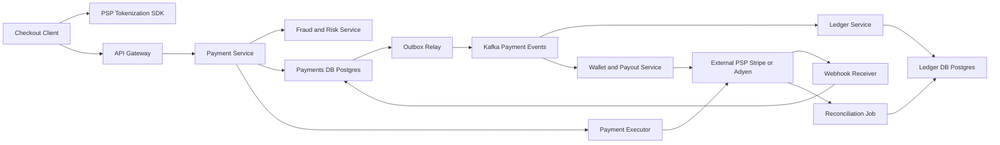

# Payment System

**Category:** System Design
**Difficulty:** 🔴 Hard
**Seniority:** staff
**Companies:** Stripe, PayPal, Amazon, Uber, Square, Shopify, Coinbase
**Tags:** idempotency, double-entry-ledger, distributed-transactions, reconciliation, exactly-once, consistency, pci-compliance
**Time:** 60 min

---

## Problem Statement

Design the payment backend for a large e-commerce marketplace (like Amazon or Shopify checkout). When a buyer places an order, the system must charge their card through an external payment service provider (PSP such as Stripe, Adyen, or Braintree), record the money movement accurately, and later pay out sellers.

The interviewer emphasizes correctness over raw scale: no double charges, no lost payments, a complete audit trail, and graceful handling of PSP timeouts and failures — while still handling peak shopping traffic like Black Friday.

## Clarifying Questions

- Do we process cards ourselves or use a PSP? *Use PSPs (Stripe/Adyen); we never store raw card numbers.*
- Scale? *10M payments/day, peak ~10x average during sales events.*
- Payment methods? *Cards and wallets in v1; bank transfers later.*
- One-step or two-step charges? *Authorize at checkout, capture at shipment.*
- Multi-currency? *Yes, settle in the merchant's currency; FX via the PSP.*
- Refunds and chargebacks? *Refunds yes; chargebacks handled via PSP webhooks.*
- Payouts to sellers? *Yes, daily batch payouts.*
- Latency expectations? *Checkout payment within ~2-3 s; correctness takes priority.*

## Requirements

### Functional

- Create a payment for an order; authorize, capture, void, refund.
- Integrate with multiple PSPs; receive asynchronous webhooks for status changes.
- Record every money movement in a double-entry ledger.
- Maintain buyer/seller wallet balances; daily seller payouts.
- Reconcile internal records with PSP settlement reports daily.

### Non-Functional

- Correctness: exactly-once effect for charges (no double charge, no lost charge).
- Durability: no financial record ever lost; immutable audit log.
- Consistency: strong consistency for ledger and payment state.
- Availability: 99.99% for checkout; degrade by queueing rather than failing.
- Security & compliance: PCI DSS scope minimized via tokenization; encryption; access audits.
- Latency: p99 < 3 s for authorization (dominated by PSP/bank).

### Out of Scope

- Building a card network/acquirer, fraud ML model internals, tax calculation.

## Capacity Estimation

| Metric | Arithmetic | Result |
|---|---|---|
| Payments/day | given | 10M |
| Avg TPS | 10M / 86,400 | ~115 TPS |
| Peak TPS | 10x | ~1,200 TPS |
| Ledger entries | ~4 entries per payment lifecycle (auth, capture, fee, payout) x 2 sides | ~80M rows/day |
| Ledger storage | 80M x 200 B | ~16 GB/day, ~6 TB/year |
| Payment records | 10M x 1 KB | ~10 GB/day |
| Webhooks inbound | ~3 per payment | ~350/s avg, ~3,500/s peak |
| Retention | regulatory | 7-10 years -> ~60 TB ledger, archived to cold storage |

Throughput is modest; a sharded PostgreSQL cluster handles it. The design challenge is correctness under failures, not QPS.

## API Design

```text
POST /v1/payments
  headers: Idempotency-Key: 3f6b2c1e-...      // required, client-generated per checkout attempt
  body: { "orderId": "o_123", "amount": 4999, "currency": "USD",
          "paymentMethodToken": "tok_visa_abc", "captureMethod": "manual",
          "sellerId": "s_77" }
  resp: 201 { "paymentId": "pay_9", "status": "AUTHORIZED" }
        202 { "paymentId": "pay_9", "status": "PENDING" }   // PSP timeout, result via webhook

POST /v1/payments/{paymentId}/capture   headers: Idempotency-Key   body: { "amount": 4999 }
POST /v1/payments/{paymentId}/refunds   headers: Idempotency-Key   body: { "amount": 1000, "reason": "..." }
GET  /v1/payments/{paymentId}           -> { status, amount, events[], refunds[] }

// Inbound from PSP
POST /v1/webhooks/{psp}
  headers: Signature: t=...,v1=...      // HMAC verified
  body: { "eventId": "evt_1", "type": "charge.captured", "pspPaymentId": "ch_1", ... }
  resp: 200 (after durable persist)

GET  /v1/sellers/{sellerId}/balance     -> { "available": 120000, "pending": 4999, "currency": "USD" }
```

Amounts are integers in minor units (cents) — never floating point.

## Data Model

**PostgreSQL (sharded by `merchant_id` / `payment_id` via Citus or app-level sharding)** — ACID transactions, constraints, and mature tooling matter more than scale here. Alternative: Spanner/CockroachDB for global consistency.

```text
payment
  payment_id       UUID PK
  order_id         TEXT
  idempotency_key  TEXT UNIQUE (per client)
  amount_minor     BIGINT
  currency         CHAR(3)
  status           ENUM(CREATED, AUTH_PENDING, AUTHORIZED, CAPTURE_PENDING, CAPTURED,
                        FAILED, VOIDED, REFUNDED, PARTIALLY_REFUNDED)
  psp              TEXT
  psp_payment_id   TEXT UNIQUE
  version          INT
  created_at, updated_at TIMESTAMP

payment_event                     // append-only state history
  event_id, payment_id, from_status, to_status, source (api|webhook|recon), payload JSONB, ts

ledger_entry                      // immutable, double-entry
  entry_id         BIGSERIAL PK
  txn_id           UUID           // groups balanced entries
  account_id       TEXT           // e.g. buyer_card_clearing, seller:s_77:pending, platform_fees
  direction        ENUM(DEBIT, CREDIT)
  amount_minor     BIGINT CHECK (amount_minor > 0)
  currency         CHAR(3)
  created_at       TIMESTAMP
  // invariant: per txn_id, SUM(debits) = SUM(credits)

account_balance                   // derived, updated in same transaction
  account_id PK, balance_minor BIGINT, version INT

outbox
  id, aggregate_id, event_type, payload, published BOOL
```

Card data never touches our databases: the client tokenizes directly with the PSP (Stripe Elements / Adyen hosted fields), keeping us in reduced PCI scope (SAQ A).

## High-Level Design



**Payment (write) path:**

1. Client tokenizes the card with the PSP SDK, then calls `POST /payments` with the token and an idempotency key.
2. Payment Service checks the idempotency key; if seen, returns the stored result.
3. Risk service scores the payment (rules + ML); high risk -> 3DS challenge or reject.
4. Payment is persisted as `AUTH_PENDING` before calling the PSP (write-ahead intent).
5. Executor calls the PSP with our `payment_id` as the PSP idempotency key; on success, status -> `AUTHORIZED` and an outbox event is written in the same transaction.
6. Outbox relay publishes to Kafka; the Ledger Service writes balanced double-entry records; Wallet updates seller pending balance.
7. On shipment, capture follows the same pattern; webhooks confirm final settlement.

**Read path:** payment status and balances are read from the Payments DB / balance table (primary for strong reads, replicas for dashboards).

## Deep Dives

### Idempotency and exactly-once effects

Networks fail between every hop, so every call is retried — making retries safe is the core of the design.

```text
FUNCTION createPayment(req, idemKey):
    BEGIN TRANSACTION
        SET existing ← SELECT * FROM idempotency WHERE key = idemKey FOR UPDATE
        IF existing EXISTS:
            IF existing.requestHash != hash(req): RETURN 422 "key reused with different body"
            IF existing.status = IN_PROGRESS:     RETURN 409 "retry later"
            RETURN existing.response
        INSERT idempotency(key = idemKey, requestHash = hash(req), status = IN_PROGRESS)
        INSERT payment(status = AUTH_PENDING, ...)
    COMMIT

    SET result ← psp.authorize(paymentId, token, amount, pspIdempotencyKey = paymentId)
    // on timeout: leave AUTH_PENDING; webhook or status poller resolves it

    BEGIN TRANSACTION
        UPDATE payment SET status = mapStatus(result), version = version + 1
            WHERE id = paymentId AND status = AUTH_PENDING
        INSERT outbox(event = "payment.authorized", ...)
        UPDATE idempotency SET status = DONE, response = serialize(result)
    COMMIT
    RETURN result
```

Key properties: our intent is durable before calling the PSP; the PSP deduplicates by our key; state transitions are conditional so duplicate webhooks or retries are no-ops. Idempotency keys expire after ~24 h-7 days.

### Handling PSP timeouts and unknown states

A timeout does not mean failure — the card may have been charged. Never blindly retry with a new key or mark failed.

- Leave the payment in `*_PENDING`.
- Retry with the same idempotency key using exponential backoff with jitter (e.g. 1 s, 2 s, 4 s... up to ~5 min).
- A status poller queries the PSP for stuck payments older than N minutes.
- Webhooks (verified via HMAC signature, deduplicated by `eventId`) advance the state machine.
- Daily reconciliation is the final safety net.

### Double-entry ledger

Every money movement is a transaction of balanced entries; balances are derived from entries, never edited directly.

```text
// Capture of $49.99 with $1.50 platform fee
txn_id = T1
  DEBIT   psp_receivable            4999
  CREDIT  seller:s_77:pending       4849
  CREDIT  platform:fee_revenue       150

FUNCTION postTransaction(txnId, entries):
    ASSERT sum(debits(entries)) = sum(credits(entries))
    BEGIN TRANSACTION (SERIALIZABLE)
        IF EXISTS ledger_entry WHERE txn_id = txnId: RETURN    // idempotent consumer
        FOR e IN entries:
            INSERT ledger_entry(e)
            UPDATE account_balance SET balance = balance +/- e.amount, version = version + 1
                WHERE account_id = e.account
    COMMIT
```

Entries are immutable; corrections are new reversing transactions. This gives a complete audit trail and makes "where did the money go" answerable at any time.

### Reconciliation

Each night, download PSP settlement files (and bank statements), normalize, and match against ledger entries by `psp_payment_id` and amount.

- **Matched:** mark settled; move seller funds from pending to available.
- **Mismatched amounts / missing internally / missing at PSP:** create reconciliation exceptions; auto-fix known classes (e.g. late webhook) and queue the rest for finance operations.
- Track fees and FX differences as their own ledger accounts.

Reconciliation is what turns "probably correct" distributed processing into auditable correctness.

## Scaling & Reliability

- **Sharding:** payments and ledger sharded by merchant/account; ledger transactions involving multiple shards use a clearing account per shard plus the outbox/saga pattern rather than 2PC.
- **Replication:** synchronous replication to a standby in another AZ (RPO = 0); PITR backups; WAL archived to S3 with object lock (WORM).
- **Sagas over distributed transactions:** order -> payment -> inventory -> shipping coordinated by events with compensating actions (void authorization, refund) on failure.
- **PSP redundancy:** route to multiple PSPs; circuit-break a degraded PSP and fail over for new payments (never for in-flight ones).
- **Peak traffic:** queue-based load leveling for captures and payouts; authorizations scale via stateless services and connection pooling (PgBouncer).
- **Security:** tokenization, TLS everywhere, KMS-managed encryption, secrets rotation, least-privilege access, audit logs.
- **Monitoring:** auth success rate per PSP/issuer, pending-state age, webhook lag, ledger imbalance (must be zero), reconciliation exception count, duplicate-charge detector.

## Trade-offs

| Decision | Option A | Option B | Choice & Why |
|---|---|---|---|
| Database | NoSQL (Cassandra) | Relational with ACID (Postgres/Spanner) | Relational — transactions, constraints, and auditability outweigh scale needs at ~1K TPS. |
| Cross-service consistency | 2PC | Saga + outbox | Saga + outbox — PSPs can't join 2PC; compensations model real-world reversals. |
| Balance storage | Mutable balance column only | Immutable double-entry ledger + derived balance | Ledger — full audit trail, provable correctness, easy reconciliation. |
| PSP call on timeout | Mark failed and retry new | Keep pending, retry same key, reconcile | Pending + same key — prevents double charges. |
| Card data | Store PANs (full PCI scope) | PSP tokenization | Tokenization — dramatically reduces PCI DSS burden and breach risk. |
| Charge flow | Single-step charge | Authorize then capture | Auth/capture — charge only when goods ship, easy voids for cancellations. |

## Follow-up Questions

1. **How do you prevent a double charge if the client double-clicks "Pay"?** Client generates one idempotency key per checkout attempt; the server returns the stored result for duplicates and the PSP also deduplicates by our payment ID.
2. **How would you handle multi-currency?** Store amounts with currency in minor units, keep per-currency ledger accounts, record FX conversions as explicit ledger transactions with the rate used.
3. **How do you do seller payouts safely?** Daily job computes available balance from the ledger, creates payout records with idempotency keys, debits seller available and credits payout-in-transit, then confirms on bank/PSP settlement.
4. **How do you handle chargebacks?** PSP webhook creates a dispute; ledger moves funds from seller to a dispute reserve; evidence submission workflow; final outcome posts a resolving transaction.
5. **How would you go multi-region active-active?** Use Spanner/CockroachDB with region-pinned merchant data, or keep a single write region per merchant with async DR — financial data favors consistency over write locality.

## Common Mistakes

- Using floating point for money.
- Retrying PSP calls without idempotency keys, or treating timeouts as failures.
- Mutating balances in place without a ledger or audit trail.
- Proposing 2PC across external PSPs.
- Calling the PSP before durably recording the payment intent.
- Forgetting reconciliation and webhook signature verification.

## Key Takeaways

- Correctness dominates: idempotency keys at every hop plus a state machine with conditional transitions.
- Persist intent before external calls; resolve unknown outcomes via retries with the same key, webhooks, and polling.
- A double-entry, immutable ledger is the source of truth for money.
- Use sagas and the transactional outbox instead of distributed transactions.
- Daily reconciliation with PSP and bank reports is the ultimate safety net.
