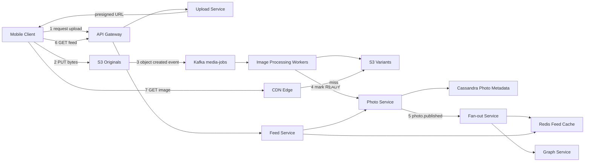

# Photo Sharing Platform

**Category:** System Design
**Difficulty:** 🟡 Medium
**Seniority:** senior
**Companies:** Meta, Instagram, Pinterest, Snap, Google, Amazon, Flickr
**Tags:** object-storage, cdn, image-processing, presigned-urls, social-graph, read-heavy
**Time:** 45 min

---

## Problem Statement

Design a photo sharing platform like Instagram. Users upload photos with captions, follow other users, and browse a home feed of photos from accounts they follow. Photos must render quickly on any device, from low-end phones on 3G to high-DPI desktops.

The interviewer hints at ~500M daily active users and ~100M photo uploads per day, with reads outnumbering writes by more than 100:1. The focus is on the media path: how bytes get from a phone into durable storage, how they are processed into multiple variants, and how they are served cheaply worldwide. The feed itself can reuse a standard fan-out design; spend time on what is unique to photos.

## Clarifying Questions

- What is the scale? *500M DAU, 100M photo uploads/day, each user views ~100 photos/day.*
- Photo size and formats? *Phone uploads of 2-5 MB JPEG/HEIC, up to 4096 px on the long edge; no video in scope.*
- Which variants are needed? *Thumbnail (150 px), small (320 px), medium (640 px), large (1080 px), in JPEG and WebP/AVIF.*
- How fast must an uploaded photo be visible? *Uploader sees it immediately; followers within ~10 s.*
- Is the original kept? *Yes, forever, for re-processing into new formats later.*
- Privacy? *Public and private accounts; private photos only visible to approved followers.*
- Do we need likes/comments? *Counts displayed, but the design focus is upload, storage, delivery, and feed.*
- Filters/edits? *Applied client-side before upload; server only resizes, strips EXIF, and transcodes.*

## Requirements

### Functional
- Upload a photo with caption and optional location.
- Generate multiple resolutions and formats automatically.
- Follow / unfollow users; public and private accounts.
- View a home feed of followed users' photos and any user's profile grid.
- Like and comment counts on photos.

### Non-Functional
- Highly durable: zero photo loss (11 nines via object storage).
- Feed and image load latency p99 < 200 ms for metadata; images served from CDN edge.
- Highly available for reads; eventual consistency acceptable for feeds and counters.
- Uploads resilient on flaky mobile networks (resumable).
- Cost-efficient storage and egress at petabyte scale.

### Out of Scope
- Video/Reels, stories, direct messages, search, ads, ML ranking details.

## Capacity Estimation

| Metric | Arithmetic | Result |
|---|---|---|
| Upload QPS | 100M / 86,400 | ~1.2K/s avg, ~4K/s peak |
| Original storage | 100M x 3 MB | 300 TB/day, ~110 PB/year |
| Variant storage | 4 sizes x 2 formats, ~600 KB total per photo | 60 TB/day |
| Photo views | 500M x 100 / 86,400 | ~580K/s avg, ~1.5M/s peak |
| Egress | 580K/s x ~100 KB average variant | ~58 GB/s (~460 Gbps), CDN-served |
| Metadata | 100M x 500 B | 50 GB/day, ~18 TB/year |
| Feed reads | 500M x 10 opens / 86,400 | ~58K/s avg |

- CDN hit ratio of 95%+ is essential: origin then serves only ~30K req/s.
- Originals dominate storage: tier to S3 Infrequent Access / Glacier Instant Retrieval after 30 days (photos are rarely viewed after the first week).

## API Design

```text
POST /v1/uploads
  req:  { content_type: "image/heic", size_bytes: 3145728, sha256 }
  resp: { upload_id, presigned_url | multipart_urls[], expires_at }

POST /v1/photos
  req:  { upload_id, caption, location?, visibility }
  resp: { photo_id, status: "PROCESSING" }

GET  /v1/photos/{photo_id}
  resp: { photo_id, owner, caption, created_at, like_count, comment_count,
          variants: { "320": url, "640": url, "1080": url }, blurhash, width, height }

GET  /v1/feed?cursor=<opaque>&limit=20
  resp: { items: [photo summaries], next_cursor }

GET  /v1/users/{user_id}/photos?cursor=...   // profile grid
POST /v1/users/{user_id}/follow   |  DELETE /v1/users/{user_id}/follow
POST /v1/photos/{photo_id}/like
```

Image URLs are CDN URLs of the form `https://cdn.example.com/p/{photo_id}/{variant}.{fmt}?sig=...`; private-account photos use short-lived signed URLs.

## Data Model

| Store | Entity | Key fields | Why |
|---|---|---|---|
| S3 (originals bucket) | Original blob | key `orig/{shard}/{photo_id}` | 11 nines durability, lifecycle tiering |
| S3 (variants bucket) | Variant blob | key `v/{photo_id}/{size}.{fmt}` | CDN origin; regenerable from original |
| Cassandra | photos | PK `photo_id`; owner_id, caption, created_at, status, variants map, width, height, blurhash | High write rate, simple key lookups |
| Cassandra | user_photos | PK `owner_id`, CK `created_at DESC, photo_id` | Profile grid as one partition scan |
| MySQL/TAO-style graph store | follows | (follower_id, followee_id, created_at), indexed both directions | Strong consistency for follow/approve on private accounts |
| Redis | feed:{user_id} | list of photo_ids (trim to 500) | Precomputed home timeline |
| Redis + Cassandra counters | like_count, comment_count | photo_id → count | Sharded counters, async aggregation |

- `photo_id` is a 64-bit Snowflake-style ID (time-sortable), so ordering by ID equals ordering by time and keys spread evenly.
- S3 key prefix uses a hash shard to avoid hot prefixes.
- Shard Cassandra by `photo_id` for photos and by `owner_id` for user_photos.

## High-Level Design



1. **Upload request**: client asks Upload Service for a presigned (multipart for >5 MB) S3 URL. The API tier never touches image bytes, so it scales on request count, not bandwidth.
2. **Direct upload**: client PUTs bytes straight to S3 (via S3 Transfer Acceleration / nearest region), resumable per part.
3. **Processing**: S3 event lands in Kafka; workers validate, strip EXIF/GPS, decode HEIC, generate variants and a blurhash placeholder, and run content moderation.
4. **Publish**: worker writes variant URLs and flips status to READY in Cassandra. The client called `POST /photos` earlier with caption; the photo becomes visible once both caption and READY exist.
5. **Fan-out**: Fan-out Service pushes `photo_id` to followers' Redis feed lists (push for normal users, pull for celebrities; see News Feed problem).
6. **Feed read**: Feed Service reads photo_ids from Redis, hydrates metadata from a cache in front of Cassandra, filters privacy/blocks, returns CDN URLs.
7. **Image read**: client chooses the variant for its viewport and DPR; the CDN serves it, falling back to the S3 variants bucket (through an origin shield) on miss.

## Deep Dives

### Upload pipeline and resumability

Mobile uploads fail often, so the protocol is idempotent and resumable:

```text
FUNCTION start_upload(user, size, sha256):
    IF dedup_index.has(sha256, user) THEN RETURN existing upload_id   // retry of same photo
    SET upload_id ← new_id()
    IF size > 5 MB THEN
        SET parts ← s3.create_multipart(key = "orig/" + shard(upload_id) + "/" + upload_id)
        RETURN presigned URLs per 5 MB part
    RETURN single presigned PUT (expires 15 min, content-length and content-type pinned)

FUNCTION on_client_reconnect(upload_id):
    SET done ← s3.list_parts(upload_id)
    RETURN parts not in done            // client re-sends only missing parts
```

- Presigned URLs pin content-type and max length so clients cannot upload arbitrary payloads.
- A periodic job aborts incomplete multipart uploads after 24 h (S3 lifecycle rule) to avoid paying for orphaned parts.
- Client compresses to max 1080-2048 px before upload where acceptable, cutting bandwidth 3-5x.

### Image processing and variants

- Workers use libvips (much faster and lower memory than ImageMagick) for decode, resize, sharpen, and encode.
- Generate eager variants for the sizes used by the feed (320, 640, 1080 in WebP + JPEG), since 90% of views happen in the first 48 hours. Rare sizes and AVIF can be generated **lazily** on first CDN miss by an on-the-fly resizer (Thumbor-style) and then cached.
- Processing is idempotent keyed by `photo_id` + variant spec version, so Kafka redelivery is safe. Failed jobs go to a retry topic with backoff, then a DLQ.
- Throughput: ~4K uploads/s peak x ~300 ms CPU per photo for all variants = ~1,200 cores busy; autoscale a worker fleet on Kafka consumer lag.
- Moderation (hash matching against PhotoDNA-like lists plus an ML classifier) runs in parallel; flagged photos stay hidden pending review.
- Adding a new format (e.g. JPEG XL) is a backfill job reading originals; this is why originals are never deleted.

### Serving images: CDN, caching, and cost

- Multi-tier caching: client cache (immutable URLs, `Cache-Control: max-age=1y`) → CDN edge → regional origin shield → S3. URLs include `photo_id` and variant version, so they never need invalidation.
- Client picks variant via `srcset`/DPR; serving WebP/AVIF saves 25-50% bytes over JPEG at equal quality, directly cutting the dominant cost (egress).
- Blurhash (~30 bytes in metadata) renders an instant placeholder before the image arrives.
- Private photos: CDN validates a signed URL (HMAC over path + expiry, e.g. CloudFront signed URLs) issued by the Photo Service after a follow check. Expiry ~1 h limits leaked-link damage.
- Hot photos (celebrity posts) are naturally absorbed by the CDN; origin shield collapses concurrent misses into one S3 GET.

### Feed and profile reads specific to photos

- Feed fan-out reuses the hybrid push/pull model; the photo-specific concern is **hydration**: each feed page needs 20 photo metadata records plus counts. Batch `multiget` from a Memcached/Redis layer in front of Cassandra, then fall back to Cassandra for misses.
- Only READY, non-deleted, visible photos are returned; filtering happens at hydration so deletes take effect instantly without rewriting timelines.
- Profile grid reads `user_photos` partition (one sequential scan of the newest 30 rows) and returns 150 px thumbnails.
- Like counts use sharded counters (N sub-keys per hot photo in Redis, summed on read) to avoid a single hot key when a celebrity post gets 100K likes/min.

## Scaling & Reliability

- **Storage**: S3 cross-region replication for originals; variants are regenerable, so replicate them lazily or only in the primary region plus CDN.
- **Lifecycle tiering**: originals move to S3 IA at 30 days and Glacier Instant Retrieval at 180 days, saving ~60-70% on the 110 PB/year that dominates cost.
- **Metadata**: Cassandra RF=3 per region, `LOCAL_QUORUM` writes; multi-region active-active with last-write-wins for captions.
- **Processing**: Kafka partitions by `photo_id`; worker autoscaling on lag; graceful degradation shows the original downscaled if variants lag.
- **Failure handling**: if fan-out lags, the uploader still sees the photo on their profile immediately (read-your-writes via `user_photos`).
- **Monitoring**: upload success rate per network type, time-to-READY p99, processing lag, CDN hit ratio, egress per variant, 4xx/5xx on signed URLs.

## Trade-offs

| Decision | Option A | Option B | Choice & Why |
|---|---|---|---|
| Upload path | Through API servers | Presigned direct-to-S3 | Direct: API tier stays stateless and cheap; S3 handles bandwidth and multipart resume |
| Variant generation | Eager all sizes | Lazy on-the-fly on CDN miss | Hybrid: eager for hot feed sizes, lazy for rare sizes/formats to save compute and storage |
| Image format | JPEG only | WebP/AVIF with JPEG fallback | Modern formats: 25-50% egress savings; content negotiation via Accept header or client capability |
| Metadata store | PostgreSQL sharded | Cassandra | Cassandra for photos (write-heavy, key lookups); relational store for follow graph needing consistency |
| Private photo access | Check auth at origin per request | Signed CDN URLs with expiry | Signed URLs: keep CDN caching while enforcing access; short expiry limits leaks |
| Original retention | Delete after variants | Keep in cold tier | Keep: enables re-processing for new formats/sizes and legal holds |

## Follow-up Questions

1. **How do you handle a user deleting a photo?** Mark deleted in metadata (filtered at hydration immediately), delete S3 objects asynchronously, and rely on short signed-URL expiry or a CDN purge API for already-cached variants.
2. **How do you dedupe identical uploads (reposts, memes)?** Content hash (SHA-256 for exact, perceptual hash for near-duplicates) mapped to a blob ID; multiple photo records reference one blob with reference counting.
3. **How would you support multi-photo carousels?** A post entity with an ordered list of photo_ids; each photo processed independently and the post published once all are READY.
4. **A celebrity posts and 50M followers open it within minutes. What breaks?** Not the images (CDN absorbs) but metadata hydration and like counters; cache the post object in every region and use sharded counters.
5. **How do you strip location privacy leaks?** Remove EXIF GPS during processing before any variant is created; keep user-chosen location only as structured metadata.
6. **How do you serve users in regions far from S3?** CDN edges globally plus regional origin shields; optionally replicate the variants bucket to 2-3 regions.

## Common Mistakes

- Streaming image bytes through application servers instead of presigned direct uploads.
- Storing images in the database or serving them from origin without a CDN.
- Generating only one image size, wasting bandwidth on mobile or looking blurry on desktop.
- Forgetting EXIF stripping and moderation in the processing pipeline.
- Spending the whole interview on feed fan-out and never addressing storage tiers, egress cost, or variant generation.
- Using mutable image URLs that require CDN invalidation on every change.

## Key Takeaways

- Separate the control plane (metadata, small JSON) from the data plane (image bytes via presigned URLs, S3, CDN).
- Asynchronous, idempotent processing via a queue turns one upload into many variants without blocking the user.
- Immutable, versioned URLs plus modern formats and a high CDN hit ratio are the key to latency and cost.
- Keep originals in cold storage; variants are derived data that can always be regenerated.
- Reuse the hybrid fan-out feed, but filter privacy and deletes at hydration time.
