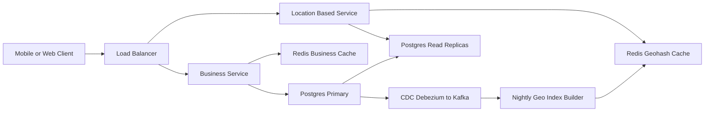

# Proximity Service

**Category:** System Design
**Difficulty:** 🟡 Medium
**Seniority:** senior
**Companies:** Yelp, Google, Uber, DoorDash, Meta, Airbnb
**Tags:** geospatial-indexing, geohash, quadtree, read-heavy, caching, location-based
**Time:** 45 min

---

## Problem Statement

Design a proximity service (like Yelp "nearby" or Google Maps "restaurants near me") that, given a user's location and a radius, returns nearby businesses. Business owners can add, update, or delete listings, and users can view business details.

Scale hint: 100M daily active users and 200M businesses worldwide. Search must be fast, while business data changes relatively rarely.

## Clarifying Questions

- What search radii are supported? *0.5 km, 1 km, 2 km, 5 km, 20 km; expand if too few results.*
- How many results? *Up to 20 per page, sorted by distance (ranking signals later).*
- How fresh must business updates be? *Visible by next day is acceptable.*
- Are businesses moving? *No — static locations (moving objects like drivers are a different problem).*
- Scale? *100M DAU, 5 searches/day each; 200M businesses.*
- Filters? *Category and open-now filters are nice-to-have.*
- Global? *Yes, multi-region.*

## Requirements

### Functional

- Search businesses by (lat, lng, radius) with optional category filter.
- View business details (name, address, hours, photos, rating).
- Business owners add, update, delete businesses.

### Non-Functional

- Search latency p99 < 200 ms.
- High availability (99.99%) for search.
- Read heavy: ~5,000 search QPS vs. a few writes/s.
- Privacy: user locations not stored beyond aggregate analytics.

### Out of Scope

- Reviews, reservations, directions/routing, real-time moving objects.

## Capacity Estimation

| Metric | Arithmetic | Result |
|---|---|---|
| Search QPS avg | 100M x 5 / 86,400 | ~5,800 QPS |
| Peak QPS | 3x | ~18K QPS |
| Business writes | ~1M changes/day / 86,400 | ~12 writes/s |
| Business record size | ~1 KB | 200M x 1 KB = ~200 GB |
| Geo index entry | business_id (8 B) + geohash (8 B) + lat/lng (16 B) | ~32 B |
| Geo index size | 200M x 32 B | ~6.4 GB — fits in memory |
| Search response | 20 x ~200 B summary | ~4 KB |

Key insight: the geospatial index is small enough to fit entirely in RAM on each read replica; the problem is read scaling, not storage.

## API Design

```text
GET /v1/search/nearby?lat=37.7764&lng=-122.4172&radius=1000&category=cafe&limit=20&cursor=...
  resp: 200 {
    "total": 134,
    "businesses": [
      { "id": "b_123", "name": "Blue Bottle", "lat": 37.776, "lng": -122.423,
        "distanceM": 420, "rating": 4.6, "category": "cafe" }
    ],
    "nextCursor": "eyJvZmZzZXQiOjIwfQ"
  }

GET    /v1/businesses/{id}
  resp: 200 { "id", "name", "address", "lat", "lng", "hours", "photos", ... }

POST   /v1/businesses
  body: { "name", "address", "lat", "lng", "category", "hours" }
  resp: 201 { "id": "b_456" }

PUT    /v1/businesses/{id}      body: partial fields     resp: 200
DELETE /v1/businesses/{id}                               resp: 204
```

## Data Model

**Business table — PostgreSQL (primary + read replicas)**. Relational, modest size (~200 GB), strong consistency for owner edits; shard by `business_id` if it grows.

```text
business
  business_id  BIGINT PK
  name         TEXT
  address      TEXT
  city, country TEXT
  lat, lng     DOUBLE
  category     TEXT
  hours        JSONB
  rating       NUMERIC(2,1)
  updated_at   TIMESTAMP
```

**Geo index — PostgreSQL table or in-memory structure**

```text
geohash_index
  geohash      CHAR(6)     // precision 6 cell ~1.2 km x 0.6 km
  business_id  BIGINT
  PRIMARY KEY (geohash, business_id)
```

Store geohash at precision 4-6 so we can query at different radii (or store precision 6 and query by prefix). The table is ~6 GB and replicated to every read replica; no sharding needed for the index.

**Cache — Redis**

```text
geo:{geohash6}     -> LIST<business_id>     // businesses in a cell
biz:{business_id}  -> business summary JSON // TTL 24h
```

## High-Level Design



**Search (read path):**

1. Client calls `/search/nearby` with lat/lng/radius.
2. The Location-Based Service (LBS, stateless) picks a geohash precision matching the radius (e.g. 1 km -> precision 6, 5 km -> precision 5).
3. It computes the user's cell plus its 8 neighbors (to handle boundary issues).
4. For each of the 9 cells, it fetches business IDs from Redis (fallback to replica).
5. It hydrates candidates' lat/lng, computes exact haversine distance, filters to the radius, sorts, and returns the top 20.
6. If fewer than N results, it expands to a coarser precision (larger radius).

**Business update (write path):**

1. Owner calls the Business Service, which writes to the Postgres primary.
2. Changes stream to replicas; CDC events feed a job that updates geohash cache entries (nightly batch is acceptable per requirements).
3. Business detail cache entries are invalidated on write.

## Deep Dives

### Choosing a geospatial index

| Approach | How it works | Pros | Cons |
|---|---|---|---|
| Naive lat/lng range | `WHERE lat BETWEEN .. AND lng BETWEEN ..` | Simple | Two 1-D indexes intersect poorly; slow at scale |
| Geohash | Interleave lat/lng bits into base32 string; shared prefix = nearby | Simple, works in any KV/SQL store, easy cache keys | Boundary issues; uneven density per cell |
| Quadtree | Recursively split a cell into 4 until <= 100 businesses per leaf | Adapts to density (Manhattan vs. desert) | In-memory, build time on startup, harder updates |
| Google S2 | Hilbert curve on sphere, cell IDs | Precise region covering, used by Google/Uber | More complex library |

**Choice:** geohash for simplicity and cacheability; mention quadtree or S2 when density varies a lot. PostGIS or Redis GEO (`GEOSEARCH`, which uses geohash internally) are production-ready options.

Geohash precision table: length 4 ≈ 39 km x 19.5 km, length 5 ≈ 4.9 km x 4.9 km, length 6 ≈ 1.2 km x 0.6 km.

### Boundary problem and neighbor search

Two points near each other can have totally different geohashes if they straddle a cell boundary (e.g. the equator or prime meridian). Fix: always query the target cell plus its 8 neighbors.

```text
FUNCTION searchNearby(lat, lng, radiusM):
    SET precision ← precisionFor(radiusM)        // 1000m -> 6, 5000m -> 5
    SET center ← geohash(lat, lng, precision)
    SET cells ← [center] + neighbors(center)     // 9 cells
    SET candidates ← []
    FOR cell IN cells:
        candidates.addAll(geoCache.get(cell) OR db.query(cell))
    SET results ← []
    FOR b IN candidates:
        SET d ← haversine(lat, lng, b.lat, b.lng)
        IF d <= radiusM: results.add((b, d))
    IF size(results) < MIN_RESULTS AND precision > 4:
        RETURN searchNearby(lat, lng, radiusM x 2)
    SORT results BY d ASC
    RETURN first 20 of results
```

### Quadtree alternative

Build an in-memory quadtree on each LBS server at startup: ~200M businesses / 100 per leaf = 2M leaves, ~2.7M nodes total; with 32 B per business plus node overhead, ~2 GB RAM. Build takes a few minutes, so do rolling deploys and keep a warm pool. Search: descend to the leaf containing the user, then expand to neighbor leaves until enough results. Updates are applied nightly by rebuilding or incrementally with care around node splits.

### Hot spots and caching

Dense areas (Times Square) generate heavy queries. Cache `geohash -> business IDs` in Redis for precisions 4-6 (~6.4 GB per precision level); cache business summaries separately so a detail change only invalidates one key. Rounding user coordinates to the cell means cache keys are shared by all users in the cell — very high hit rates.

## Scaling & Reliability

- **Read scaling:** LBS is stateless; add instances. Postgres read replicas (or Redis replicas) each hold the full geo index.
- **Business table sharding:** shard by `business_id` if it exceeds a single primary; the geo index stays unsharded and replicated because it is small.
- **Multi-region:** deploy LBS and replicas in each region near users; route via GeoDNS. Businesses could also be partitioned by region for data residency.
- **Replication lag:** acceptable — new businesses appear by next day per requirements.
- **Failure handling:** Redis miss falls back to replicas; replica failover via Patroni; circuit breakers on detail hydration.
- **Monitoring:** search p99, empty-result rate, cache hit ratio, replica lag, index build duration.

## Trade-offs

| Decision | Option A | Option B | Choice & Why |
|---|---|---|---|
| Geo index | Geohash | Quadtree | Geohash — simple, DB/caching friendly; quadtree if density skew hurts result quality. |
| Index storage | Sharded | Replicated full copy | Replicated — 6 GB fits in RAM; sharding adds fan-out with no benefit. |
| Database | PostgreSQL (+PostGIS) | Cassandra | PostgreSQL — modest size, rich queries, strong consistency for owner edits. |
| Update propagation | Real-time index updates | Nightly batch | Batch — requirement allows it and keeps the read path simple. |
| Distance | Precompute per cell | Exact haversine at query time | Exact at query time on a small candidate set — cheap and accurate. |

## Follow-up Questions

1. **How would you support moving objects like drivers?** Use an in-memory index (Redis GEO or S2 cells) updated every few seconds with TTLs, not a nightly-built DB index — see Ride-Sharing design.
2. **How do you rank results beyond distance?** Retrieve ~200 candidates geospatially, then re-rank with rating, popularity, open-now, and personalization in a ranking service.
3. **How do you filter by category efficiently?** Add category to the cache key (`geo:{geohash}:{category}`) or filter candidates in memory — candidate sets are small.
4. **What about searching along a route or polygon?** Use S2 region coverer to compute the set of cells covering the polygon and query each.
5. **How do you handle very sparse areas?** Expand radius progressively (coarser geohash) until a minimum number of results is found or a max radius is reached.

## Common Mistakes

- Using two separate B-tree indexes on lat and lng and expecting efficient 2-D queries.
- Forgetting the geohash boundary problem — querying only one cell.
- Sharding a small index unnecessarily, creating scatter-gather latency.
- Not computing exact distance after the coarse cell filter.
- Treating static businesses and moving vehicles with the same design.

## Key Takeaways

- The geo index is small (~GBs) — this is a read-scaling problem solved by replication and caching.
- Geohash turns 2-D proximity into 1-D prefix matching; always include neighbor cells.
- Quadtree and S2 adapt better to density; know when to propose them.
- Separate the Location-Based Service (read-heavy, stateless) from the Business Service (write path, strong consistency).
