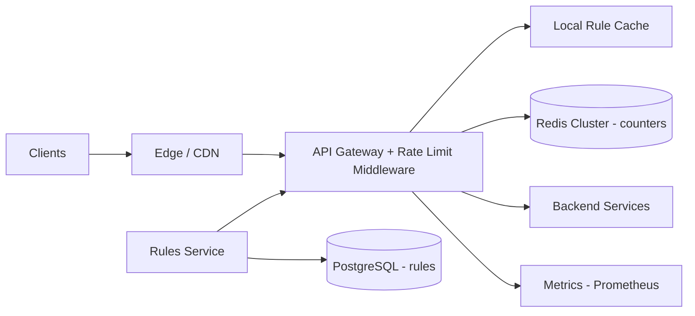

# Rate Limiter

**Category:** System Design
**Difficulty:** 🟡 Medium
**Seniority:** senior
**Companies:** Stripe, Google, Amazon, Cloudflare, Uber, Microsoft, LinkedIn
**Tags:** token-bucket, sliding-window, redis, distributed-counters, api-gateway, throttling
**Time:** 45 min

---

## Problem Statement

Design a distributed rate limiter that protects a fleet of API servers by limiting how many requests a client can make in a time window (e.g. 100 requests per minute per API key). Requests over the limit are rejected with HTTP 429.

The interviewer says the API serves about 1M requests per second across hundreds of gateway nodes in multiple regions. Rules vary by endpoint, user tier, and IP. The limiter must add minimal latency and must not become a single point of failure.

## Clarifying Questions

- Client-side or server-side? *Server-side, enforced at the API gateway layer.*
- What do we key limits on? *API key / user ID primarily; IP for unauthenticated traffic; also per endpoint.*
- What scale? *~1M req/s peak, ~50M active keys, ~500 gateway nodes in 3 regions.*
- How strict must limits be? *Small overshoot (a few %) is acceptable; never wildly over.*
- Global or per-region limits? *Global per key ideally; per-region approximation acceptable.*
- Should bursts be allowed? *Yes, short bursts up to the bucket capacity.*
- What happens if the limiter itself fails? *Fail open (allow traffic) for most endpoints; fail closed for sensitive ones like login.*
- Do clients need to know their remaining quota? *Yes, via `X-RateLimit-*` headers.*

## Requirements

### Functional
- Limit requests per key per rule (e.g. 100/min, 10/s burst) and return 429 with `Retry-After` when exceeded.
- Support multiple rules per request (per user, per IP, per endpoint) evaluated together.
- Configurable rules without redeploys.
- Expose remaining quota headers.

### Non-Functional
- Added latency < 1-2 ms p99.
- Highly available; limiter failure must not take down the API.
- Accurate within a few percent in a distributed setting.
- Scales horizontally to millions of decisions per second.

### Out of Scope
- Full DDoS protection at L3/L4 (handled by Cloudflare/AWS Shield), billing/quota for monthly usage.

## Capacity Estimation

| Metric | Arithmetic | Result |
|---|---|---|
| Decision QPS | 1M req/s x ~2 rules each | ~2M counter ops/s |
| Active keys | given | 50M keys |
| Memory per key (token bucket) | key ~40 B + tokens 8 B + ts 8 B + Redis overhead ~60 B | ~120 B |
| Memory per rule | 50M x 120 B | ~6 GB |
| Total memory (3 rules) | 6 GB x 3 | ~18 GB (fits in a small Redis Cluster) |
| Redis throughput | ~100K ops/s per shard (Lua scripts) | ~20-30 shards for 2M ops/s with headroom |
| Network | 2M ops/s x ~100 B | ~200 MB/s across the cluster |

Memory is small; the challenge is throughput and latency, not storage.

## API Design

```text
// Internal gRPC used by the gateway (or embedded library)
rpc ShouldAllow(CheckRequest {
        string  tenant_key;        // e.g. "user:42" or "ip:1.2.3.4"
        string  endpoint;          // e.g. "POST /v1/payments"
        int32   cost;              // default 1
    }) returns (CheckResponse {
        bool    allowed;
        int32   limit;
        int32   remaining;
        int64   reset_epoch_ms;
        int32   retry_after_ms;
    })

// Rule management (admin)
PUT  /admin/v1/rules/{rule_id}  { "match": { "endpoint": "POST /v1/payments", "tier": "free" },
                                  "algorithm": "token_bucket", "capacity": 20, "refill_per_sec": 1 }
GET  /admin/v1/rules

// Client-facing response headers
HTTP 429 Too Many Requests
  X-RateLimit-Limit: 100
  X-RateLimit-Remaining: 0
  X-RateLimit-Reset: 1717000000
  Retry-After: 12
```

## Data Model

```text
Rules store (PostgreSQL, source of truth; cached in every gateway)
  rule_id        UUID PK
  match_endpoint VARCHAR
  match_tier     VARCHAR
  key_type       ENUM(user, api_key, ip)
  algorithm      ENUM(token_bucket, sliding_window_counter)
  capacity       INT
  refill_per_sec FLOAT
  window_sec     INT
  fail_mode      ENUM(open, closed)

Counter state (Redis Cluster, in-memory, TTL'd)
  Token bucket:     HASH rl:{rule_id}:{tenant_key} -> { tokens: FLOAT, ts_ms: INT }  TTL = 2x full-refill time
  Sliding window:   STRING rl:{rule_id}:{tenant_key}:{window_start} -> count        TTL = 2 x window
```

- **Redis** because it gives sub-millisecond atomic operations, Lua scripting for read-modify-write atomicity, and native TTLs so idle keys disappear.
- **Shard key:** the full counter key (hash slot by `{rule_id}:{tenant_key}`), spreading load across shards; using hash tags keeps all windows for one tenant on one shard.
- Rules are small (thousands of rows), pushed to gateways and refreshed every ~10 s or via pub/sub.

## High-Level Design



**Request path**
1. Request arrives at an API Gateway node (Envoy/Kong/custom); middleware extracts identity (API key, user ID, IP) and endpoint.
2. Matches applicable rules from the in-memory rule cache (no network).
3. Executes a single Redis Lua script per rule (pipelined when multiple rules apply) that atomically refills/decrements.
4. If all rules allow, forwards to backend and attaches `X-RateLimit-*` headers; otherwise returns 429 with `Retry-After`.
5. If Redis times out (budget ~5 ms), apply the rule's fail mode: open (allow) or closed (deny).

**Config path**
1. Operators update rules via the Rules Service, persisted in PostgreSQL.
2. The service publishes changes (Redis pub/sub or polling); gateways hot-reload rules.

## Deep Dives

### Algorithm choice

- **Fixed window counter:** `INCR key:minute`. Cheap, but allows 2x bursts at window boundaries.
- **Sliding window log:** store each timestamp in a sorted set. Exact, but O(requests) memory per key; too expensive at 100/min x 50M keys.
- **Sliding window counter:** weighted sum of current and previous window counts; ~99% accurate with 2 counters per key. Good for "N per minute" rules.
- **Token bucket (chosen default):** two values per key, allows controlled bursts, natural "cost" per request. Used by Stripe and AWS API Gateway.
- **Leaky bucket:** smooths output to a constant rate; better for queueing/shaping than for API rejections.

```text
// Redis Lua script, executed atomically on one shard
FUNCTION tokenBucket(key, capacity, refillPerSec, nowMs, cost):
    SET (tokens, ts) ← HMGET key "tokens" "ts"
    IF tokens IS NULL:
        SET tokens ← capacity
        SET ts ← nowMs
    SET elapsed ← max(0, nowMs - ts) / 1000
    SET tokens ← min(capacity, tokens + elapsed * refillPerSec)
    IF tokens >= cost:
        SET tokens ← tokens - cost
        SET allowed ← TRUE
    ELSE:
        SET allowed ← FALSE
    HSET key "tokens" tokens "ts" nowMs
    PEXPIRE key ceil(capacity / refillPerSec * 2000)
    SET retryAfterMs ← IF allowed THEN 0 ELSE ceil((cost - tokens) / refillPerSec * 1000)
    RETURN (allowed, floor(tokens), retryAfterMs)
```

Use Redis server time (`TIME`) instead of gateway clocks to avoid skew between nodes.

### Race conditions and atomicity

- Naive "GET then SET" from two gateways allows both to pass when one token remains.
- Lua scripts (or `MULTI`/`EXEC` with `WATCH`) make the read-modify-write atomic on the shard; Redis is single-threaded per shard, so scripts serialize naturally.
- Keep scripts O(1) and short; a slow script blocks the whole shard.

### Distributed and multi-region accuracy

- **Centralized Redis per region:** exact within region; cross-region requests would add 50-100 ms, unacceptable.
- **Per-region limits:** split the global limit across regions (e.g. by traffic share); simple and common.
- **Local + async sync (for very high QPS):** each gateway keeps local token buckets and periodically (every 100-500 ms) syncs deltas to Redis, accepting small overshoot. Reduces Redis load by 10-100x for hot keys.
- **Hot keys:** a single tenant at 50K req/s saturates one shard. Mitigate with local pre-aggregation or splitting the bucket into N sub-buckets each with capacity/N.

### Failure modes

- Redis shard down: Redis Cluster promotes a replica in seconds; counters may reset, causing a brief over-allowance (acceptable).
- Timeout budget: strict 2-5 ms client timeout plus circuit breaker; when open, fall back to local in-memory limiting with conservative per-node limits (`global_limit / node_count`).
- Login/OTP endpoints fail closed to prevent brute force during outages.

## Scaling & Reliability

- **Sharding:** Redis Cluster with 16,384 hash slots; add shards and reshard online as QPS grows.
- **Replication:** 1 replica per shard, async; losing a few counter updates on failover is tolerable.
- **Latency:** co-locate Redis with gateways in the same AZ; pipeline multiple rule checks in one round-trip; connection pooling.
- **Layered defense:** coarse IP limits at the edge (Cloudflare/WAF), fine-grained per-user limits at the gateway, and concurrency limits inside services.
- **Monitoring:** 429 rate per rule and tenant, Redis p99 latency and CPU, fail-open events, hot-key detection (top-K tenants), rule reload lag. Shadow mode lets new rules log decisions without enforcing.

## Trade-offs

| Decision | Option A | Option B | Choice & Why |
|---|---|---|---|
| Algorithm | Sliding window log (exact) | Token bucket | Token bucket: O(1) memory, supports bursts and cost-based limits |
| Counter store | Local in-memory per node | Centralized Redis | Redis for accurate global counts; local fallback on failure |
| Placement | Inside each service | API gateway middleware | Gateway: single enforcement point, consistent policy |
| Failure mode | Fail closed | Fail open | Fail open by default for availability; closed for auth-sensitive endpoints |
| Multi-region | Global synchronous counter | Per-region quotas | Per-region: avoids cross-region latency, small accuracy loss |

## Follow-up Questions

1. **How do you rate-limit by cost, e.g. expensive search vs cheap reads?** Assign a per-endpoint cost and deduct `cost` tokens from the bucket; the Lua script already supports it.
2. **How do you prevent fixed-window boundary bursts?** Use sliding window counter or token bucket; explain the weighted formula `prev * (1 - elapsed/window) + curr`.
3. **What if one tenant generates 100K req/s?** Detect hot keys, handle them with local buckets synced asynchronously, or shard the bucket into sub-keys.
4. **How do you roll out a new stricter rule safely?** Shadow mode first: log would-be rejections, review impact per tenant, then enforce gradually.
5. **How would clients behave well under limiting?** Return `Retry-After`; clients use exponential backoff with jitter; SDKs read `X-RateLimit-Remaining` to self-throttle.
6. **How is this different from load shedding?** Rate limiting is per-client fairness; load shedding protects the server based on its own health (CPU, queue depth) regardless of client.

## Common Mistakes

- Non-atomic read-then-write against Redis, causing over-admission under concurrency.
- Using gateway local clocks for windows, causing skew across nodes.
- Synchronously checking a cross-region counter, adding tens of ms per request.
- No defined behavior when the limiter store is down (accidental fail closed takes down the API).
- Choosing sliding-window log without estimating its memory at scale.
- Forgetting to return 429 with `Retry-After` and quota headers.

## Key Takeaways

- Token bucket in Redis with Lua scripts is the standard, defensible answer.
- The hard parts are atomicity, distribution across nodes/regions, and failure behavior, not the algorithm itself.
- Keep the decision path to one sub-millisecond round-trip; rules are cached locally.
- Explicitly choose fail-open vs fail-closed per endpoint.
