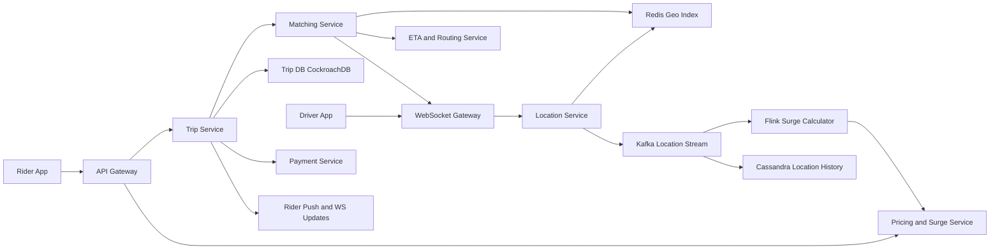

# Ride-Sharing Service

**Category:** System Design
**Difficulty:** 🔴 Hard
**Seniority:** staff
**Companies:** Uber, Lyft, Grab, DoorDash, Amazon, Google, Bolt
**Tags:** geospatial-indexing, real-time, matching, websockets, state-machine, location-tracking, sharding
**Time:** 60 min

---

## Problem Statement

Design a ride-sharing service like Uber or Lyft. Riders request a ride from their current location to a destination; the system finds a nearby available driver, the driver accepts, and both parties see each other's live location until the trip completes and payment is charged.

The interviewer hints at global scale: millions of active drivers sending location updates every few seconds, tens of thousands of ride requests per minute at peak, and matching that must complete within seconds without double-assigning drivers.

## Clarifying Questions

- Scale? *100M riders, 5M drivers; 1M drivers online at peak; 20M trips/day.*
- Location update frequency? *Drivers send GPS every 4 s while online.*
- Matching goal? *Minimize rider pickup ETA; driver must accept within 15 s or we try the next.*
- Ride types? *UberX and XL in v1; pooling is a follow-up.*
- Pricing? *Upfront fare with surge pricing per area.*
- Payments? *Charge on trip completion via a payment service (separate system).*
- Multi-region? *Yes; cities operate largely independently.*
- Consistency? *A driver must never be assigned to two trips simultaneously.*

## Requirements

### Functional

- Rider sees nearby drivers and an upfront fare/ETA estimate.
- Rider requests a ride; system matches a driver who accepts or declines.
- Real-time location tracking of driver for rider during pickup and trip.
- Trip lifecycle: requested -> matched -> driver arriving -> in progress -> completed / cancelled.
- Fare calculation with surge pricing; payment on completion; trip history and ratings.

### Non-Functional

- Matching latency: driver offer within ~2 s of request (p99 < 5 s).
- Location ingestion: ~250K updates/s, freshness < 5 s.
- Strong consistency for trip and driver assignment state; eventual is fine for map dots.
- Availability 99.99% — outages strand riders and drivers.
- Fault tolerance per city/region; degrade gracefully.

### Out of Scope

- Turn-by-turn navigation and map tile rendering (use a maps provider), driver onboarding, food delivery.

## Capacity Estimation

| Metric | Arithmetic | Result |
|---|---|---|
| Location updates | 1M online drivers / 4 s | ~250K writes/s |
| Location payload | driverId, lat, lng, heading, speed, ts ~ 100 B | 250K x 100 B = ~25 MB/s ingress |
| Live location memory | 1M drivers x ~200 B with index overhead | ~200 MB — trivially in memory |
| Trips/day | 20M / 86,400 | ~230 trips/s avg, ~1K/s peak |
| Nearby-driver queries | riders opening app ~10x trips | ~2.5K-10K QPS |
| Location history | 250K/s x 100 B x 86,400 | ~2 TB/day (to cold storage for analytics) |
| Trip records | 20M x 2 KB | ~40 GB/day |
| WebSocket connections | 1M drivers + ~2M active riders | ~3M concurrent; ~50K per gateway node -> ~60 nodes |

The hard part is write throughput of ephemeral location data and coordinating matches — not storage.

## API Design

```text
// Rider
POST /v1/fare-estimates
  body: { "pickup": {"lat": 37.77, "lng": -122.41}, "dropoff": {...}, "product": "uberx" }
  resp: 200 { "estimateId": "e_1", "fare": 18.40, "currency": "USD",
              "surgeMultiplier": 1.3, "pickupEtaSec": 240, "expiresAt": "..." }

POST /v1/trips
  headers: Idempotency-Key: 6c1f...
  body: { "estimateId": "e_1", "paymentMethodId": "pm_9" }
  resp: 202 { "tripId": "t_42", "status": "REQUESTED" }

GET  /v1/trips/{tripId}        -> { status, driver, vehicle, driverLocation, etaSec }
POST /v1/trips/{tripId}/cancel -> 200 { "status": "CANCELLED", "fee": 0 }

// Driver
POST /v1/drivers/me/status     body: { "online": true }
WS   /v1/drivers/me/stream
  driver -> server: { "type": "location", "lat", "lng", "heading", "speed", "ts" }
  server -> driver: { "type": "offer", "tripId": "t_42", "pickup": {...}, "expiresInSec": 15 }
  driver -> server: { "type": "offer_response", "tripId": "t_42", "accept": true }
POST /v1/trips/{tripId}/events  body: { "type": "ARRIVED" | "STARTED" | "COMPLETED" }

// Rider live updates
WS   /v1/trips/{tripId}/stream  server -> rider: { "driverLocation", "etaSec", "status" }
```

## Data Model

**Live driver locations — Redis (in-memory, sharded by city / S2 cell)** — ephemeral, overwritten every 4 s.

```text
driver_loc:{driverId}   -> HASH { lat, lng, heading, status, product, ts }   TTL 30s
cell:{s2CellId_L12}     -> SET of driverIds                                    // ~3-6 km^2 cells
```

**Trips — PostgreSQL / CockroachDB (sharded by city or trip_id)** — strong consistency for state transitions.

```text
trip
  trip_id        UUID PK
  rider_id       BIGINT
  driver_id      BIGINT NULL
  city_id        INT           // shard key
  status         ENUM(REQUESTED, MATCHED, ARRIVING, IN_PROGRESS, COMPLETED, CANCELLED)
  pickup, dropoff GEOGRAPHY
  fare_quote     NUMERIC, surge NUMERIC
  version        INT           // optimistic concurrency
  created_at, updated_at TIMESTAMP

driver_state
  driver_id      BIGINT PK
  status         ENUM(OFFLINE, AVAILABLE, OFFERED, ON_TRIP)
  current_trip   UUID NULL
  version        INT
```

**Location history — Kafka -> Cassandra / S3** (time-series by `(driver_id, day)`) for trip route replay, fare disputes, and ETA model training.

**Users, payments, ratings** — separate services with their own stores (MySQL/Postgres).

## High-Level Design



**Location ingest path:**

1. Driver app sends GPS over a persistent WebSocket (or batched HTTP/2) every 4 s.
2. Gateway forwards to the Location Service (partitioned by city), which updates the driver hash and moves the driver between S2 cell sets if the cell changed.
3. Each update is also published to Kafka for history, surge calculation, and rider live tracking.

**Ride request path:**

1. Rider gets a fare estimate (pricing service uses route distance/time from ETA service and current surge for the pickup cell).
2. Rider creates a trip with an idempotency key; Trip Service persists `REQUESTED` and calls Matching.
3. Matching queries nearby available drivers from the S2 cells around pickup, ranks by road-network ETA, and offers the best candidate after atomically reserving them.
4. Driver accepts within 15 s -> trip moves to `MATCHED` and driver to `ON_TRIP` in one transaction; on decline/timeout, release and offer the next candidate.
5. Rider receives driver details and live location via WebSocket fan-out from the Kafka location stream.
6. On completion, Trip Service computes the final fare and calls the Payment Service asynchronously (with idempotency).

## Deep Dives

### Geospatial index for moving drivers

Drivers move constantly, so a nightly-built index (as in a static proximity service) doesn't work. Use Google S2 or Uber H3 hexagonal cells at a resolution of ~1-5 km^2, stored in memory.

```text
FUNCTION onLocationUpdate(driverId, lat, lng, ts):
    SET prev ← redis.HGET("driver_loc:" + driverId)
    IF prev.ts > ts: RETURN                                 // out-of-order update
    SET newCell ← s2CellId(lat, lng, level = 12)
    IF prev.cell != newCell:
        redis.SREM("cell:" + prev.cell, driverId)
        redis.SADD("cell:" + newCell, driverId)
    redis.HSET("driver_loc:" + driverId, {lat, lng, cell: newCell, ts})
    redis.EXPIRE("driver_loc:" + driverId, 30)              // stale drivers vanish

FUNCTION nearbyDrivers(lat, lng, radiusM, product):
    SET cells ← s2Cover(lat, lng, radiusM)                   // ~4-9 cells
    SET result ← []
    FOR cell IN cells:
        FOR d IN redis.SMEMBERS("cell:" + cell):
            SET loc ← redis.HGET("driver_loc:" + d)
            IF loc.status = AVAILABLE AND loc.product = product:
                result.add((d, haversine(lat, lng, loc)))
    RETURN result
```

Sharding by city keeps all lookups single-shard; very large cities are sub-sharded by cell ranges. Uber's Ringpop/consistent hashing on cell IDs is an alternative for dispatch servers holding state in memory.

### Matching without double-booking

Two concurrent ride requests may pick the same nearest driver. Reserve atomically:

```text
FUNCTION dispatch(trip):
    SET candidates ← rankByEta(nearbyDrivers(trip.pickup, 3000, trip.product), limit = 10)
    FOR driver IN candidates:
        // atomic compare-and-set; Redis Lua script or DB conditional update
        IF casDriverState(driver, from = AVAILABLE, to = OFFERED, tripId = trip.id, ttl = 15s):
            sendOffer(driver, trip)
            SET resp ← awaitResponse(driver, timeout = 15s)
            IF resp = ACCEPT:
                BEGIN TRANSACTION
                    UPDATE trip SET status = MATCHED, driver_id = driver WHERE id = trip.id AND status = REQUESTED
                    UPDATE driver_state SET status = ON_TRIP, current_trip = trip.id WHERE id = driver AND status = OFFERED
                COMMIT
                RETURN driver
            casDriverState(driver, from = OFFERED, to = AVAILABLE)
    expandRadiusOrFail(trip)
```

At high density, greedy nearest-first is suboptimal; batch matching collects requests over a 2-second window and solves an assignment problem (Hungarian algorithm / min-cost flow) to minimize total ETA across riders.

### Trip state machine and consistency

The trip is a finite state machine; every transition is a conditional update (`WHERE status = expected AND version = v`), so retries and duplicate events are safe. State changes are written with an outbox record in the same transaction, and a relay publishes them to Kafka for notifications, payments, and analytics — avoiding dual-write inconsistencies. CockroachDB/Spanner provide serializable transactions with regional placement (data for a city lives in the nearest region).

### Surge pricing and ETA

- **Surge:** Flink consumes ride requests and driver locations, computes demand/supply ratio per H3 cell over 1-2 minute windows, smooths over neighboring cells and time to avoid flapping, and writes multipliers to Redis. The fare estimate locks the multiplier for ~2 minutes.
- **ETA:** road-graph routing (contraction hierarchies over OpenStreetMap) plus ML correction from historical traffic; ETAs are cached per (origin cell, destination cell, time bucket).

## Scaling & Reliability

- **City-based cells of deployment:** each region serves a set of cities; failure of one region is contained, and city data can fail over to a secondary region.
- **Location Service:** stateless frontends; Redis Cluster sharded by city with replicas; losing a shard is tolerable since drivers re-send location within 4 s (state self-heals).
- **WebSocket gateways:** sticky routing by user ID; on node failure clients reconnect with exponential backoff and jitter to avoid thundering herd; a connection registry (Redis) maps user -> gateway node.
- **Backpressure:** drop or downsample location updates under overload (latest position wins) rather than queueing stale data.
- **Idempotency:** trip creation, offer responses, and payment calls carry idempotency keys.
- **Disaster mode:** if the trip DB is unavailable, Uber stores trip state on driver phones and reconciles later — an example of designing for degraded operation.
- **Monitoring:** match latency, match rate, offer acceptance rate, location staleness, WebSocket connection churn, surge distribution, trip state transition errors.

## Trade-offs

| Decision | Option A | Option B | Choice & Why |
|---|---|---|---|
| Driver location store | Database with geo index (PostGIS) | In-memory Redis/S2 index | In-memory — 250K writes/s of ephemeral data; durability comes from Kafka. |
| Spatial cells | Geohash squares | H3 hexagons / S2 cells | H3/S2 — uniform neighbor distances, better for surge and radius queries. |
| Matching | Greedy nearest driver | Batched global optimization | Greedy at low density for latency; batch at high density for marketplace efficiency. |
| Client transport | HTTP polling | WebSockets / push | WebSockets — bidirectional, low-latency offers and live tracking at lower cost. |
| Trip storage | Eventually consistent NoSQL | Strongly consistent SQL (CockroachDB) | Strong consistency — assignment and payments must never diverge. |

## Follow-up Questions

1. **How would you support ride pooling?** Matching considers active trips whose route can absorb a detour under a threshold (e.g. < 5 min added), solving a vehicle-routing problem per batch window.
2. **What happens if a driver's phone goes offline mid-trip?** Trip remains `IN_PROGRESS`; location history gaps are filled by route estimation; the phone buffers events and replays them on reconnect with idempotent sequence numbers.
3. **How do you prevent GPS spoofing?** Validate speed/acceleration plausibility, compare with cell/Wi-Fi signals, and flag anomalies to a fraud service.
4. **How do you scale for New Year's Eve peaks?** Pre-scale by city, enable batch matching, raise surge smoothing, and shed non-critical traffic (history, analytics) first.
5. **How do you compute the final fare reliably?** Use the server-side location history to compute distance/time, apply the locked quote rules, and charge via the payment service with an idempotency key.

## Common Mistakes

- Writing every location update to a relational database.
- Using a static geo index (nightly build) for moving drivers.
- Ignoring the race where two riders get the same driver.
- Polling for trip status instead of pushing updates.
- Mixing payment logic synchronously into trip completion without idempotency.
- Treating the system as one global cluster instead of city/region partitions.

## Key Takeaways

- Separate high-volume ephemeral location data (in-memory, lossy OK) from critical trip state (strongly consistent).
- Use S2/H3 cells for fast nearby-driver queries on constantly moving objects.
- Atomic reservation (CAS) plus a trip state machine prevents double-booking.
- Partition by city/region for scalability and fault isolation.
- Real-time streams (Kafka, Flink, WebSockets) power tracking, surge, and notifications.
