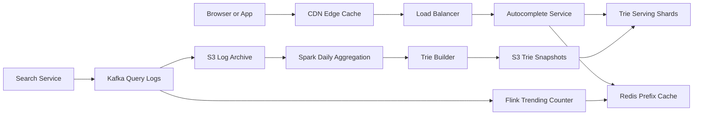

# Search Autocomplete

**Category:** System Design
**Difficulty:** 🟡 Medium
**Seniority:** senior
**Companies:** Google, Amazon, Microsoft, LinkedIn, Uber, Airbnb
**Tags:** trie, top-k, caching, low-latency, data-aggregation, read-heavy
**Time:** 45 min

---

## Problem Statement

Design a search autocomplete (typeahead) system. As a user types into a search box, the system returns the top 5-10 most relevant query suggestions that start with the typed prefix, ranked mainly by popularity.

The interviewer frames it at Google/Amazon scale: hundreds of millions of daily users, each keystroke producing a request, with suggestions needing to appear in well under 100 ms so typing feels instant.

## Clarifying Questions

- How many suggestions per request? *Top 10, ranked by popularity.*
- Is matching prefix-only or also mid-word? *Prefix only in v1.*
- How fresh must suggestions be? *Daily rebuild acceptable; trending queries within ~15 min is a nice-to-have.*
- Scale? *100M DAU, ~10 searches/user/day, ~20 chars per query.*
- Languages and character sets? *English lowercase letters, digits, spaces in v1; Unicode later.*
- Personalization? *Not in v1; global and per-region popularity only.*
- Do we filter offensive content? *Yes, via a blocklist.*
- Spelling correction? *Out of scope for v1.*

## Requirements

### Functional

- Given a prefix, return top 10 completions sorted by score (frequency, recency-weighted).
- Update rankings from search logs (batch daily, optional near-real-time trending).
- Filter blocked/offensive suggestions.
- Support regional variants (e.g. suggestions differ by country).

### Non-Functional

- Latency: p99 < 100 ms end to end; server-side < 20 ms.
- High availability (99.99%); stale suggestions are acceptable, errors are not.
- Read heavy: ~100:1 reads vs. log writes processed.
- Scales horizontally with traffic and vocabulary.

### Out of Scope

- Full search results, spell correction, personalization in v1.

## Capacity Estimation

| Metric | Arithmetic | Result |
|---|---|---|
| Searches/day | 100M DAU x 10 | 1B searches/day |
| Keystroke requests | 1B x ~20 chars, debounced to ~6 calls | ~6B requests/day |
| Avg QPS | 6B / 86,400 | ~70K QPS |
| Peak QPS | 2-3x | ~200K QPS |
| New query log | 1B x 20 B | ~20 GB/day raw |
| Unique queries | assume 1B long-tail, keep top 100M | ~100M phrases |
| Trie size | 100M phrases x ~30 B + top-10 cache per node | ~30-50 GB per full replica |
| Response size | 10 suggestions x 30 B | ~300 B; ~60 MB/s at peak |

A ~50 GB trie fits in memory on a large instance, or is sharded by prefix range across several nodes.

## API Design

```text
GET /v1/autocomplete?q=how%20to%20b&limit=10&locale=en-US
  resp: 200 {
    "prefix": "how to b",
    "suggestions": [
      { "text": "how to boil eggs", "score": 98123 },
      { "text": "how to buy bitcoin", "score": 87210 }
    ],
    "version": "2025-01-10T00:00Z"
  }
  headers: Cache-Control: public, max-age=300

POST /v1/search/log        (fire-and-forget from search service)
  body: { "query": "how to boil eggs", "locale": "en-US", "ts": 1736500000 }
  resp: 202

POST /v1/admin/blocklist
  body: { "phrases": ["..."] }
  resp: 200
```

## Data Model

**Raw query logs — Kafka -> S3 (Parquet)**

```text
search_log
  query     STRING
  locale    STRING
  ts        TIMESTAMP
  user_hash STRING     // for dedupe/anti-abuse, not personalization
```

**Aggregated frequencies — Spark job output in S3 / Cassandra**

```text
query_freq
  locale    STRING   PK part
  query     STRING   PK part
  score     DOUBLE   // exponentially decayed count, half-life ~7 days
  updated   DATE
```

**Serving structure — in-memory trie (or prefix hash map) per shard**

```text
TrieNode
  children   MAP<char, TrieNode>
  topK       LIST<(phraseId, score)>   // precomputed top 10 for this prefix
```

Alternative serving store: a **Redis / key-value map of `prefix -> top10 list`** for prefixes up to length ~20. Simpler to shard (by prefix hash) and replicate; costs more memory but zero traversal.

Snapshots of the trie are serialized to S3 so serving nodes can boot quickly.

## High-Level Design



**Read path:**

1. Client debounces keystrokes (~100-150 ms) and sends `GET /autocomplete?q=prefix`.
2. CDN / browser cache answers popular short prefixes (`a`, `ho`, `how`) directly — these dominate traffic.
3. On miss, the service checks a Redis prefix cache, then queries the trie shard owning that prefix.
4. The trie node for the prefix already stores the precomputed top 10 — O(length of prefix) lookup, no subtree scan.
5. Results are merged with any trending overrides, filtered by blocklist, and returned.

**Write / build path:**

1. Search service publishes every executed query to Kafka.
2. Logs are archived to S3; a daily Spark job computes decayed frequencies per locale, drops queries below a threshold (e.g. < 50 occurrences) and blocked terms.
3. Trie Builder builds a fresh trie with top-K per node and writes versioned snapshots to S3.
4. Serving nodes load the new snapshot in the background and atomically swap pointers (blue/green).
5. Optional: Flink computes sliding-window counts (last 1 h) to boost trending queries in near real time.

## Deep Dives

### Trie with precomputed top-K

Naive lookup would traverse the entire subtree of a prefix and sort — too slow for short prefixes like "a". Instead each node caches the top K completions.

```text
FUNCTION build(phrases):
    SET root ← new TrieNode()
    FOR (phrase, score) IN phrases:
        SET node ← root
        FOR ch IN phrase:
            SET node ← node.children.getOrCreate(ch)
            node.topK.offer((phrase, score))      // bounded min-heap of size K
    FOR node IN allNodes(root):
        SORT node.topK BY score DESC
    RETURN root

FUNCTION suggest(prefix):
    SET node ← root
    FOR ch IN prefix:
        IF ch NOT IN node.children: RETURN []
        SET node ← node.children[ch]
    RETURN node.topK
```

Memory optimizations: store phrase IDs (4 bytes) instead of strings in topK, use a compressed/radix trie to collapse single-child chains, and cap prefix depth at ~20 chars (longer prefixes fall back to scanning a small subtree).

### Sharding the trie

- **By first characters:** shard `a-c`, `d-f`... is uneven (many words start with "s", few with "x").
- **By precomputed load:** analyze historical prefix traffic and split ranges so each shard gets equal QPS (e.g. `s` split into `sa-sh`, `si-sz`). A shard map lives in ZooKeeper/etcd.
- **Full replication:** if the trie fits in memory (~50 GB), simply replicate the whole structure on every node — simplest, and read scaling is trivial. Preferred for v1.

### Ranking and freshness

Score = exponentially decayed count: `score = sum(count_day x 0.5^(age_days / 7))`. This lets yesterday's spikes rise without forgetting evergreen queries. Trending: Flink maintains count-min sketches of 1-hour windows; queries with a large ratio to their baseline get a boost and are pushed into the Redis cache for affected prefixes (all prefixes of the phrase), which overrides the trie result until the next rebuild.

### Client-side optimizations

- Debounce 100-150 ms; cancel in-flight requests when a new keystroke arrives.
- Cache responses locally: if the user types "how t" after "how", filter the previous list client-side when it's still complete enough.
- HTTP caching with `max-age` of minutes for popular prefixes; CDN hit rate of 60%+ is typical for short prefixes.
- Prefetch suggestions for the next likely character on slow networks.

## Scaling & Reliability

- **Stateless service tier** behind the load balancer; autoscale on QPS.
- **Replication:** each trie shard has 3+ replicas across AZs; snapshots in S3 allow a new replica to warm up in minutes.
- **Caching layers:** browser -> CDN -> Redis -> trie. Most traffic never reaches the trie.
- **Rebuild safety:** versioned snapshots; canary the new trie on 1% of traffic and compare suggestion overlap before full rollout; instant rollback by pointer swap.
- **Degradation:** if trie shards are unhealthy, serve from Redis/CDN caches or return empty suggestions — never block the search box.
- **Abuse:** rate-limit log ingestion per user/IP so bots cannot inflate a phrase into suggestions.
- **Monitoring:** p50/p99 latency, cache hit ratio per layer, snapshot age, suggestion click-through rate, blocked-term leaks.

## Trade-offs

| Decision | Option A | Option B | Choice & Why |
|---|---|---|---|
| Serving structure | Trie with top-K per node | Prefix -> top-K hash map in Redis | Trie for memory efficiency at scale; hash map is fine for smaller vocabularies and simpler ops. |
| Update frequency | Real-time trie updates | Periodic rebuild + trending overlay | Rebuild + overlay — real-time mutation of a shared trie causes locking and inconsistency. |
| Sharding | Shard by prefix range | Full replication | Full replication while it fits in RAM; shard by traffic-balanced ranges beyond that. |
| Ranking | Raw counts | Time-decayed counts | Decayed — balances evergreen and recent queries. |
| Client calls | Every keystroke | Debounced | Debounced — cuts QPS ~3x with negligible UX impact. |

## Follow-up Questions

1. **How do you add personalization?** Blend global top-K with a small per-user list (recent searches stored in a user-keyed KV store) at request time; re-rank with a lightweight model.
2. **How do you support multiple languages?** Build per-locale tries, normalize Unicode (NFKC), and use language-specific tokenization for CJK where prefixes are characters, not letters.
3. **How do you handle typos?** Add fuzzy matching via edit-distance-bounded trie traversal or a separate spell-correction service for prefixes with zero results.
4. **How do you remove an offensive suggestion immediately?** Push to a blocklist cached in every serving node (filtered at response time), not waiting for the next rebuild.
5. **What if trending news needs suggestions within minutes?** Use the Flink streaming path to update Redis overrides for all prefixes of the trending phrase.

## Common Mistakes

- Traversing the whole subtree at query time instead of precomputing top-K per node.
- Updating the trie on every search in the hot path.
- Ignoring client-side debouncing and caching, dramatically overestimating QPS.
- Sharding naively by first letter, creating hot shards.
- Forgetting content filtering and abuse protection on suggestions.

## Key Takeaways

- Separate the offline aggregation/build pipeline from the online, read-only serving path.
- Precompute top-K at every trie node to make lookups O(prefix length).
- Multi-layer caching (browser, CDN, Redis) absorbs most traffic for short prefixes.
- Use time-decayed scoring plus a streaming overlay for freshness.
