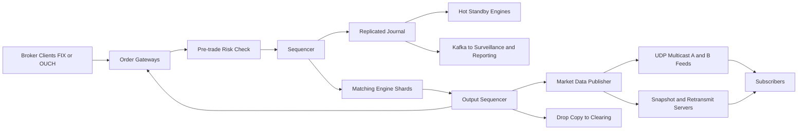

# Stock Exchange Platform

**Category:** System Design
**Difficulty:** 🔴 Hard
**Seniority:** staff
**Companies:** Coinbase, Robinhood, Jane Street, Citadel, Goldman Sachs, Nasdaq, Bloomberg
**Tags:** matching-engine, low-latency, event-sourcing, determinism, market-data, sequencer
**Time:** 60 min

---

## Problem Statement

Design an electronic stock exchange: brokers connect and submit orders (limit, market, cancel, replace), the exchange matches buyers and sellers by price-time priority, reports executions back to the brokers, and publishes real-time market data (trades, top of book, full depth) to every subscriber.

The interviewer is looking for an end-to-end design: order gateways, risk checks, a sequencer that totally orders all input, a single-threaded deterministic matching engine, market data dissemination, and recovery/failover with no lost or duplicated fills. Assume ~10,000 listed symbols, a peak of a few million order messages per second, and a latency target in microseconds, not milliseconds.

## Clarifying Questions

- Who are the clients? *Member brokers/market makers over dedicated connections using FIX or a binary protocol (like Nasdaq OUCH); no retail users directly.*
- Which order types? *Limit, market, cancel, cancel/replace; IOC and FOK time-in-force. Stop orders and auctions are stretch goals.*
- What volume? *~10K symbols, ~1B order messages/day, peak ~2M msgs/s; trade:order ratio ~1:20 because most orders are cancelled.*
- Latency target? *Gateway-in to ack-out p99 < 50 µs inside the data center; market data within ~10 µs of the match.*
- Trading hours? *Continuous session 9:30–16:00 with opening/closing auctions; the system can be restarted overnight.*
- Is clearing/settlement in scope? *No — we emit a trade drop-copy to the clearing house; settlement (T+1) is downstream.*
- Fairness requirements? *Strict price-time priority; every participant sees identical market data at the same time.*
- Single region? *Yes, a primary co-location data center plus a warm disaster-recovery site.*

## Requirements

### Functional
- Accept new/cancel/replace orders, perform pre-trade risk checks, acknowledge or reject.
- Match orders per symbol with price-time priority and generate executions for both sides.
- Publish market data: trades, L1 (best bid/offer), L2/L3 order book depth.
- Provide end-of-day reports, drop-copy to clearing, and full audit trail for regulators.
- Trading halts and circuit breakers per symbol (e.g. LULD bands).

### Non-Functional
- Ultra-low, predictable latency: p99 < 50 µs, p99.99 bounded (jitter matters more than mean).
- Deterministic: replaying the same input sequence produces exactly the same output.
- No lost orders, no duplicated fills; exactly-once semantics from the client's view.
- High availability during market hours; failover in < 1 s with no state loss.
- Fairness: total order of events and simultaneous market data delivery.

### Out of Scope
- Clearing, settlement, custody, broker-side order routing (SOR), retail apps.

## Capacity Estimation

| Quantity | Estimate |
|---|---|
| Order messages/day | 1B (6.5 h session ≈ 23,400 s → ~43K/s average) |
| Peak rate | ~50× average at open/close → ~2M msgs/s |
| Trades/day | ~50M (1:20 of orders) |
| Message size | ~64 bytes binary (vs ~300 bytes FIX) |
| Sequenced journal/day | 1B × 64 B ≈ 64 GB/day (plus outputs ≈ 150 GB/day) |
| Journal bandwidth at peak | 2M × 64 B ≈ 128 MB/s — fits one 10/25 GbE link |
| Live order book memory | ~10M resting orders × ~100 B ≈ 1 GB — fully in RAM |
| Market data fan-out | ~5M updates/s peak × ~40 B ≈ 200 MB/s multicast (one copy regardless of subscribers) |

Key insight: the whole hot state fits in memory of a single machine, and the per-symbol throughput is dominated by a handful of hot symbols (SPY, AAPL, TSLA may take 5–10% of all traffic each).

## API Design

```text
// Order entry: binary protocol over TCP (OUCH-like) or FIX 4.4 via gateway
NewOrder      { clOrdId, account, symbol, side: BUY|SELL, type: LIMIT|MARKET,
                price (int64 ticks), qty, tif: DAY|IOC|FOK }
  -> Ack      { clOrdId, orderId, seqNo, timestamp_ns }
  -> Reject   { clOrdId, reason: RISK_LIMIT|HALTED|BAD_PRICE|DUP_ID }
CancelOrder   { clOrdId, origClOrdId }        -> Cancelled { orderId, leavesQty=0 }
ReplaceOrder  { clOrdId, origClOrdId, newPrice, newQty } -> Replaced | Reject
  -> Execution { orderId, execId, fillPrice, fillQty, leavesQty, liquidity: MAKER|TAKER }

// Market data: UDP multicast (ITCH-like), sequenced, with A/B feeds
AddOrder { seq, symbol, orderId, side, price, qty }
OrderExecuted { seq, orderId, qty, matchId }
OrderCancel { seq, orderId, qty }
Trade { seq, symbol, price, qty }
// Gap recovery: TCP retransmission request  GET /replay?fromSeq=&toSeq=
// Snapshot: GET /snapshot?symbol=  -> full book at seq N

// Admin/ops (REST, internal)
POST /symbols/{symbol}/halt      POST /symbols/{symbol}/resume
GET  /reports/eod?date=
```

Prices are integer ticks (never floating point) to keep matching deterministic.

## Data Model

- **Order book (in memory, per symbol)**: two sides; each side is a sorted map `price -> PriceLevel`, each `PriceLevel` holds a FIFO doubly-linked list of orders plus total qty. A hash map `orderId -> Order node` gives O(1) cancel. Pre-allocated object pools avoid GC/malloc on the hot path.
- **Order**: `orderId, account, symbol, side, price, qty, leavesQty, seqNo, timestamp`.
- **Sequenced journal (event log)**: append-only, memory-mapped files on local NVMe, replicated to hot standbys; record = `seqNo, timestamp_ns, type, payload`. This is the source of truth (event sourcing) — the book is a pure function of the journal.
- **Risk state (in memory, per account)**: buying power, open position, open order count, credit limit; refreshed from the clearing firm at start of day.
- **Reference data (PostgreSQL)**: symbols, tick sizes, lot sizes, price bands, member accounts — loaded at startup, read-only during the session.
- **Trade/audit store**: journal is shipped asynchronously to Kafka → columnar storage (ClickHouse/kdb+) for surveillance, CAT regulatory reporting, and EOD reports.

Shard key: **symbol**. All orders for one symbol go to exactly one matching engine shard; symbols are statically assigned to shards at start of day based on prior-day volume.

## High-Level Design



1. **Order entry**: a broker sends `NewOrder` over a persistent TCP session to a gateway. The gateway authenticates the session, validates fields, dedups `clOrdId`, normalizes FIX to the internal binary format, and timestamps it.
2. **Risk check**: the risk component (in-process with the gateway, or a dedicated sequenced stage) verifies buying power, max order size, fat-finger price band, and kill-switch state. Rejections return immediately.
3. **Sequencing**: the sequencer assigns a monotonically increasing global `seqNo` and writes to the journal, which is replicated to standbys before (or in parallel with) processing. This creates a single total order — the basis for fairness and determinism.
4. **Matching**: the symbol's matching engine (single thread, pinned core) consumes the sequenced stream, matches against the book, and emits ordered output events (acks, fills, book changes).
5. **Execution reports** are routed back through the originating gateway to the broker; drop copies go to clearing.
6. **Market data**: the publisher converts book events into ITCH-like messages and multicasts them on redundant A/B feeds. Subscribers detect gaps via sequence numbers and recover from retransmit servers or snapshots.

## Deep Dives

### Matching Engine: single-threaded and deterministic

Concurrency inside a book adds locks and non-determinism, so each shard runs one thread on an isolated core (busy-spin, no syscalls, no allocation). Throughput of a tuned single-threaded engine is 1–5M ops/s, which exceeds any single symbol's rate. Inputs arrive via a lock-free ring buffer (LMAX Disruptor pattern).

```text
FUNCTION onNewOrder(order):
    SET book ← books[order.symbol]
    SET opposite ← book.side(opposite of order.side)
    WHILE order.leavesQty > 0 AND opposite.notEmpty():
        SET best ← opposite.bestLevel()
        IF NOT crosses(order, best.price): BREAK
        FOR resting IN best.fifo:                       // time priority
            SET fill ← min(order.leavesQty, resting.leavesQty)
            EMIT Execution(order, resting, best.price, fill)   // price = resting price
            SET order.leavesQty ← order.leavesQty - fill
            SET resting.leavesQty ← resting.leavesQty - fill
            IF resting.leavesQty = 0: REMOVE resting FROM best.fifo
            IF order.leavesQty = 0: BREAK
        IF best.isEmpty(): REMOVE best FROM opposite
    IF order.leavesQty > 0:
        IF order.tif = IOC OR order.type = MARKET: EMIT Cancelled(order)
        ELSE: book.side(order.side).add(order); EMIT BookAdd(order)

FUNCTION crosses(order, price):
    RETURN (order.side = BUY AND order.price >= price) OR
           (order.side = SELL AND order.price <= price)
```

Determinism rules: no wall-clock reads (time comes from the sequenced message timestamp), no randomness, no hash-map iteration order dependence, integer prices, and identical code versions on primary and standbys.

### Sequencer and replicated state machine

The sequencer is the heart of correctness. Every input (orders, cancels, halts, timer ticks) becomes a journal entry with a `seqNo`. Because the engine is deterministic, standbys that consume the same journal hold byte-identical books.

- Replication: primary sends each batch to 2 standbys over kernel-bypass networking (RDMA or Solarflare/ef_vi) and waits for at least one ack before releasing outputs (so a fill is never published that could be lost). Aeron Cluster and LMAX-style designs use Raft-like consensus for this; round-trip on a co-lo switch is ~5–10 µs.
- Batching: under load, the sequencer commits batches of messages per replication round-trip, keeping per-message overhead low.
- Output dedup: outputs carry the input `seqNo`, so after failover the new primary can suppress outputs the clients already received.

### Market data dissemination and fairness

- UDP multicast sends one packet to all subscribers simultaneously — TCP fan-out would give earlier connections an advantage and scale poorly.
- Each message carries a sequence number; two identical feeds (A/B) on separate network paths are arbitrated by the client (take the first copy of each seq).
- Gap recovery: request a retransmit for small gaps; for late joiners or big gaps, load a periodic book snapshot (taken at seq N) and apply the incremental feed from N+1.
- Fairness: co-located participants get equal-length cables; some venues add speed bumps (IEX 350 µs) to neutralize latency arbitrage.

### Recovery, failover, and start of day

- Start of day: load reference data, risk limits, and carry-over GTC orders; open with an auction that computes a single clearing price maximizing executed volume.
- Primary crash: standbys are already at the same `seqNo`; a cluster leader election (or an external arbiter) promotes one in < 1 s. Gateways reconnect and resend unacked orders; dedup by `clOrdId` prevents doubles.
- Full recovery: rebuild from the latest snapshot plus journal replay; replaying 64 GB at ~1 GB/s takes about a minute.
- Disaster recovery: journal is streamed asynchronously to the DR site; RPO is a few ms, so regulators allow a "declared" failover where the session is halted and reconciled with members.

## Scaling & Reliability

- **Sharding**: partition by symbol across ~8–32 engine shards; hot symbols get dedicated shards. Cross-symbol orders (spreads/options combos) need a dedicated complex-order book or a coordinating engine.
- **Gateways** scale horizontally and are stateless except for session sequence numbers (recoverable from the journal).
- **Latency engineering**: kernel bypass (DPDK/ef_vi), CPU pinning and isolcpus, NUMA-local memory, huge pages, no GC (C++/Rust or Java with zero-allocation and Azul/ZGC), busy polling, hardware timestamps; FPGA for risk checks and feed handlers at top venues.
- **Back-pressure**: per-session order-rate throttles at the gateway; reject rather than queue unbounded.
- **Safety**: circuit breakers (market-wide halts at 7/13/20%), LULD price bands, per-member kill switches, self-trade prevention.
- **Monitoring**: per-hop latency histograms with hardware timestamps, sequence gap alarms, book checksums compared across primary/standby every N messages, surveillance for spoofing/layering.

## Trade-offs

| Decision | Option A | Option B | Choice & Why |
|---|---|---|---|
| Engine concurrency | Multi-threaded with locks per book | Single thread per shard | Single thread: deterministic, no lock contention, millions of ops/s per core is enough |
| Durability | Sync fsync to disk | Replicate to standby memory before ack | Replication: µs vs ms latency; durability comes from ≥2 copies plus async disk |
| Market data transport | TCP per subscriber | UDP multicast + retransmit | Multicast: simultaneous fair delivery, O(1) send cost; gaps handled with seq + A/B feeds |
| Price representation | Floating point | Integer ticks | Integers: exact comparisons, deterministic replay |
| Risk check placement | Separate service hop | Inline in gateway or FPGA | Inline: avoids a network hop; sequenced risk state if limits are shared across gateways |
| Language | Java/JVM | C++/Rust | Either works; JVM needs zero-GC discipline (LMAX proved it), C++/Rust give tighter tail latency |

## Follow-up Questions

1. **How do you handle a symbol that becomes too hot for one core?** You cannot split a single book without losing price-time priority, so you optimize the engine path and give it a dedicated shard; throttling and batching at the sequencer smooth spikes.
2. **How does an opening auction work?** Collect orders without matching, then compute the price that maximizes matched volume (tie-break on minimum imbalance and reference price), execute all at that single price, and switch to continuous trading.
3. **How do you guarantee a client never gets a fill that is later lost?** Outputs are released only after the input is replicated to a quorum; after failover the new primary replays and dedups by seqNo.
4. **How would you support a crypto exchange with 24/7 trading?** No overnight maintenance window, so you need rolling upgrades via snapshot + standby promotion, and wallet/custody integration replaces clearing.
5. **How do you prevent self-trading and spoofing?** Self-trade prevention flags at match time (cancel newest/oldest/both); spoofing is detected offline by surveillance over the journal.
6. **How do you test determinism?** Replay production journals into new builds and diff outputs byte-for-byte; continuous primary/standby book checksums.

## Common Mistakes

- Putting the order book in a database or distributed cache — orders of magnitude too slow and non-deterministic.
- Using multiple threads with locks on the same book, breaking time priority and determinism.
- Using floating-point prices or reading wall-clock time inside the matching engine.
- Forgetting gap detection and recovery for UDP market data.
- Acking fills before they are durably replicated, then losing them on failover.
- Ignoring cancels, which are the majority of traffic and must be O(1).

## Key Takeaways

- An exchange is a replicated deterministic state machine: sequencer → journal → single-threaded matching engine per symbol.
- All hot state lives in memory; durability comes from replicating the sequenced input log, not from a database.
- Fairness = a single total order of inputs plus simultaneous multicast market data.
- Latency is won with mechanical sympathy: kernel bypass, core pinning, no allocation, binary protocols.
- Recovery is snapshot + replay; failover works because standbys process the same journal.
