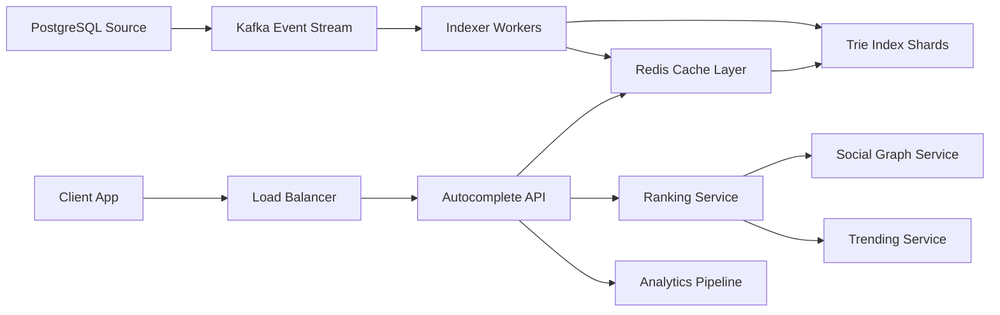

# Typeahead for Social Search

**Category:** System Design
**Difficulty:** 🟡 Medium
**Seniority:** mid-level
**Companies:** LinkedIn, Twitter, Facebook, Google, Instagram
**Tags:** trie, prefix-search, ranking, autocomplete, caching, real-time
**Time:** 60-90 min

---

## Problem Statement

Design a typeahead/autocomplete service for a social platform that suggests users, hashtags, and content as users type in a search box. The system must return relevant suggestions within 100-200 ms, handle millions of queries per second, support personalized results based on the user's social graph and activity, and update in near real-time as new content is created.

The interviewer mentions ~10M daily active users, 50K QPS at peak, and requirements for multi-language support, typo tolerance, and ranking by relevance (social connections, popularity, recency).

## Clarifying Questions

- What entities are searchable? *Users (name, handle), hashtags, content posts/tweets.*
- Query volume? *50K QPS peak, average query length 3-5 characters.*
- Latency SLA? *p95 < 200 ms end-to-end.*
- Personalization depth? *Rank friends higher, show recently interacted content, respect user's language.*
- Real-time requirements? *New users and hashtags appear within seconds; viral content trends quickly.*
- Typo tolerance? *Yes, fuzzy matching for typos (e.g., "joh" should suggest "john").*
- Caching strategy? *Cache popular prefixes; invalidate on updates.*
- Mobile vs web? *Both; mobile has bandwidth constraints.*

## Requirements

### Functional

- Return autocomplete suggestions for partial queries (prefix search).
- Support multiple entity types: users, hashtags, content.
- Rank results by relevance: social connections, popularity (followers/engagement), recency, query history.
- Handle typos with fuzzy matching (edit distance, phonetic matching).
- Support multi-language queries with language detection.
- Personalize results based on user's social graph and past interactions.
- Update index in near real-time (new content searchable within seconds).

### Non-Functional

- Low latency: p95 < 200 ms, p99 < 500 ms.
- High throughput: 50K+ QPS.
- Scalability: handle growth in users and content.
- Availability: 99.9% for search queries.
- Freshness: new content indexed within 5-10 seconds.

### Out of Scope

- Full-text search (post-query), semantic search, ML-based ranking models, analytics dashboard.

## Capacity Estimation

| Metric | Arithmetic | Result |
|---|---|---|---|
| DAU | given | 10M |
| Queries/day | 10M x 5 avg | 50M |
| Peak QPS | 50M / 86,400 x 3 | ~1,700 QPS |
| Searchable entities | Users: 500M, Hashtags: 50M, Content: 1B | ~1.55B total |
| Avg entity size | 200 B (name, id, metadata) | ~310 GB total |
| Prefix cache | Common prefixes (top 10M) x 10 results x 200 B | ~20 GB |
| Update rate | New content: 10K/s, new users: 100/s | ~10K updates/s |

A sharded trie/prefix tree in memory (Redis or custom) handles prefix search efficiently. Personalization adds a ranking layer on top of cached results.

## API Design

```text
GET /v1/autocomplete?q=john&type=user,hashtag&limit=10
  headers: Authorization: Bearer <token>
  resp: 200 {
    "query": "john",
    "results": [
      {
        "id": "u_123",
        "type": "user",
        "name": "John Smith",
        "handle": "@johnsmith",
        "profileImage": "https://...",
        "reason": "friend",
        "score": 0.95
      },
      {
        "id": "h_456",
        "type": "hashtag",
        "text": "#johnwick",
        "postCount": 1500000,
        "reason": "trending",
        "score": 0.87
      }
    ],
    "suggestions": ["john doe", "johnny", "jonathan"]  // did-you-mean
  }

GET /v1/autocomplete/trending?limit=5
  resp: 200 { "hashtags": [...], "topics": [...] }

POST /v1/autocomplete/feedback
  body: { "query": "john", "clickedResultId": "u_123" }
  // Used for ranking improvement
```

## Data Model

**In-memory Trie/Prefix Tree (per shard):**

```text
TrieNode:
  children: Map<char, TrieNode>
  isEnd: boolean
  entityIds: List<EntityId>  // top K entities for this prefix
  entityScores: Map<EntityId, float>  // precomputed scores
```

**Redis (cache and real-time index):**

```text
// Prefix → sorted set of entity IDs by score
prefix:{shard}:{prefix} → ZSET (entity_id, score)

// Entity details (cached)
entity:{id} → HASH { name, handle, type, metadata, updated_at }

// User's social graph for personalization
user:{user_id}:friends → SET of friend_ids
user:{user_id}:recent → LIST of recently interacted entity_ids

// Trending scores (computed periodically)
trending:hashtag → ZSET (hashtag_id, trending_score)
```

**PostgreSQL (source of truth and analytics):**

```sql
user
  user_id UUID PK
  name TEXT
  handle TEXT UNIQUE
  follower_count INT
  created_at TIMESTAMP
  language CHAR(2)

hashtag
  hashtag_id UUID PK
  text TEXT UNIQUE
  post_count INT
  created_at TIMESTAMP

content
  content_id UUID PK
  author_id UUID FK
  text TEXT
  hashtag_ids UUID[]
  engagement_score FLOAT
  created_at TIMESTAMP

search_analytics
  query_id BIGSERIAL PK
  user_id UUID
  query_text TEXT
  results_clicked JSONB
  timestamp TIMESTAMP
```

## High-Level Design



**Query path:**
1. Client sends autocomplete query with partial text.
2. API checks cache for the exact (user, query, type) combination.
3. On cache miss, query the trie index for matching entity IDs.
4. Fetch entity details from cache or database.
5. Ranking service re-ranks based on user's social graph, query history, and trending scores.
6. Return top N results to client.

**Index update path:**
1. New user/hashtag/content created in PostgreSQL.
2. Change events published to Kafka.
3. Indexer workers consume events, update trie index and cache.
4. Invalidate affected cache entries.
5. Trending service periodically recomputes trending scores.

## Deep Dives

### Trie-based prefix search

A trie enables O(L) lookup where L is query length. Each shard holds a portion of the trie (e.g., by first character or hash range).

```text
FUNCTION searchPrefix(prefix, limit):
  node ← trieRoot
  FOR char IN prefix:
    IF char NOT IN node.children: RETURN []
    node ← node.children[char]

  results ← []
  collectResults(node, results, limit)
  RETURN results

FUNCTION collectResults(node, results, limit):
  IF node.isEnd:
    results.extend(node.entityIds)
  IF len(results) >= limit: RETURN

  FOR child IN node.children.values():
    collectResults(child, results, limit)
    IF len(results) >= limit: RETURN
```

Optimizations:
- Store top K entity IDs at each node to avoid deep traversal.
- Use a compressed trie (radix tree) to reduce memory.
- Shard by first character to parallelize queries.

### Fuzzy matching for typos

Handle typos using edit distance (Levenshtein) or phonetic algorithms (Soundex, Metaphone).

```text
FUNCTION fuzzySearch(query, maxDistance=2):
  exactResults ← searchPrefix(query, limit=50)

  IF len(exactResults) >= limit: RETURN exactResults

  // Generate variations within edit distance
  variations ← generateVariations(query, maxDistance)
  fuzzyResults ← []
  FOR var IN variations:
    fuzzyResults.extend(searchPrefix(var, limit=10))

  // Deduplicate and re-rank
  combined ← deduplicate(exactResults + fuzzyResults)
  RETURN rank(combined, query)[:limit]
```

Optimization: Pre-compute common misspellings and map to correct terms. Use a separate "typo index" with n-gram based search for large edit distances.

### Personalized ranking

Rank results based on user's social connections and activity:

```text
FUNCTION rankResults(results, userId, query):
  userFriends ← socialGraph.getFriends(userId)
  userRecent ← recentInteractions.get(userId)
  userLanguage ← userPreferences.getLanguage(userId)

  scored ← []
  FOR entity IN results:
    score ← entity.baseScore  // from index (popularity, recency)

    // Boost for friends
    IF entity.id IN userFriends:
      score ← score * 2.0

    // Boost for recently interacted
    IF entity.id IN userRecent:
      score ← score * 1.5

    // Language match
    IF entity.language == userLanguage:
      score ← score * 1.2

    // Query history boost
    IF query IN userQueryHistory[userId]:
      score ← score * 1.3

    scored.append({ entity, score })

  RETURN sort_by(score, descending)[:limit]
```

Social graph data is cached in Redis and updated via events. For cold users, fall back to global ranking (popularity + recency).

### Real-time index updates

New content must be searchable within seconds:

```text
FUNCTION onContentCreated(content):
  // Extract searchable terms
  terms ← extractTerms(content.text)  // names, hashtags, keywords
  FOR term IN terms:
    // Update trie for each term
    trie.insert(term, content.id, content.score)

    // Update cache for affected prefixes
    FOR prefix IN getAllPrefixes(term):
      cache.invalidate(prefix)

  // Update trending scores asynchronously
  trendingService.update(content.hashtags)
```

Use a write-ahead log for durability: append updates to Kafka before applying to trie. Indexer workers process in parallel with idempotent operations.

### Caching strategy

Multi-level caching for performance:

```text
L1: In-memory cache per API instance (LRU, 10K entries)
  Key: (user_id, query, type) → results
  TTL: 5 minutes

L2: Redis distributed cache
  Key: prefix:{shard}:{prefix} → sorted set of entity IDs
  TTL: 1 hour (invalidated on updates)

L3: Trie index (always hot)
  Persistent in memory across restarts via snapshot/restore
```

Cache warming: Pre-load top 10K prefixes (common queries) during deployment. Use a "shadow cache" to track miss patterns and proactively cache popular queries.

## Scaling & Reliability

- **Sharding:** Shard trie by first character (26 shards for A-Z) or by hash (256 shards). Each shard on a separate Redis instance.
- **Replication:** Each trie shard has a replica for failover. Use Redis Sentinel or Cluster for automatic failover.
- **Read path:** Stateless API servers can query any shard. Use consistent hashing for shard location.
- **Write path:** Indexer workers are partitioned by shard to avoid write conflicts. Use Kafka partitions for ordered processing per entity.
- **Rate limiting:** Per-user rate limits to prevent abuse (e.g., 100 queries/minute).
- **Monitoring:** Cache hit rate, query latency p95/p99, index update lag, error rate per shard, trending score freshness.
- **Graceful degradation:** If ranking service is down, return unranked results from cache. If trie is slow, fall back to database prefix search.

## Trade-offs

| Decision | Option A | Option B | Choice & Why |
|---|---|---|---|
| Index structure | Trie in memory | Elasticsearch inverted index | Trie — faster prefix lookup, simpler for autocomplete; ES better for full-text search |
| Personalization | Real-time ranking | Pre-computed per-user | Real-time — fresher results; pre-computed at scale for millions of users |
| Fuzzy matching | Edit distance at query time | Pre-computed typo index | Pre-computed — faster queries; edit distance for rare long-tail queries |
| Cache invalidation | TTL-based | Event-based invalidation | Event-based — fresher results; TTL as fallback |
| Index updates | Synchronous | Async via Kafka | Async — decouples writes from indexing, better throughput |
| Trending computation | Real-time | Batch periodic | Batch periodic — more stable scores, reduces noise |

## Follow-up Questions

1. **How do you handle multi-byte characters (Unicode, emojis)?** Use UTF-8 encoding in trie; normalize characters (NFC form) to handle composed/decomposed forms. Shard by Unicode code point ranges.
2. **How would you add search suggestions for phrases?** Build a phrase index using n-grams (2-gram, 3-gram) or use a separate phrase autocomplete service with a different data structure (e.g., phrase trie).
3. **How do you handle trending topics that spike suddenly?** Use a decaying score algorithm (exponential decay) combined with real-time counters. Detect spikes via anomaly detection and boost temporarily.
4. **How would you support typeahead in offline mode for mobile?** Bundle a compressed trie of popular terms with the app. Use differential sync to update when online. Fall back to local cache when offline.
5. **How do you prevent autocomplete from revealing private information?** Filter results based on privacy settings (e.g., private users only visible to friends). Apply privacy checks in the ranking layer before returning results.

## Common Mistakes

- Using a database LIKE query for prefix search (too slow at scale).
- Storing the full trie on disk instead of memory (high latency).
- Not handling Unicode and multi-byte characters correctly.
- Forgetting to invalidate cache on index updates (stale results).
- Over-personalizing (filtering too aggressively, resulting in empty results).
- Not accounting for typo tolerance (poor user experience for misspellings).

## Key Takeaways

- Trie-based prefix search provides O(L) lookup and is ideal for autocomplete.
- Multi-level caching (per-instance, distributed, index) reduces latency significantly.
- Personalization requires access to social graph and user activity data; cache this for performance.
- Real-time index updates via event streaming ensure freshness without blocking writes.
- Fuzzy matching and typo tolerance are essential for good UX; pre-compute common misspellings.
- Shard the index by prefix or hash to scale horizontally.
- Monitor cache hit rates and index update lag to detect performance issues early.
