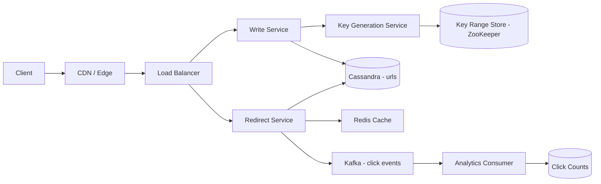

# URL Shortener

**Category:** System Design
**Difficulty:** 🟢 Easy
**Seniority:** mid
**Companies:** Google, Amazon, Microsoft, Bitly, Meta, Uber
**Tags:** hashing, base62, caching, key-generation, read-heavy
**Time:** 45 min

---

## Problem Statement

Design a URL shortening service like Bitly or TinyURL. Users submit a long URL and receive a short alias (e.g. `https://sho.rt/aZ3kP9q`). When anyone visits the short URL, the service redirects them to the original long URL.

The interviewer hints at large scale: hundreds of millions of new links per month and a read-to-write ratio around 100:1. Redirects must be fast (they sit on the critical path of every click) and links must not be lost.

## Clarifying Questions

- How many new URLs per day? *Assume 100M new URLs/day.*
- What is the read:write ratio? *Assume 100:1, so ~10B redirects/day.*
- How short should the code be? *As short as possible; 7 characters is acceptable.*
- Can users choose a custom alias? *Yes, optional, up to 16 characters.*
- Do links expire? *Default retention 5 years; users may set a custom expiry.*
- Do we need click analytics? *Basic click counts, eventually consistent, are nice to have.*
- Should the same long URL always map to the same short URL? *No; each request can produce a new code (simpler, per-user analytics).*
- 301 or 302 redirect? *302 by default so we can count clicks; 301 optional for cacheable links.*

## Requirements

### Functional
- Given a long URL, return a unique short URL.
- Redirect a short URL to its long URL.
- Optional custom alias and expiration time.
- Basic per-link click count.

### Non-Functional
- High availability for redirects (99.99%); redirects should survive a write-path outage.
- Low latency: p99 redirect < 50 ms server-side.
- Short codes must be unique and not easily guessable/enumerable.
- Durable: once created, a link must not be lost.

### Out of Scope
- User accounts dashboard UI, link editing, QR codes, malware scanning details.

## Capacity Estimation

| Metric | Arithmetic | Result |
|---|---|---|
| Write QPS | 100M / 86,400 s | ~1,200/s avg, ~3,000/s peak |
| Read QPS | 1,200 x 100 | ~120K/s avg, ~300K/s peak |
| Records over 5 years | 100M x 365 x 5 | ~182B links |
| Size per record | code 7B + long URL ~200B + metadata ~100B | ~500 B (with overhead) |
| Total storage | 182B x 500 B | ~91 TB (before replication) |
| Write bandwidth | 1,200 x 500 B | ~0.6 MB/s |
| Read bandwidth | 120K x 500 B | ~60 MB/s |
| Cache (20% hot of a day's reads) | 0.2 x 10B x 500 B | ~1 TB; in practice the hot set is far smaller, ~100-200 GB covers 90%+ hits |

Keyspace check: base62 with 7 characters = 62^7 ≈ 3.5 trillion codes, ~19x the 182B links needed.

## API Design

```text
POST /api/v1/urls
  Headers: Authorization: Bearer <api_key>   (optional for anonymous)
  Body:    { "long_url": "https://...", "custom_alias": "my-link"?, "expires_at": "2030-01-01T00:00:00Z"? }
  201 ->   { "short_url": "https://sho.rt/aZ3kP9q", "code": "aZ3kP9q", "expires_at": "..." }
  409 ->   alias already taken
  400 ->   invalid URL

GET /{code}
  302 ->   Location: <long_url>
  404 ->   unknown code
  410 ->   expired

GET /api/v1/urls/{code}/stats
  200 ->   { "code": "aZ3kP9q", "clicks": 18234, "created_at": "..." }

DELETE /api/v1/urls/{code}
  204 ->   deleted (owner only)
```

Rate-limit `POST` per API key / IP (e.g. 100 creates/min) to prevent abuse and keyspace exhaustion.

## Data Model

```text
Table: urls  (key-value / wide-column)
  code         STRING  PRIMARY KEY (partition key)
  long_url     STRING
  user_id      STRING  nullable
  created_at   TIMESTAMP
  expires_at   TIMESTAMP nullable

Table: click_counts  (aggregated)
  code         STRING  PRIMARY KEY
  clicks       COUNTER
```

- **DB choice:** Cassandra or DynamoDB. Access is a pure key lookup by `code`, there are no joins, data is ~100 TB, and we need horizontal scale and multi-region replication. TTL support handles expiry natively.
- **Partition key:** `code`. Codes are randomly distributed, so load spreads evenly with consistent hashing.
- **Custom aliases** live in the same table; uniqueness is enforced with a conditional write (`INSERT ... IF NOT EXISTS` / DynamoDB `attribute_not_exists`).
- A small PostgreSQL DB can hold users and API keys (low volume, relational).

## High-Level Design



**Write path**
1. Client calls `POST /api/v1/urls`; LB routes to a stateless Write Service.
2. Service validates the URL (format, length < 2 KB, blocklist check).
3. If a custom alias is given, it performs a conditional insert; on conflict returns 409.
4. Otherwise it takes the next code from its locally pre-allocated key range (from the Key Generation Service) and inserts `{code, long_url, ...}` into Cassandra.
5. Optionally writes through to Redis, returns the short URL.

**Read path**
1. Browser hits `GET /aZ3kP9q`. CDN may serve cached 301s for links marked permanent.
2. Redirect Service looks up Redis; on hit returns 302 immediately.
3. On miss, reads Cassandra (`LOCAL_ONE` / `LOCAL_QUORUM`), populates Redis with a TTL, returns 302 (or 404/410).
4. Asynchronously emits a click event to Kafka; consumers aggregate counts in batches.

## Deep Dives

### Short code generation

Options:
- **Hash + truncate** (MD5/SHA-256 of long URL, take 7 base62 chars): collisions require a check-and-retry loop on every write.
- **Random 7-char code**: simple, unguessable, but needs a uniqueness check (conditional insert); collision probability is low while the space is < 10% full.
- **Counter + base62** (chosen): a global counter guarantees uniqueness with no checks. To avoid a single bottleneck, a Key Generation Service hands out ranges (e.g. 1M IDs) to each Write Service instance via ZooKeeper/etcd.

```text
FUNCTION nextCode():
    IF localCounter >= rangeEnd:
        SET (rangeStart, rangeEnd) ← KGS.allocateRange(size = 1_000_000)  // atomic CAS in ZooKeeper
        SET localCounter ← rangeStart
    SET id ← localCounter
    SET localCounter ← localCounter + 1
    RETURN base62Encode(scramble(id))

FUNCTION base62Encode(n):
    SET alphabet ← "0-9a-zA-Z"
    SET out ← ""
    WHILE n > 0:
        SET out ← alphabet[n MOD 62] + out
        SET n ← n DIV 62
    RETURN leftPad(out, 7, "0")
```

`scramble` is a reversible bijection (e.g. a Feistel cipher or multiply by a large odd constant mod 62^7) so sequential IDs do not produce guessable sequential codes. If an instance crashes, the rest of its range is simply wasted, which is fine given a 3.5T keyspace.

### Caching hot links

- Link popularity is heavily skewed (Zipfian): a small set of links gets most clicks. Redis cluster with LRU eviction, ~100-200 GB, gives 90%+ hit rate.
- Cache-aside on read; write-through on create (new links are often clicked immediately after sharing).
- Negative caching: cache 404s for a short TTL (60 s) to absorb scans for non-existent codes.
- For viral links, a per-instance in-process LRU (e.g. Caffeine, 10K entries, 30 s TTL) prevents a single Redis shard becoming a hot spot.

### 301 vs 302 and analytics

- **301 Permanent**: browsers and CDNs cache it; lowers load but we lose click visibility.
- **302 Found**: every click reaches us; enables analytics. Chosen as default.
- Click tracking must not slow redirects: the Redirect Service publishes `{code, ts, referrer, country}` to Kafka fire-and-forget; a Flink/consumer job aggregates per-minute and increments counters in batches.

### Expiration and cleanup

- Use Cassandra/DynamoDB TTL on `expires_at` so expired rows are removed automatically.
- Redirect Service also checks `expires_at` on read (TTL deletion is lazy) and returns 410.
- Codes are not reused after expiry to avoid redirecting old links to new destinations.

## Scaling & Reliability

- **Stateless services** behind LB, autoscaled on CPU/QPS; read and write services scaled independently.
- **Sharding:** Cassandra consistent-hashing ring by `code`; add nodes to grow capacity linearly.
- **Replication:** RF=3 per region, multi-region active-active for reads; writes with `LOCAL_QUORUM`.
- **Caching tiers:** CDN (for 301 links) -> in-process LRU -> Redis -> Cassandra.
- **KGS availability:** ranges are pre-fetched, so a KGS/ZooKeeper outage only blocks writes after local ranges drain (minutes to hours); redirects are unaffected.
- **Abuse:** rate limiting on create, URL blocklist (Google Safe Browsing), and enumeration protection via non-sequential codes.
- **Monitoring:** redirect p99 latency, cache hit ratio, 404 rate (scanning detection), KGS range remaining, Kafka consumer lag.

## Trade-offs

| Decision | Option A | Option B | Choice & Why |
|---|---|---|---|
| Code generation | Hash of URL + collision check | Pre-allocated counter ranges + base62 | Counter ranges: guaranteed unique, no read-before-write, scales horizontally |
| Redirect code | 301 permanent | 302 temporary | 302 default for analytics; 301 opt-in to offload traffic |
| Database | PostgreSQL sharded | Cassandra / DynamoDB | NoSQL KV: simple key access, ~100 TB, built-in TTL and multi-region |
| Duplicate long URLs | Dedupe to same code | New code each time | New code: no extra index on long_url, per-user stats |
| Analytics | Synchronous counter update | Async Kafka pipeline | Async: keeps redirect latency low; counts eventually consistent |

## Follow-up Questions

1. **How do you prevent people from enumerating all links?** Scramble counter IDs with a bijective cipher, rate-limit by IP, and monitor 404 rates; private links can require longer random codes.
2. **How would you support custom domains (e.g. brand.co/x)?** Add `domain` to the primary key `(domain, code)` and route via Host header; certificates via ACME/Let's Encrypt automation.
3. **A link goes viral at 1M QPS — what breaks?** A single Redis key/shard; mitigate with in-process caches, replicating hot keys across shards, and CDN caching with short TTL.
4. **How do you handle a region outage?** Multi-region Cassandra with DNS/anycast failover; reads continue from the surviving region; KGS ranges are region-partitioned so writes continue independently.
5. **How would you detect malicious URLs?** Check against Safe Browsing on create, rescan asynchronously, and flag links to show an interstitial warning page.

## Common Mistakes

- Using a single auto-increment DB column as the global counter, creating a write bottleneck and SPOF.
- Hashing the URL and truncating without handling collisions.
- Forgetting the 100:1 read skew and not designing a caching layer.
- Doing analytics synchronously on the redirect path.
- Choosing 301 without realizing it kills click tracking.
- Not computing keyspace size to justify the code length.

## Key Takeaways

- It is a read-heavy key-value lookup problem: optimize the redirect path with layered caching.
- Code generation via distributed counter ranges + base62 avoids collisions and coordination per request.
- 7 base62 characters (~3.5T codes) comfortably cover hundreds of billions of links.
- Keep side effects (analytics) asynchronous so the hot path stays a single cache lookup.
