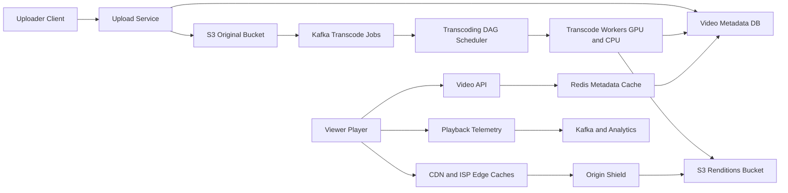

# Video Streaming Platform

**Category:** System Design
**Difficulty:** 🔴 Hard
**Seniority:** staff
**Companies:** Netflix, Google, Meta, Amazon, TikTok, Twitch, Disney
**Tags:** video-transcoding, adaptive-bitrate, cdn, blob-storage, dag-pipeline, read-heavy
**Time:** 60 min

---

## Problem Statement

Design a video streaming platform like YouTube or Netflix. Users (or studios) upload videos; the platform processes them into streamable formats and serves playback to a global audience on phones, browsers, and TVs with minimal buffering.

The interviewer hints at YouTube-like scale: hundreds of millions of daily viewers, hundreds of hours of video uploaded every minute, and playback bandwidth measured in hundreds of terabits per second. Focus on the upload/transcoding pipeline and the playback/delivery path.

## Clarifying Questions

- UGC (YouTube) or curated catalog (Netflix)? *UGC with large uploads; mention Netflix-style differences.*
- Scale? *500M DAU, each watching ~30 min/day; 500 hours uploaded per minute.*
- Max upload size/length? *Up to 256 GB or 12 hours.*
- Devices? *Web, iOS, Android, smart TVs — need multiple codecs and resolutions.*
- Live streaming? *Out of scope; VOD only.*
- Startup latency target? *Playback start < 2 s; rebuffer ratio < 0.5%.*
- DRM? *Required for premium content; not for most UGC.*
- Features beyond upload/watch? *Basic metadata, view counts; recommendations and comments out of scope.*

## Requirements

### Functional

- Upload videos (resumable), with title, description, visibility.
- Transcode into multiple resolutions/bitrates and codecs; generate thumbnails.
- Stream videos with adaptive bitrate (ABR) on varied networks.
- View video metadata and counts; search by title (basic).

### Non-Functional

- Playback availability 99.99%; uploads 99.9%.
- Low startup latency (< 2 s) and low rebuffering globally.
- Huge read bandwidth, served mostly from CDN.
- Durable storage of originals (no video loss).
- Cost efficiency: storage and egress are the dominant costs.
- Eventual consistency acceptable for view counts and metadata.

### Out of Scope

- Live streaming, recommendations, comments, monetization.

## Capacity Estimation

| Metric | Arithmetic | Result |
|---|---|---|
| Upload volume | 500 h/min x 60 x 24 | 720K hours/day |
| Original storage | 720K h x ~2 GB/h (1080p source avg) | ~1.4 PB/day |
| Transcoded renditions | ~6 renditions x 2 codecs, ~1.5x original total | ~2 PB/day |
| Yearly storage | 3.4 PB x 365 | ~1.2 EB/year (before cold tiering) |
| Watch time | 500M x 30 min | 250M hours/day |
| Avg concurrent viewers | 250M h / 24 h | ~10M concurrent (peak ~25M) |
| Egress bandwidth | 10M x 3 Mbps avg | ~30 Tbps avg, ~75 Tbps peak |
| Metadata QPS | 500M x 20 page loads / 86,400 | ~115K QPS reads |
| Upload API QPS | ~30K uploads/hour | ~10 uploads/s (but large, long-lived) |

Egress makes a CDN (and ISP-embedded caches like Netflix Open Connect) mandatory; origin should serve < 5% of bytes.

## API Design

```text
POST /v1/videos
  body: { "title", "description", "visibility": "public", "sizeBytes": 2147483648 }
  resp: 201 { "videoId": "v_9f2", "uploadUrl": "https://upload.example.com/v_9f2",
              "chunkSize": 8388608 }

PUT  {uploadUrl}?part=17          // resumable chunked upload (or S3 multipart presigned URLs)
  body: <bytes>                    resp: 200 { "etag": "..." }

POST /v1/videos/{videoId}/complete
  body: { "parts": [{ "n": 1, "etag": "..." }, ...] }
  resp: 202 { "status": "processing" }

GET  /v1/videos/{videoId}
  resp: 200 { "title", "durationSec", "status": "ready", "views": 1204,
              "manifestUrl": "https://cdn.example.com/v_9f2/master.m3u8",
              "thumbnails": [...] }

GET  {cdn}/v_9f2/master.m3u8       // HLS master playlist: lists renditions
GET  {cdn}/v_9f2/720p/seg_00042.m4s  // 4-second CMAF segment

POST /v1/videos/{videoId}/events   // playback telemetry, batched
  body: { "events": [{ "type": "rebuffer", "positionSec": 312, "bitrate": 2500 }] }
```

## Data Model

**Video metadata — MySQL/Vitess (sharded by `video_id`)** or Cassandra; relational fits ownership and status queries; Vitess scales it horizontally (YouTube's approach).

```text
video
  video_id      BIGINT PK (Snowflake)
  owner_id      BIGINT        // secondary index / separate table by owner
  title, description TEXT
  status        ENUM(uploading, processing, ready, failed, blocked)
  duration_sec  INT
  visibility    ENUM
  created_at    TIMESTAMP

rendition
  video_id      BIGINT        // PK part
  codec         ENUM(h264, vp9, av1)
  resolution    ENUM(240p..2160p)
  bitrate_kbps  INT
  storage_path  TEXT          // s3://videos-transcoded/v_9f2/720p_h264/
```

**View counts — Redis counters + Kafka -> Cassandra/BigQuery** aggregated asynchronously.

**Blob storage — S3 / GCS:** originals in an infrequent-access tier after transcoding; renditions as CMAF segments (~4 s each) plus HLS/DASH manifests; long-tail renditions moved to cheaper tiers.

**Search — Elasticsearch** index over title/description, updated via CDC.

## High-Level Design



**Upload path:**

1. Client creates the video record and receives presigned multipart upload URLs (8-64 MB chunks); uploads chunks in parallel and resumes on failure.
2. On completion, an event is published to Kafka with the original's S3 location; status becomes `processing`.
3. The DAG scheduler splits the video into GOP-aligned chunks (~10 s) and fans out tasks: inspect, transcode per rendition, thumbnails, audio, content moderation, packaging.
4. Workers write CMAF segments and HLS/DASH manifests to S3; when the minimal ladder (e.g. 360p, 720p) is ready, status becomes `ready` and higher resolutions follow.
5. Uploader is notified (webhook/push); CDN can be pre-warmed for creators with large audiences.

**Playback path:**

1. Player fetches metadata and manifest URL from the Video API (cached in Redis and CDN).
2. Player downloads the master manifest, picks an initial rendition, and requests 2-6 s segments from the nearest CDN edge (via GeoDNS/anycast).
3. Edge misses go to a regional origin shield, then to S3 — collapsing duplicate misses.
4. ABR logic switches renditions per segment based on throughput and buffer level.
5. Player sends telemetry (startup time, rebuffers, bitrate) for QoE monitoring and view counting.

## Deep Dives

### Transcoding pipeline as a DAG

A 2-hour 4K upload transcoded serially could take many hours. Split into independent chunks and process in parallel.

```text
FUNCTION processVideo(videoId, sourcePath):
    SET info ← probe(sourcePath)                          // codec, fps, duration
    SET chunks ← splitAtKeyframes(sourcePath, target = 10s)
    SET ladder ← chooseLadder(info)                       // per-title encoding
    SET tasks ← []
    FOR chunk IN chunks:
        FOR rendition IN ladder:
            tasks.add(submit(transcode, chunk, rendition))  // idempotent: output keyed by (chunk, rendition)
    tasks.add(submit(extractThumbnails, sourcePath))
    tasks.add(submit(moderationScan, sourcePath))
    WAIT FOR ALL tasks WITH retries = 3
    FOR rendition IN ladder:
        concatAndPackage(rendition, format = CMAF)         // HLS + DASH manifests
    updateStatus(videoId, READY)
```

- **Encoding ladder:** e.g. 240p@300 kbps, 360p@700, 480p@1.2M, 720p@2.5M, 1080p@5M, 4K@15M. Per-title (content-aware) encoding lowers bitrates for simple content (cartoons) by 20-50%.
- **Codecs:** H.264 for universal support; VP9/AV1 for ~30-50% bandwidth savings on supported devices — encode AV1 only for popular videos since it is ~10x costlier to encode.
- **Compute:** spot/preemptible instances with idempotent tasks; GPU or ASIC encoders (YouTube's Argos VCU) for throughput.

### Adaptive bitrate streaming

Videos are split into short segments (2-6 s) available in every rendition. The player measures throughput and buffer occupancy each segment:

```text
FUNCTION chooseNextRendition(buffer, throughputEstimate, ladder):
    IF buffer < 5s:
        RETURN lowest rendition with bitrate < 0.5 x throughputEstimate   // avoid stall
    SET target ← 0.8 x throughputEstimate                                  // safety margin
    RETURN highest rendition IN ladder WHERE bitrate <= target
```

Buffer-based algorithms (BOLA) reduce oscillation. CMAF lets one set of fMP4 segments serve both HLS (Apple) and DASH (Android/web), halving storage.

### CDN strategy and cost

- Popularity is a power law: the top ~10% of videos generate ~90% of views. Push popular content to edges proactively; let the long tail be pulled on demand from regional caches or origin.
- Netflix-style: Open Connect appliances inside ISPs pre-filled overnight with predicted-popular titles — avoids transit costs, serves 95%+ of traffic.
- Multi-CDN (Akamai, Cloudflare, Fastly + in-house) with real-time steering based on QoE.
- Signed URLs/tokens with short expiry protect content; DRM (Widevine, FairPlay, PlayReady) for premium content.

### View counting at scale

Writing every view to the database is ~3K+ writes/s per hot video during viral spikes. Instead, players emit view events to Kafka; Flink deduplicates (per user/session per video), filters bots, and aggregates in 1-minute windows; counters are batched into Cassandra/Redis. Displayed counts are eventually consistent (seconds to minutes).

## Scaling & Reliability

- **Stateless API tier** with Redis caching of metadata (hot videos ~99% hit rate).
- **Metadata DB sharding** by `video_id` with Vitess; read replicas per region.
- **Storage durability:** S3 11 nines; originals replicated cross-region; lifecycle policies to Glacier-like tiers for rarely watched renditions (re-transcode on demand if needed).
- **Pipeline resilience:** Kafka-backed job queue, idempotent chunk tasks, retries with backoff, dead-letter queue for corrupt uploads; priority lanes for popular creators.
- **Edge failures:** clients fail over between CDN hostnames listed in the manifest; origin shield prevents thundering herd on S3.
- **Monitoring:** video start time, rebuffer ratio, average bitrate, playback failure rate by device/ISP/CDN, transcoding queue depth and latency, CDN hit ratio, egress cost.

## Trade-offs

| Decision | Option A | Option B | Choice & Why |
|---|---|---|---|
| Streaming protocol | Progressive MP4 download | HLS/DASH ABR segments | ABR — adapts to bandwidth, enables seeking and CDN caching of small objects. |
| Codec | H.264 only | H.264 + VP9/AV1 | Multi-codec — AV1 saves ~30% egress for popular videos; H.264 fallback for old devices. |
| Transcoding | Whole file serially | Chunked parallel DAG | Chunked — minutes instead of hours; tolerant of worker failure. |
| Content placement | Pull-through CDN only | Proactive push + pull | Hybrid — push predicted-popular content, pull long tail. |
| Rendition storage | Store all renditions forever | Tier/delete long-tail renditions | Tiering — most videos are rarely watched; storage is a top cost driver. |

## Follow-up Questions

1. **How would you add live streaming?** Ingest RTMP/SRT, transcode in real time into 1-2 s segments (LL-HLS), and push through the CDN; latency drops to 2-5 s but no time for multi-pass encoding.
2. **How do you handle a video going viral instantly?** Origin shield and request collapsing protect S3; pre-warm edges based on early view velocity; scale metadata caches.
3. **How do you reduce startup time?** Prefetch the manifest and first segment for likely-next videos, start at a conservative bitrate, use short first segments, and keep DNS/TLS connections warm.
4. **How would you handle copyright detection?** Generate audio/video fingerprints during processing and match against a reference database (Content ID) before publishing.
5. **How do you resume an interrupted 50 GB upload?** Multipart upload with server-tracked part ETags; the client queries which parts exist and uploads only the missing ones.

## Common Mistakes

- Serving video from application servers instead of a CDN.
- Ignoring the transcoding pipeline or doing it synchronously in the upload request.
- Using a single bitrate rather than ABR.
- Underestimating storage/egress cost and not discussing tiering or codec efficiency.
- Writing every view directly to the primary database.

## Key Takeaways

- Separate the write-heavy, asynchronous processing pipeline from the read-heavy, CDN-dominated playback path.
- Chunked, parallel, idempotent transcoding in a DAG keeps processing fast and resilient.
- ABR streaming over HLS/DASH with CMAF segments is the playback standard.
- CDN and ISP-embedded caching plus codec choices are the main levers on cost and QoE.
