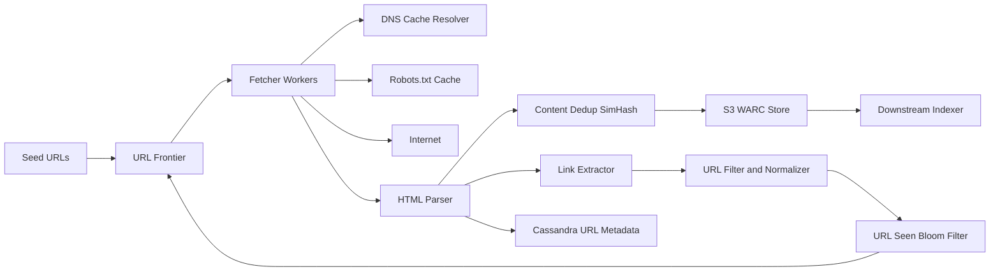

# Web Crawler

**Category:** System Design
**Difficulty:** 🟡 Medium
**Seniority:** senior
**Companies:** Google, Microsoft, Amazon, Apple, OpenAI, Bloomberg
**Tags:** distributed-systems, url-frontier, politeness, deduplication, bloom-filter, batch-processing
**Time:** 45 min

---

## Problem Statement

Design a web crawler that discovers and downloads pages across the public web to feed a search index (or an LLM training corpus). Starting from a set of seed URLs, the crawler fetches pages, extracts links, and recursively visits new URLs while respecting site owners' rules.

The interviewer hints at web scale: roughly 1 billion pages per month, with recrawling of frequently-changing pages. The system must be polite (never hammer a single host), robust against malicious or malformed content, and horizontally scalable.

## Clarifying Questions

- What is the purpose of the crawl? *Search indexing; store raw HTML for downstream parsers and indexers.*
- How many pages per month? *Assume 1B new/refreshed pages per month.*
- Content types? *HTML only; skip images, video, PDFs for now.*
- Should we recrawl pages? *Yes, with frequency based on change rate and page importance.*
- Must we respect robots.txt and crawl-delay? *Yes, strictly.*
- How long do we retain content? *5 years of raw HTML snapshots (latest version hot, older versions cold).*
- Do we need to render JavaScript? *Not in v1; headless rendering is a follow-up.*
- How to handle duplicate content? *Detect exact and near-duplicates and skip storing them.*

## Requirements

### Functional

- Given seed URLs, fetch pages, extract outgoing links, and enqueue newly discovered URLs.
- Store downloaded HTML plus metadata (URL, fetch time, status, content hash).
- Respect robots.txt, crawl-delay, and per-host rate limits.
- Deduplicate URLs (already seen) and content (same page at different URLs).
- Prioritize important pages (e.g. PageRank, domain authority) and recrawl based on freshness.

### Non-Functional

- Scalability: ~400 pages/s average, 1,000+ pages/s peak; scale linearly by adding workers.
- Politeness: at most 1 concurrent connection per host, configurable delay (default 1 s).
- Robustness: tolerate spider traps, malformed HTML, slow servers, and worker crashes.
- Extensibility: plug in new content types (PDF, images) and processors.
- Durability: no lost frontier state on worker crash; crawl resumes after restarts.

### Out of Scope

- Indexing, ranking, and serving search queries.
- JavaScript rendering and authenticated/deep-web content.

## Capacity Estimation

| Metric | Arithmetic | Result |
|---|---|---|
| Fetch QPS (avg) | 1B / (30 days x 86,400 s) | ~400 pages/s |
| Fetch QPS (peak) | 2.5x average | ~1,000 pages/s |
| Avg page size | compressed HTML | ~100 KB raw, ~25 KB gzip |
| Storage per month | 1B x 100 KB | ~100 TB raw (~25 TB compressed) |
| Storage 5 years | 100 TB x 60 months | ~6 PB raw (~1.5 PB compressed) |
| Inbound bandwidth | 400 x 100 KB | ~40 MB/s avg (~320 Mbps), ~1 Gbps peak |
| URL-seen set | 10B URLs x 8-byte hash | ~80 GB (or ~12 GB Bloom filter at 1% FPR) |
| Frontier size | 1B pending URLs x ~100 B | ~100 GB, disk-backed |
| Workers | 1 worker ~ 50 pages/s (async I/O) | ~20-30 fetcher nodes with headroom |

DNS is a hidden bottleneck: 400 lookups/s against public resolvers is too slow, so we run a local caching resolver.

## API Design

The crawler is mostly an internal pipeline, but exposes control-plane APIs:

```text
POST /v1/seeds
  body: { "urls": ["https://example.com", ...], "priority": 0-10 }
  resp: 202 { "accepted": 120, "rejected": 3 }

GET /v1/urls/{urlHash}
  resp: 200 { "url": "...", "lastFetched": "2025-01-10T12:00:00Z",
              "status": 200, "contentHash": "a1b2...", "nextFetch": "..." }

PUT /v1/hosts/{host}/policy
  body: { "maxQps": 0.5, "blocked": false }
  resp: 200

GET /v1/stats
  resp: 200 { "fetchedPerSec": 412, "frontierSize": 980000000,
              "errorRate": 0.031 }

// Internal gRPC between frontier and fetchers
rpc LeaseUrls(LeaseRequest{workerId, maxUrls}) returns (UrlBatch)
rpc ReportResult(FetchResult{url, status, contentHash, outLinks[]}) returns (Ack)
```

## Data Model

**URL metadata store — Cassandra / Bigtable** (wide-column, write-heavy, 10B+ rows, key lookup only).

```text
url_metadata
  url_hash        BINARY(16)  PK (partition key)  // MD5/xxHash128 of normalized URL
  url             TEXT
  host            TEXT
  last_fetched    TIMESTAMP
  http_status     INT
  content_hash    BINARY(8)    // SimHash for near-dup detection
  change_rate     FLOAT        // estimated changes/day
  priority        FLOAT
  next_fetch_at   TIMESTAMP
```

**Host table — Redis + PostgreSQL** (small: ~500M hosts, hot subset cached).

```text
host_policy
  host            TEXT PK
  robots_txt      TEXT          // cached, TTL 24h
  crawl_delay_ms  INT
  next_allowed_at TIMESTAMP
  ip              TEXT          // cached DNS
```

**Content store — S3 / HDFS** in WARC format, batched into ~1 GB files keyed by `crawl_date/shard/part-N.warc.gz`. An index `content_hash -> (file, offset)` lets downstream jobs locate a document.

**Frontier — Kafka + local disk-backed queues** partitioned by host hash so a single fetcher owns each host.

## High-Level Design



**Crawl loop (write path):**

1. Seeds are inserted into the URL Frontier with high priority.
2. A fetcher leases a batch of URLs for the hosts it owns; the frontier only hands out URLs whose host's `next_allowed_at` has passed.
3. The fetcher resolves DNS via a local cache (Unbound / in-process LRU), checks robots.txt (cached per host for 24 h), and downloads with timeouts (connect 5 s, total 30 s, max body 10 MB).
4. The parser validates HTML, computes SimHash, and drops near-duplicates (Hamming distance <= 3).
5. Unique content is appended to a WARC buffer and flushed to S3 in ~1 GB objects; metadata goes to Cassandra.
6. The link extractor resolves relative links, normalizes (lowercase host, strip fragments, sort query params, remove session IDs), and filters by blocklist, depth, and file extension.
7. New URLs are checked against the Bloom filter / URL-seen store; unseen ones are added to the frontier with a computed priority.

**Read path (downstream):** indexers consume a Kafka topic of `(url, s3_location)` events and read WARC records from S3.

## Deep Dives

### URL Frontier: priority plus politeness

The frontier has two layers (Mercator design):

- **Front queues (priority):** F queues, one per priority level. A prioritizer assigns URLs based on PageRank, domain authority, and freshness need.
- **Back queues (politeness):** B queues, each mapped to exactly one host. A min-heap keyed by `next_allowed_at` decides which host is ready.

```text
FUNCTION nextUrl():
    SET host ← heap.popMin()                  // host with smallest next_allowed_at
    WAIT UNTIL now() >= host.next_allowed_at
    SET url ← backQueue[host].dequeue()
    IF backQueue[host].isEmpty():
        refillFromFrontQueues(host)           // pick from front queues, weighted by priority
    SET host.next_allowed_at ← now() + max(crawlDelay(host), 10 x lastFetchDuration(host))
    heap.push(host)
    RETURN url
```

Partition hosts across fetchers by `hash(host) mod N` (consistent hashing) so politeness is enforced locally without distributed locks. Back queues live in memory with overflow spilled to RocksDB on local SSD.

### URL and content deduplication

- **URL seen:** 10B URLs. A Bloom filter with 1% false positive rate needs ~9.6 bits/element, i.e. ~12 GB, sharded across nodes. False positives mean we skip ~1% of new URLs, acceptable for crawling. The authoritative check is in Cassandra for important URLs.
- **Exact content dup:** MD5/SHA-1 of normalized body; ~30% of the web is exact duplicate.
- **Near dup:** 64-bit SimHash; documents with Hamming distance <= 3 are near-duplicates. Index SimHash by splitting into 4 x 16-bit blocks for fast lookup (any match with <=3 differing bits shares at least one block exactly).

```text
FUNCTION isNearDuplicate(doc):
    SET h ← simhash64(shingles(doc.text, k = 5))
    FOR i IN 0..3:
        SET block ← bits(h, i x 16, 16)
        FOR candidate IN simIndex[i][block]:
            IF hamming(h, candidate) <= 3:
                RETURN true
    insertAllBlocks(h)
    RETURN false
```

### Spider traps and robustness

- Cap URL length (2,048 chars), path depth (~16), and pages per host per crawl cycle (e.g. 100K unless high authority).
- Detect repeating path segments (`/a/b/a/b/a/b`) and calendar-style infinite pages.
- Enforce timeouts, max body size, and redirect limit (5).
- Run fetchers in sandboxed processes; parse with a tolerant HTML parser (e.g. jsoup / lxml).
- Treat 429/503 as backoff signals: exponentially increase that host's delay.

### Recrawl scheduling (freshness)

Estimate each page's change rate from observed history (Poisson model). Schedule `next_fetch_at = last_fetched + f(change_rate, importance)`: news homepages every few minutes, static docs every few weeks. Use HTTP `If-Modified-Since` / `ETag` for conditional GETs — a 304 response costs almost no bandwidth. Sitemaps with `lastmod` provide cheap hints.

## Scaling & Reliability

- **Sharding:** frontier and fetchers partitioned by host hash with consistent hashing; adding a node moves only ~1/N of hosts.
- **Geo-distribution:** deploy fetchers in multiple regions and route hosts to the nearest region to cut latency.
- **Replication:** Cassandra RF=3; S3 provides 11 nines of durability; Kafka RF=3 for link events.
- **Checkpointing:** fetchers periodically checkpoint back-queue state to RocksDB/S3; leased URLs expire after 10 min and return to the frontier if not acknowledged.
- **Caching:** DNS cache (TTL respected, ~100M entries), robots.txt cache (24 h TTL), host policy hot set in Redis.
- **Backpressure:** if the parser or storage lags, Kafka absorbs bursts; fetchers slow down when consumer lag exceeds a threshold.
- **Monitoring:** pages/s, error rate by status code, frontier size, per-host queue depth, duplicate rate, DNS latency, Bloom filter fill ratio. Alert when a single host dominates fetches (possible trap).

## Trade-offs

| Decision | Option A | Option B | Choice & Why |
|---|---|---|---|
| Traversal order | BFS | DFS | BFS with priority — DFS falls into traps and over-crawls single sites; prioritized BFS reaches important pages first. |
| URL-seen check | Bloom filter | Exact set in DB | Bloom filter in front of DB — 12 GB vs 80+ GB, tiny miss rate acceptable. |
| Politeness enforcement | Central rate limiter | Host-partitioned workers | Host partitioning — no cross-node coordination, simple and scalable. |
| Content storage | Many small files | Batched WARC files on S3 | WARC batches — avoids small-file overhead, standard format for downstream tools. |
| JS rendering | Headless Chrome for all | Static fetch, render selectively | Selective — rendering is 10-50x more expensive; render only JS-heavy high-value pages. |

## Follow-up Questions

1. **How would you add JavaScript rendering?** Route URLs flagged as JS-heavy (empty body, SPA frameworks detected) to a separate pool of headless Chrome (Puppeteer) workers with its own rate budget.
2. **How do you prioritize which pages to crawl first?** Combine PageRank/backlink count, domain authority, freshness need, and sitemap hints into a score that maps to front-queue priority.
3. **What if a fetcher node dies mid-batch?** Leases time out and URLs return to the frontier; consistent hashing reassigns that node's hosts to neighbors, which reload state from checkpoints.
4. **How do you detect and avoid crawling low-quality or spam sites?** Maintain domain reputation scores, blocklists, and classifiers on fetched content; demote or block domains with link farms or thin content.
5. **How would you crawl 10x more pages?** Scale fetchers horizontally, shard the Bloom filter further, use more regions, and lean on conditional GETs to cut recrawl bandwidth.

## Common Mistakes

- Ignoring politeness — sending parallel requests to one host gets the crawler IP-banned.
- Forgetting DNS resolution as a bottleneck.
- Using a simple FIFO queue for the frontier with no prioritization or per-host scheduling.
- Not normalizing URLs, leading to massive duplicate crawling (`?utm=`, fragments, trailing slashes).
- Not handling spider traps or unbounded page sizes.
- Storing each page as a separate small object without batching.

## Key Takeaways

- The URL Frontier (priority front queues + per-host back queues) is the heart of the design.
- Partition by host so politeness is a local concern, not a distributed lock problem.
- Dedupe at two levels: URL (Bloom filter) and content (hash + SimHash).
- Robustness (timeouts, traps, size limits) matters as much as throughput on the hostile open web.
- Freshness scheduling with conditional GETs keeps recrawl cost manageable.
